<table style=""width:100%;border-collapse:collapse;font-family:'Heebo Light',Heebo,Arial,sans-serif;"">
<tr><td colspan=""2"" style=""background:#642138;color:#F0EAC8;padding:14px;font-family:'Mallong Regular',Georgia,serif;font-size:22px;""><strong>[LOGO: Isotipo floral de 4 pétalos - ZHUD ALELÍ Productos Naturales]</strong> ZA-CU-002 · Casos de uso detallados de asistencia y participación</td></tr>
<tr><th style=""background:#642138;color:#F0EAC8;text-align:left;padding:8px;"">Control documental</th><th style=""background:#642138;color:#F0EAC8;text-align:left;padding:8px;"">Valor</th></tr>
<tr style=""background:#F0EAC8;""><td style=""padding:7px;border:1px solid #AC6E40;"">Módulo</td><td style=""padding:7px;border:1px solid #AC6E40;"">Asistencia y participación (<code>attendance</code>)</td></tr>
<tr><td style=""padding:7px;border:1px solid #AC6E40;"">Fase / entregable</td><td style=""padding:7px;border:1px solid #AC6E40;"">Fase 2 — Especificación de casos de uso</td></tr>
<tr style=""background:#F0EAC8;""><td style=""padding:7px;border:1px solid #AC6E40;"">Versión / fecha</td><td style=""padding:7px;border:1px solid #AC6E40;"">v1.2 / 13 de octubre de 2026</td></tr>
<tr><td style=""padding:7px;border:1px solid #AC6E40;"">Autor / analista</td><td style=""padding:7px;border:1px solid #AC6E40;"">Franklin Acero (tesista) / Codex (asistencia de redacción)</td></tr>
<tr style=""background:#F0EAC8;""><td style=""padding:7px;border:1px solid #AC6E40;"">Estado</td><td style=""padding:7px;border:1px solid #AC6E40;"">Propuesta interna para revisión; no aprobada ni publicada</td></tr>
</table>

**Historial de revisiones**

| Versión | Fecha | Descripción | Responsable |
|---|---|---|---|
| v1.0 | 2026-10-13 | Primera propuesta de nueve casos de uso detallados para RF-ASI-001 a RF-ASI-007. | Franklin Acero; redacción asistida por Codex |
| v1.1 | 2026-10-13 | Se añaden dos diagramas UML y se actualizan la presentación del resumen y las referencias de sección. | Franklin Acero; redacción asistida por Codex |
| v1.2 | 2026-10-13 | Se incorporan nueve diagramas de flujo, uno por caso de uso, con flujo principal, alternativas, excepciones y postcondiciones. | Franklin Acero; redacción asistida por Codex |

## 1. Propósito y límites

Este documento especifica recorridos verificables para el módulo de asistencia y participación. Cubre captura, duplicados e inconsistencias, correcciones, consulta, participación adicional, generación automática de faltas, presentación de justificativos, validación de multas por la Tesorera y captura con QR/código/delegación. Los requisitos funcionales y su importancia proceden de las fuentes aprobadas. La complejidad es una estimación inicial de análisis, no prioridad ni esfuerzo aprobado. Las reglas `RN-CU-ASI-*` son identificadores auxiliares propuestos y no añaden requisitos a CAT-REQ-001.

La instrucción «siguiente» autorizó preparar esta propuesta de Fase 2. No se interpreta como aprobación de reglas candidatas, alcance, decisiones pendientes ni especificación técnica.

## 2. Actores

| Actor | Participación en estos casos |
|---|---|
| Socia participante | Registra y consulta su asistencia; presenta su justificación y consulta su estado. |
| Integrante de Directiva o encargada autorizada | Corrige registros y realiza consultas o registros solo dentro de permisos definidos para la operación. |
| Tesorera | Valida la procedencia de las multas antes de su aplicación; no se infiere autoridad para resolver justificativos. |
| Responsable autorizada de actividad | Registra participación adicional si la actividad la requiere y habilita únicamente opciones que le estén asignadas. |
| Módulo de Planificación | Proporciona actividad, participantes y cierre mediante operaciones públicas; no escribe directamente la asistencia. |
| Módulos de Acceso y Auditoría | Proveen decisiones de autorización y registro verificable; son servicios del sistema, no actores humanos. |

## 3. Resumen y orden de importancia

| Caso | Objetivo | Importancia confirmada | Complejidad inicial |
|---|---|---|---|
| ZA-CU-ASI-001 | Registrar entrada y salida de una actividad | Esencial | Media (estimación inicial) |
| ZA-CU-ASI-002 | Prevenir duplicados y conservar inconsistencias | Esencial | Media (estimación inicial) |
| ZA-CU-ASI-003 | Corregir un registro de asistencia | Esencial | Media (estimación inicial) |
| ZA-CU-ASI-006 | Generar una falta al cierre de la actividad | Esencial | Alta (estimación inicial) |
| ZA-CU-ASI-007 | Presentar una justificación de falta | Esencial | Alta (estimación inicial) |
| ZA-CU-ASI-008 | Validar la procedencia de una multa | Esencial | Alta (estimación inicial) |
| ZA-CU-ASI-009 | Registrar asistencia con QR, código o delegación | Alta | Alta (estimación inicial) |
| ZA-CU-ASI-004 | Consultar el historial de asistencia | Complementaria | Baja (estimación inicial) |
| ZA-CU-ASI-005 | Registrar participación adicional | Complementaria | Media (estimación inicial) |

La importancia se conserva por requisito. RF-ASI-006 se desarrolla en tres casos separados para distinguir falta automática, justificación y validación de multa; esto no cambia su importancia Esencial. La trazabilidad a los requisitos se detalla en la sección 7. La complejidad debe revisarse cuando se cierren P-02, P-03 y P-13/P-14.

## 4. Diagramas generales de casos de uso

### Registro y consulta

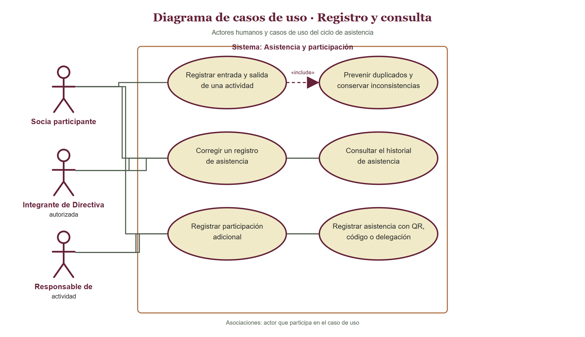

### Faltas y multas

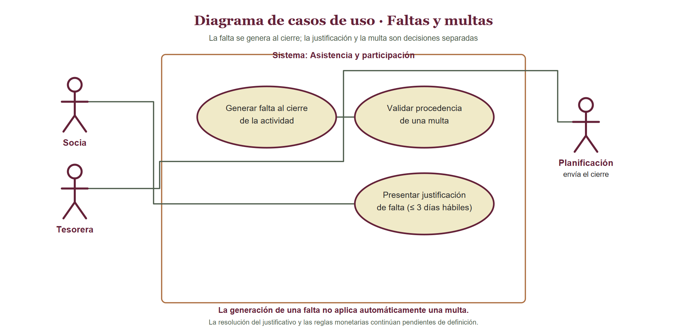

Estos dos diagramas muestran actores y alcance general; el detalle paso a paso se especifica en la sección siguiente. Generar una falta no aplica una multa automáticamente.

## 5. Diagramas de flujo por caso de uso

Se presenta un diagrama individual para cada caso. Las cajas de la columna izquierda muestran el flujo principal; las rutas enlazadas a la derecha detallan alternativas y excepciones referidas al paso donde ocurren. Al final se indican las postcondiciones de éxito y fallo.

### ZA-CU-ASI-001 — Registrar entrada y salida de una actividad

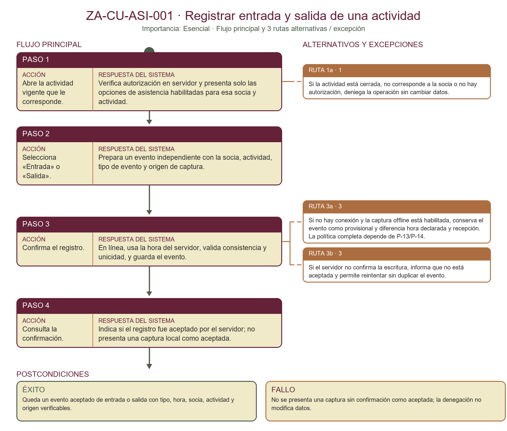

### ZA-CU-ASI-002 — Prevenir duplicados y conservar inconsistencias

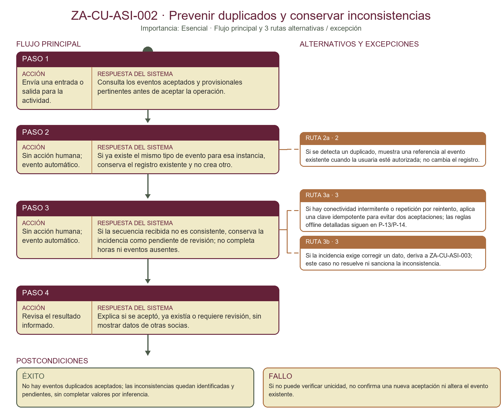

### ZA-CU-ASI-003 — Corregir un registro de asistencia

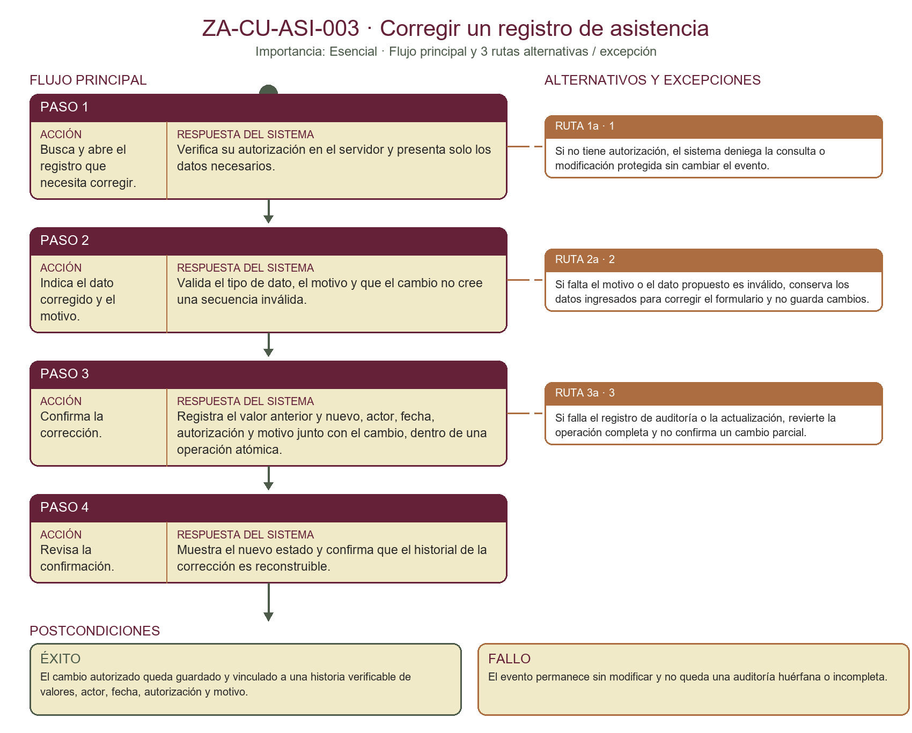

### ZA-CU-ASI-004 — Consultar el historial de asistencia

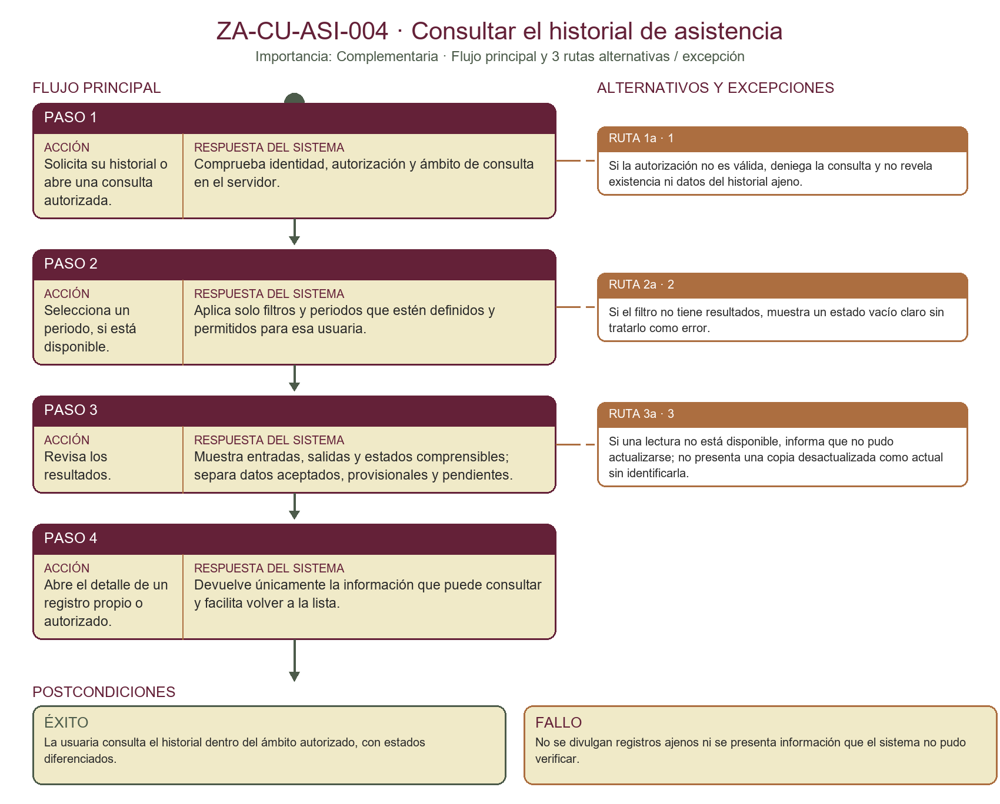

### ZA-CU-ASI-005 — Registrar participación adicional

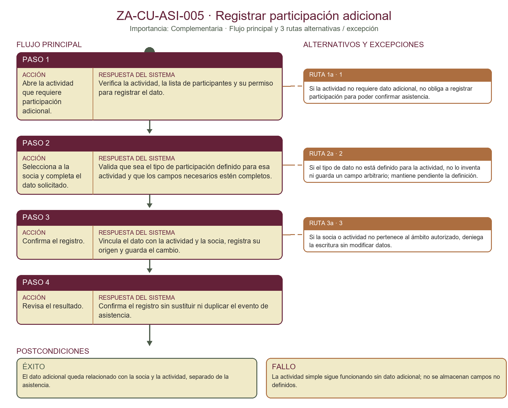

### ZA-CU-ASI-006 — Generar una falta al cierre de la actividad

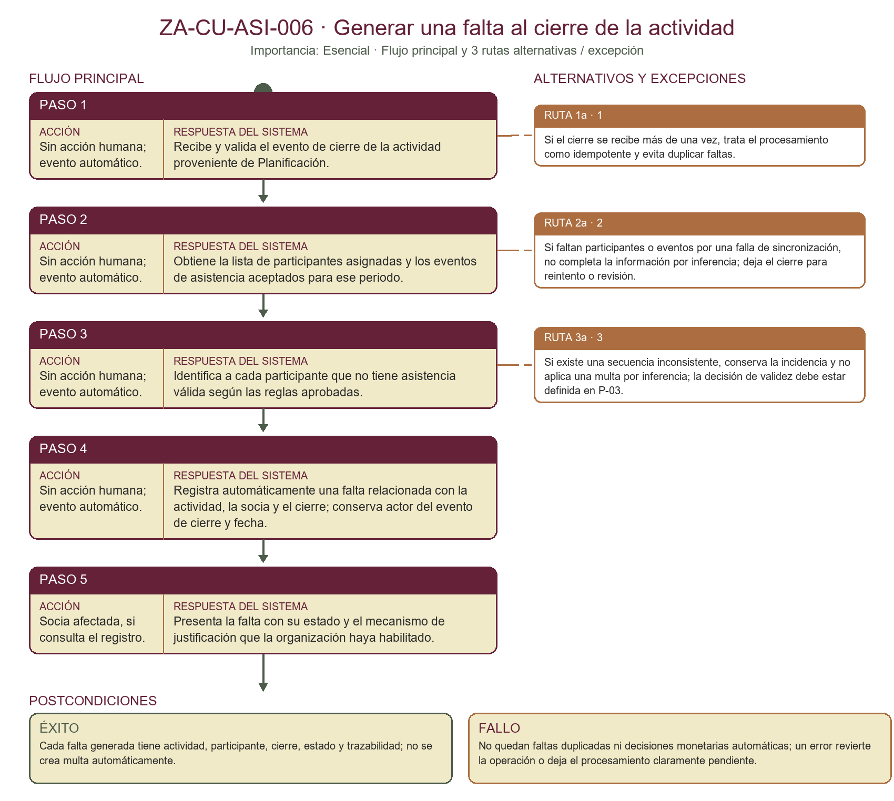

### ZA-CU-ASI-007 — Presentar una justificación de falta

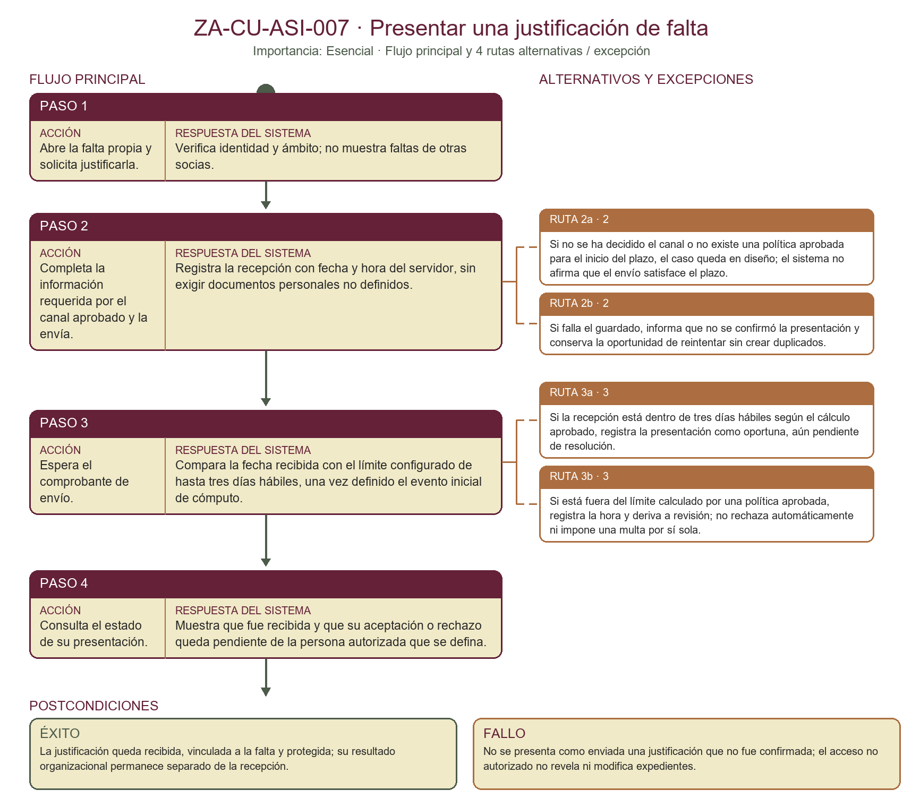

### ZA-CU-ASI-008 — Validar la procedencia de una multa

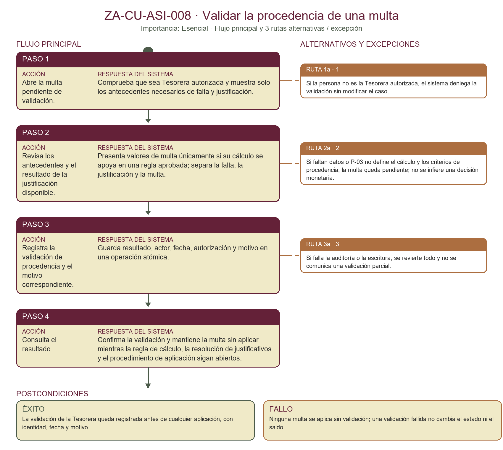

### ZA-CU-ASI-009 — Registrar asistencia con QR, código o delegación

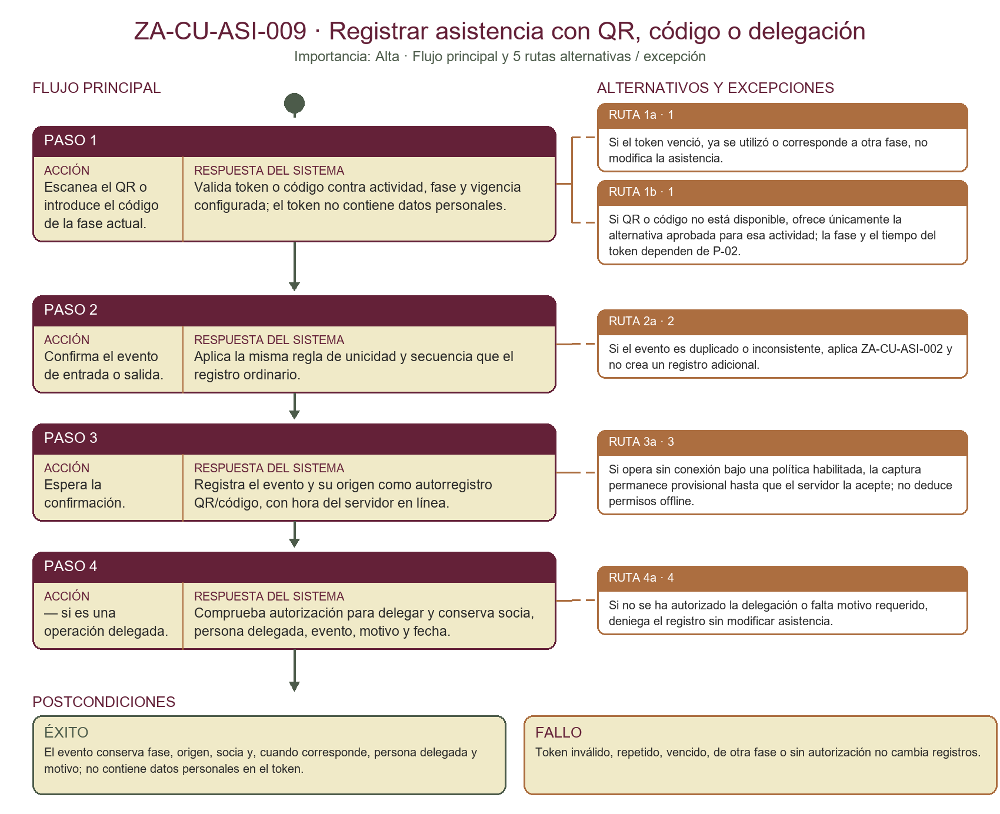

## 6. Casos de uso detallados

### ZA-CU-ASI-001 — Registrar entrada y salida de una actividad

| Campo | Especificación |
|---|---|
| ID y nombre | ZA-CU-ASI-001 — Registrar entrada y salida de una actividad |
| Actor primario | Socia participante en la actividad |
| Actor secundario | Módulo de Planificación, como proveedor de actividad y participantes; módulo de Acceso, para autorización. |
| Descripción | Conservar por separado la entrada y salida de la socia en una actividad, con hora del servidor y origen del registro cuando hay conexión. |
| Importancia / complejidad | Esencial / Media (estimación inicial) |
| Disparador | La socia selecciona registrar su entrada o su salida. |
| Precondiciones | La actividad está vigente, la socia está vinculada como participante y la usuaria tiene autorización para el modo de captura disponible. |
| Reglas asociadas | RN-CU-ASI-01; RN-CU-ASI-02; RN-CU-ASI-10 |
| Requisitos asociados | RF-ASI-001; RNF-SEC-001; RNF-DAT-001; RNF-CON-001; RNF-UX-001/002/003 |

**Flujo principal**

| Paso | Acción del actor | Respuesta del sistema |
|---|---|---|
| 1 | Abre la actividad vigente que le corresponde. | Verifica autorización en servidor y presenta solo las opciones de asistencia habilitadas para esa socia y actividad. |
| 2 | Selecciona «Entrada» o «Salida». | Prepara un evento independiente con la socia, actividad, tipo de evento y origen de captura. |
| 3 | Confirma el registro. | En línea, usa la hora del servidor, valida consistencia y unicidad, y guarda el evento. |
| 4 | Consulta la confirmación. | Indica si el registro fue aceptado por el servidor; no presenta una captura local como aceptada. |

**Flujos alternativos y de excepción**

| Flujo | Referencia | Acción / resultado |
|---|---|---|
| 1a | Paso 1 | Si la actividad está cerrada, no corresponde a la socia o no hay autorización, deniega la operación sin cambiar datos. |
| 3a | Paso 3 | Si no hay conexión y la captura offline está habilitada, conserva el evento como provisional y diferencia hora declarada y recepción. La política completa depende de P-13/P-14. |
| 3b | Paso 3 | Si el servidor no confirma la escritura, informa que no está aceptada y permite reintentar sin duplicar el evento. |

**Postcondiciones**

| Resultado | Condición |
|---|---|
| Éxito | Queda un evento aceptado de entrada o salida con tipo, hora, socia, actividad y origen verificables. |
| Fallo | No se presenta una captura sin confirmación como aceptada; la denegación no modifica datos. |

### ZA-CU-ASI-002 — Prevenir duplicados y conservar inconsistencias

| Campo | Especificación |
|---|---|
| ID y nombre | ZA-CU-ASI-002 — Prevenir duplicados y conservar inconsistencias |
| Actor primario | Socia que registra asistencia; persona autorizada que consulta una inconsistencia |
| Actor secundario | Servicio de validación de asistencia. |
| Descripción | Impedir eventos repetidos para la misma socia, actividad e instancia y mantener visibles las secuencias inconsistentes para su revisión, sin inventar datos. |
| Importancia / complejidad | Esencial / Media (estimación inicial) |
| Disparador | Se intenta registrar un evento repetido o el sistema detecta una secuencia no válida. |
| Precondiciones | Existe una actividad y el sistema puede consultar los eventos existentes de la socia para esa instancia. |
| Reglas asociadas | RN-CU-ASI-01; RN-CU-ASI-02 |
| Requisitos asociados | RF-ASI-001; RF-ASI-002; RNF-SEC-001; RNF-AUD-001; RNF-DAT-001 |

**Flujo principal**

| Paso | Acción del actor | Respuesta del sistema |
|---|---|---|
| 1 | Envía una entrada o salida para la actividad. | Consulta los eventos aceptados y provisionales pertinentes antes de aceptar la operación. |
| 2 | — | Si ya existe el mismo tipo de evento para esa instancia, conserva el registro existente y no crea otro. |
| 3 | — | Si la secuencia recibida no es consistente, conserva la incidencia como pendiente de revisión; no completa horas ni eventos ausentes. |
| 4 | Revisa el resultado informado. | Explica si se aceptó, ya existía o requiere revisión, sin mostrar datos de otras socias. |

**Flujos alternativos y de excepción**

| Flujo | Referencia | Acción / resultado |
|---|---|---|
| 2a | Paso 2 | Si se detecta un duplicado, muestra una referencia al evento existente cuando la usuaria esté autorizada; no cambia el registro. |
| 3a | Paso 3 | Si hay conectividad intermitente o repetición por reintento, aplica una clave idempotente para evitar dos aceptaciones; las reglas offline detalladas siguen en P-13/P-14. |
| 3b | Paso 3 | Si la incidencia exige corregir un dato, deriva a ZA-CU-ASI-003; este caso no resuelve ni sanciona la inconsistencia. |

**Postcondiciones**

| Resultado | Condición |
|---|---|
| Éxito | No hay eventos duplicados aceptados; las inconsistencias quedan identificadas y pendientes, sin completar valores por inferencia. |
| Fallo | Si no puede verificar unicidad, no confirma una nueva aceptación ni altera el evento existente. |

### ZA-CU-ASI-003 — Corregir un registro de asistencia

| Campo | Especificación |
|---|---|
| ID y nombre | ZA-CU-ASI-003 — Corregir un registro de asistencia |
| Actor primario | Integrante de Directiva o encargada con autorización vigente |
| Actor secundario | Servicio de auditoría del sistema. |
| Descripción | Corregir un evento sensible conservando el valor anterior, el nuevo, el motivo y la identidad de quien autorizó y realizó el cambio. |
| Importancia / complejidad | Esencial / Media (estimación inicial) |
| Disparador | Una inconsistencia o error de registro requiere una corrección autorizada. |
| Precondiciones | La usuaria está autenticada y autorizada para corregir ese registro; el evento existe y se ingresa un motivo comprensible. |
| Reglas asociadas | RN-CU-ASI-03 |
| Requisitos asociados | RF-ASI-003; RF-ASI-002; RNF-SEC-001; RNF-AUD-001; RNF-DAT-001 |

**Flujo principal**

| Paso | Acción del actor | Respuesta del sistema |
|---|---|---|
| 1 | Busca y abre el registro que necesita corregir. | Verifica su autorización en el servidor y presenta solo los datos necesarios. |
| 2 | Indica el dato corregido y el motivo. | Valida el tipo de dato, el motivo y que el cambio no cree una secuencia inválida. |
| 3 | Confirma la corrección. | Registra el valor anterior y nuevo, actor, fecha, autorización y motivo junto con el cambio, dentro de una operación atómica. |
| 4 | Revisa la confirmación. | Muestra el nuevo estado y confirma que el historial de la corrección es reconstruible. |

**Flujos alternativos y de excepción**

| Flujo | Referencia | Acción / resultado |
|---|---|---|
| 1a | Paso 1 | Si no tiene autorización, el sistema deniega la consulta o modificación protegida sin cambiar el evento. |
| 2a | Paso 2 | Si falta el motivo o el dato propuesto es inválido, conserva los datos ingresados para corregir el formulario y no guarda cambios. |
| 3a | Paso 3 | Si falla el registro de auditoría o la actualización, revierte la operación completa y no confirma un cambio parcial. |

**Postcondiciones**

| Resultado | Condición |
|---|---|
| Éxito | El cambio autorizado queda guardado y vinculado a una historia verificable de valores, actor, fecha, autorización y motivo. |
| Fallo | El evento permanece sin modificar y no queda una auditoría huérfana o incompleta. |

### ZA-CU-ASI-004 — Consultar el historial de asistencia

| Campo | Especificación |
|---|---|
| ID y nombre | ZA-CU-ASI-004 — Consultar el historial de asistencia |
| Actor primario | Socia que consulta sus registros; integrante de Directiva autorizada |
| Actor secundario | Módulo de asistencia, como proveedor de lecturas del historial. |
| Descripción | Consultar registros de asistencia dentro del alcance permitido para la socia o para la función autorizada de Directiva. |
| Importancia / complejidad | Complementaria / Baja (estimación inicial) |
| Disparador | La usuaria abre su historial de asistencia. |
| Precondiciones | La usuaria está autenticada; el alcance de consulta corresponde a su propia información o a una autorización vigente de Directiva. |
| Reglas asociadas | RN-CU-ASI-04 |
| Requisitos asociados | RF-ASI-004; RNF-SEC-001; RNF-PRV-001; RNF-UX-001/002/003 |

**Flujo principal**

| Paso | Acción del actor | Respuesta del sistema |
|---|---|---|
| 1 | Solicita su historial o abre una consulta autorizada. | Comprueba identidad, autorización y ámbito de consulta en el servidor. |
| 2 | Selecciona un periodo, si está disponible. | Aplica solo filtros y periodos que estén definidos y permitidos para esa usuaria. |
| 3 | Revisa los resultados. | Muestra entradas, salidas y estados comprensibles; separa datos aceptados, provisionales y pendientes. |
| 4 | Abre el detalle de un registro propio o autorizado. | Devuelve únicamente la información que puede consultar y facilita volver a la lista. |

**Flujos alternativos y de excepción**

| Flujo | Referencia | Acción / resultado |
|---|---|---|
| 1a | Paso 1 | Si la autorización no es válida, deniega la consulta y no revela existencia ni datos del historial ajeno. |
| 2a | Paso 2 | Si el filtro no tiene resultados, muestra un estado vacío claro sin tratarlo como error. |
| 3a | Paso 3 | Si una lectura no está disponible, informa que no pudo actualizarse; no presenta una copia desactualizada como actual sin identificarla. |

**Postcondiciones**

| Resultado | Condición |
|---|---|
| Éxito | La usuaria consulta el historial dentro del ámbito autorizado, con estados diferenciados. |
| Fallo | No se divulgan registros ajenos ni se presenta información que el sistema no pudo verificar. |

### ZA-CU-ASI-005 — Registrar participación adicional

| Campo | Especificación |
|---|---|
| ID y nombre | ZA-CU-ASI-005 — Registrar participación adicional |
| Actor primario | Responsable autorizada de una actividad |
| Actor secundario | Módulo de Planificación, como proveedor de actividad y participantes. |
| Descripción | Registrar un dato de participación distinto de la asistencia solamente cuando la actividad lo requiera. |
| Importancia / complejidad | Complementaria / Media (estimación inicial) |
| Disparador | La responsable registra una participación requerida por una actividad. |
| Precondiciones | La actividad vigente define que necesita el dato adicional y la responsable está autorizada para registrarlo. |
| Reglas asociadas | RN-CU-ASI-05 |
| Requisitos asociados | RF-ASI-005; RF-PLA-001; RNF-SEC-001; RNF-DAT-001; RNF-PRV-001; RNF-UX-001/002/003 |

**Flujo principal**

| Paso | Acción del actor | Respuesta del sistema |
|---|---|---|
| 1 | Abre la actividad que requiere participación adicional. | Verifica la actividad, la lista de participantes y su permiso para registrar el dato. |
| 2 | Selecciona a la socia y completa el dato solicitado. | Valida que sea el tipo de participación definido para esa actividad y que los campos necesarios estén completos. |
| 3 | Confirma el registro. | Vincula el dato con la actividad y la socia, registra su origen y guarda el cambio. |
| 4 | Revisa el resultado. | Confirma el registro sin sustituir ni duplicar el evento de asistencia. |

**Flujos alternativos y de excepción**

| Flujo | Referencia | Acción / resultado |
|---|---|---|
| 1a | Paso 1 | Si la actividad no requiere dato adicional, no obliga a registrar participación para poder confirmar asistencia. |
| 2a | Paso 2 | Si el tipo de dato no está definido para la actividad, no lo inventa ni guarda un campo arbitrario; mantiene pendiente la definición. |
| 3a | Paso 3 | Si la socia o actividad no pertenece al ámbito autorizado, deniega la escritura sin modificar datos. |

**Postcondiciones**

| Resultado | Condición |
|---|---|
| Éxito | El dato adicional queda relacionado con la socia y la actividad, separado de la asistencia. |
| Fallo | La actividad simple sigue funcionando sin dato adicional; no se almacenan campos no definidos. |

### ZA-CU-ASI-006 — Generar una falta al cierre de la actividad

| Campo | Especificación |
|---|---|
| ID y nombre | ZA-CU-ASI-006 — Generar una falta al cierre de la actividad |
| Actor primario | Sistema, al recibir el cierre de una actividad |
| Actor secundario | Módulo de Planificación, que aporta el evento de cierre, vigencia y participantes asignadas. |
| Descripción | Registrar automáticamente una falta para cada participante asignada que no tenga asistencia válida al cierre de la actividad. |
| Importancia / complejidad | Esencial / Alta (estimación inicial) |
| Disparador | Planificación confirma el cierre de una actividad. |
| Precondiciones | La actividad, el periodo de asistencia y la lista de participantes están completos y se recibe un evento de cierre válido una sola vez. |
| Reglas asociadas | RN-CU-ASI-06; RN-CU-ASI-07 |
| Requisitos asociados | RF-ASI-006; RF-PLA-001/002; RNF-SEC-001; RNF-AUD-001; RNF-DAT-001; RNF-PRV-001 |

**Flujo principal**

| Paso | Acción del actor | Respuesta del sistema |
|---|---|---|
| 1 | — | Recibe y valida el evento de cierre de la actividad proveniente de Planificación. |
| 2 | — | Obtiene la lista de participantes asignadas y los eventos de asistencia aceptados para ese periodo. |
| 3 | — | Identifica a cada participante que no tiene asistencia válida según las reglas aprobadas. |
| 4 | — | Registra automáticamente una falta relacionada con la actividad, la socia y el cierre; conserva actor del evento de cierre y fecha. |
| 5 | Socia afectada, si consulta el registro. | Presenta la falta con su estado y el mecanismo de justificación que la organización haya habilitado. |

**Flujos alternativos y de excepción**

| Flujo | Referencia | Acción / resultado |
|---|---|---|
| 1a | Paso 1 | Si el cierre se recibe más de una vez, trata el procesamiento como idempotente y evita duplicar faltas. |
| 2a | Paso 2 | Si faltan participantes o eventos por una falla de sincronización, no completa la información por inferencia; deja el cierre para reintento o revisión. |
| 3a | Paso 3 | Si existe una secuencia inconsistente, conserva la incidencia y no aplica una multa por inferencia; la decisión de validez debe estar definida en P-03. |

**Postcondiciones**

| Resultado | Condición |
|---|---|
| Éxito | Cada falta generada tiene actividad, participante, cierre, estado y trazabilidad; no se crea multa automáticamente. |
| Fallo | No quedan faltas duplicadas ni decisiones monetarias automáticas; un error revierte la operación o deja el procesamiento claramente pendiente. |

### ZA-CU-ASI-007 — Presentar una justificación de falta

| Campo | Especificación |
|---|---|
| ID y nombre | ZA-CU-ASI-007 — Presentar una justificación de falta |
| Actor primario | Socia a quien se registró una falta |
| Actor secundario | Módulo de asistencia; rol que resuelve la justificación, pendiente de definición organizacional. |
| Descripción | Recibir y registrar la justificación de una falta dentro del límite máximo aprobado de tres días hábiles, conservando su estado pendiente de resolución. |
| Importancia / complejidad | Esencial / Alta (estimación inicial) |
| Disparador | La socia inicia la presentación de una justificación asociada a una falta. |
| Precondiciones | La falta corresponde a la socia autenticada; el canal y el evento inicial para contar tres días hábiles deben estar aprobados antes de implementar el flujo completo. |
| Reglas asociadas | RN-CU-ASI-07; RN-CU-ASI-08 |
| Requisitos asociados | RF-ASI-006; RNF-SEC-001; RNF-AUD-001; RNF-DAT-001; RNF-PRV-001; RNF-UX-001/002/003 |

**Flujo principal**

| Paso | Acción del actor | Respuesta del sistema |
|---|---|---|
| 1 | Abre la falta propia y solicita justificarla. | Verifica identidad y ámbito; no muestra faltas de otras socias. |
| 2 | Completa la información requerida por el canal aprobado y la envía. | Registra la recepción con fecha y hora del servidor, sin exigir documentos personales no definidos. |
| 3 | Espera el comprobante de envío. | Compara la fecha recibida con el límite configurado de hasta tres días hábiles, una vez definido el evento inicial de cómputo. |
| 4 | Consulta el estado de su presentación. | Muestra que fue recibida y que su aceptación o rechazo queda pendiente de la persona autorizada que se defina. |

**Flujos alternativos y de excepción**

| Flujo | Referencia | Acción / resultado |
|---|---|---|
| 2a | Paso 2 | Si no se ha decidido el canal o no existe una política aprobada para el inicio del plazo, el caso queda en diseño; el sistema no afirma que el envío satisface el plazo. |
| 3a | Paso 3 | Si la recepción está dentro de tres días hábiles según el cálculo aprobado, registra la presentación como oportuna, aún pendiente de resolución. |
| 3b | Paso 3 | Si está fuera del límite calculado por una política aprobada, registra la hora y deriva a revisión; no rechaza automáticamente ni impone una multa por sí sola. |
| 2b | Paso 2 | Si falla el guardado, informa que no se confirmó la presentación y conserva la oportunidad de reintentar sin crear duplicados. |

**Postcondiciones**

| Resultado | Condición |
|---|---|
| Éxito | La justificación queda recibida, vinculada a la falta y protegida; su resultado organizacional permanece separado de la recepción. |
| Fallo | No se presenta como enviada una justificación que no fue confirmada; el acceso no autorizado no revela ni modifica expedientes. |

### ZA-CU-ASI-008 — Validar la procedencia de una multa

| Campo | Especificación |
|---|---|
| ID y nombre | ZA-CU-ASI-008 — Validar la procedencia de una multa |
| Actor primario | Tesorera |
| Actor secundario | Módulo de asistencia y servicio de auditoría. |
| Descripción | Permitir que la Tesorera valide la procedencia de una multa antes de cualquier aplicación, dejando constancia auditable de su decisión. |
| Importancia / complejidad | Esencial / Alta (estimación inicial) |
| Disparador | La Tesorera abre un caso de multa pendiente de validación. |
| Precondiciones | La Tesorera está autenticada y autorizada; existen falta, asistencia y justificación asociadas. Para aplicar una multa se deben aprobar antes los detalles monetarios y de resolución de P-03. |
| Reglas asociadas | RN-CU-ASI-08 |
| Requisitos asociados | RF-ASI-006; RNF-SEC-001; RNF-AUD-001; RNF-DAT-001; RNF-PRV-001 |

**Flujo principal**

| Paso | Acción del actor | Respuesta del sistema |
|---|---|---|
| 1 | Abre la multa pendiente de validación. | Comprueba que sea Tesorera autorizada y muestra solo los antecedentes necesarios de falta y justificación. |
| 2 | Revisa los antecedentes y el resultado de la justificación disponible. | Presenta valores de multa únicamente si su cálculo se apoya en una regla aprobada; separa la falta, la justificación y la multa. |
| 3 | Registra la validación de procedencia y el motivo correspondiente. | Guarda resultado, actor, fecha, autorización y motivo en una operación atómica. |
| 4 | Consulta el resultado. | Confirma la validación y mantiene la multa sin aplicar mientras la regla de cálculo, la resolución de justificativos y el procedimiento de aplicación sigan abiertos. |

**Flujos alternativos y de excepción**

| Flujo | Referencia | Acción / resultado |
|---|---|---|
| 1a | Paso 1 | Si la persona no es la Tesorera autorizada, el sistema deniega la validación sin modificar el caso. |
| 2a | Paso 2 | Si faltan datos o P-03 no define el cálculo y los criterios de procedencia, la multa queda pendiente; no se infiere una decisión monetaria. |
| 3a | Paso 3 | Si falla la auditoría o la escritura, se revierte todo y no se comunica una validación parcial. |

**Postcondiciones**

| Resultado | Condición |
|---|---|
| Éxito | La validación de la Tesorera queda registrada antes de cualquier aplicación, con identidad, fecha y motivo. |
| Fallo | Ninguna multa se aplica sin validación; una validación fallida no cambia el estado ni el saldo. |

### ZA-CU-ASI-009 — Registrar asistencia con QR, código o delegación

| Campo | Especificación |
|---|---|
| ID y nombre | ZA-CU-ASI-009 — Registrar asistencia con QR, código o delegación |
| Actor primario | Socia participante o persona delegada autorizada |
| Actor secundario | Responsable autorizada que habilita fase de captura; módulo de Acceso, para permisos. |
| Descripción | Registrar una entrada o salida usando la fase QR habilitada, un código alternativo o una persona delegada, con origen verificable y token sin datos personales. |
| Importancia / complejidad | Alta / Alta (estimación inicial) |
| Disparador | La socia escanea un QR, introduce el código alternativo o una persona autorizada registra por delegación. |
| Precondiciones | La actividad y fase están habilitadas; la usuaria tiene el permiso correspondiente. Duración de token, responsables y casos de delegación dependen de P-02; uso offline depende de P-13/P-14. |
| Reglas asociadas | RN-CU-ASI-01; RN-CU-ASI-02; RN-CU-ASI-03; RN-CU-ASI-09; RN-CU-ASI-10 |
| Requisitos asociados | RF-ASI-001; RF-ASI-007; RNF-SEC-001; RNF-AUD-001; RNF-DAT-001; RNF-CON-001; RNF-PRV-001 |

**Flujo principal**

| Paso | Acción del actor | Respuesta del sistema |
|---|---|---|
| 1 | Escanea el QR o introduce el código de la fase actual. | Valida token o código contra actividad, fase y vigencia configurada; el token no contiene datos personales. |
| 2 | Confirma el evento de entrada o salida. | Aplica la misma regla de unicidad y secuencia que el registro ordinario. |
| 3 | Espera la confirmación. | Registra el evento y su origen como autorregistro QR/código, con hora del servidor en línea. |
| 4 | — si es una operación delegada. | Comprueba autorización para delegar y conserva socia, persona delegada, evento, motivo y fecha. |

**Flujos alternativos y de excepción**

| Flujo | Referencia | Acción / resultado |
|---|---|---|
| 1a | Paso 1 | Si el token venció, ya se utilizó o corresponde a otra fase, no modifica la asistencia. |
| 1b | Paso 1 | Si QR o código no está disponible, ofrece únicamente la alternativa aprobada para esa actividad; la fase y el tiempo del token dependen de P-02. |
| 2a | Paso 2 | Si el evento es duplicado o inconsistente, aplica ZA-CU-ASI-002 y no crea un registro adicional. |
| 4a | Paso 4 | Si no se ha autorizado la delegación o falta motivo requerido, deniega el registro sin modificar asistencia. |
| 3a | Paso 3 | Si opera sin conexión bajo una política habilitada, la captura permanece provisional hasta que el servidor la acepte; no deduce permisos offline. |

**Postcondiciones**

| Resultado | Condición |
|---|---|
| Éxito | El evento conserva fase, origen, socia y, cuando corresponde, persona delegada y motivo; no contiene datos personales en el token. |
| Fallo | Token inválido, repetido, vencido, de otra fase o sin autorización no cambia registros. |

## 7. Reglas de negocio locales propuestas

| ID propuesto | Regla derivada | Fuente base |
|---|---|---|
| RN-CU-ASI-01 | La asistencia diferencia entrada y salida por socia, actividad e instancia; toda captura identifica origen y estado. | RF-ASI-001; RF-ASI-007 |
| RN-CU-ASI-02 | Un evento repetido no crea un duplicado; una secuencia inconsistente queda pendiente y nunca recibe una hora o evento inventado. | RF-ASI-002; RNF-DAT-001 |
| RN-CU-ASI-03 | Una corrección sensible exige autorización y motivo; conserva valor anterior/nuevo, actor, fecha y motivo de forma auditable y atómica. | RF-ASI-003; RNF-SEC-001; RNF-AUD-001; RNF-DAT-001 |
| RN-CU-ASI-04 | La socia consulta su propio historial; Directiva consulta únicamente dentro del cargo, permiso y periodo autorizados. | RF-ASI-004; RNF-PRV-001 |
| RN-CU-ASI-05 | La participación adicional se registra solo si la actividad define que la necesita y nunca sustituye asistencia. | RF-ASI-005 |
| RN-CU-ASI-06 | Al cierre de la actividad se genera una falta por participante asignada sin asistencia válida según reglas aprobadas; cierre repetido no duplica faltas. | RF-ASI-006; RF-PLA-001/002; RNF-DAT-001 |
| RN-CU-ASI-07 | La justificación puede presentarse hasta el máximo de tres días hábiles; el evento que inicia el cómputo, calendario y canal deben estar definidos antes de calcular vencimiento. | RF-ASI-006; P-03 |
| RN-CU-ASI-08 | La Tesorera valida cada multa antes de su aplicación; justificativo, falta y multa conservan estados separados; no se automatizan aceptación, cálculo, cobro o aplicación con P-03 abierto. | RF-ASI-006; RNF-SEC-001; RNF-AUD-001; P-03 |
| RN-CU-ASI-09 | QR/código corresponde a la actividad y fase habilitadas; tokens temporales no contienen datos personales; la delegación conserva actor y motivo. | RF-ASI-007; P-02 |
| RN-CU-ASI-10 | Toda captura offline es provisional hasta aceptación del servidor; conflicto, caducidad y reconciliación siguen sujetos a P-13/P-14. | RF-ASI-001/007; RNF-CON-001; P-13/P-14 |

Los identificadores `RN-CU-ASI-*` organizan esta propuesta; no reemplazan ni modifican requisitos o reglas vigentes.

## 8. Matriz de trazabilidad

| Requisito confirmado | Casos de uso | Cobertura resumida |
|---|---|---|
| RF-ASI-001 | ZA-CU-ASI-001, 002, 009 | Entrada/salida diferenciadas, origen, hora en línea, estado provisional offline y validación. |
| RF-ASI-002 | ZA-CU-ASI-002, 003 | Unicidad, inconsistencias pendientes y corrección auditable. |
| RF-ASI-003 | ZA-CU-ASI-003 | Corrección por persona autorizada, con motivo e historial reconstruible. |
| RF-ASI-004 | ZA-CU-ASI-004 | Historial propio y consultas de Directiva dentro del permiso. |
| RF-ASI-005 | ZA-CU-ASI-005 | Participación distinta de asistencia, solo si la actividad lo requiere. |
| RF-ASI-006 | ZA-CU-ASI-006, 007, 008 | Falta automática; justificación hasta tres días hábiles; validación previa de multa por Tesorería. |
| RF-ASI-007 | ZA-CU-ASI-009 | QR por fase, alternativa de código y delegación auditable; tokens sin datos personales. |
| RNF-SEC-001 | ZA-CU-ASI-001 a 009 | Toda consulta o escritura sensible se autoriza en backend; una denegación no cambia datos. |
| RNF-AUD-001 | ZA-CU-ASI-002, 003, 006, 007, 008, 009 | Correcciones, excepciones, recepción y validaciones reconstruibles. |
| RNF-DAT-001 | ZA-CU-ASI-001 a 003, 005 a 009 | Evita duplicidad y escrituras parciales en eventos y auditoría relacionados. |
| RNF-PRV-001 | ZA-CU-ASI-004, 005, 007, 008 | Historiales y justificativos con acceso restringido y datos mínimos. |
| RNF-CON-001 | ZA-CU-ASI-001, 002, 009 | Diferencia captura local, pendiente, aceptada y rechazada; sin afirmar aceptación remota. |
| RNF-UX-001/002/003 | ZA-CU-ASI-001, 004, 005, 007 | Recorridos móviles, accesibles y comprensibles con errores recuperables. |

## 9. Consistencia con historias de usuario

La edición de historias v2.5 conserva `HU-ASI-006` con la descripción de resolver una inconsistencia mediante acuerdo de asamblea, mientras que la línea base actual asigna `RF-ASI-006` a faltas automáticas, justificaciones y validación de multas. Por jerarquía documental, estos casos se trazan a los RF confirmados en CAT-REQ-001 y requisitos generales vigentes. Se requiere reconciliar el código/contenido de HU-ASI-006 en una nueva versión antes de usar la historia como referencia de sprint; este documento no modifica la edición aprobada.

## 10. Decisiones de detalle que permanecen abiertas

| Tema | Límite de esta propuesta | Cuándo resolver |
|---|---|---|
| P-02 · QR y delegación | Duración y uso de tokens, quién habilita fases, quién puede delegar y en qué casos. | Antes de cerrar diseño e implementación de ZA-CU-ASI-009. |
| P-03 · faltas y multas | Evento inicial del plazo, calendario de días hábiles, canal, resolución de justificativos, redondeo, impugnación y cobro/aplicación. | Antes de implementar ZA-CU-ASI-007/008 o aplicar consecuencias monetarias. |
| P-13/P-14 · offline | Autorización, marcas de tiempo, caducidad, conflictos y aceptación/rechazo en sincronización. | Antes de tratar capturas sin conexión como definitivas. |
| Participación adicional | Tipos de dato por actividad, obligatoriedad concreta y quién configura el dato. | Antes de definir formulario y validaciones de ZA-CU-ASI-005. |
| Validez ante secuencias inconsistentes | Qué evento constituye asistencia válida cuando falta entrada/salida o hay capturas tardías. | Antes de automatizar la generación de faltas en ZA-CU-ASI-006. |
| Autorización y resolución | Matriz de cargos/encargos para corregir, consultar, registrar asistencia y resolver justificativos. | En esta especificación y las operaciones públicas de Acceso/Planificación. |

## 11. Fuentes y estado

- [[../../../docs/requirements/CAT-REQ-001|CAT-REQ-001 v1.2]]: línea base confirmada y decisiones pendientes.
- [[../../../documentacion/requisitos/requisitos_generales_v2.0_2026-10-13|Requisitos generales v2.0]]: redacción actual de RF-ASI-001 a RF-ASI-007 y RNF.
- [[../../../documentacion/requisitos/priorizacion/priorizacion_requisitos_v1.3_2026-10-13|Priorización v1.3]]: importancia por requisito.
- [[../alcances-modulos/ZA-ALC-002-asistencia-y-participacion-v1.0-2026-10-13|ZA-ALC-002 v1.0]]: límite modular de esta propuesta.
- [[../../../documentacion/historias/usuario/historias_usuario_v2.5_2026-10-13|Historias de usuario v2.5]]: fuente de actores y criterios; presenta la discrepancia editorial señalada en la sección 9.
- [[../../../docs/evidence/requirements/2026-10-13-aprobacion-propuesta-requisitos-generales-v2-2|EVID-REQ-APP-2026-10-13]]: decisión del tesista sobre falta automática, máximo de tres días hábiles y validación de multa por la Tesorera; no afirma aprobación de la organización o de la directora.
- [[../../../.specify/memory/constitution|Constitución 0.2.0]] y [[../../../docs/decisions/ADR-0006-monolito-modular-y-entrega-incremental|ADR-0006]]: autorización en backend, propiedad de escrituras e integridad transaccional.

**Estado:** propuesta interna pendiente de revisión. P-02, P-03, P-13 y P-14 siguen abiertos. No modifica CAT-REQ-001 ni reemplaza una especificación técnica; no está preparada para publicación al repositorio docente.