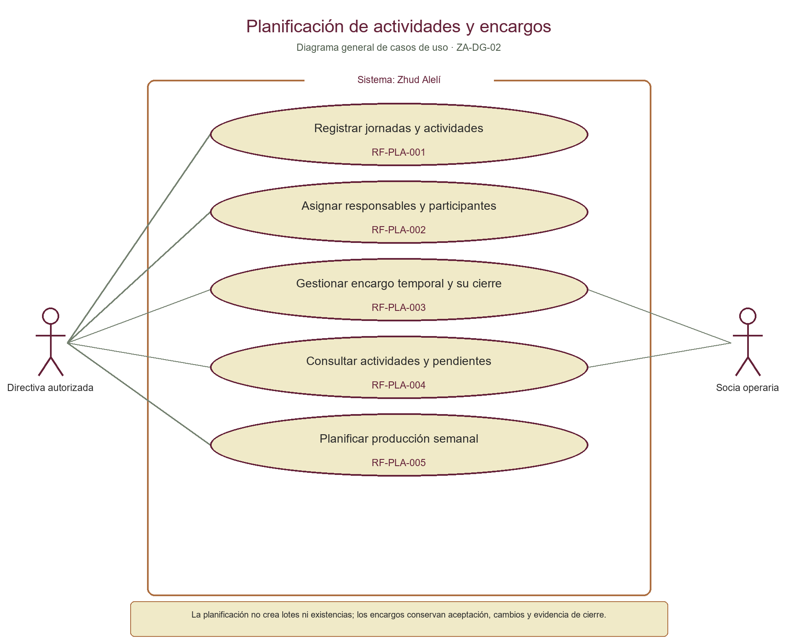
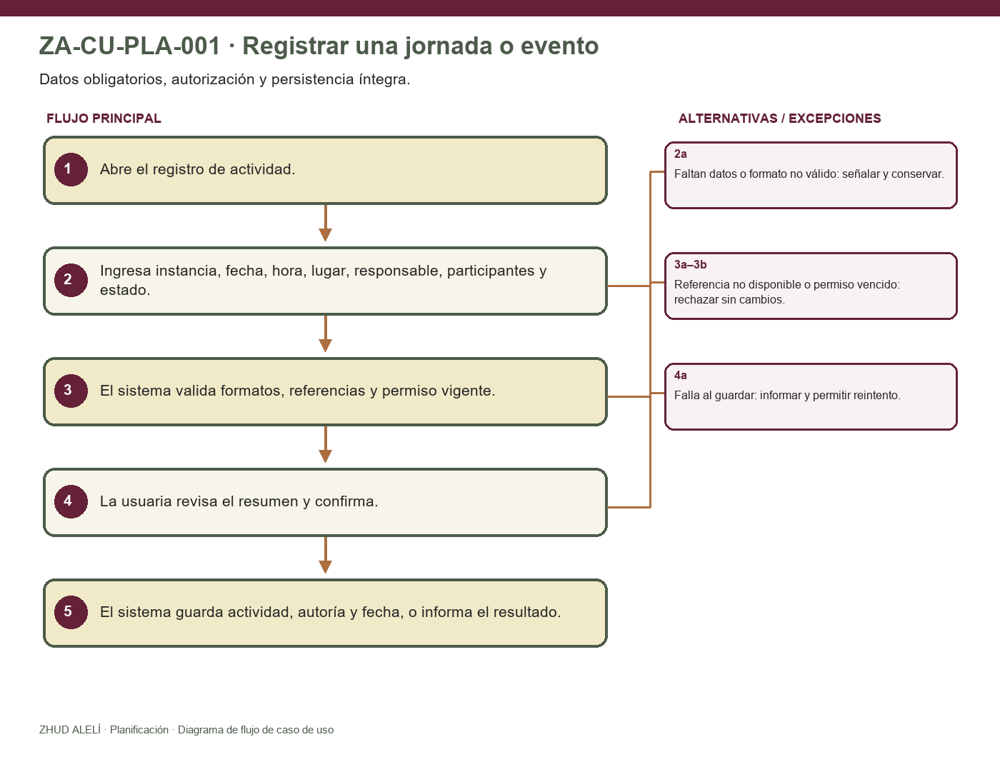
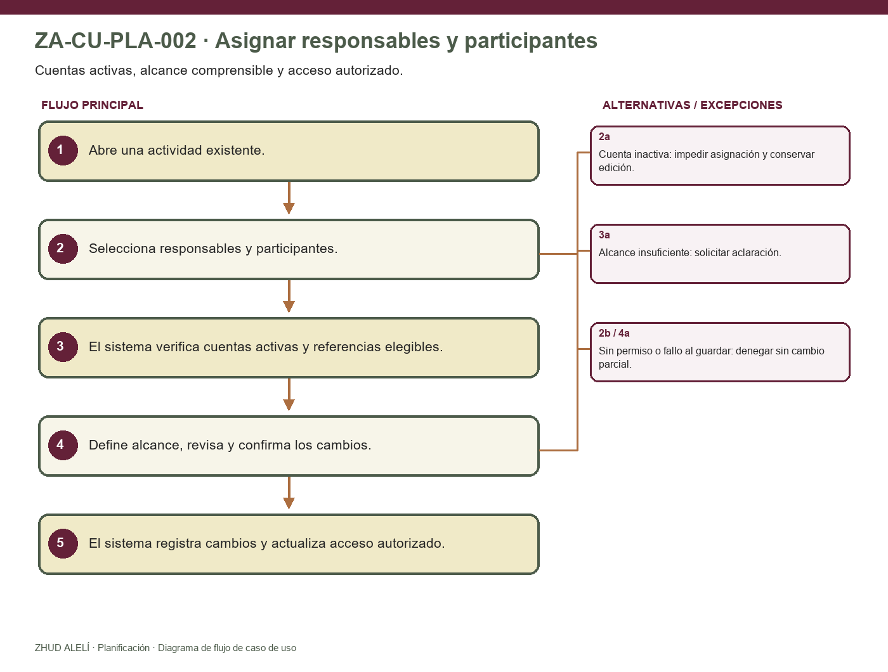
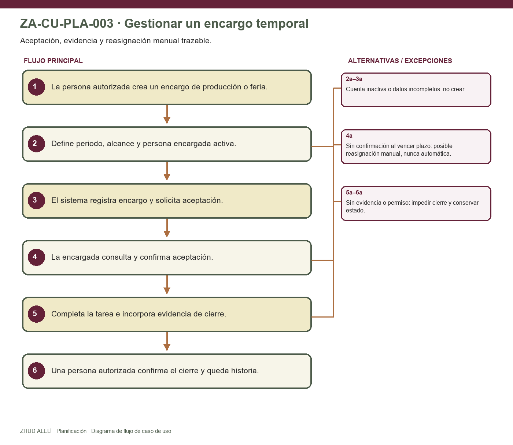
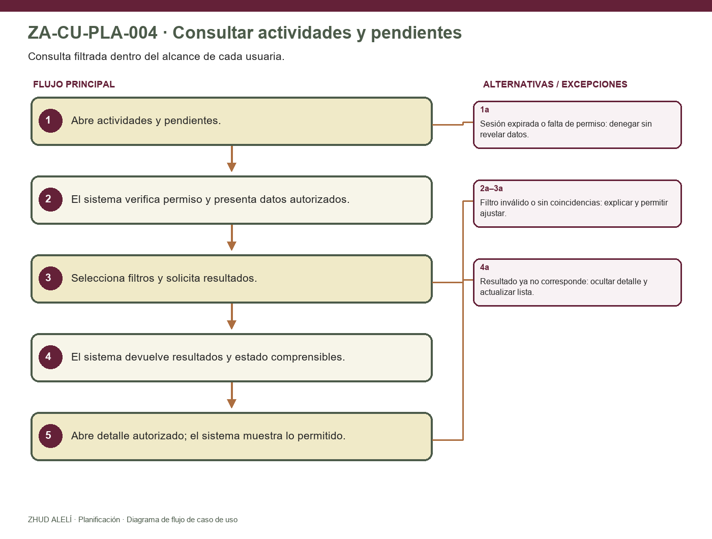
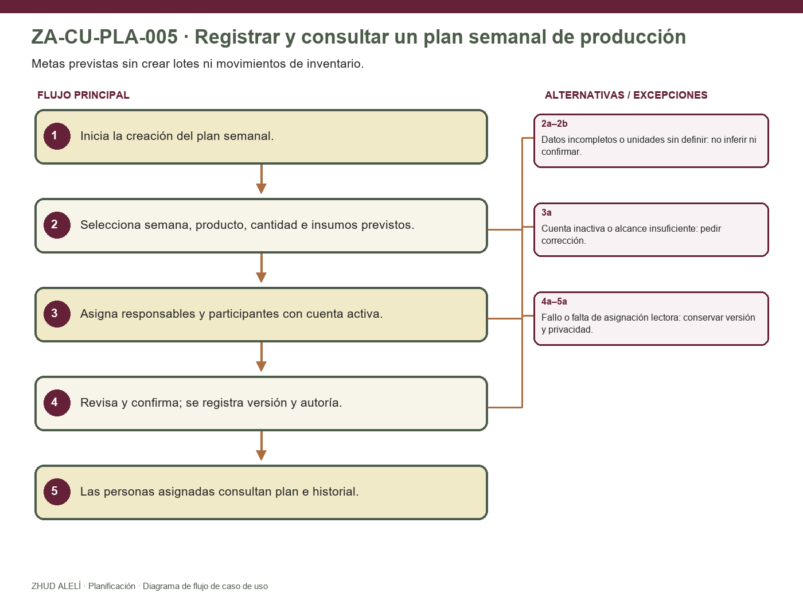

<table style="width:100%;border-collapse:collapse;font-family:'Heebo Light',Heebo,Arial,sans-serif;">
<tr><td colspan="2" style="background:#642138;color:#F0EAC8;padding:14px;font-family:'Mallong Regular',Georgia,serif;font-size:22px;"><strong>[LOGO: Isotipo floral de 4 pétalos - ZHUD ALELÍ Productos Naturales]</strong> ZA-CU-004 · Casos de uso detallados de planificación de actividades</td></tr>
<tr><th style="background:#642138;color:#F0EAC8;text-align:left;padding:8px;">Control documental</th><th style="background:#642138;color:#F0EAC8;text-align:left;padding:8px;">Valor</th></tr>
<tr style="background:#F0EAC8;"><td style="padding:7px;border:1px solid #AC6E40;">Módulo</td><td style="padding:7px;border:1px solid #AC6E40;">Planificación de actividades (<code>planning</code>)</td></tr>
<tr><td style="padding:7px;border:1px solid #AC6E40;">Fase / entregable</td><td style="padding:7px;border:1px solid #AC6E40;">Fase 2 — Especificación de casos de uso</td></tr>
<tr style="background:#F0EAC8;"><td style="padding:7px;border:1px solid #AC6E40;">Versión / fecha</td><td style="padding:7px;border:1px solid #AC6E40;">v1.0 / 13 de octubre de 2026</td></tr>
<tr><td style="padding:7px;border:1px solid #AC6E40;">Autor / analista</td><td style="padding:7px;border:1px solid #AC6E40;">Franklin Acero (tesista) / Codex (asistencia de redacción)</td></tr>
<tr style="background:#F0EAC8;"><td style="padding:7px;border:1px solid #AC6E40;">Estado</td><td style="padding:7px;border:1px solid #AC6E40;">Propuesta interna para revisión; no aprobada ni publicada</td></tr>
</table>

**Historial de revisiones**

| Versión | Fecha | Descripción | Responsable |
|---|---|---|---|
| v1.0 | 13-10-2026 | Primera propuesta de cinco casos detallados, un diagrama general y cinco diagramas de flujo para Planificación. | Franklin Acero; redacción asistida por Codex |

## 1. Propósito y límites

Este documento detalla recorridos verificables para los cinco requisitos confirmados de Planificación: registrar jornadas y eventos, asignar responsables y participantes, gestionar encargos temporales de producción o feria, consultar actividades y pendientes, y preparar el plan semanal de producción. Cada caso identifica actores, precondiciones, disparador, prioridad, flujo principal, alternativas, postcondiciones, reglas locales auxiliares y trazabilidad.

La importancia procede de la priorización aprobada v1.3. La complejidad es una estimación inicial de análisis, no esfuerzo aprobado. Las reglas `RN-CU-PLA-*` son auxiliares propuestas, derivadas de requisitos confirmados; no agregan reglas organizativas ni resuelven decisiones abiertas. La instrucción «siguiente doc» autoriza preparar esta propuesta; no se interpreta como aprobación de requisitos, alcance o reglas derivadas.

## 2. Actores

| Actor | Participación en estos casos |
|---|---|
| Directiva o persona con permiso para la operación | Registra actividades, asignaciones, encargos y planes, dentro de la autorización vigente para cada operación. La matriz por cargo sigue pendiente de definición funcional. |
| Socia operaria asignada | Consulta sus actividades y pendientes; confirma la aceptación del encargo y registra su cierre con evidencia cuando corresponda. |
| Módulo de Acceso | Proporciona identidad, estado de la cuenta y decisión de autorización por operación mediante contrato; no es actor humano ni dueño de los datos de planificación. |
| Módulos consumidores | Asistencia, Producción/Trazabilidad, Inventario y Notificaciones consultan datos autorizados de actividades, participantes, encargos o planes. No escriben directamente las tablas de Planificación. |

## 3. Resumen y orden de importancia

| Caso | Objetivo | Importancia confirmada | Complejidad inicial | Requisitos principales |
|---|---|---|---|---|
| ZA-CU-PLA-001 | Registrar una jornada o evento | Alta | Media (estimación inicial) | RF-PLA-001; RNF-UX-001/002/003; RNF-DAT-001; RNF-AUD-001 |
| ZA-CU-PLA-002 | Asignar responsables y participantes | Alta | Media (estimación inicial) | RF-PLA-002; RF-ACC-002/003; RNF-SEC-001; RNF-PRV-001 |
| ZA-CU-PLA-003 | Gestionar un encargo temporal | Alta | Alta (estimación inicial) | RF-PLA-003; RNF-AUD-001; RNF-DAT-001 |
| ZA-CU-PLA-005 | Registrar y consultar un plan semanal de producción | Alta | Media (estimación inicial) | RF-PLA-005; RF-CAT-001; RNF-AUD-001; RNF-DAT-001 |
| ZA-CU-PLA-004 | Consultar actividades y pendientes | Complementaria | Baja (estimación inicial) | RF-PLA-004; RF-ACC-004; RNF-UX-001/002/003; RNF-PRV-001 |

Los cuatro casos de prioridad alta preceden en el resumen al caso complementario, sin alterar el Sprint 2 aprobado. Complejidad e importancia son dimensiones distintas; el orden de esta tabla no fija el orden de implementación dentro del sprint.

## 4. Diagramas generales de casos de uso

El diagrama muestra el límite general del módulo y sus interacciones. Los pasos y bifurcaciones de cada recorrido se muestran en las figuras individuales y se especifican en las tablas siguientes.

## 5. Diagramas de flujo por caso de uso

Las figuras resumen los flujos principales y sus salidas relevantes. Las decisiones organizacionales aún abiertas se representan como puntos de decisión manuales o se dejan indicadas en la tabla de alternativas; no se automatizan por inferencia.

### ZA-CU-PLA-001 — Registrar una jornada o evento

### ZA-CU-PLA-002 — Asignar responsables y participantes

### ZA-CU-PLA-003 — Gestionar un encargo temporal

### ZA-CU-PLA-004 — Consultar actividades y pendientes

### ZA-CU-PLA-005 — Registrar y consultar un plan semanal de producción

## 6. Casos de uso detallados

### ZA-CU-PLA-001 — Registrar una jornada o evento

| Campo | Especificación |
|---|---|
| ID y nombre | ZA-CU-PLA-001 — Registrar una jornada o evento |
| Actor primario | Directiva o usuaria con permiso de registro para la operación |
| Actor secundario | Módulo de Acceso; módulos consumidores consultan después los datos autorizados |
| Descripción | Registrar los datos de una jornada o evento para que la organización y sus módulos consumidores trabajen sobre la misma actividad. |
| Importancia / complejidad | Alta / Media (estimación inicial) |
| Disparador | Una persona autorizada necesita programar una jornada o evento. |
| Precondiciones | La usuaria tiene una sesión vigente y autorización para registrar actividades. Los valores de instancia, tipos y estados disponibles están definidos por configuración aprobada. |
| Reglas asociadas | RN-CU-PLA-01; RN-CU-PLA-06 |
| Requisitos asociados | RF-PLA-001; RNF-SEC-001; RNF-AUD-001; RNF-DAT-001; RNF-UX-001/002/003 |

**Flujo principal**

| Paso | Acción del actor | Respuesta del sistema |
|---:|---|---|
| 1 | Abre la opción para registrar una jornada o evento. | Verifica su identidad y permiso vigente en backend; presenta el formulario disponible. |
| 2 | Ingresa instancia, fecha, hora, lugar, responsable, participantes y estado según los valores disponibles. | Presenta los campos requeridos y conserva temporalmente los valores ingresados para validar el envío. |
| 3 | Envía el formulario para revisión. | Valida presencia y formato de los datos requeridos, existencia de referencias seleccionadas y autorización actual. No aplica reglas de duplicidad o colisión no aprobadas. |
| 4 | Revisa el resumen y confirma el registro. | Persiste la actividad y los datos relacionados que pertenezcan a Planificación de forma íntegra; registra actor y fecha del cambio. |
| 5 | Consulta el resultado. | Confirma el registro o informa errores recuperables; los módulos consumidores acceden mediante las lecturas autorizadas definidas. |

**Flujos alternativos y de excepción**

| Flujo | Referencia | Acción / resultado |
|---|---|---|
| 2a | Paso 2–3 | Si falta un dato obligatorio o su formato no es válido, señala el campo y conserva lo ingresado; no crea la actividad. |
| 3a | Paso 3 | Si una referencia seleccionada dejó de estar disponible o cambió su autorización, rechaza el envío y solicita revisar los datos. |
| 3b | Paso 3 | Si la sesión o permiso ya no está vigente, deniega la escritura sin modificar datos. |
| 4a | Paso 4 | Si el guardado falla, informa que no se confirmó; no muestra una actividad como creada y permite corregir o reintentar. |

**Postcondiciones**

- Éxito: la actividad conserva los datos confirmados y su autoría; puede consultarse conforme a permisos.
- Fallo: no existe una actividad parcialmente guardada ni se pierden sin aviso los datos que puedan recuperarse en el formulario.

### ZA-CU-PLA-002 — Asignar responsables y participantes

| Campo | Especificación |
|---|---|
| ID y nombre | ZA-CU-PLA-002 — Asignar responsables y participantes |
| Actor primario | Directiva o usuaria con permiso de asignación para la actividad |
| Actor secundario | Socias asignadas; Módulo de Acceso valida estado y autorización |
| Descripción | Asociar responsables y participantes a una actividad con un alcance visible y entendible para cada persona. |
| Importancia / complejidad | Alta / Media (estimación inicial) |
| Disparador | Una actividad requiere identificar quién responde por ella y quién participa. |
| Precondiciones | La actividad existe y la usuaria puede modificar sus asignaciones en su estado actual. La asignación corresponde a cuentas vigentes. |
| Reglas asociadas | RN-CU-PLA-02; RN-CU-PLA-06 |
| Requisitos asociados | RF-PLA-002; RF-ACC-002/003; RNF-SEC-001; RNF-PRV-001; RNF-DAT-001 |

**Flujo principal**

| Paso | Acción del actor | Respuesta del sistema |
|---:|---|---|
| 1 | Abre una actividad existente y solicita administrar asignaciones. | Comprueba permiso para la operación y muestra las asignaciones visibles. |
| 2 | Selecciona personas responsables y participantes. | Comprueba en servidor que las cuentas seleccionadas estén activas y que las referencias correspondan a socias elegibles. |
| 3 | Describe de forma clara la responsabilidad o participación asignada. | Presenta la asignación y su alcance para revisión; no concede permisos a otros módulos automáticamente. |
| 4 | Confirma el cambio. | Persiste las asignaciones autorizadas y registra actor, fecha y cambio conforme a auditoría. |
| 5 | Consulta el resultado. | Actualiza la vista de actividad y habilita consultas individuales solo a las personas asignadas, dentro de su permiso. |

**Flujos alternativos y de excepción**

| Flujo | Referencia | Acción / resultado |
|---|---|---|
| 2a | Paso 2 | Si alguna cuenta está inactiva, el sistema no la asigna, indica el problema sin exponer información innecesaria y conserva las demás selecciones editables. |
| 2b | Paso 2 | Si la usuaria no tiene permiso vigente, el sistema deniega la acción sin guardar cambios. |
| 3a | Paso 3 | Si el alcance de una asignación no queda claro o falta información necesaria, el sistema solicita corregirla antes de confirmar. |
| 4a | Paso 4 | Si falla el guardado, no deja una asignación parcial; informa el resultado y permite reintentar. |

**Postcondiciones**

- Éxito: las personas activas asignadas pueden ver la actividad que les corresponde; los cambios quedan trazables.
- Fallo: asignaciones previas permanecen intactas; cuentas inactivas o cambios no autorizados no quedan registrados.

### ZA-CU-PLA-003 — Gestionar un encargo temporal

| Campo | Especificación |
|---|---|
| ID y nombre | ZA-CU-PLA-003 — Gestionar un encargo temporal |
| Actor primario | Directiva o responsable autorizada para crear o reasignar encargos |
| Actor secundario | Socia operaria encargada |
| Descripción | Crear un encargo temporal de producción o feria, permitir que la persona confirme su aceptación y cerrar el encargo con evidencia; una responsable autorizada puede reasignarlo si no existe confirmación dentro del plazo acordado. |
| Importancia / complejidad | Alta / Alta (estimación inicial) |
| Disparador | Se requiere asignar temporalmente una tarea productiva o de feria relacionada con una actividad. |
| Precondiciones | Existe una actividad y una persona con cuenta activa; la iniciadora tiene permiso específico. El plazo y las reglas del encargo fueron acordados antes del caso que dependa de ellos. |
| Reglas asociadas | RN-CU-PLA-03; RN-CU-PLA-04; RN-CU-PLA-06 |
| Requisitos asociados | RF-PLA-003; RNF-SEC-001; RNF-AUD-001; RNF-DAT-001; RNF-PRV-001 |

**Flujo principal**

| Paso | Acción del actor | Respuesta del sistema |
|---:|---|---|
| 1 | Selecciona crear encargo para una actividad de producción o feria. | Valida permiso y presenta actividad, periodo, alcance y responsable como datos del encargo. |
| 2 | Completa el periodo, alcance y persona encargada. | Comprueba cuenta activa y datos requeridos; muestra resumen de asignación. |
| 3 | Confirma la creación del encargo. | Guarda el encargo y deja visible a la persona encargada la acción de confirmar aceptación; registra quién creó y cuándo. |
| 4 | La persona encargada consulta y confirma la aceptación. | Registra su confirmación con actor y fecha; presenta el encargo vigente dentro de su periodo y alcance. |
| 5 | La persona encargada completa la tarea y adjunta o registra la evidencia disponible. | Valida que se incluya evidencia conforme a los tipos que la organización haya definido y presenta el cierre para confirmación. |
| 6 | Confirma el cierre si tiene autorización para esa acción. | Registra el cierre y la evidencia, con actor y fecha; conserva la historia del encargo. |

**Flujos alternativos y de excepción**

| Flujo | Referencia | Acción / resultado |
|---|---|---|
| 2a | Paso 2 | Si la cuenta seleccionada está inactiva, el sistema impide asignarla y conserva el encargo sin cambios. |
| 3a | Paso 3 | Si la actividad, periodo, alcance o persona encargada no están completos, indica los datos faltantes y no crea el encargo. |
| 4a | Paso 4 | Si no existe confirmación al vencer el plazo previamente acordado, la responsable autorizada puede iniciar una reasignación manual; el sistema conserva el responsable anterior, actor y fecha del cambio. No reasigna automáticamente. |
| 5a | Paso 5 | Si falta evidencia o no puede almacenarse, el sistema no registra el cierre como completo e informa cómo corregirlo. |
| 6a | Paso 6 | Si quien intenta cerrar no tiene permiso, el sistema deniega el cambio y mantiene evidencia como pendiente de cierre. |

**Postcondiciones**

- Éxito: queda un encargo delimitado por actividad, periodo y alcance, con aceptación, cierre/evidencia y cambios de responsable trazables según el recorrido ejecutado.
- Fallo: el sistema conserva el último estado confirmado, no aplica una reasignación automática y no marca como cerrado un encargo sin evidencia requerida.

### ZA-CU-PLA-004 — Consultar actividades y pendientes

| Campo | Especificación |
|---|---|
| ID y nombre | ZA-CU-PLA-004 — Consultar actividades y pendientes |
| Actor primario | Socia operaria o integrante de Directiva |
| Actor secundario | Módulo de Acceso determina el alcance autorizado de la consulta |
| Descripción | Permitir a la Directiva consultar actividades autorizadas y a cada socia consultar las actividades y pendientes que le corresponden mediante filtros comprensibles. |
| Importancia / complejidad | Complementaria / Baja (estimación inicial) |
| Disparador | La usuaria necesita conocer sus actividades, responsabilidades o pendientes. |
| Precondiciones | Existe sesión vigente; la usuaria tiene permiso de lectura. Los filtros disponibles pertenecen al conjunto configurado para la consulta. |
| Reglas asociadas | RN-CU-PLA-05; RN-CU-PLA-06 |
| Requisitos asociados | RF-PLA-004; RF-ACC-004; RNF-UX-001/002/003; RNF-SEC-001; RNF-PRV-001 |

**Flujo principal**

| Paso | Acción del actor | Respuesta del sistema |
|---:|---|---|
| 1 | Abre la consulta de actividades y pendientes. | Verifica permiso y presenta los datos visibles para su cuenta. |
| 2 | Selecciona uno o más filtros disponibles. | Valida el criterio y busca solo dentro del conjunto autorizado. |
| 3 | Solicita la consulta. | Devuelve actividades y pendientes que coinciden, con estado y datos claros para la usuaria. |
| 4 | Abre un resultado autorizado. | Muestra el detalle permitido y las acciones disponibles según asignación y estado. |

**Flujos alternativos y de excepción**

| Flujo | Referencia | Acción / resultado |
|---|---|---|
| 2a | Paso 2 | Si el filtro no es válido, explica cómo corregirlo y conserva el resto de criterios. |
| 3a | Paso 3 | Si no hay coincidencias, muestra un estado vacío comprensible y permite cambiar filtros. |
| 1a | Paso 1 | Si la cuenta carece de permiso o la sesión expiró, deniega el acceso sin revelar resultados. |
| 4a | Paso 4 | Si el resultado dejó de estar disponible o ya no corresponde a la usuaria, oculta el detalle y actualiza el resultado de consulta. |

**Postcondiciones**

- Éxito: la usuaria conoce actividades y pendientes dentro de su alcance autorizado.
- Fallo: no se revelan datos de otras socias ni se modifica la planificación.

### ZA-CU-PLA-005 — Registrar y consultar un plan semanal de producción

| Campo | Especificación |
|---|---|
| ID y nombre | ZA-CU-PLA-005 — Registrar y consultar un plan semanal de producción |
| Actor primario | Directiva o persona con permiso para planificar producción |
| Actor secundario | Socias asignadas; módulos de Catálogo, Producción e Inventario proveen referencias autorizadas |
| Descripción | Registrar un objetivo semanal por producto, cantidad objetivo, responsables e insumos previstos; hacer visible el plan a las personas asignadas y conservar cambios. |
| Importancia / complejidad | Alta / Media (estimación inicial) |
| Disparador | La organización necesita acordar qué productos espera elaborar durante una semana y quiénes participarán. |
| Precondiciones | Existe permiso de planificación y están disponibles las referencias de producto/unidad que la organización haya aprobado. La definición de semana sigue el calendario acordado en la especificación. |
| Reglas asociadas | RN-CU-PLA-07; RN-CU-PLA-08; RN-CU-PLA-06 |
| Requisitos asociados | RF-PLA-005; RF-CAT-001; RNF-SEC-001; RNF-AUD-001; RNF-DAT-001 |

**Flujo principal**

| Paso | Acción del actor | Respuesta del sistema |
|---:|---|---|
| 1 | Abre la opción para crear el plan de producción semanal. | Verifica autorización y carga referencias de productos disponibles para esa operación. |
| 2 | Selecciona la semana y producto, e ingresa cantidad objetivo e insumos previstos. | Valida formato y referencias seleccionadas; señala unidades cuyo uso aún no esté definido, sin convertirlas por inferencia. |
| 3 | Asigna responsables y participantes del plan. | Comprueba cuentas activas y que el alcance de cada asignación esté claro. |
| 4 | Revisa y confirma el plan. | Registra la versión vigente, autoría y fecha; no crea lote, movimiento, consumo ni existencia. |
| 5 | Una socia asignada consulta el plan. | Muestra el plan y sus cambios a las personas asignadas conforme a sus permisos. |

**Flujos alternativos y de excepción**

| Flujo | Referencia | Acción / resultado |
|---|---|---|
| 2a | Paso 2 | Si falta producto, cantidad objetivo, responsable o referencia necesaria, solicita corregir y no guarda el plan incompleto. |
| 2b | Paso 2 | Si producto/unidad ya no está disponible o sus unidades no pueden interpretarse con reglas aprobadas, impide confirmar esa combinación; no calcula conversiones o mermas no aprobadas. |
| 3a | Paso 3 | Si una cuenta está inactiva o una asignación no tiene alcance, la identifica y no guarda el plan hasta corregirla. |
| 4a | Paso 4 | Si el guardado falla, conserva la última versión confirmada y no presenta una meta nueva como vigente. |
| 5a | Paso 5 | Si una socia no tiene asignación autorizada, no revela el plan privado; no altera el plan existente. |

**Postcondiciones**

- Éxito: existe un plan semanal consultable por sus personas asignadas y con historia de cambios.
- Fallo: la última versión confirmada permanece vigente; un intento fallido no crea lote ni altera existencias.

## 7. Reglas de negocio locales propuestas

| ID propuesto | Regla derivada para estos casos | Fuente base |
|---|---|---|
| RN-CU-PLA-01 | Una actividad se confirma solo después de validar sus datos requeridos y la autorización de quien la registra. | RF-PLA-001; RNF-SEC-001; RNF-DAT-001 |
| RN-CU-PLA-02 | Una asignación requiere cuenta activa y un alcance que la persona asignada pueda consultar. | RF-PLA-002; RF-ACC-002; RF-ACC-004 |
| RN-CU-PLA-03 | Un encargo conserva actividad, periodo, alcance, responsable, confirmación de aceptación, cierre y evidencia de los eventos ejecutados. | RF-PLA-003; RNF-AUD-001; RNF-DAT-001 |
| RN-CU-PLA-04 | La reasignación por falta de confirmación es una acción manual de persona autorizada, después del plazo acordado; registra responsable previo, nuevo, actor y fecha. | RF-PLA-003; decisiones abiertas del CAT-REQ-001 v1.2 |
| RN-CU-PLA-05 | La consulta filtra solo el conjunto de actividades y pendientes autorizado para la usuaria. | RF-PLA-004; RNF-SEC-001; RNF-PRV-001 |
| RN-CU-PLA-06 | Toda operación protegida se autoriza en servidor, y los cambios persistidos conservan auditoría e integridad requeridas. | RF-ACC-003; RNF-SEC-001; RNF-AUD-001; RNF-DAT-001 |
| RN-CU-PLA-07 | Un plan registra una meta prevista; por sí mismo no registra producción, lote, consumo de insumos ni existencias. | RF-PLA-005 |
| RN-CU-PLA-08 | Las cantidades y productos del plan se conservan con referencias y unidades aprobadas; el módulo no inventa conversiones. | RF-PLA-005; RF-CAT-001; P-04 |

Estas reglas son una organización analítica de requisitos confirmados. Los detalles de rol, periodo, evidencia y aceptación permanecen pendientes donde se indica; las reglas no cierran esas decisiones.

## 8. Matriz de trazabilidad

| Requisito confirmado | Caso(s) | Cobertura |
|---|---|---|
| RF-PLA-001 | ZA-CU-PLA-001; precondición de ZA-CU-PLA-002/003/004 | Registrar y exponer actividad con instancia, fecha, hora, lugar, responsable, participantes y estado. |
| RF-PLA-002 | ZA-CU-PLA-002 | Asignar personas con cuenta activa y alcance consultable. |
| RF-PLA-003 | ZA-CU-PLA-003 | Periodo, alcance, responsable, aceptación, evidencia de cierre y reasignación manual tras falta de confirmación. |
| RF-PLA-004 | ZA-CU-PLA-004 | Consulta autorizada de actividades y pendientes con filtros y estado vacío comprensible. |
| RF-PLA-005 | ZA-CU-PLA-005 | Plan semanal con productos, cantidad objetivo, responsables, insumos previstos, visibilidad e historia, sin movimientos de stock. |
| RNF-SEC-001; RNF-PRV-001 | ZA-CU-PLA-001 a 005 | Autorización por operación, lecturas restringidas y denegación sin cambios. |
| RNF-AUD-001; RNF-DAT-001 | ZA-CU-PLA-001/002/003/005 | Trazabilidad de cambios e integridad de registros y asignaciones. |
| RNF-UX-001/002/003 | ZA-CU-PLA-001/004/005 | Formularios claros, uso móvil, filtros entendibles y errores recuperables. |
| RF-NOT-001 | Integración posterior a ZA-CU-PLA-001/004 | Los datos de actividad y destinatarios alimentan recordatorios; su envío y reglas son propiedad de Notificaciones. |

## 9. Decisiones de detalle que permanecen abiertas

| Tema | Límite de esta propuesta | Cuándo resolver |
|---|---|---|
| Permisos por operación | P-01 cierra acceso básico, no la matriz detallada para crear/cambiar actividades, asignaciones, encargos y planes. | En la especificación propietaria de Planificación, con decisión organizacional. |
| Tipos, instancias y estados de actividad | No se inventa una lista de categorías ni transiciones. | Antes de cerrar los formularios, reglas de edición y flujos alternativos. |
| RF-PLA-003: aceptación/reasignación | Plazo, autoridad de aceptación/reasignación, tipos de evidencia y validador del cierre no están fijados. | Antes de aprobar los escenarios que dependen de esos detalles o implementar el ciclo. |
| RF-PLA-005: semana, unidades e insumos | Frontera de semana, catálogo de productos, unidades, cantidades, conversiones y lista de insumos dependen de decisiones de campo/catálogo. | Antes de validar cálculos o interoperar con Producción e Inventario. |
| Avisos de actividad | RF-NOT-001 permite recordatorios uno o dos días antes; destinatarios y excepciones están pendientes. | En la especificación de Notificaciones antes de habilitar envíos. |
| Cambios offline | Las reglas PWA rigen aceptación local y sincronización; este caso no declara modificaciones remotas confirmadas si no las acepta el servidor. | En las specs offline y criterios de sincronización correspondientes. |

## Fuentes y estado

- CAT-REQ-001 v1.2, requisitos confirmados y decisiones de detalle abiertas.
- Requisitos generales v2.0 y priorización v1.3, definiciones y prioridades de RF-PLA-001 a RF-PLA-005.
- ZA-ALC-003 v1.0, propuesta interna de alcance del módulo de Planificación.
- ZA-DG-001, diagramas generales por proceso, referencia del límite y actores del proceso.
- Constitución 0.2.0 y ADR-0006, propiedad modular de escrituras, autorización backend y contratos de colaboración.

**Estado:** propuesta interna para revisión del tesista. Las cinco RF se trazan sin cambiar su importancia; las reglas locales son derivadas y las decisiones abiertas permanecen pendientes. El documento no declara validación académica, implementación o prueba.
