# Arquitectura detallada y comportamiento de Zhud Alelí

> **Estado:** edición v1.2 preparada para revisión académica. Conserva la arquitectura base de la v1.1 e incorpora la organización modular de backend y frontend aprobada por el tesista el 2026-10-28. La app Django ya cuenta con una implementación local parcial de acceso y una adaptación de presentación en el árbol de trabajo. Los diagramas generales siguen representando el diseño previsto de los demás módulos. La convención técnica está aprobada y esta edición se publica para revisión docente. La publicación no implica aceptación académica, nuevas funcionalidades ni despliegue.

## 1. Propósito y alcance

Explica cómo se organiza la aplicación de gestión organizacional y trazabilidad productiva del Comité de Mujeres Indígenas “Tránsito Amaguaña” de Zhud, cuya marca de productos es Zhud Alelí. Cubre actores, componentes, módulos, recorridos de datos, autorización, transacciones, operación offline y despliegue lógico.

El diseño aprobado es un **monolito modular cliente-servidor** con Python 3.12, Django 5.2 LTS, PostgreSQL, plantillas renderizadas en servidor (SSR/MVT), Bootstrap 5 y JavaScript progresivo. Se entrega como una unidad, con límites internos claros.

- **Confirmado:** decisión o requisito aprobado.
- **Previsto:** diseño aún no implementado.
- **Pendiente:** detalle por resolver en una spec o plan.
- **Ilustrativo:** patrón explicativo que no agrega reglas de negocio.

No fija el esquema relacional final, proveedor de alojamiento, respaldos, políticas completas de sincronización, matriz definitiva de cargos ni reglas productivas detalladas.

## 2. Contexto del sistema

Directiva y socias operarias acceden al espacio privado según cuenta y permisos. Las visitantes consultan solo información pública aprobada. El navegador presenta las páginas; Django controla identidad, autorización y reglas; PostgreSQL conserva datos operativos.

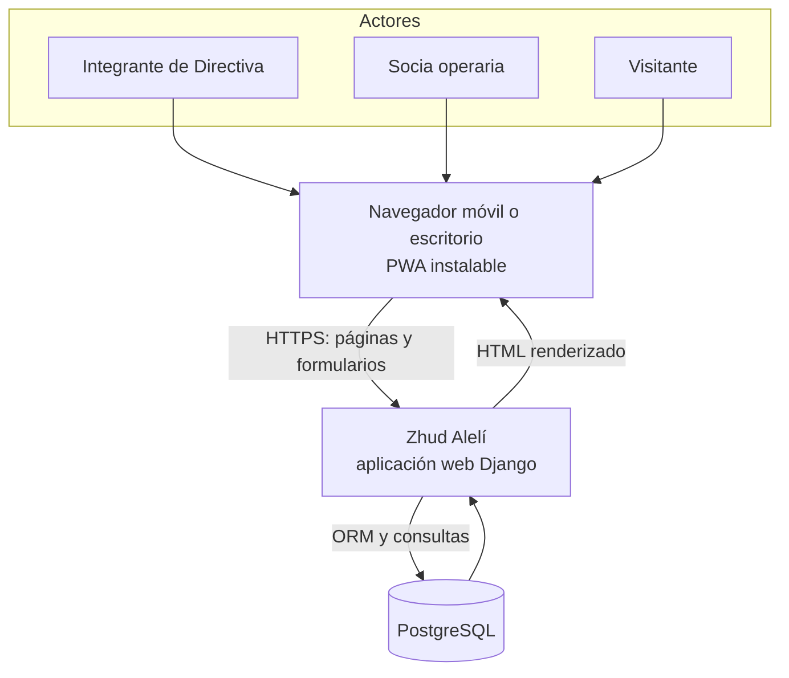

**Lectura:** el navegador no se conecta a la base de datos. Las operaciones privadas pasan por el servidor.

## 3. Contenedores y frontera PWA

“Contenedor” describe unidades lógicas; no significa que se haya elegido Docker o un proveedor.

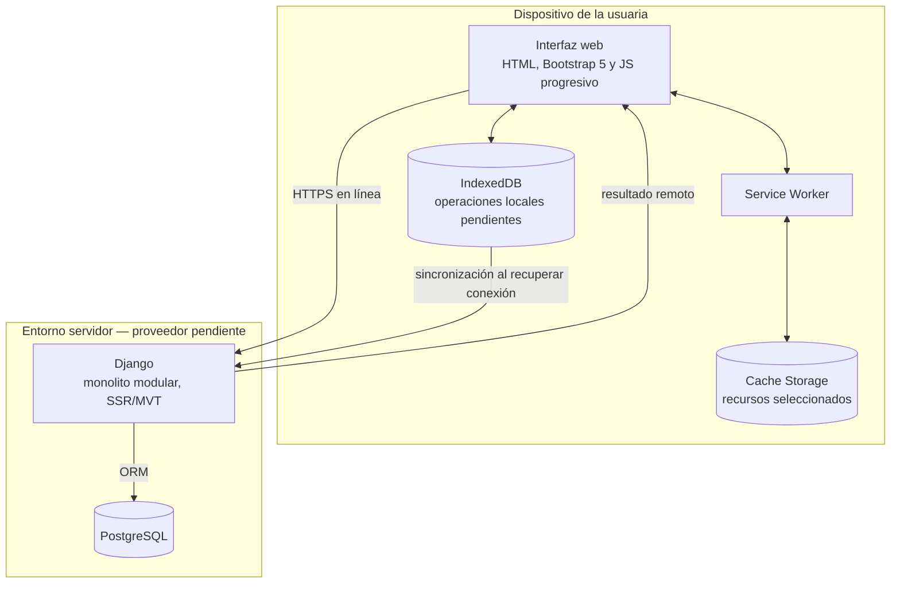

- **Service Worker y Cache Storage:** instalación y recursos elegidos; no almacenan páginas privadas autenticadas.
- **IndexedDB:** almacenamiento local previsto para operaciones esenciales autorizadas sin conexión. Los datos exactos esperan sus specs.
- **Django:** revalida identidad, permiso, datos y reglas al recibir una operación sincronizada.
- **PostgreSQL:** contiene datos aceptados por el servidor. Un borrador local aún no es un registro confirmado.

## 4. Módulos y propiedad de datos

Las apps están dentro del mismo proyecto Django; no son microservicios ni tienen bases separadas. Las flechas indican consumo de operaciones públicas o lecturas autorizadas, no escritura directa en tablas ajenas.

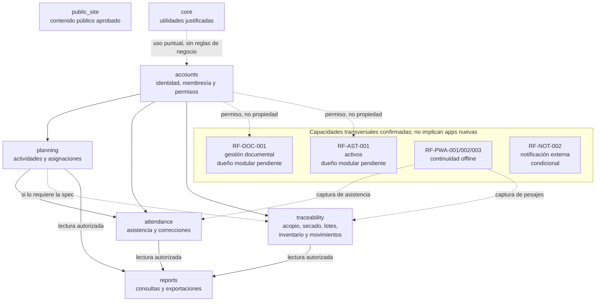

| Módulo | Responsabilidad prevista | Frontera |
|---|---|---|
| **accounts** | Cuenta, membresía, roles y permisos. | No administra actividades ni producción. |
| **planning** | Actividades, jornadas, responsables y asignaciones. | No registra asistencia. |
| **attendance** | Entradas, salidas, participación y correcciones autorizadas. | Consume identidad y actividades permitidas; no posee autenticación ni inventario. |
| **traceability** | Catálogos productivos, acopio, secado, lotes, inventario, ventas, gastos y cuentas por cobrar, según specs. | Dueño de invariantes y escrituras. La ubicación final de capacidades comerciales depende de specs. |
| **reports** | Consultas, filtros, vistas derivadas y exportaciones previstas. | Lee fuentes autorizadas; no crea saldos operativos paralelos. |
| **public_site** | Navegación e información aprobada para visitantes. | No expone información interna o personal. |
| **core** | Tipos y utilidades transversales realmente compartidos. | Pequeño, sin reglas de negocio. |

Cada módulo posee sus datos, invariantes, escrituras y migraciones. Los módulos colaboran mediante operaciones públicas y lecturas autorizadas. Las claves foráneas se conservan cuando protegen integridad; se evitan ciclos. Los límites se precisan por funcionalidad.

## 5. Componentes internos de Django

Django utiliza MVT: la vista coordina la petición, los modelos representan datos y reglas locales, y la plantilla genera la respuesta. Las capas son responsabilidades; no obligan a crear servicios o carpetas vacías.

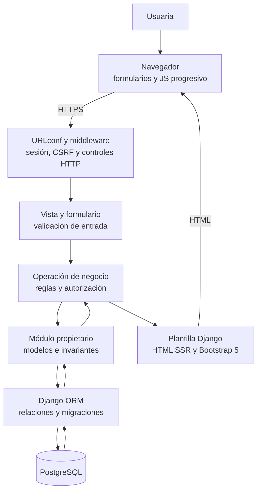

1. **URLconf y middleware:** enrutan solicitudes y aplican sesión, CSRF y controles HTTP.
2. **Vista y formulario:** validan la forma de la entrada y coordinan la respuesta.
3. **Operación de negocio:** aplica reglas reutilizables desde SSR o sincronización con una identidad confiable.
4. **Módulo propietario:** conserva invariantes, escrituras y migraciones.
5. **ORM y PostgreSQL:** persisten datos relacionales y aplican restricciones. Las plantillas no ejecutan consultas de negocio.

Los archivos de servicios, consultas o políticas se añaden cuando un comportamiento real los justifica. No se impone una capa genérica sobre el ORM.

### 5.1. Organización por módulo de negocio

Cada app de dominio reúne sus modelos, operaciones, permisos, presentación y pruebas. El
criterio de separación es la responsabilidad de negocio: cuentas, planificación, asistencia
y trazabilidad. Una pantalla nueva se incorpora al módulo que posee la operación.

Esta organización permite modificar un recorrido dentro de un ámbito identificable y
conservar dependencias explícitas entre módulos. El sistema continúa siendo un monolito
modular: se entrega conjuntamente y utiliza PostgreSQL, con integridad entre sus entidades.
La agrupación de carpetas facilita esa organización, pero no sustituye los límites de datos,
las operaciones públicas ni las comprobaciones de autorización.

### 5.2. Responsabilidades del backend

| Elemento del módulo | Responsabilidad | Criterio de organización |
|---|---|---|
| `models.py` o paquete `models/` | Entidades, relaciones, restricciones e invariantes locales. | Conserva el descubrimiento nativo de Django. Si se usa un paquete, sus modelos se importan explícitamente. |
| `forms.py` | Interpretación y validación de entradas de formularios y configuración de campos. | Presenta errores de entrada; las reglas reutilizadas por otras entradas permanecen en el módulo propietario. |
| `views.py` | Recibe la petición, coordina formularios y operaciones y devuelve HTML o una redirección. | Conserva la coordinación HTTP y evita acumular reglas de varios dominios. |
| `services.py`, cuando exista una necesidad | Operaciones con reglas, reutilización o coordinación que justifican su extracción. | Un recorrido pequeño puede usar directamente los mecanismos nativos. |
| `urls.py` | Direcciones y nombres públicos del módulo. | Los movimientos internos conservan las rutas de los recorridos existentes. |
| `migrations/` | Evolución del esquema relacional. | Se mantiene en la ubicación nativa, con compatibilidad de datos comprobada. |
| `tests/` | Pruebas de reglas, permisos, integridad y recorridos del módulo. | Los cambios se verifican con casos relacionados con su comportamiento. |

Las consultas complejas o reutilizadas pueden agruparse en `queries.py`; las reglas de
autorización reutilizables, en `policies.py` o en mecanismos nativos de permisos. Estos
archivos se incorporan cuando el comportamiento lo exige, sin crear capas vacías.

Las operaciones de negocio reutilizables reciben datos y una identidad confiable; evitan
depender de plantillas o respuestas HTTP. Un adaptador de autenticación puede recibir la
petición cuando lo requiere Django. Los permisos y las reglas se comprueban en backend,
también desde una futura entrada de sincronización. Las escrituras que deban confirmarse
juntas comparten una transacción y el control de concurrencia que corresponda.

### 5.3. Frontend agrupado por pantalla

La convención aprobada reúne la plantilla y los recursos exclusivos de una pantalla dentro
de su módulo. El siguiente árbol ilustra el patrón de organización; no obliga a crear
archivos sin contenido ni afirma que todos los módulos estén implementados:

```text
apps/accounts/
├── models.py
├── forms.py
├── views.py
├── urls.py
├── migrations/
├── tests/
└── frontend/
    └── accounts/
        └── login/
            ├── login.html
            └── recursos/
                ├── login.css
                └── imagenes/
```

El segundo nombre `accounts` identifica las plantillas del módulo y evita colisiones con
otras apps. `recursos/` delimita el contenido público de la pantalla. Un JavaScript propio
se incorpora allí cuando exista un comportamiento exclusivo; los comportamientos comunes
se reutilizan desde su ubicación compartida.

Django continúa procesando el HTML en servidor y entregando CSS, JS e imágenes al navegador.
Se configura la raíz `frontend/` para localizar plantillas y únicamente los directorios
`recursos/`, con prefijos de módulo y pantalla, para localizar estáticos. No se publica toda
la carpeta de presentación. El mismo criterio se comprueba al servir archivos en desarrollo
y al recopilar estáticos para su entrega.

Esta disposición busca facilitar el mantenimiento por pantalla y conservar una frontera
explícita entre plantillas procesadas y archivos públicos. Se apoya en la configuración de
directorios de plantillas y estáticos que ofrece Django; no requiere separar la aplicación
en un cliente independiente y una API.

### 5.4. Componentes compartidos y configuración general

| Ubicación general | Responsabilidad |
|---|---|
| `config/` | Configuración por entorno, composición de rutas y puntos de entrada del proyecto. Las reglas de negocio permanecen en sus módulos. |
| `templates/base.html` | Estructura HTML general y bloques para que cada pantalla declare sus recursos. |
| `templates/components/` | Fragmentos HTML reutilizados, como mensajes. |
| `static/compartido/` | Estilos generales y comportamientos utilizados por varias pantallas. |
| `static/brand/` | Identidad visual común y logotipos. |
| `static/pwa/` | Registro, Service Worker, iconos y alternativa pública sin conexión. |
| `static/vendor/` | Bibliotecas de terceros, como Bootstrap, separadas del código propio. |
| `tests/` general | Comprobaciones transversales de integración, sin desplazar las pruebas de cada módulo. |

La base carga los recursos generales y cada pantalla incorpora los particulares que utiliza.
Los componentes compartidos tienen una sola fuente; su reutilización evita copiar estilos o
comportamientos entre pantallas.

### 5.5. Crecimiento proporcional y transición

Los archivos se dividen cuando contienen responsabilidades que conviene mantener por separado.
El número de líneas es una señal para revisar, no un umbral que determine automáticamente
la creación de carpetas. `css/` o `js/` dentro de `recursos/` resultan útiles al agrupar varios
archivos; con un único archivo puede conservarse una estructura más simple. Las reglas de
adaptación a móvil permanecen junto a los componentes que modifican.

La transición se realiza por pantalla o recorrido completo: ubicación, configuración,
referencias y pruebas se actualizan en la misma porción. El árbol anterior de plantillas y
estáticos puede coexistir temporalmente, con una única fuente activa de cada archivo. Se
conservan nombres públicos, relaciones de datos, migraciones y comportamiento de negocio.

La verificación comprende renderizado, resolución de recursos, exclusión de plantillas de los
estáticos, compatibilidad de la cascada CSS, comportamiento móvil y escritorio y política de
caché PWA. Cuando cambian recursos precargados se actualizan sus referencias y versión de
caché. Las páginas privadas y de autenticación siguen excluidas de esa caché.

## 6. Recorrido de una operación en línea

Patrón general para una acción privada; no define campos ni reglas productivas concretas.

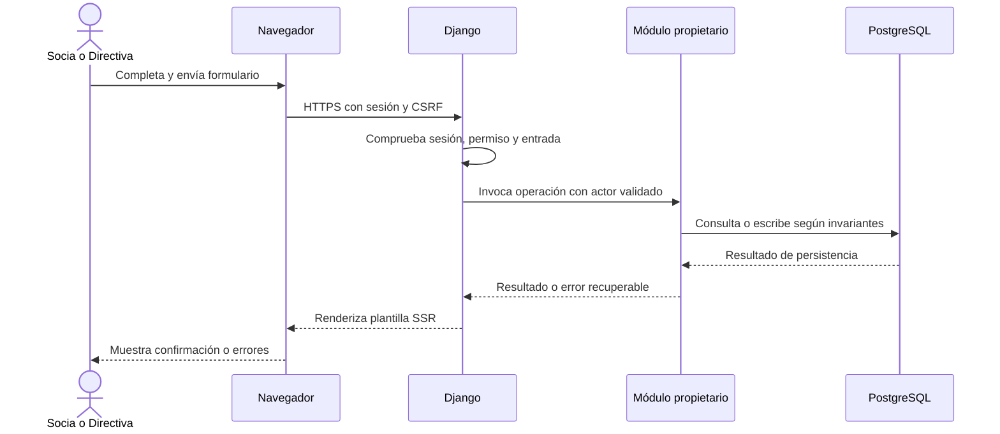

Sin sesión o permiso, el backend rechaza la petición antes de mostrar datos privados. Una entrada inválida produce un error comprensible. Si se cumplen las invariantes, el servidor confirma el cambio y presenta el resultado remoto.

## 7. Acceso y protección del espacio privado

SPEC-001 confirma el inicio/cierre de sesión de cuentas activas y la protección de contenido privado.

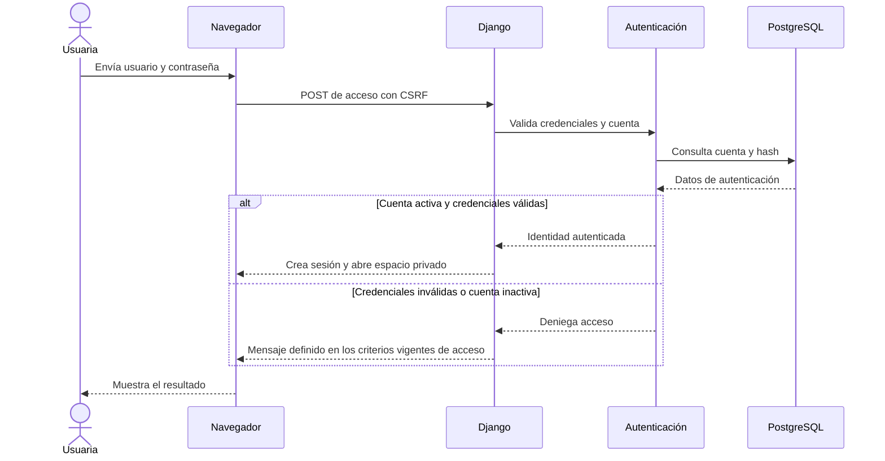

- Toda URL privada exige sesión; ocultar botones no constituye autorización.
- Cada acción sensible verifica permisos en el servidor.
- Cerrar sesión impide reutilizarla; el contenido privado no reaparece al volver atrás.
- Las páginas privadas de SPEC-001 evitan caché; el Service Worker no las almacena.
- Los criterios vigentes distinguen «Usuario incorrecto» y «Contraseña incorrecta». El primero se utiliza para cuentas inexistentes o inactivas; el segundo, para una contraseña incorrecta de una cuenta activa. Esta edición corrige la descripción genérica de v1.1 conforme a SPEC-001, sin introducir una regla nueva.
- Las acciones sensibles requieren pruebas de acceso permitido y denegado.

## 8. Captura offline y sincronización

La capacidad PWA offline forma parte del diseño. Las operaciones exactas, datos locales, retención, conflictos y dispositivos compartidos esperan sus specs. El navegador conserva una operación; el servidor decide si la acepta.

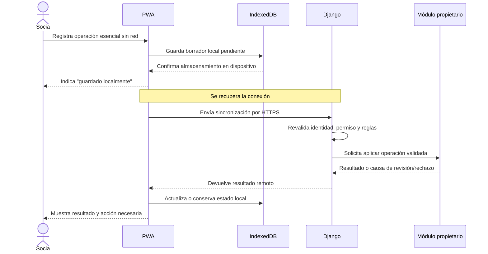

Reglas del flujo:

1. Solo se guarda lo autorizado por una spec; no se cachean contraseñas, páginas de acceso ni páginas privadas completas.
2. “Guardado localmente” no significa aceptado por la organización.
3. El servidor verifica identidad, permisos vigentes, relaciones y reglas al sincronizar.
4. Los reintentos deben evitar aplicar dos veces una operación; el mecanismo concreto aún debe definirse y probarse.
5. Ante conflicto o falta de autorización, no se confirma una escritura parcial y se comunica la acción pendiente.
6. El resultado de un reintento también se autoriza para quien lo solicita.

La política P-13/P-14, expiración, deduplicación, datos offline, conflictos, revocación y retención no se definen aquí.

## 9. Atomicidad e integridad

Cuando varios cambios deben quedar consistentes, se confirman juntos en una transacción. La frontera entre apps no debe causar guardados parciales. Cada módulo conserva sus escrituras y colabora mediante operaciones explícitas.

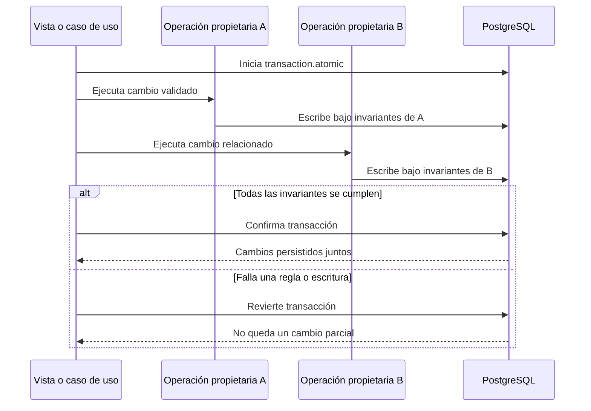

- Claves foráneas y restricciones protegen relaciones.
- Inventario, pesajes, secado y lotes conservan movimientos e historial cuando lo exige el requisito.
- Correcciones sensibles conservan autor, fecha, valores y motivo cuando lo requiere el requisito.
- La concurrencia se controla según las invariantes de cada operación.
- Efectos externos no pertenecen a una transacción SQL y requieren recuperación propia.
- Unidades, lotes, conciliación y reglas comerciales esperan sus specs.

## 10. Reportes y recorrido de información

Los reportes leen fuentes operativas autorizadas y presentan información derivada; no son una fuente paralela de saldos.

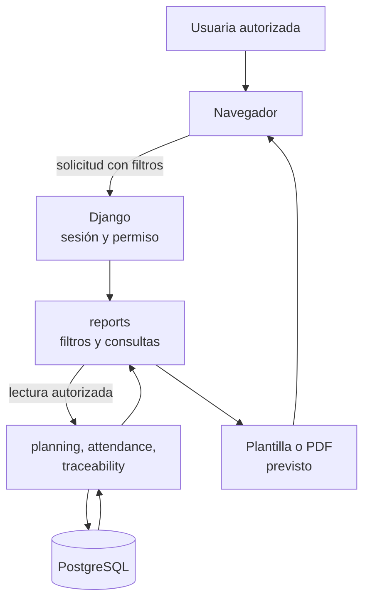

El mapa muestra dominios y propiedad, no un modelo entidad-relación ni una secuencia obligatoria por jornada.

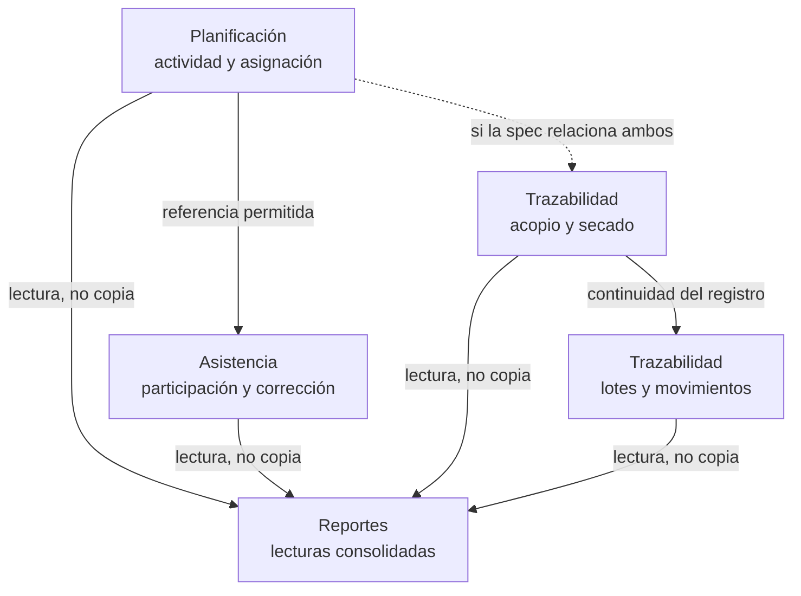

Los permisos, reglas de creación/corrección y secuencia productiva real se fijan en las specs de cada módulo.

## 11. Despliegue lógico y entrega

El proveedor y la topología física siguen pendientes. El diagrama muestra separación lógica; no afirma un despliegue actual ni confirma Vercel o Supabase como destino final.

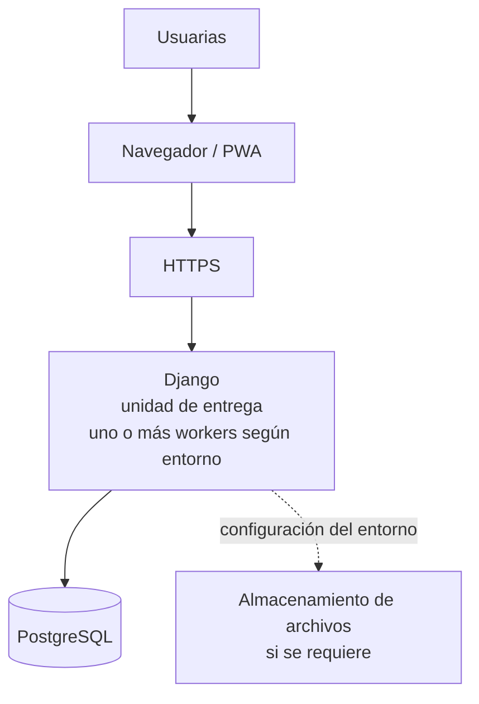

- Código, migraciones y recursos compatibles se entregan como versión conjunta.
- Un monolito puede usar varios workers o instancias.
- Configuración y secretos permanecen fuera de Git.
- Antes de publicar se verifican migraciones y recuperación; después, arranque, acceso y recorridos críticos.
- Revertir el código no revierte automáticamente cambios de datos.
- Django, PostgreSQL, HTTPS, almacenamiento y restauración deben probarse en el entorno elegido.

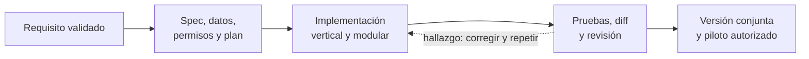

Cada incremento conserva compatibilidad y prueba recorridos previos afectados. Diseñar una capacidad no significa que esté implementada o publicada.

## 12. Prácticas de ingeniería verificables

| Área | Práctica | Evidencia de aceptación |
|---|---|---|
| Módulos | Dueño explícito de datos, escrituras, invariantes y migraciones. | Revisión de dependencias, operaciones y pruebas. |
| Seguridad | Autorización backend para todas las entradas, incluida sincronización. | Casos positivos y negativos por acción sensible. |
| Integridad | Restricciones y transacciones donde los cambios deban confirmarse juntos. | Pruebas PostgreSQL y escenarios de fallo/concurrencia. |
| Privacidad | Sin secretos en Git; no cachear páginas privadas; logs mínimos. | Revisión de configuración, cabeceras y registros anonimizados. |
| Interfaz | Móvil, accesible, responsiva y recuperable ante errores. | Pruebas de teclado, contraste, zoom y recorridos. |
| PWA | Separar estado pendiente del resultado aceptado. | Pruebas de pérdida de red, reintento y conflicto según spec. |
| Entrega | Código, migraciones y recursos compatibles como unidad. | Migración, recorridos, respaldo y restauración. |
| Rendimiento | Medir antes de escalar o guardar proyecciones. | Escenarios y resultados; no se presuponen cifras. |

**Fronteras de confianza:** el navegador guarda interfaz y datos locales limitados; Django decide permisos y reglas; PostgreSQL conserva estado transaccional. La entrada del cliente nunca concede permisos por sí sola.

## 13. Decisiones abiertas

1. Proveedor, topología, almacenamiento de archivos y despliegue real de Django.
2. Respaldos, objetivos de recuperación y prueba de restauración (P-11).
3. Operaciones/datos offline, conflictos, reintentos, deduplicación y retención (P-13/P-14).
4. Reglas de unidades, catálogos, secado, lotes, inventario, ventas y cuentas por cobrar.
5. Ubicación modular de capacidades comerciales según sus specs.
6. Filtros, gráficos, exportación y permisos concretos de cada reporte.
7. Requisitos nuevos de entrevistas que aún no estén validados.
8. Propietarios modulares de RF-DOC-001 y RF-AST-001. El análisis previo consideró `documents` con HU-DOC-001 y `assets` con HU-AST-001 como candidatos; esta edición los conserva como opciones de trabajo, no como módulos aprobados. La ratificación debe reflejarse en una spec/plan y en la historia y pila correspondientes antes de crear apps.

La decisión aprobada tampoco introduce microservicios, SPA separada, API completa, arquitectura hexagonal obligatoria, colas de servidor ni proyecciones persistidas por defecto.

## 14. Cobertura de requisitos, módulos y entrevista

Esta matriz añade trazabilidad arquitectónica; no copia los criterios completos ni reemplaza el catálogo, las historias o las specs. La fuente vigente contiene **58 RF y 9 RNF confirmados**; el catálogo CAT-REQ-001 v1.2 registra **67 requisitos confirmados** en total, **RF-COS-001** y **RNF-OPS-001** como propuestos, además de 12 IDs históricos sustituidos. El tesista aprobó la edición precedente v1.1 el 2026-10-19 como detalle de la arquitectura base registrada en ADR-0006. Esta matriz conserva esa línea base; las ampliaciones candidatas se consultan en requisitos generales v2.1 y los criterios de acceso y superadministración v1.4. La presente edición v1.2 está preparada para revisión académica y no incorpora RF-ACC-005 a la lista de requisitos confirmados.

### Requisitos funcionales y responsabilidad arquitectónica

| Dominio en CAT-REQ-001 v1.2 | Requisitos funcionales confirmados | Correspondencia arquitectónica y límites |
|---|---|---|
| Administración y acceso | RF-ACC-001, RF-ACC-002, RF-ACC-003, RF-ACC-004 | accounts; identidad, membresía, permisos y operaciones privadas. SPEC-001 solo detalla el acceso inicial; la administración y matriz completa de cargos requieren sus specs. |
| Planificación | RF-PLA-001, RF-PLA-002, RF-PLA-003, RF-PLA-004, RF-PLA-005 | planning; actividades, responsables, asignaciones, encargos de secado y necesidades vinculadas a producción. |
| Asistencia y participación | RF-ASI-001, RF-ASI-002, RF-ASI-003, RF-ASI-004, RF-ASI-005, RF-ASI-006, RF-ASI-007 | attendance; captura, participación, correcciones y reglas de falta. El detalle de QR, delegación y políticas temporales espera la spec de asistencia. |
| Catálogo, producción e inventario | RF-CAT-001, RF-INV-001, RF-TRA-001, RF-TRA-002, RF-TRA-003, RF-TRA-004, RF-TRA-005, RF-INV-002, RF-INV-003, RF-INV-004 | traceability; catálogos, pesajes, secado, lotes, movimientos e inventario. Solo se incorporan recetas validadas y relaciones/unidades definidas. |
| Ventas, gastos, saldos y rendición | RF-VEN-001, RF-VEN-002, RF-VEN-003, RF-VEN-004, RF-VEN-005, RF-VEN-006, RF-VEN-007, RF-VEN-008, RF-GAS-001, RF-GAS-002, RF-CXC-001, RF-CXC-002, RF-CXC-003 | Capacidades comerciales previstas dentro de traceability mientras sus specs confirman cohesión y propiedad. Ventas con varias entidades deben conservar atomicidad e historial; fórmulas y excepciones no se infieren. |
| Reportes, recordatorios y sitio público | RF-REP-001, RF-REP-002, RF-REP-003, RF-REP-004, RF-REP-005, RF-REP-006, RF-NOT-001, RF-PUB-001, RF-PUB-002 | reports consulta datos autorizados; planning puede originar avisos internos; public_site publica contenido aprobado. Cada lectura conserva el permiso de su fuente. |
| Continuidad PWA | RF-PWA-001, RF-PWA-002, RF-PWA-003 | Transversal: interfaz esencial preparada, cola local limitada y sincronización validada. RF-PWA-002 identifica asistencia y pesajes como mínimo; la operación exacta, la hora confiable y las reglas de aceptación esperan P-13/P-14. |
| Gestión documental | RF-DOC-001 | Capacidad transversal confirmada. El módulo propietario y su relación con archivos, privacidad y retención siguen por definir; no se asigna a core ni se crea una app sin spec/plan. |
| Activos | RF-AST-001 | Registro con historial separado del inventario consumible. Su propietario modular no está decidido; depreciación queda fuera hasta una decisión aprobada. |
| Inventario y producción ampliados | RF-INV-005, RF-INV-006 | Relación prevista con traceability: separar custodia individual de inventario organizacional y alertar mínimos con unidades compatibles. No convertir custodia automáticamente en deuda ni inventar umbrales. |
| Sitio público ampliado | RF-PUB-003 | public_site muestra precios aprobados vigentes y un enlace contextual de consulta; no genera automáticamente un pedido o una venta. La propiedad y vigencia del precio requieren detalle. |
| Feria | RF-VEN-009 | Preparación trazable de comisiones de feria. La fórmula, destinatarios y excepciones no están aprobados para distribuir importes. |
| Notificaciones externas | RF-NOT-002 | Integración condicional, solo con destinatarios autorizados y consentimiento; canal, proveedor, costo, resultados y reintentos siguen pendientes. No se presupone automatización por WhatsApp. |

La matriz agrupa los **58 RF** y los ubica frente a los módulos previstos. Las filas de documentos, activos y extensiones derivadas de entrevista son brechas de definición modular: muestran que el catálogo fue considerado sin inventar nuevos módulos ni autoridad para core.

### Requisitos no funcionales transversales

| Requisitos confirmados | Impacto arquitectónico recogido en esta edición |
|---|---|
| RNF-UX-001, RNF-UX-002, RNF-UX-003 | Interfaz móvil y responsiva, accesibilidad, mensajes recuperables y comprensión de los recorridos. Las pruebas con usuarias siguen pendientes. |
| RNF-CON-001 | Recursos esenciales y continuidad PWA. No se presupone ejecución offline universal ni sincronización cuando todos los navegadores estén cerrados. |
| RNF-SEC-001 | Autorización en backend, sesión, CSRF, protección de contenido privado y pruebas positivas/negativas. |
| RNF-AUD-001 | Historial y actor de cambios conforme al requisito; auditoría de un cambio debe ser consistente con su transacción. |
| RNF-DAT-001 | Relaciones, restricciones y atomicidad; las existencias se respaldan en movimientos y no en totales editables sin evidencia. |
| RNF-PRV-001 | Minimización de datos y acceso restringido, especialmente en justificativos, expedientes y documentos personales; clasificación y retención aún requieren definición. |
| RNF-PDF-001 | Exportación PDF prevista en reportes; formatos y contenido de cada reporte se concretan por spec. |

**Estado de los requisitos:** RF-COS-001 (costos completos) y RNF-OPS-001 (copias/restauración) continúan propuestos. Las prácticas de despliegue y recuperación de esta arquitectura no los promueven a requisitos confirmados. Los IDs históricos superseded permanecen en el catálogo como historial y no se reactivan.

### Cotejo de los doce temas de entrevista

El registro vigente es la edición v1.1 del 13/10/2026, basada en un resumen comunicado por el tesista sobre una entrevista del 12/10/2026. No hay acta formal, grabación o transcripción en el repositorio. El tesista aprobó CAT-REQ-001 v1.2; la validación organizacional directa de las novedades y la revisión de la directora siguen pendientes.

| Tema comunicado | Requisito o módulo relacionado | Tratamiento arquitectónico y límite |
|---|---|---|
| Reducir papel, traslados y demoras | Problema y objetivos del sistema | Orienta la solución; no se define una cifra de ahorro ni un indicador no validado. |
| Costos y pérdidas estimados | Factibilidad | Se excluye de reglas arquitectónicas: son supuestos de factibilidad, no ahorro observado ni requisito de cálculo confirmado. |
| Documentos versionados y acceso | RF-DOC-001; RNF-PRV-001 | Capacidad transversal con historial y acceso autorizado; propietario, metadatos, clasificación y retención pendientes. |
| Vencimientos y avisos | RF-DOC-001; RF-NOT-002 | Aviso interno de vencimiento; plazos por tipo y destinatarios requieren validación. Mensajería externa es opcional y condicionada a consentimiento. |
| Asistencia, faltas y multas | RF-ASI-001, RF-ASI-006/007 | Se registra la falta al cierre y existe un máximo de tres días hábiles para justificar; la Tesorera valida una multa antes de aplicarla. P-03 mantiene abiertos inicio del plazo, canal, resolución, redondeo, impugnación y cobro. |
| Agenda y recordatorios | RF-PLA-001/002/004; RF-NOT-001/002 | Planificación y avisos internos. Un canal externo no se habilita sin consentimiento y decisiones pendientes resueltas. |
| Delegación de secado | RF-PLA-003; RF-TRA-002 | Encargo, aceptación, evidencia de cierre y posible reasignación; actores, plazos y evidencia concreta esperan spec. |
| Inventario, custodia y activos | RF-AST-001; RF-INV-002/003/004/005 | Activos separados de consumibles y custodia individual distinta del inventario general; propiedad, diferencias y conciliación monetaria pendientes. |
| Producción, recetas y mínimos | RF-TRA-001/005; RF-PLA-005; RF-INV-006 | Trazabilidad, recetas aprobadas y alertas con unidades compatibles. El ejemplo de 50 litros/100 champús no es receta aprobada; umbrales y mermas pendientes. |
| Sitio público, precios y contacto | RF-PUB-001/002/003; public_site | Contenido y precios aprobados, con enlace contextual de consulta; no crea venta ni pedido automáticamente. |
| Ferias y rendición | RF-INV-003/004; RF-VEN-006/009; RF-GAS-001; RF-CXC-003 | Movimientos y gastos con historia. No se distribuyen comisiones hasta aprobar fórmula, destinatarios y excepciones. |
| Ventas mensuales por socia | RF-REP-005; RF-INV-005; RF-VEN-003/006; cuentas por cobrar | Cierre mensual con entregas, ventas, devoluciones, pagos y saldos conciliados; período y reglas de conciliación pendientes. |

### Pendientes de trazabilidad documental

El registro de cobertura del 19/10/2026 encontró **siete RF confirmados sin referencia en las historias v2.5 y pila v1.6**: RF-DOC-001, RF-AST-001, RF-INV-005, RF-INV-006, RF-PUB-003, RF-VEN-009 y RF-NOT-002. También dejó seis requisitos con criterios ampliados por cotejar en sus historias: RF-ASI-006, RF-PLA-003, RF-NOT-001, RF-TRA-005, RF-GAS-001 y RF-REP-005. Esta edición los hace visibles arquitectónicamente, pero no corrige ni declara cerrada esa brecha de HU/backlog.

Solo SPEC-001 tiene especificación/plan aprobados en el índice funcional activo; el resto de módulos y los flujos de asistencia/pesajes/sincronización todavía requieren specs. Por eso la tabla define correspondencias de alto nivel, no contratos, esquemas ni tareas listos para implementar.

## 15. Fuentes de trazabilidad

| Tema | Fuente | Uso |
|---|---|---|
| Monolito modular, propiedad de datos y entregas | ADR-0006 (fuente interna del proyecto, aceptada el 2026-10-08) | Decisión técnica base; no se modifica en esta edición. |
| Módulos, capas, transacciones, permisos, SSR/PWA y despliegue | `ARQUITECTURA-OBJETIVO.md` (fuente interna del proyecto) | Guía canónica de organización y evolución. |
| Principios y puertas de calidad | Constitución 2.0.0 vigente (fuente interna del proyecto); adopción inicial bajo 0.2.0 | Restricciones de arquitectura, pruebas y entrega; se conserva la decisión de monolito modular. |
| Acceso privado | SPEC-001 y su plan vigentes (fuentes internas del proyecto) | Sesión, privacidad y criterios de mensajes CA-ACC-001-02/03. |
| Funcionalidades y specs activas | Índice interno de funcionalidades | Estado y límites de las especificaciones. |
| Índice y estado documental | [Documentación v5.1](../README.md) | Versiones vigentes, estados editoriales y publicación. |
| Requisitos confirmados | [Requisitos generales v2.0](../requisitos/requisitos_generales_v2.0_2026-10-13.md); CAT-REQ-001 v1.2 (fuente interna) | IDs, criterios, estados y decisiones abiertas. |
| Entrevista y cotejo de los doce temas | [Registro de entrevista v1.1](../levantamiento/registro_entrevista_v1.1_2026-10-13.md) | Fuente, cobertura y límites de validación. |
| Brechas de historias y pila | [Registro de cobertura v1.0](../seguimiento/pendientes_trazabilidad_v1.0_2026-10-19.md) | Siete RF sin referencia y seis ampliaciones por cotejar. |
| Edición documental anterior | [Arquitectura v1.1](arquitectura_v1.1_2026-10-19.md) | Base ampliada por esta edición; v1.0 y v1.1 conservadas sin modificaciones. |
| Aceptación original del estilo | Evidencia interna de aceptación de 2026-10-08 | Alcance y límites de la decisión original. |
| Organización por módulo y pantalla | Convención técnica aprobada por el tesista el 2026-10-28 e incorporada a la guía de arquitectura (fuente interna) | Responsabilidades del backend, cercanía del frontend y criterios de transición. |
| Separación de repositorios | ADR-0008 (fuente interna) | Código de producto independiente de las fuentes de proceso y de la edición para entrega. |
| Estado académico de las ampliaciones | [Requisitos generales v2.1](../requisitos/requisitos_generales_v2.1_2026-10-27.md) y [criterios de acceso y superadministración v1.4](../sprints/plan_implementacion_superadmin_v1.4_2026-10-27.md) | Conservación de la línea base y distinción de criterios candidatos. |
| Apps y modelos Django | [Aplicaciones autocontenidas](https://docs.djangoproject.com/en/5.2/intro/reusable-apps/) y [paquetes de modelos](https://docs.djangoproject.com/en/5.2/topics/db/models/#organizing-models-in-a-package) | Organización interna y descubrimiento nativo de modelos. |
| Presentación Django | [Cargadores de plantillas](https://docs.djangoproject.com/en/5.2/ref/templates/api/#loader-types) y [directorios estáticos](https://docs.djangoproject.com/en/5.2/ref/settings/#staticfiles-dirs) | Separación del procesamiento de HTML y de la publicación de recursos. |
| Integridad transaccional | [Transacciones Django](https://docs.djangoproject.com/en/5.2/topics/db/transactions/) | Confirmación o reversión conjunta de operaciones relacionadas. |

Las fuentes señaladas como internas pertenecen al repositorio de trabajo y no están incluidas en esta edición destinada a documentación académica. Los enlaces locales apuntan exclusivamente a archivos de `documentacion/`; las referencias técnicas externas corresponden a documentación oficial de Django.

## 16. Glosario

- **Monolito modular:** una aplicación entregable como unidad, con módulos internos de responsabilidad explícita.
- **SSR/MVT:** Django genera HTML en el servidor mediante vistas, modelos y plantillas.
- **PWA:** aplicación web instalable con recursos y capacidades locales controladas.
- **Operación pendiente:** dato local aún no validado ni aceptado por el servidor.
- **Propietario del dato:** módulo responsable de invariantes, escrituras y migraciones.
- **Transacción:** conjunto de cambios que PostgreSQL confirma completo o revierte completo.
- **Autorización backend:** decisión del servidor basada en identidad, cuenta y permisos vigentes.

## 17. Estado del incremento y límites de verificación al 2026-10-28

| Elemento | Estado comprobable | Límite |
|---|---|---|
| Arquitectura y organización por módulo/pantalla | Convención técnica aprobada por el tesista. | La presente edición completa continúa preparada para revisión académica. |
| Base Django y acceso | Existe código local de login, cierre de sesión, cambio de contraseña, protección privada y control temporal de intentos. | No acredita la entrega de planificación, asistencia, trazabilidad ni administración completa. |
| Reorganización inicial del frontend | Se realizaron pruebas del recorrido de acceso y comparación visual antes de la adaptación más reciente. | Los resultados corresponden a esa estructura y a ese corte. |
| Presentación bajo `frontend/` | La inspección local al preparar esta edición muestra las tres pantallas de cuentas y configuración de descubrimiento de plantillas y recursos. | Cambios sin commit; la sola presencia de archivos no acredita la aceptación completa de la transición. |
| Módulos restantes y captura operativa offline | Diseño y desarrollo incremental según requisitos y especificaciones. | No se declaran implementados por figurar en diagramas o carpetas previstas. |

La reorganización inicial contó con 19 pruebas PostgreSQL correctas y comprobaciones visuales
de tres pantallas a 360 y 1440 píxeles. Se comprobaron también controles JavaScript y una base
PWA sobre páginas renderizadas de prueba. Estos resultados preceden a la adaptación más
reciente observada y no se transfieren automáticamente a ella. En esta edición documental
no se repitieron pruebas funcionales ni se verificó un despliegue.

Antes de presentar la transición como completada se debe comprobar el descubrimiento de
plantillas y recursos, la ausencia de HTML fuente en los estáticos, los recorridos permitidos
y denegados, la compatibilidad de la presentación y la exclusión de contenido privado de la
caché. El esquema de datos y las migraciones se comprueban cuando el cambio los afecta.

## Historial de esta edición

| Versión | Fecha | Cambio | Estado |
|---|---|---|---|
| 1.1 | 2026-10-19 | Añade diagramas, matriz de los 58 RF y 9 RNF, cotejo de entrevista, brechas de trazabilidad, componentes, PWA, transacciones, reportes, despliegue y pendientes. | Aprobada por el tesista para documentación; revisión académica, validación organizacional y transferencia pendientes. |
| 1.2 | 2026-10-28 | Incorpora la convención de backend por módulo y frontend por pantalla, recursos compartidos, crecimiento proporcional y verificación de transición; actualiza el estado local y corrige mensajes de acceso conforme a SPEC-001. | Publicada para revisión académica; convención técnica aprobada y aceptación de la edición completa pendiente. |
