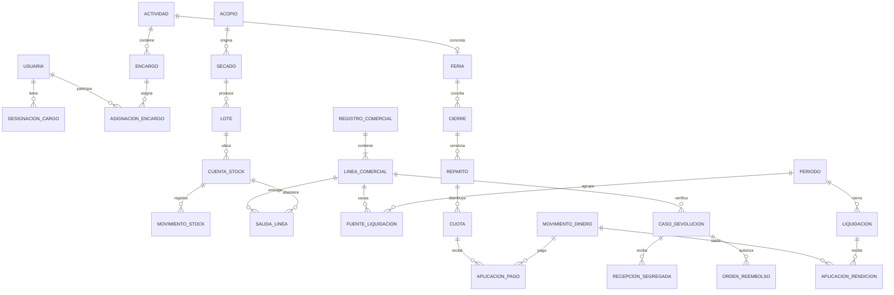

# Base consolidada para el diseño de datos

Esta edición es la referencia de trabajo para diseñar la base de datos. Sustituye el diseño v1.0 y las adendas v1.1/v1.2 en las reglas y estructuras aquí descritas. Reúne las decisiones expresas del tesista, incluidas 1A, 2B, 3B, 4A, 5A, 6A, 7A y 8B. No exige reconstruir reglas combinando adendas. Las ediciones anteriores son evidencia histórica; no se borran ni se presentan como vigentes.

Las decisiones del tesista sustentan esta consolidación; no se atribuye una nueva validación a la organización. El catálogo confirmado conserva su evidencia original. Antes de implementar una discrepancia con ese catálogo debe reconciliarse la regla concreta. Esta edición prepara el diseño lógico y físico por módulo; no acredita tablas creadas, migraciones ni pruebas de producto ejecutadas.

## 1. Naturaleza del flujo y decisiones vigentes

| Clave de esta edición | Regla vigente | Origen |
|---|---|---|
| C01 | Nunca hay crédito al comprador: pago completo antes de entrega. Custodia de una socia no es venta ni deuda. | D24/D27 |
| C02 | Contexto de venta y propiedad económica del stock son independientes: fuera de feria o feria; stock individual o compartido. | Respuestas 7/9 y aclaración posterior |
| C03 | La base siempre corresponde a la asociación. Excedente individual a la dueña del stock, aunque otra socia lo venda con autorización. Registrar dueña, vendedora efectiva y registradora separadamente. | Respuestas 1/9, 1A |
| C04 | La socia cobra todo y conserva el excedente individual; la obligación formal de rendir base se determina al cierre periódico definido por la organización. Cada venta sigue identificada. | Respuestas 1/2 |
| C05 | La feria se concilia al terminar cada feria o periodo definido; se puede entregar dinero durante la jornada o al final. Las ventas fuera de feria tienen su propio periodo de rendición. | Aclaración de periodicidad |
| C06 | Reparto compartido proporcional al importe de ventas compartidas por vendedora o por importes negociados. No hay modo igualitario automático. Preparación no excede el fondo; cierre exige asignarlo todo. | Respuestas 9/10, 2B |
| C07 | Cancelación solicitada y cobrada sin entrega: reembolso completo autorizado automáticamente, sin aprobación humana. Un pedido simplemente pendiente de entrega no se cancela solo. | Respuesta 3 |
| C08 | Devolución por defecto de fabricación o daño dentro de dos días hábiles desde el día hábil siguiente a la entrega, revisada por Tesorera o Superadministradora. Producto recibido queda segregado. | Respuesta 4, 4A/5A/6A |
| C09 | Solo Superadministradora habilita/deshabilita devoluciones mediante política global versionada. Cada venta conserva la versión aplicable; el cambio no altera retrospectivamente ventas ni casos admitidos. | Aclaración y 5A |
| C10 | Defecto de fabricación: asociación reembolsa todo; socia conserva excedente. No se recuperan cuotas históricas por ese defecto. | 3B |
| C11 | Sin nota de venta se verifica con la vendedora producto, cantidad, fecha y pago; guardar evidencia y artículo recibido. No exigir identidad del cliente para venta ordinaria o devolución. | 4A |
| C12 | Faltante en custodia: solo si revisión confirma responsabilidad de socia se exige la base de la cantidad faltante. Sobrepago: devolución al mismo pagador, mismo medio si posible, con aprobación y comprobante interno; no saldo de cliente. | Respuestas 5/6 |
| C13 | Superadministradora ejecuta y aprueba negocio sin autorización previa, puede sustituir otros cargos y corrige con auditoría; nunca vende personalmente. Concesión/revocación del rol conserva autorización presidencial D19. | Aclaración, 6A |
| C14 | Venta individual offline exige stock asignado, pago completo y evidencia local. Compartido de feria admite conteo provisional por socia/producto sin conexión, registro posterior y conciliación obligatoria. | Respuesta 7, 8B |
| C15 | Feria registra resumen por socia, producto y origen de stock durante la jornada. No exige factura ni registro de cliente por operación; nota opcional. | Respuesta 13 y aclaración |
| C16 | Cada secado tiene un solo acopio. Materias primas en kg; conversiones solo entre magnitudes compatibles. | D26 y respuesta 12 |
| C17 | Kit de shampoo por variante: referencia 50 L, lote y consumo de kits, rendimiento real separado. Nunca almacenar fórmula secreta; solo ingredientes de etiqueta oficial. | Aclaración, 7A |
| C18 | Importe/base por línea al centavo con ROUND_HALF_UP; reparto proporcional por restos mayores y empate por menor ID de asignación. | D30 |

Coherencia organizacional: custodia conserva responsabilidad física sin inventar crédito; la base financia la asociación y el excedente reconoce a la socia; la feria tiene cierre común sin apropiarse de excedentes individuales. Resúmenes y captura provisional permiten rendir sin facturar a cada comprador. La autoridad amplia de Superadministración sigue siendo trazable y no equivale a ser vendedora.

## 2. Identidad organizacional y convenciones del esquema

El tesista confirma seis personas en la asociación; las seis tienen cuenta. También confirma cuatro roles de negocio combinables en una misma cuenta: General, Presidenta, Tesorera y Secretaria. Hay una cuenta Superadmin externa al padrón. Se infieren al menos siete cuentas actuales, pero esos conteos no son restricciones permanentes. General se registra como perfil de negocio y los tres cargos se registran en asignaciones vigentes; el modelo admite que una cuenta reúna el perfil General y uno o más cargos. La Superadministración se concede a la cuenta externa separadamente y no equivale a `is_superuser`. La regla previa permite más de una concesión activa; el dato de una Superadmin describe la situación actual, no un límite futuro.

La base de desarrollo inspeccionada contiene una sola fila en `accounts_user`, cero con `is_superuser` y cero con `is_staff`; el padrón reportado no está cargado en ese entorno. No se consultaron identidades.

Monolito modular Django/PostgreSQL conforme a la constitución 2.0.0 y ADR-0006. `accounts` posee identidad; `planning`, actividad y encargos; `attendance`, asistencia y multas; `traceability`, producción, inventario y comercio. `portal` y `reports` leen sin saldos paralelos; `public_site` posee publicaciones. `documents` y `assets` se crean cuando se implemente su recorrido, conforme D08; no se crean apps vacías.

Los nombres siguientes son entidades lógicas propuestas, no nombres físicos ya migrados. Toda entidad tiene PK estable; eventos tienen UUID de operación, actor, instante real/declarado y recibido. FK históricas protegidas contra borrado; catálogos se desactivan. Cantidades `numeric(18,6)`, dinero final `numeric(18,2)`, precios de cálculo `numeric(18,6)`; no usar float. Importes no negativos salvo ajustes explícitos con dirección. Fechas operativas en America/Guayaquil, instantes almacenados con zona. Índices en FKs y búsquedas por ámbito/estado/fecha, sin indexar datos personales innecesarios.

Las tablas de configuración separan borrador, aprobación y vigencia. Cambiar valores no recalcula hechos pasados. Invariantes de seguridad no son opciones editables. Relaciones entre módulos se justifican por FK; ninguna escritura ajena se hace saltando el servicio propietario.

## 3. Identidad, organización y asistencia

| Entidad / propietario | Datos y relaciones esenciales | Integridad |
|---|---|---|
| Persona organizacional y cuenta / accounts | Persona socia con `account_user_id` único y requerido; cuenta de acceso actual; estado/vigencia de membresía | Seis personas actuales, sin CHECK de seis; una cuenta por socia. Superadmin externo no tiene persona de asociación. No duplicar login/contactos/passkeys existentes |
| Tipo y asignación de perfil / accounts | General como perfil de negocio, persona, vigencia, asignadora | Se combina con designaciones de cargo; conservar historial y evitar intervalos duplicados |
| Tipo y designación de cargo / accounts | Presidenta/Tesorera/Secretaria, persona, vigencia, evidencia | Puede coexistir con perfil General y otros cargos; un titular por cada cargo durante un intervalo según regla vigente |
| Concesión Superadministradora / accounts | Beneficiaria, autorizadora presidencial, ejecutora, evidencia, vigencia/revocación | Varias administradoras posibles; no autoconcesión; primer alta admite constancia externa; `is_superuser` no otorga este rol |
| Actividad, participante / planning | Tipo, fecha, lugar, organizadora, participantes | Intervalos coherentes; participante pertenece a actividad; baja conserva asistencia |
| Encargo, asignación y evento / planning | Encargo vinculado a actividad, varias socias, vigencias, aceptación y relevo | Un encargo puede tener varias encargadas; cierre de asignación no borra historia |
| Plan de producción / planning | Periodo, estado, responsable | Líneas de producto/insumo pertenecen a traceability y referencian plan; no ciclo inverso |
| Política y fase QR / attendance | Duración versionada, actividad, tipo entrada/salida, digest, expiración | Duración inicial 3600 s según D16; Secretaria o Superadministradora opera; nunca token en claro ni datos personales en QR |
| Registro y corrección de asistencia / attendance | Participante, tipo, fase, origen, actor, fechas, motivo, revisión | Una entrada/salida efectiva por participante/tipo; salida requiere entrada; corrección append-only |
| Falta, justificativo, multa, impugnación, pago / attendance | Fuente de falta, decisión, política e importe histórico, aplicaciones y evidencia | No imponer dos multas por mismo origen; no confundir multa con venta; Presidenta/Tesorera según función o sustitución Superadministradora auditada |
| Calendario de días hábiles / dueño del caso | Fecha, ámbito, motivo no hábil, versión/fuente | Calendario común leído sin duplicar feriados; plazo de devolución guarda calendario y vencimiento usados; actualización no altera un caso ya calculado |

## 4. Catálogo, producción y stock

| Entidad / traceability | Campos y relaciones esenciales | Restricción o servicio |
|---|---|---|
| Unidad y conversión | Código, magnitud, factor; base kg/L/unidad | Factor positivo; kg↔g y L↔mL; nunca masa↔volumen |
| Materia, producto, variante, presentación | Identidad, unidad, contenido, etiqueta oficial, estado | Presentación pertenece al producto; kg de materia y unidades envasadas no son intercambiables |
| Versión de valor | Producto/presentación, tipo base/precio, valor, vigencia, aprobadora | Intervalos sin solape por clave; aprobación por cargo competente o Superadministradora; base no equivale a costo completo |
| Regla de descuento | Umbral, unidad, modalidad, valor, vigencia, aprobación | Inactiva hasta cantidades y umbrales completos; no autorizar una venta bajo base por inferencia |
| Receta y versión / línea | Producto, rendimiento y consumo autorizado por insumo | Solo recetas conocidas y autorizadas; sin columnas ni adjuntos para fórmula secreta de shampoo |
| Kit y lote de kit | Variante, referencia 50 L por kit, lote proveedor, etiqueta | Kit de shampoo separado del kit de colada morada; no inventar composición |
| Acopio y pesaje | Socia, materia, fecha, peso kg, evidencia, lote húmedo | Peso positivo; corrección trazable |
| Secado y consumo | Acopio único, lote húmedo, cantidad consumida, responsable, fechas | Un secado no mezcla acopios; puede consumir parte; suma consumos no excede existencias |
| Lote | Materia XOR producto, estado, fechas, origen | Presentación coherente; lote de salida propio; linaje sin ciclos |
| Transformación y consumos | Receta autorizada o kit, lotes consumidos, cantidades, lotes obtenidos | Consumo de kit sin fórmula; referencia = kits × 50 L; registrar litros realmente obtenidos y envases reales por separado |
| Relación de origen de lote | Lote padre/hijo, operación, cantidad y unidad | No ciclos, mismos hechos que consumos efectivos; desde salida de venta se recupera acopio o kit |
| Cuenta de existencias | Lote, presentación, unidad, tipo custodia, titular, feria, condición vendible/segregado | Unicidad con nulos equivalentes; titular obligatorio en individual y ausente en compartido; feria obligatoria en cuenta de feria |
| Operación y movimiento de inventario | Cuenta, cantidad, sentido, causa, actor, operación inversa si procede | Transferencia produce dos movimientos equivalentes; operación atómica; no borrar movimientos confirmados |
| Entrega en custodia y líneas | Socia/encargo, cuentas origen/destino, cantidades, recepción | No venta ni deuda; stock al terminar feria se cuenta y devuelve o transfiere expresamente, nunca se desaparece al cerrar |

Inventario central confirmado no admite saldo negativo. Un hecho provisional real que excede saldo conocido queda en incidencia sin salida central ficticia: se investiga la transferencia, conteo u origen faltante y se registra la corrección autorizada antes de aceptar su movimiento. No se descarta una venta real para que el saldo aparente cuadrar.

## 5. Ventas individuales y resumen de feria

| Entidad | Campos y relaciones esenciales | Invariante |
|---|---|---|
| Feria / jornada | Actividad, inicio/fin, estado, responsables y periodo de cierre | Venta fuera de feria no necesita feria; periodo no se superpone al ya cerrado |
| Registro comercial | Tipo detalle/resumen, contexto, feria o periodo individual, registradora, origen local, estado, intervalo real | Un resumen es un registro comercial, no otra venta adicional a sus capturas; identidad externa estable |
| Línea comercial | Producto/presentación, cantidad, vendedora efectiva, dueña nullable, individual/compartido, precio y base congelados, total, política devolución | Identidad de dueña no se infiere de quien registra; Superadministradora no puede figurar como vendedora; resumen separado por vendedora/producto/origen y por valores/políticas diferentes |
| Salida de línea | Línea, cuenta/lote, cantidad y movimiento | Una línea puede salir de varios lotes compatibles con misma dueña/origen; suma de salidas = entregado |
| Cobro y aplicación | Flujo comprador, importe, medio, instante, receptora, evidencia, línea/registro | Dinero efectivamente recibido; sumas aplicadas <= cobro; no duplicar con rendición |
| Entrega comercial | Línea, cantidad, instante real, evidencia mínima | Toda entrega exige pago completo del compromiso comercial; en resumen la evidencia de campo declara cobro previo a cada entrega, no inventa tickets por cliente |
| Nota de venta | Registro, número opcional, emisión, archivo si existe | Opcional; número único en su serie; no convierte resumen en obligación de facturar por cliente |
| Captura provisional y vínculo de incorporación | UUID, actor, dispositivo, socia, producto, stock, cantidad, importe, periodo, contenido digest, resumen destino | Incorporación una sola vez; si se conserva detalle, el resumen es vista; si se importa resumen, capturas son evidencia, no ventas adicionales |
| Incidencia de conciliación | Fuente, diferencia física/monetaria, decisión, autoridad, estado | Se mantiene hasta resolver; encargada decide operación, Tesorera dinero, Superadministradora puede sustituir con motivo |

Una línea resumida no puede mezclar dueñas ni políticas/precios diferentes. Si hay entregas en días distintos se divide por fecha; para devoluciones se registra la fecha real verificada de la compra. La falta de hora individual exacta no debe inventarse: conservar la precisión conocida (día o intervalo). Retornos parciales se vinculan al resumen y a la comprobación realizada; el límite agregado previene exceso de unidades, pero no prueba por sí solo la compra de una persona.

## 6. Rendición, dinero y reparto

| Entidad | Campos esenciales | Regla |
|---|---|---|
| Periodo de rendición | Ámbito individual/feria, socia si individual, inicio/fin, estado, versión | Periodos disjuntos por ámbito; acumular base visible antes de cerrar |
| Fuente de liquidación | Periodo, línea comercial o decisión de faltante, cantidad/base congelada | Exactamente un origen; origen liquidado una sola vez; faltante no exige venta ficticia |
| Liquidación / obligación interna | Periodo, socia/custodia, base total, ajustes, versión de cierre | Nace al cierre; no crédito de cliente; preserve desglose de origen; compartido no genera deuda individual duplicada |
| Movimiento de dinero | Tipo cobro/rendición/reembolso/pago_reparto/gasto, importe positivo, medio, origen/destino, ejecutora, fecha, evidencia, estado | Autorizado ≠ ejecutado; transferencia pendiente/fallida no salda; cada salida real se contabiliza una sola vez |
| Aplicación de rendición | Movimiento, periodo/fuente, obligación al cerrar, importe | Anticipos durante jornada quedan vinculados; cierre aplica sin cobrar otra vez; suma <= movimiento y saldo |
| Gasto y aplicación al fondo | Feria, concepto, pagador, importe aprobado, evidencia | Deducir solo gastos comunes aprobados pagados por asociación, una vez; gastos individuales no entran automáticamente |
| Cierre y conciliación de feria | Periodo, versión, inventario, cobros, dinero entregado/pendiente, incidencias, responsables | Encargada y Tesorera intervienen o Superadministradora sustituye expresamente; sin capturas/incidencias sin resolver |
| Versión de reparto | Cierre, modo proporcional/manual, fondo congelado, fuente de cálculo | Cambiar fuentes o importes genera nueva versión y nuevas aceptaciones; no editar versión cerrada |
| Cuota de reparto | Reparto, socia, asignación representativa, base de cálculo, importe | Una socia por versión; elegible si tuvo asignación durante periodo; individual excluido |
| Aceptación y aplicación de pago | Cuota/versión, beneficiaria, fecha; movimiento pagado, importe | Acuerdo verbal se registra como evidencia del acuerdo; aceptación no equivale a pago ni permite suplantar actor; pagos parciales <= cuota |

Propuesta técnica de cómputo: `base = suma de bases de líneas entregadas y pagadas`; `excedente_individual = suma(total - base) de líneas individuales`; `fondo_compartido = suma(total - base) de líneas compartidas - gastos comunes aplicables`. Los sobrepagos no son ingreso de venta ni fondo. La base no se deduce dos veces por recibir rendiciones. Una venta institucional conserva identificación mínima y su excedente organizacional según RF-VEN-007, sin atribuirlo a socias.

Para reparto proporcional, usar importes de ventas compartidas de cada vendedora como peso. Calcular centavos por truncamiento y distribuir residuo por mayor resto; empate por menor ID de asignación. Si una socia tiene varias asignaciones históricas, su peso se suma una sola vez y la asignación representativa es la menor ID elegible; conservar vínculos a todas las fuentes. Es una concreción técnica de D30. Con denominador cero no ejecutar proporcional: corregir fuentes o elegir manual autorizado.

Reparto manual: montos acordados visibles por socia y total disponible; no superar fondo. Cierre solo con suma exacta al centavo y acuerdo registrado de las beneficiarias. Fondo cero no produce comisión; negativo requiere resolver déficit, nunca cuotas negativas. Los importes individuales se muestran aparte y no se negocian dentro del fondo compartido. Una cuota ya pagada no vuelve a pagarse al reintentar ni al revisar un cierre; ajustes posteriores enlazan versión original y pagos existentes.

Ejemplo: stock individual vende $20 con base $12; compartido vende $30 con base $18 y gasto común aplicable $2. Base asociación $30, excedente dueña $8, fondo compartido $10. Reparto manual $6+$4 cierra; $6+$3 deja $1 pendiente y no cierra. Rendir $10 antes del cierre deja $20 de base pendiente, sin crear otra venta.

## 7. Cancelaciones, devoluciones y pérdidas

| Entidad | Datos / transición | Control |
|---|---|---|
| Política de devolución | Versión, habilitada, vigencia, configuradora, motivo | Solo Superadministradora; sin solapes; línea guarda versión efectiva al vender incluso al sincronizar después |
| Caso de ajuste | Tipo cancelación/devolución/sobrepago/faltante, fuente explícita, solicitud, cantidades, evidencia, responsable | FK específica a venta/resumen, cobro o custodia según tipo; no FK genérica sin integridad |
| Revisión y decisión | Caso, actor, autoridad usada, hechos, causa, responsable económico, fecha/plazo | Tesorera o Superadministradora; decisiones inmutables; cancelación sin entrega usa autorización automática registrada |
| Recepción de artículo | Caso, producto/lote si verificable, cantidad, condición, movimiento segregado | Cantidad retornada acumulada <= vendido verificado; lote desconocido no se inventa; identificación pendiente conserva cuarentena |
| Orden y ejecución de reembolso | Caso, importe autorizado, pagador destinatario mínimo, medio original/preferido, motivo alternativa, movimiento ejecutado | No doble reembolso por caso/cobro; suma ejecutada <= autorizada; devolución real distinta de autorización |
| Resolución de faltante | Custodia, cantidad, base aplicable, evidencia de responsabilidad | Sin decisión no crea cargo; congelar versión de base usada en decisión y conservar antecedente; merma productiva normal no es falta automática |

Cancelación exige ausencia total de entrega y solicitud; si existe entrega corresponde revisión de devolución de lo entregado, sin automatizar un reembolso completo por la vía de cancelación. El interruptor de devoluciones afecta retornos posentrega; no elimina cancelación sin entrega ni obligación de restituir sobrepago.

Defecto de fabricación admitido: devolver importe completo de unidades admitidas mediante salida organizacional vinculada. Conservar base, excedente y reparto histórico. Ese reembolso no se vuelve a restar de la liquidación de socia ni del fondo compartido: efecto contable/económico único. El artículo queda fuera de stock vendible. Daño de causa distinta: puede registrarse y revisarse; la responsabilidad económica requiere resolución específica, no se supone que la asociación absorba todos los daños. Esta excepción queda visible y no bloquea venta normal ni devoluciones por defecto definido.

## 8. Publicaciones, documentos y controles comunes

`public_site`: contenido con revisiones, aprobación/publicación/retirada, solo una revisión publicada por ítem; publicación de precio referencia versión aprobada y no crea pedidos. `portal` y `reports`: consultas autorizadas, sin nueva tabla de stock, deuda o reparto. Avisos pertenecen al módulo del hecho; envío externo con consentimiento/contacto verificado e intentos idempotentes, solo tras habilitar proveedor y costo.

`documents`: tipo, registro, versiones de archivo con digest y almacenamiento privado, concesiones de acceso y eventos. Vínculos explícitos con entidades; privacidad y retención se concretan en su incremento. `assets`: categoría, activo, custodio, altas/cambios/retiro con eventos; no confundir con inventario consumible ni calcular depreciación sin requisito. No almacenar secretos de kits como documentos adjuntos.

Auditoría por dueño: actor real, autoridad usada, motivo, valores mínimos antes/después y correlación de operación. No registrar claves, tokens ni datos personales del comprador por comodidad. Corrección crea reverso/versión y conserva evidencia; Superadministradora tampoco borra historia financiera para corregir.

## 9. Integridad y concurrencia

1. BD: FK protegidas, XOR en orígenes, cantidad/importe positivos, fechas coherentes, unicidad operación/captura/cuota, stock por clave con nulos equivalentes. PostgreSQL compatible: `NULLS NOT DISTINCT` si disponible; alternativamente índices parciales por ámbito, sin sentinelas ambiguos.
2. Servicio transaccional: autorización y vigencias, pago antes de entrega, suma de aplicaciones, conversión compatible, misma propietaria entre línea y salidas, cierre sin incidencias, reparto exacto. Los agregados entre filas no se simulan mediante `CHECK` de una fila.
3. Bloquear padres existentes antes de crear hijos o validar intervalos: usuario/actividad/feria, catálogo, lote, documento comercial, cuentas stock, dinero, liquidación y eventos; dentro de cada grupo ordenar por PK. Operaciones que no usan un grupo lo omiten. Verificar este orden al diseñar cada transacción.
4. Evitar confiar en `select_for_update` de conjuntos vacíos. Unicidad además del bloqueo; reintentar conflicto controladamente. Doble venta de última unidad confirmada permite una sola; venta provisional en conflicto se conserva como incidencia real.
5. Recibo idempotente por actor/tipo/UUID de cliente, digest del contenido y resultado atómico. Repetición igual devuelve mismo resultado; contenido distinto con UUID igual genera conflicto. UUID estable también para importación manual del conteo provisional.
6. Efecto externo de pago/reembolso: orden persistida y clave idempotente antes de enviar; confirmar ejecución por evidencia/respuesta fiable; recuperar resultado tras timeout, no reenviar ciegamente. Efectivo exige registro de entrega real.
7. Importes y políticas históricos inmutables. Cerrar periodo congela fuentes; operaciones tardías generan conciliación y versión correctiva, nunca inclusión silenciosa en un cierre pagado.

## 10. Relaciones esenciales

El diagrama resume relaciones; los anticipos de rendición pueden apuntar al periodo antes de existir liquidación y se aplican al cerrarlo. Casos de sobrepago/faltante tienen sus propias FK; no necesitan línea comercial. Los lotes también nacen de acopio o transformación, no solo secado. La cardinalidad de una orden de reembolso permite ejecuciones parciales controladas, sin superar el autorizado.

Los diagramas ER completos de estas entidades, junto con el esquema Django actualmente migrado, están en el [modelo ER integral v2.1](modelo_er_integral_v2.1_2026-10-30.md). Ese documento registra la diferencia entre tablas físicas presentes y el diseño todavía propuesto.

## 11. Criterios verificables para el diseño físico

Casos definidos, todavía no ejecutados en producto:

| Caso | Resultado exigido |
|---|---|
| DB-01 | Custodia no crea deuda ni cobro; transferencia conserva cantidades/lote |
| DB-02 | Pago incompleto impide entrega; reintento no duplica cobro/salida |
| DB-03 | Dueña A y vendedora B: excedente individual de A, peso compartido de B solo por sus ventas compartidas |
| DB-04 | Resumen no exige cliente/nota; política o precio distinto separa líneas; capturas no duplican resumen |
| DB-05 | Anticipo de rendición se aplica una vez al cierre; origen no entra en dos periodos |
| DB-06 | Ejemplo $20/$30: base $30, individual $8, fondo $10; manual incompleto no cierra |
| DB-07 | Proporcional redondea exacto, empate usa asignación mínima; varias asignaciones no duplican socia |
| DB-08 | Cancelación solicitada sin entrega autoriza sin revisión; autorización no marca reembolso pagado |
| DB-09 | Política desactivada después no invalida venta anterior; dos días hábiles computan feriados y fecha verificada |
| DB-10 | Sin comprobante se registra verificación; retorno acumulado no excede venta y nunca entra vendible |
| DB-11 | Defecto: asociación paga total, socia conserva excedente, un único efecto económico |
| DB-12 | Faltante sin responsabilidad decidida no causa cargo; sobrepago no crea saldo a favor |
| DB-13 | Superadministradora aprueba y sustituye, queda actor real; venta personal y autoconcesión denegadas |
| DB-14 | Secado rechaza varios acopios; origen de venta rastreable; conversiones incompatibles rechazadas |
| DB-15 | Kit variante referencia 50 L, salida real diferente válida; ninguna fórmula secreta requerida/guardada |
| DB-16 | Compartido offline conserva hecho provisional; conflicto visible y cierre bloqueado hasta conciliación |
| DB-17 | Dos ventas concurrentes de última unidad no producen negativo confirmado; UUID repetido no duplica |
| DB-18 | Corrección de cierre pagado conserva versión y pagos; no cobra ni paga de nuevo |
| DB-19 | Revocación de cargo conserva historial; permisos y exportaciones no filtran datos ajenos |
| DB-20 | Precio/descuento/receta incompletos inactivos; cambios no recalculan ventas anteriores |

## 12. Preparación y límites

Listo para diseñar por módulo: propietarios, entidades, relaciones, reglas de dinero, estados, excepciones, autorización y criterios de integridad anteriores. Siguiente trabajo técnico: ER físico con columnas definitivas y FK, restricciones SQL/índices, transacciones Django y migraciones con prueba PostgreSQL. No se marca HT-PRE-003 ni SB-S1-03 terminado por esta edición.

Configuración pendiente, sin inventar valores: tarifas/precios, descuentos y recetas no secretas todavía incompletas; periodos concretos; calendario de feriados; importes de cada reparto manual. Para daños distintos de defecto de fabricación hace falta resolver responsabilidad económica del caso. Retención documental, proveedor de avisos y parámetros de módulos futuros se concretan antes de su implementación. No son motivo para reabrir las ocho decisiones ya respondidas ni para retrasar el diseño de los recorridos definidos.

La regla de responsabilidad del faltante y base aplicable necesita dejar evidencia de la versión de valor elegida en la revisión; no se establece retroactivamente una tarifa punitiva. Las decisiones técnicas propuestas (precisiones numéricas, asignación representativa, estructura de anticipos) se verifican al diseñar el incremento, sin presentarlas como decisiones de campo.

## 13. Fuentes y control

- [Catálogo y evidencia originales](../../docs/requirements/CAT-REQ-001.md).
- [Constitución](../../.specify/memory/constitution.md) y [arquitectura aprobada](../../docs/architecture/ARQUITECTURA-OBJETIVO.md).
- El registro D01–D30, las adendas v1.1/v1.2 y la enmienda de reglas son antecedentes locales de la evolución; esta edición consolida las reglas vigentes sin requerir su consulta para interpretarlas.

Historial: 2.1, 2026-10-30, Codex: incorpora Persona organizacional vinculada con su cuenta, padrón actual de seis socias, cuatro roles combinables y cuenta Superadmin externa. El diseño v2.0 se conserva como antecedente local. Preparado para revisión; sin publicación ni cambios de código.
