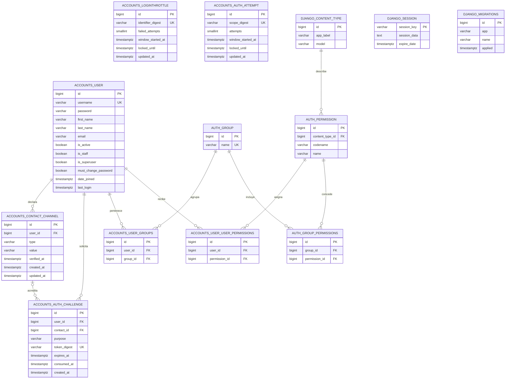
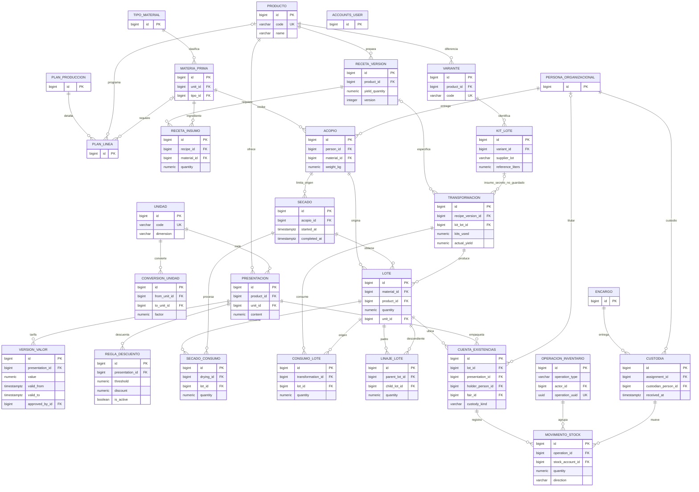
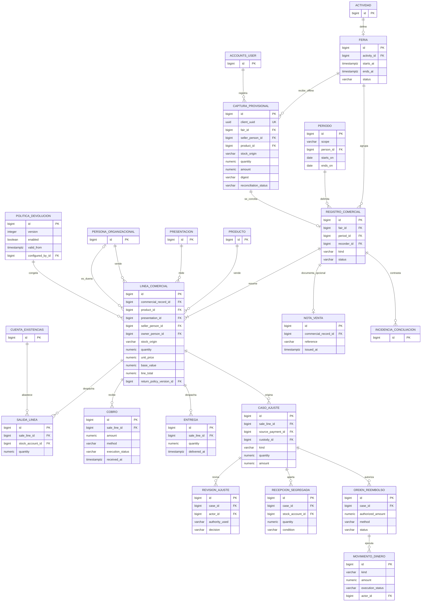
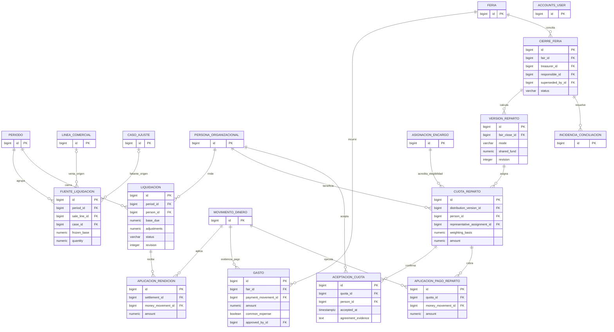

# Modelo entidad-relación integral

Este documento representa el esquema que existe en PostgreSQL hoy y el modelo lógico acordado para completar el producto. Los diagramas se separan por módulo para que sigan siendo legibles. El primer diagrama es el esquema físico verificado; los demás son entidades propuestas, todavía sin tablas ni migraciones.

## Verificación del estado actual

Se consultó la base `zhud_aleli_dev` usando la configuración de desarrollo de Django, PostgreSQL e introspección del catálogo del motor. Django reporta aplicadas todas las migraciones visibles: `contenttypes`, `auth`, `accounts` (0001–0003) y `sessions`. Se encontraron **13 tablas**, todas representadas en el primer diagrama. La app `portal` no define modelos. No se consultaron valores de filas de negocio ni se inspeccionó una base de producción; solo se usaron conteos agregados de desafíos/contactos para comprobar la brecha de integridad. Esta comprobación describe la base de desarrollo configurada.

Las cinco clases de modelo propias son `accounts.User`, `LoginThrottle`, `ContactChannel`, `AuthChallenge` y `AuthAttempt`. `User` además hereda los campos de `AbstractUser`. Django aporta grupos, permisos, sesiones, tipos de contenido e historial de migraciones. No existen aún tablas para membresía/cargos, planificación, asistencia, trazabilidad, inventario, ventas, pagos organizacionales, ferias, rendición ni reparto.

Nombres físicos exactos consultados: `accounts_authattempt`, `accounts_authchallenge`, `accounts_contactchannel`, `accounts_loginthrottle`, `accounts_user`, `accounts_user_groups`, `accounts_user_user_permissions`, `auth_group`, `auth_group_permissions`, `auth_permission`, `django_content_type`, `django_migrations` y `django_session`. Los identificadores ER en mayúsculas representan estas tablas.

## A. Tablas físicas actuales (verificadas)



`LoginThrottle`, `AuthAttempt`, `django_session` y `django_migrations` son tablas independientes, sin FK en el esquema consultado. Las dos primeras guardan digests de alcance distintos y no guardan el identificador original. El esquema tiene restricciones únicas de username normalizado, contacto repetido por dueña/tipo/valor, contacto verificado global y digest de desafío; se verificaron las FK de los diagramas directamente en PostgreSQL. La base de desarrollo tiene una cuenta y cero filas con `is_superuser`/`is_staff`; no refleja las seis cuentas de socias más la cuenta externa Superadmin reportadas por el tesista (al menos siete cuentas en total) y aún no contiene el padrón de negocio.

## B. Identidad organizacional, actividades y asistencia (propuesto)

`ACCOUNTS_USER` representa la cuenta de acceso actual. Se agrega `PERSONA_ORGANIZACIONAL` para representar a cada socia, vinculada de forma obligatoria y única con su cuenta. El tesista confirma seis personas asociadas, todas con cuenta. La Superadministradora es externa y se representa como una cuenta sin persona asociada; con la información actual se infieren al menos siete cuentas en total. El seis y el total actual describen el padrón, no límites permanentes del esquema. Los cuatro roles de negocio son General, Presidenta, Tesorera y Secretaria; pueden combinarse en una misma cuenta. General se expresa como perfil y los otros cargos como designaciones, conservando vigencias e historial. Se informa una cuenta Superadmin actual, externa al padrón; la decisión anterior de admitir varias concesiones se conserva como capacidad del esquema. La Superadministración es un permiso separado, no se convierte en perfil de negocio ni en `is_superuser`. Los tipos y concesiones organizacionales son propios del dominio y se mantienen separados de `auth_group` y permisos técnicos de Django.

```mermaid
erDiagram
    ACCOUNTS_USER o|--|| PERSONA_ORGANIZACIONAL : cuenta_de_acceso
    PERSONA_ORGANIZACIONAL ||--o{ MEMBRESIA : tiene
    ESTADO_MEMBRESIA ||--o{ MEMBRESIA : clasifica
    PERSONA_ORGANIZACIONAL ||--o{ ASIGNACION_PERFIL : recibe
    TIPO_PERFIL ||--o{ ASIGNACION_PERFIL : define
    PERSONA_ORGANIZACIONAL ||--o{ DESIGNACION_CARGO : ocupa
    TIPO_CARGO ||--o{ DESIGNACION_CARGO : define
    ACCOUNTS_USER ||--o{ CONCESION_SUPERADMIN : recibe
    ACCOUNTS_USER ||--o{ CONCESION_SUPERADMIN : autoriza
    ACCOUNTS_USER ||--o{ ACTIVIDAD : organiza
    ESTADO_ACTIVIDAD ||--o{ ACTIVIDAD : clasifica
    ACTIVIDAD ||--o{ PARTICIPANTE : convoca
    ACCOUNTS_USER ||--o{ PARTICIPANTE : participa
    ACTIVIDAD ||--o{ ENCARGO : contiene
    TIPO_ENCARGO ||--o{ ENCARGO : define
    ENCARGO ||--o{ ASIGNACION_ENCARGO : asigna
    PERSONA_ORGANIZACIONAL ||--o{ ASIGNACION_ENCARGO : cumple
    ASIGNACION_ENCARGO ||--o{ EVENTO_ENCARGO : historiza
    ACTIVIDAD ||--o{ PLAN_PRODUCCION : planifica
    PARTICIPANTE ||--o{ REGISTRO_ASISTENCIA : origina
    FASE_QR ||--o{ REGISTRO_ASISTENCIA : captura
    POLITICA_QR ||--o{ FASE_QR : configura
    TIPO_EVENTO_ASISTENCIA ||--o{ FASE_QR : distingue
    REGISTRO_ASISTENCIA ||--o{ CORRECCION_ASISTENCIA : rectifica
    REGISTRO_ASISTENCIA ||--o| FALTA : puede_generar
    FALTA ||--o{ JUSTIFICATIVO : documenta
    FALTA ||--o| MULTA : determina
    MULTA ||--o{ IMPUGNACION_MULTA : recibe
    MULTA ||--o{ PAGO_MULTA : cobra
    CALENDARIO_DIA ||--o{ JUSTIFICATIVO : calcula_plazo

    ACCOUNTS_USER {
        bigint id PK
        varchar username
    }
    PERSONA_ORGANIZACIONAL {
        bigint id PK
        bigint account_user_id FK UK
        timestamptz created_at
    }
    MEMBRESIA {
        bigint id PK
        bigint person_id FK
        bigint estado_id FK
        date joined_on
        date ended_on
    }
    ASIGNACION_PERFIL {
        bigint id PK
        bigint person_id FK
        bigint tipo_perfil_id FK
        date valid_from
        date valid_to
    }
    DESIGNACION_CARGO {
        bigint id PK
        bigint person_id FK
        bigint tipo_cargo_id FK
        date valid_from
        date valid_to
    }
    CONCESION_SUPERADMIN {
        bigint id PK
        bigint user_id FK
        bigint authorized_by_id FK
        bigint granted_by_id FK
        date valid_from
        date revoked_at
        text authorization_evidence
    }
    ACTIVIDAD {
        bigint id PK
        bigint organizer_id FK
        bigint estado_id FK
        timestamptz starts_at
        timestamptz ends_at
    }
    PARTICIPANTE {
        bigint id PK
        bigint activity_id FK
        bigint user_id FK
        bigint estado_id FK
    }
    ENCARGO {
        bigint id PK
        bigint activity_id FK
        bigint tipo_encargo_id FK
    }
    ASIGNACION_ENCARGO {
        bigint id PK
        bigint encargo_id FK
        bigint person_id FK
        timestamptz starts_at
        timestamptz ends_at
        bigint replaced_by_id FK
    }
    EVENTO_ENCARGO {
        bigint id PK
        bigint assignment_id FK
        bigint actor_id FK
        timestamptz occurred_at
    }
    PLAN_PRODUCCION {
        bigint id PK
        date week_start
        bigint created_by_id FK
    }
    PLAN_LINEA {
        bigint id PK
        bigint plan_id FK
        bigint product_id FK
        bigint material_id FK
        numeric planned_quantity
    }
    REGISTRO_ASISTENCIA {
        bigint id PK
        bigint participant_id FK
        bigint qr_phase_id FK
        timestamptz server_received_at
        timestamptz accepted_at
    }
    FASE_QR {
        bigint id PK
        bigint activity_id FK
        bigint policy_version_id FK
        varchar token_digest UK
        timestamptz expires_at
    }
    CORRECCION_ASISTENCIA {
        bigint id PK
        bigint event_id FK
        bigint actor_id FK
        integer revision_no
    }
    FALTA {
        bigint id PK
        bigint attendance_id FK
        bigint policy_version_id FK
    }
    JUSTIFICATIVO {
        bigint id PK
        bigint falta_id FK
        bigint decided_by_id FK
        bigint calendario_id FK
    }
    MULTA {
        bigint id PK
        bigint falta_id FK
        numeric amount
        bigint value_version_id FK
    }
    IMPUGNACION_MULTA {
        bigint id PK
        bigint multa_id FK
        bigint decided_by_id FK
    }
    PAGO_MULTA {
        bigint id PK
        bigint multa_id FK
        numeric amount
        timestamptz paid_at
    }
    CALENDARIO_DIA {
        bigint id PK
    }

    ESTADO_ACTIVIDAD {
        bigint id PK
    }

    ESTADO_MEMBRESIA {
        bigint id PK
    }

    POLITICA_QR {
        bigint id PK
    }

    TIPO_CARGO {
        bigint id PK
    }

    TIPO_ENCARGO {
        bigint id PK
    }

    TIPO_EVENTO_ASISTENCIA {
        bigint id PK
    }

    TIPO_PERFIL {
        bigint id PK
    }
```

Los stubs de ID que se repiten en más de un diagrama identifican FKs a entidades cuyo módulo propietario se explica en otro panel; no son tablas duplicadas. Las entidades catálogo de estados, tipos, políticas, eventos y decisiones usan su catálogo propio según el módulo. `EVENTO_ENCARGO` y `CORRECCION_ASISTENCIA` guardan cambios append-only con actor, motivo y revisión. Los nombres en este diagrama son lógicos y pueden mapearse a `accounts_*`, `planificacion_*` y `asistencia_*` al hacer el diseño físico.

## C. Catálogo, producción, linaje e inventario (propuesto)



La relación `SECADO → ACOPIO` es singular por secado; el acopio puede originar varios secados si las cantidades lo permiten. Lote usa XOR entre materia prima y producto. Cada cuenta de stock fija su titularidad (individual/compartida), presentación, lote, feria y estado vendible/segregado; una custodia es transferencia física, no deuda. `KIT_LOTE.reference_liters` conserva la referencia 50 L por kit/variante; ingredientes secretos no aparecen en el esquema. El rendimiento y envases obtenidos se registran como resultado real.

## D. Feria, registros comerciales, cobros y devoluciones (propuesto)



En los ER, `COBRO` guarda dinero efectivamente recibido y `ENTREGA` el hecho físico; la transacción de venta requiere pago completo antes de entrega. Las líneas resumen separan socia, producto, presentación, origen individual/compartido, precio/base y versión de devolución; no requieren comprador. Una captura provisional se incorpora una vez: si se importa el resumen, la captura queda como evidencia de origen y no vuelve a sumar ventas. La devolución global tiene versión; cancelar antes de entregar no requiere aprobación, pero sí evidencia de solicitud y ejecución financiera. El artículo retornado permanece en una cuenta segregada no vendible.

`CASO_AJUSTE` representa ramas de origen mutuamente excluyentes por tipo: venta/línea para devolución, pago para sobrepago, custodia para faltante. La tabla física debe usar FKs tipadas o tablas de subtipo para que cada tipo tenga integridad relacional. No se implementa una FK polimórfica sin restricción.

## E. Periodos, rendición, dinero y reparto de feria (propuesto)



El saldo por rendir se acumula por venta y se vuelve liquidación formal al cierre del periodo; una entrega parcial durante la feria se aplica una sola vez al cerrar. Base de asociación y excedente individual no ingresan al fondo compartido. El fondo se calcula con excedente de ventas compartidas menos gastos comunes pagados/aprobados. La distribución puede ser proporcional a ventas compartidas por vendedora o manual acordada; al cerrar la suma de cuotas debe igualar el fondo positivo. Aceptación no es pago; cada pago efectivo se registra y aplica por separado.

Los casos de feria fuera de conexión conservan capturas por vendedora/producto/origen y estado de conciliación. El cierre no acepta conflictos abiertos. Una versión de cierre o reparto ya pagada no se sobrescribe; una corrección enlaza la versión anterior y preserva los pagos ya aplicados.

## F. Sitio público, documentos, activos y avisos (propuesto)

```mermaid
erDiagram
    CONTENIDO_PUBLICO ||--o{ REVISION_CONTENIDO : versiona
    CONTENIDO_PUBLICO ||--o{ EVENTO_PUBLICACION : audita
    VERSION_VALOR ||--o{ PUBLICACION_PRECIO : publica
    PUBLICACION_PRECIO ||--o{ EVENTO_PUBLICACION : audita
    TIPO_DOCUMENTO ||--o{ DOCUMENTO : clasifica
    DOCUMENTO ||--o{ VERSION_DOCUMENTO : contiene
    DOCUMENTO ||--o{ ACCESO_DOCUMENTO : autoriza
    ACCOUNTS_USER ||--o{ ACCESO_DOCUMENTO : recibe
    DOCUMENTO ||--o{ EVENTO_DOCUMENTO : audita
    CATEGORIA_ACTIVO ||--o{ ACTIVO : clasifica
    ACTIVO ||--o{ EVENTO_ACTIVO : historiza
    ACTIVIDAD o|--o{ RECORDATORIO : agenda
    ASIGNACION_ENCARGO o|--o{ RECORDATORIO : vence
    ACCOUNTS_USER ||--o{ RECORDATORIO : recibe
    ACCOUNTS_CONTACT_CHANNEL ||--o{ CONSENTIMIENTO_CONTACTO : habilita
    CONSENTIMIENTO_CONTACTO ||--o{ ENVIO_EXTERNO : permite
    RECORDATORIO ||--o{ ENVIO_EXTERNO : intenta
    ACCOUNTS_USER ||--o{ EVENTO_DOCUMENTO : actua
    ACCOUNTS_USER ||--o{ EVENTO_ACTIVO : actua
    ACCOUNTS_USER ||--o{ EVENTO_PUBLICACION : actua

    CONTENIDO_PUBLICO {
        bigint id PK
        varchar slug UK
        varchar current_status
    }
    REVISION_CONTENIDO {
        bigint id PK
        bigint content_id FK
        integer revision
        bigint approved_by_id FK
        timestamptz published_at
    }
    PUBLICACION_PRECIO {
        bigint id PK
        bigint value_version_id FK
        timestamptz published_at
    }
    EVENTO_PUBLICACION {
        bigint id PK
        bigint content_id FK
        bigint price_publication_id FK
        bigint actor_id FK
        timestamptz occurred_at
    }
    TIPO_DOCUMENTO {
        bigint id PK
        varchar code UK
        varchar label
    }
    DOCUMENTO {
        bigint id PK
        bigint document_type_id FK
        varchar privacy_class
        date effective_on
        date expires_on
    }
    VERSION_DOCUMENTO {
        bigint id PK
        bigint document_id FK
        integer version
        varchar storage_key
        varchar content_digest
    }
    EVENTO_DOCUMENTO {
        bigint id PK
        bigint document_id FK
        bigint actor_id FK
        timestamptz occurred_at
        varchar action
    }
    ACCESO_DOCUMENTO {
        bigint id PK
        bigint document_id FK
        bigint user_id FK
        timestamptz valid_from
        timestamptz valid_to
    }
    ACTIVO {
        bigint id PK
        bigint category_id FK
        bigint custodian_id FK
        varchar asset_code UK
        varchar status
    }
    EVENTO_ACTIVO {
        bigint id PK
        bigint asset_id FK
        bigint actor_id FK
        timestamptz occurred_at
    }
    CATEGORIA_ACTIVO {
        bigint id PK
        varchar code UK
        varchar label
    }
    RECORDATORIO {
        bigint id PK
        bigint activity_id FK
        bigint assignment_id FK
        bigint recipient_id FK
        timestamptz due_at
    }
    CONSENTIMIENTO_CONTACTO {
        bigint id PK
        bigint contact_id FK
        varchar purpose
        timestamptz given_at
        timestamptz withdrawn_at
    }
    ENVIO_EXTERNO {
        bigint id PK
        bigint reminder_id FK
        bigint consent_id FK
        varchar provider_ref
        varchar status
    }
    ACCOUNTS_CONTACT_CHANNEL {
        bigint id PK
    }

    ACCOUNTS_USER {
        bigint id PK
    }

    ACTIVIDAD {
        bigint id PK
    }

    ASIGNACION_ENCARGO {
        bigint id PK
    }

    VERSION_VALOR {
        bigint id PK
    }
```



Documentos y activos pertenecen a módulos futuros propios según D08. Las relaciones a dominios se incorporan como FK explícitas al aprobar el recorrido; no se usa una relación polimórfica sin integridad. `portal` y `reports` no mantienen ER operativo propio: consultan entidades fuente mediante servicios autorizados. El contacto reutiliza `accounts_contactchannel`; no se duplica la tabla.

## Hallazgos sobre compatibilidad con Django

| Punto | Estado actual | Efecto al diseñar |
|---|---|---|
| Colisión física de tablas | No se encontró una tabla existente que choque por nombre con las entidades de negocio propuestas. Las tablas actuales `accounts_*`, `auth_*` y `django_*` están identificadas arriba. | Los nombres propuestos `accounts_membresia`, `accounts_designacion_cargo`, etc. se pueden añadir sin reemplazar `accounts_user`. Al fijar nombres físicos, confirmar contra las 13 tablas introspectadas y migraciones. |
| `accounts.User` | Es el usuario custom configurado por `AUTH_USER_MODEL`; mapea a `accounts_user` y hereda `is_staff`, `is_superuser`, grupos y permisos. | Mantenerlo como identidad referenciada por todas las FKs nuevas. No crear otro usuario ni usar nombres de modelo que sugieran duplicación. |
| Grupos/permisos Django frente a roles/cargos organizacionales | `auth_group`, `auth_permission` y tablas de unión ya existen. | No reciclarlos para membresía, Presidenta, Tesorera, Secretaria o Superadministradora. Los grupos Django son permisos técnicos; las designaciones y concesiones de negocio deben ser tablas propias y con vigencias/evidencia. |
| `is_superuser` frente a Superadministradora | El booleano actual tiene significado global en el backend estándar de Django. | No mapear rol organizacional a `is_superuser`: puede saltarse comprobaciones de permisos Django. Mantener concesión organizacional propia y hacer que cada servicio aplique la autoridad de negocio, aun si la cuenta técnica tiene ese flag. |
| `AuthChallenge.user_id` y `contact_id` | Cada FK apunta a una tabla válida, pero la base no garantiza que el contacto pertenezca al mismo usuario del desafío. El servicio que crea desafíos sí asigna `user=contact.user`; SQL u otra ruta podrían insertar una combinación cruzada. La tabla tiene 0 desafíos hoy; por eso no hay fila actual que viole esta relación, pero tampoco existen datos que demuestren la condición. | Brecha de integridad potencial en el esquema. Antes de reforzar, validar datos existentes y decidir FK compuesta (`contact_id,user_id`) con clave única correspondiente, o una validación equivalente en base; Django requiere migración específica. No es colisión de nombres. |
| `LoginThrottle` y `AuthAttempt` | Son dos tablas de límites de intentos. Código las usa para operaciones distintas: acceso por username y validaciones/contactos por cuenta/IP. | No hay colisión ni duplicado accidental demostrado. Conservar los dos alcances separados y definir retención/limpieza; no unificarlos sin verificar ventanas y protección de cada flujo. |
| `ContactChannel` | Se vincula a `User`, tiene unicidad de contacto propio y de canal verificado global. | Reutilizar para consentimiento/avisos. Evitar crear otro correo/teléfono en miembros; evaluar normalización/casefold porque unicidad actual tipo/valor es exacta en BD y el servicio usa comparación `iexact` para verificados. |
| `django_session` | Sesiones serializadas, sin FK a usuario en PostgreSQL. | No usarla para eventos de acceso, auditoría, membresía o estado de negocio. Su caducidad es independiente de las FK de usuario. |
| `django_content_type` y `django_migrations` | Catálogos/metadatos internos de Django. | No son entidades del producto ni sustituyen catálogos de negocio. No renombrar ni incluirlas en módulos de dominio. |
| Modelos/tablas de `portal` | La app está instalada, pero no declara `models.py` con modelos ni migraciones de negocio. | Mantener `portal` como composición de lecturas; no crear tablas solo para completar el diagrama. |
| Relaciones nuevas entre módulos | Aún no hay modelos del dominio. | Al implementarlas, FK a `settings.AUTH_USER_MODEL`, nunca importaciones FK hard-coded a otra clase User. Respetar propietario del módulo y dependencias de arquitectura. |

### Recomendación sobre el desafío de autenticación

El cruce `AuthChallenge(user=A, contact=B)` no lo produjo la creación normal revisada, pero el esquema actual lo permite. La opción más fuerte en PostgreSQL es agregar una restricción única en `ContactChannel(id,user_id)` y una FK compuesta desde `AuthChallenge(contact_id,user_id)` a esa pareja, con migración específica; como el ORM estándar no representa cómodamente esa FK compuesta, documentarla y mantener el servicio alineado. Si la versión/estrategia de Django no la admite con seguridad, usar trigger PostgreSQL probado o validar dentro del servicio como control provisional, declarando que este último no protege SQL externo. Antes, comprobar que no haya filas inconsistentes. Este es el único conflicto estructural observado entre una relación actual y la integridad que el diseño de identidad requiere.

El tesista informa una Superadministradora externa al padrón, cuatro roles de negocio combinables y seis socias con cuenta. Esto no requiere crear subclases de `User`: cada persona organizacional enlaza una cuenta; Superadministración se concede a la cuenta externa sin una fila de persona. En la base de desarrollo actual hay una sola cuenta y no hay seis cuentas de socias ni cuenta con flags técnicos `is_superuser`/`is_staff`; la base está incompleta respecto de los datos organizacionales reportados, no respecto de sus migraciones. No se consultaron identidades ni nombres.

## Control de revisión v2.1

Esta revisión incorpora el dato comunicado por el tesista: seis personas asociadas, todas con cuenta; cuatro roles de negocio combinables; una cuenta Superadmin externa. El ER separa persona organizacional de cuenta técnica, exige una cuenta única para cada persona asociada y deja a la cuenta Superadmin externa sin relación de membresía. No fija topes por los conteos actuales. En la base de desarrollo solo se observó un registro de usuario, por lo que el padrón declarado aún no está cargado en este entorno.

## Cierre técnico

El ER distingue la porción existente de la futura, por lo que la base actual puede evolucionar por migraciones aditivas. No se debe ejecutar un `makemigrations` para todo el modelo lógico de una sola vez: construir cada módulo con sus requisitos y migraciones verificables. Antes de migrar la FK compuesta propuesta, comprobar filas de `accounts_authchallenge`; antes de usar identidades organizacionales, crear entidades propias sin reutilizar tablas `auth_*`.

Fuente del diseño lógico: [base consolidada v2.1](diseno_base_datos_v2.1_2026-10-30.md). Evidencia de introspección documentada en `docs/evidence/architecture/2026-10-30-er-integral/`; solo nombres/estructura, sin exponer filas de negocio ni credenciales.
