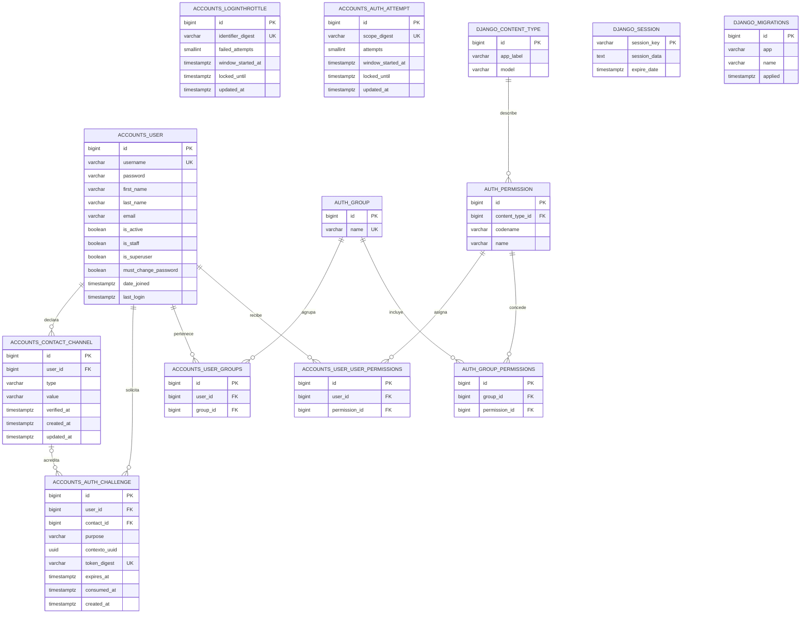
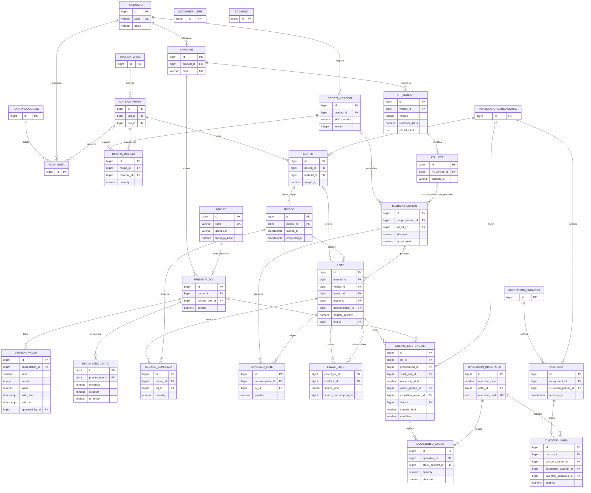
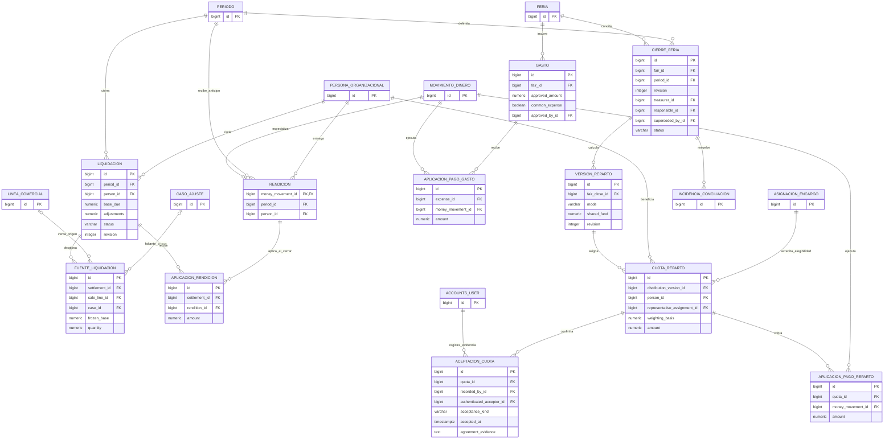

# Modelo entidad-relación integral

Este documento representa el esquema que existe en PostgreSQL hoy y el modelo lógico acordado para completar el producto. Los diagramas se separan por módulo para que sigan siendo legibles. El primer diagrama es el esquema físico verificado; los demás son entidades propuestas, todavía sin tablas ni migraciones.

## Verificación del estado actual

Se consultó la base `zhud_aleli_dev` usando la configuración de desarrollo de Django, PostgreSQL e introspección del catálogo del motor. Django reporta aplicadas todas las migraciones visibles: `contenttypes`, `auth`, `accounts` (0001–0004) y `sessions`. Se encontraron **13 tablas**, todas representadas en el primer diagrama. La app `portal` no define modelos. No se consultaron valores de filas de negocio ni se inspeccionó una base de producción; solo se usaron conteos agregados de desafíos/contactos para verificar las garantías de integridad. Esta comprobación describe la base de desarrollo configurada.

Las cinco clases de modelo propias son `accounts.User`, `LoginThrottle`, `ContactChannel`, `AuthChallenge` y `AuthAttempt`. `User` además hereda los campos de `AbstractUser`. Django aporta grupos, permisos, sesiones, tipos de contenido e historial de migraciones. No existen aún tablas para membresía/cargos, planificación, asistencia, trazabilidad, inventario, ventas, pagos organizacionales, ferias, rendición ni reparto.

Nombres físicos exactos consultados: `accounts_authattempt`, `accounts_authchallenge`, `accounts_contactchannel`, `accounts_loginthrottle`, `accounts_user`, `accounts_user_groups`, `accounts_user_user_permissions`, `auth_group`, `auth_group_permissions`, `auth_permission`, `django_content_type`, `django_migrations` y `django_session`. Los identificadores ER en mayúsculas representan estas tablas.

## A. Tablas físicas actuales (verificadas)



`LoginThrottle`, `AuthAttempt`, `django_session` y `django_migrations` son tablas independientes, sin FK en el esquema consultado. Las dos primeras guardan digests de alcance distintos y no guardan el identificador original. El esquema tiene restricciones únicas de username normalizado, contacto repetido por dueña/tipo/valor, contacto verificado global y digest de desafío; se verificaron las FK de los diagramas directamente en PostgreSQL. La base de desarrollo tiene una cuenta y cero filas con `is_superuser`/`is_staff`; no refleja las seis cuentas de socias más la cuenta externa Superadmin reportadas por el tesista (al menos siete cuentas en total) y aún no contiene el padrón de negocio.

## B. Identidad organizacional, actividades y asistencia (propuesto)

`ACCOUNTS_USER` representa la cuenta de acceso actual. Se agrega `PERSONA_ORGANIZACIONAL` para representar a cada socia, vinculada de forma obligatoria y única con su cuenta. El tesista confirma seis personas asociadas, todas con cuenta. La Superadministradora es externa y se representa como una cuenta sin persona asociada; con la información actual se infieren al menos siete cuentas en total. El seis y el total actual describen el padrón, no límites permanentes del esquema. Los cuatro roles de negocio son General, Presidenta, Tesorera y Secretaria; pueden combinarse en una misma cuenta. General se expresa como perfil y los otros cargos como designaciones, conservando vigencias e historial. Se informa una cuenta Superadmin actual, externa al padrón; la decisión anterior de admitir varias concesiones se conserva como capacidad del esquema. La Superadministración es un permiso separado, no se convierte en perfil de negocio ni en `is_superuser`. Los tipos y concesiones organizacionales son propios del dominio y se mantienen separados de `auth_group` y permisos técnicos de Django.

```mermaid
erDiagram
    ACCOUNTS_USER ||--o| PERSONA_ORGANIZACIONAL : cuenta_de_acceso
    PERSONA_ORGANIZACIONAL ||--o{ MEMBRESIA : tiene
    ESTADO_MEMBRESIA ||--o{ MEMBRESIA : clasifica
    PERSONA_ORGANIZACIONAL ||--o{ ASIGNACION_PERFIL : recibe
    TIPO_PERFIL ||--o{ ASIGNACION_PERFIL : define
    PERSONA_ORGANIZACIONAL ||--o{ DESIGNACION_CARGO : ocupa
    TIPO_CARGO ||--o{ DESIGNACION_CARGO : define
    ACCOUNTS_USER ||--o{ CONCESION_SUPERADMIN : recibe
    ACCOUNTS_USER ||--o{ CONCESION_SUPERADMIN : autoriza
    ACCOUNTS_USER ||--o{ ACTIVIDAD : organiza
    ESTADO_ACTIVIDAD ||--o{ ACTIVIDAD : clasifica
    ACTIVIDAD ||--o{ PARTICIPANTE : convoca
    PERSONA_ORGANIZACIONAL ||--o{ PARTICIPANTE : participa
    ACTIVIDAD ||--o{ ENCARGO : contiene
    TIPO_ENCARGO ||--o{ ENCARGO : define
    ENCARGO ||--o{ ASIGNACION_ENCARGO : asigna
    PERSONA_ORGANIZACIONAL ||--o{ ASIGNACION_ENCARGO : cumple
    ASIGNACION_ENCARGO ||--o{ EVENTO_ENCARGO : historiza
    ACTIVIDAD ||--o{ PLAN_PRODUCCION : planifica
    PARTICIPANTE ||--o{ REGISTRO_ASISTENCIA : origina
    FASE_QR o|--o{ REGISTRO_ASISTENCIA : captura
    POLITICA_QR ||--o{ FASE_QR : configura
    TIPO_EVENTO_ASISTENCIA ||--o{ FASE_QR : distingue
    REGISTRO_ASISTENCIA ||--o{ CORRECCION_ASISTENCIA : rectifica
    PARTICIPANTE ||--o{ FALTA : evalua_al_cierre
    REGISTRO_ASISTENCIA o|--o{ FALTA : evidencia_opcional
    FALTA ||--o{ JUSTIFICATIVO : documenta
    FALTA ||--o| MULTA : determina
    MULTA ||--o{ IMPUGNACION_MULTA : recibe
    MULTA ||--o{ PAGO_MULTA : cobra
    CALENDARIO_DIA ||--o{ JUSTIFICATIVO : calcula_plazo

    ACCOUNTS_USER {
        bigint id PK
        varchar username
    }
    PERSONA_ORGANIZACIONAL {
        bigint id PK
        bigint account_user_id FK UK
        timestamptz created_at
    }
    MEMBRESIA {
        bigint id PK
        bigint person_id FK
        bigint estado_id FK
        date joined_on
        date ended_on
    }
    ASIGNACION_PERFIL {
        bigint id PK
        bigint person_id FK
        bigint tipo_perfil_id FK
        date valid_from
        date valid_to
    }
    DESIGNACION_CARGO {
        bigint id PK
        bigint person_id FK
        bigint tipo_cargo_id FK
        date valid_from
        date valid_to
    }
    CONCESION_SUPERADMIN {
        bigint id PK
        bigint user_id FK
        bigint authorized_by_id FK
        bigint granted_by_id FK
        date valid_from
        date revoked_at
        text authorization_evidence
    }
    ACTIVIDAD {
        bigint id PK
        bigint organizer_id FK
        bigint estado_id FK
        timestamptz starts_at
        timestamptz ends_at
    }
    PARTICIPANTE {
        bigint id PK
        bigint activity_id FK
        bigint person_id FK
        bigint estado_id FK
    }
    ENCARGO {
        bigint id PK
        bigint activity_id FK
        bigint tipo_encargo_id FK
    }
    ASIGNACION_ENCARGO {
        bigint id PK
        bigint encargo_id FK
        bigint person_id FK
        timestamptz starts_at
        timestamptz ends_at
        bigint replaced_by_id FK
    }
    EVENTO_ENCARGO {
        bigint id PK
        bigint assignment_id FK
        bigint actor_id FK
        timestamptz occurred_at
    }
    PLAN_PRODUCCION {
        bigint id PK
        bigint activity_id FK
        date week_start
        bigint created_by_id FK
    }
    PLAN_LINEA {
        bigint id PK
        bigint plan_id FK
        bigint product_id FK
        bigint material_id FK
        numeric planned_quantity
    }
    REGISTRO_ASISTENCIA {
        bigint id PK
        bigint participant_id FK
        bigint event_type_id FK
        bigint qr_phase_id FK
        varchar origin
        bigint actor_id FK
        uuid operation_uuid UK
        timestamptz declared_at
        timestamptz server_received_at
        timestamptz accepted_at
    }
    FASE_QR {
        bigint id PK
        bigint activity_id FK
        bigint policy_version_id FK
        bigint event_type_id FK
        varchar token_digest UK
        timestamptz expires_at
    }
    CORRECCION_ASISTENCIA {
        bigint id PK
        bigint event_id FK
        bigint actor_id FK
        integer revision_no
    }
    FALTA {
        bigint id PK
        bigint participant_id FK
        bigint attendance_evidence_id FK
        varchar kind
        timestamptz evaluated_at
        bigint policy_version_id FK
    }
    JUSTIFICATIVO {
        bigint id PK
        bigint falta_id FK
        bigint decided_by_id FK
        bigint calendario_id FK
    }
    MULTA {
        bigint id PK
        bigint falta_id FK
        numeric amount
        bigint value_version_id FK
    }
    IMPUGNACION_MULTA {
        bigint id PK
        bigint multa_id FK
        bigint decided_by_id FK
    }
    PAGO_MULTA {
        bigint id PK
        bigint multa_id FK
        numeric amount
        timestamptz paid_at
    }
    CALENDARIO_DIA {
        bigint id PK
    }

    ESTADO_ACTIVIDAD {
        bigint id PK
    }

    ESTADO_MEMBRESIA {
        bigint id PK
    }

    POLITICA_QR {
        bigint id PK
    }

    TIPO_CARGO {
        bigint id PK
    }

    TIPO_ENCARGO {
        bigint id PK
    }

    TIPO_EVENTO_ASISTENCIA {
        bigint id PK
    }

    TIPO_PERFIL {
        bigint id PK
    }
```

Los stubs de ID que se repiten en más de un diagrama identifican FKs a entidades cuyo módulo propietario se explica en otro panel; no son tablas duplicadas. Las entidades catálogo de estados, tipos, políticas, eventos y decisiones usan su catálogo propio según el módulo. `EVENTO_ENCARGO` y `CORRECCION_ASISTENCIA` guardan cambios append-only con actor, motivo y revisión. Los nombres en este diagrama son lógicos y pueden mapearse a `accounts_*`, `planificacion_*` y `asistencia_*` al hacer el diseño físico.

## C. Catálogo, producción, linaje e inventario (propuesto)



La relación `SECADO → ACOPIO` es singular por secado; el acopio puede originar varios secados si las cantidades lo permiten. Lote usa XOR entre materia prima y variante. Cada cuenta de stock fija su titularidad (individual/compartida), presentación, lote, feria y estado vendible/segregado; una custodia es transferencia física, no deuda. `KIT_VERSION.reference_liters` conserva la referencia 50 L por kit/variante; ingredientes secretos no aparecen en el esquema. El rendimiento y envases obtenidos se registran como resultado real.

## D. Feria, registros comerciales, cobros y devoluciones (propuesto)

```mermaid
erDiagram
    ACTIVIDAD ||--o| FERIA : define
    FERIA o|--o{ REGISTRO_COMERCIAL : agrupa
    PERIODO ||--o{ REGISTRO_COMERCIAL : delimita
    REGISTRO_COMERCIAL ||--|{ LINEA_COMERCIAL : resume

    PRESENTACION ||--o{ LINEA_COMERCIAL : mide
    PERSONA_ORGANIZACIONAL ||--o{ LINEA_COMERCIAL : vende
    PERSONA_ORGANIZACIONAL o|--o{ LINEA_COMERCIAL : es_duena
    LINEA_COMERCIAL ||--o{ SALIDA_LINEA : despacha
    CUENTA_EXISTENCIAS ||--o{ SALIDA_LINEA : abastece
    MOVIMIENTO_DINERO ||--o| COBRO : especializa
    REGISTRO_COMERCIAL ||--o{ COBRO : recibe
    COBRO ||--o{ APLICACION_COBRO : distribuye
    LINEA_COMERCIAL ||--o{ APLICACION_COBRO : recibe
    LINEA_COMERCIAL ||--o{ ENTREGA : despacha
    REGISTRO_COMERCIAL ||--o| NOTA_VENTA : documenta_opcional
    CAPTURA_PROVISIONAL ||--o| INCORPORACION_CAPTURA : incorpora_una_vez
    LINEA_COMERCIAL ||--o{ INCORPORACION_CAPTURA : conserva_origen
    FERIA ||--o{ CAPTURA_PROVISIONAL : recibe_offline
    ACCOUNTS_USER ||--o{ CAPTURA_PROVISIONAL : registra
    POLITICA_DEVOLUCION ||--o{ LINEA_COMERCIAL : congela
    LINEA_COMERCIAL o|--o{ CASO_AJUSTE : origina
    CASO_AJUSTE ||--o{ REVISION_AJUSTE : revisa
    CASO_AJUSTE ||--o{ RECEPCION_SEGREGADA : aparta
    CASO_AJUSTE ||--o{ ORDEN_REEMBOLSO : autoriza
    ORDEN_REEMBOLSO o|--o{ MOVIMIENTO_DINERO : ejecuta
    REGISTRO_COMERCIAL ||--o{ INCIDENCIA_CONCILIACION : contrasta

    FERIA {
        bigint id PK
        bigint activity_id FK UK
        varchar status
    }
    PERIODO {
        bigint id PK
        varchar scope
        bigint person_id FK
        date starts_on
        date ends_on
    }
    REGISTRO_COMERCIAL {
        bigint id PK
        bigint fair_id FK
        bigint period_id FK
        bigint recorder_id FK
        varchar kind
        varchar sale_mode
        varchar institutional_reference
        varchar status
        uuid operation_uuid UK
    }
    LINEA_COMERCIAL {
        bigint id PK
        bigint commercial_record_id FK
        bigint presentation_id FK
        bigint seller_person_id FK
        bigint owner_person_id FK
        varchar stock_origin
        numeric quantity
        numeric unit_price
        numeric base_value
        numeric line_total
        bigint return_policy_version_id FK
    }
    SALIDA_LINEA {
        bigint id PK
        bigint sale_line_id FK
        bigint stock_account_id FK
        numeric quantity
    }
    COBRO {
        bigint money_movement_id PK,FK
        bigint commercial_record_id FK
        bigint receiver_person_id FK
    }
    APLICACION_COBRO {
        bigint id PK
        bigint payment_id FK
        bigint sale_line_id FK
        numeric amount
    }
    ENTREGA {
        bigint id PK
        bigint sale_line_id FK
        numeric quantity
        timestamptz delivered_at
    }
    NOTA_VENTA {
        bigint id PK
        bigint commercial_record_id FK
        varchar reference
        timestamptz issued_at
    }
    INCORPORACION_CAPTURA {
        bigint capture_id PK,FK
        bigint sale_line_id FK
        bigint incorporated_by_id FK
        timestamptz incorporated_at
    }
    CAPTURA_PROVISIONAL {
        bigint id PK
        uuid client_uuid UK
        bigint recorder_id FK
        bigint fair_id FK
        bigint seller_person_id FK
        bigint owner_person_id FK
        bigint presentation_id FK
        varchar stock_origin
        numeric quantity
        numeric amount
        varchar digest
        varchar reconciliation_status
    }
    POLITICA_DEVOLUCION {
        bigint id PK
        integer version
        boolean enabled
        timestamptz valid_from
        bigint configured_by_id FK
    }
    CASO_AJUSTE {
        bigint id PK
        bigint sale_line_id FK
        bigint source_payment_id FK
        bigint custody_id FK
        varchar kind
        numeric quantity
        numeric amount
    }
    REVISION_AJUSTE {
        bigint id PK
        bigint case_id FK
        bigint actor_id FK
        varchar authority_used
        varchar decision
    }
    RECEPCION_SEGREGADA {
        bigint id PK
        bigint case_id FK
        bigint stock_account_id FK
        numeric quantity
        varchar condition
        varchar identification_status
    }
    ORDEN_REEMBOLSO {
        bigint id PK
        bigint case_id FK
        numeric authorized_amount
        varchar method
        varchar status
    }
    MOVIMIENTO_DINERO {
        bigint id PK
        uuid operation_uuid UK
        varchar kind
        numeric amount
        varchar method
        varchar direction
        varchar execution_status
        timestamptz executed_at
        bigint actor_id FK
        bigint refund_order_id FK
    }
    ACCOUNTS_USER {
        bigint id PK
    }

    CUENTA_EXISTENCIAS {
        bigint id PK
    }

    INCIDENCIA_CONCILIACION {
        bigint id PK
    }

    PRESENTACION {
        bigint id PK
    }

    PRODUCTO {
        bigint id PK
    }

    ACTIVIDAD {
        bigint id PK
    }
    PERSONA_ORGANIZACIONAL {
        bigint id PK
    }
```

En los ER, `COBRO` guarda dinero efectivamente recibido y `ENTREGA` el hecho físico; la transacción de venta requiere pago completo antes de entrega. Las líneas resumen separan socia, producto, presentación, origen individual/compartido, precio/base y versión de devolución; no requieren comprador. Una captura provisional se incorpora una vez: si se importa el resumen, la captura queda como evidencia de origen y no vuelve a sumar ventas. La devolución global tiene versión; cancelar antes de entregar no requiere aprobación, pero sí evidencia de solicitud y ejecución financiera. El artículo retornado permanece en una cuenta segregada no vendible.

`CASO_AJUSTE` representa ramas de origen mutuamente excluyentes por tipo: venta/línea para devolución, pago para sobrepago, custodia para faltante. La tabla física debe usar FKs tipadas o tablas de subtipo para que cada tipo tenga integridad relacional. No se implementa una FK polimórfica sin restricción.

## E. Periodos, rendición, dinero y reparto de feria (propuesto)



El saldo por rendir se acumula por venta y se vuelve liquidación formal al cierre del periodo; una entrega parcial durante la feria se aplica una sola vez al cerrar. Base de asociación y excedente individual no ingresan al fondo compartido. El fondo se calcula con excedente de ventas compartidas menos gastos comunes pagados/aprobados. La distribución puede ser proporcional a ventas compartidas por vendedora o manual acordada; al cerrar la suma de cuotas debe igualar el fondo positivo. Aceptación no es pago; cada pago efectivo se registra y aplica por separado.

Los casos de feria fuera de conexión conservan capturas por vendedora/producto/origen y estado de conciliación. El cierre no acepta conflictos abiertos. Una versión de cierre o reparto ya pagada no se sobrescribe; una corrección enlaza la versión anterior y preserva los pagos ya aplicados.

## F. Sitio público, documentos, activos y avisos (propuesto)

```mermaid
erDiagram
    CONTENIDO_PUBLICO ||--o{ REVISION_CONTENIDO : versiona
    CONTENIDO_PUBLICO ||--o{ EVENTO_PUBLICACION : audita
    VERSION_VALOR ||--o{ PUBLICACION_PRECIO : publica
    PUBLICACION_PRECIO ||--o{ EVENTO_PUBLICACION : audita
    TIPO_DOCUMENTO ||--o{ DOCUMENTO : clasifica
    DOCUMENTO ||--o{ VERSION_DOCUMENTO : contiene
    DOCUMENTO ||--o{ ACCESO_DOCUMENTO : autoriza
    ACCOUNTS_USER ||--o{ ACCESO_DOCUMENTO : recibe
    DOCUMENTO ||--o{ EVENTO_DOCUMENTO : audita
    CATEGORIA_ACTIVO ||--o{ ACTIVO : clasifica
    ACTIVO ||--o{ EVENTO_ACTIVO : historiza
    ACTIVIDAD o|--o{ RECORDATORIO : agenda
    ASIGNACION_ENCARGO o|--o{ RECORDATORIO : vence
    ACCOUNTS_USER ||--o{ RECORDATORIO : recibe
    ACCOUNTS_CONTACT_CHANNEL ||--o{ CONSENTIMIENTO_CONTACTO : habilita
    CONSENTIMIENTO_CONTACTO ||--o{ ENVIO_EXTERNO : permite
    RECORDATORIO ||--o{ ENVIO_EXTERNO : intenta
    ACCOUNTS_USER ||--o{ EVENTO_DOCUMENTO : actua
    ACCOUNTS_USER ||--o{ EVENTO_ACTIVO : actua
    ACCOUNTS_USER ||--o{ EVENTO_PUBLICACION : actua

    CONTENIDO_PUBLICO {
        bigint id PK
        varchar slug UK
        varchar current_status
    }
    REVISION_CONTENIDO {
        bigint id PK
        bigint content_id FK
        integer revision
        bigint approved_by_id FK
        timestamptz published_at
    }
    PUBLICACION_PRECIO {
        bigint id PK
        bigint value_version_id FK
        timestamptz published_at
    }
    EVENTO_PUBLICACION {
        bigint id PK
        bigint content_id FK
        bigint price_publication_id FK
        bigint actor_id FK
        timestamptz occurred_at
    }
    TIPO_DOCUMENTO {
        bigint id PK
        varchar code UK
        varchar label
    }
    DOCUMENTO {
        bigint id PK
        bigint document_type_id FK
        varchar privacy_class
        date effective_on
        date expires_on
    }
    VERSION_DOCUMENTO {
        bigint id PK
        bigint document_id FK
        integer version
        varchar storage_key
        varchar content_digest
    }
    EVENTO_DOCUMENTO {
        bigint id PK
        bigint document_id FK
        bigint actor_id FK
        timestamptz occurred_at
        varchar action
    }
    ACCESO_DOCUMENTO {
        bigint id PK
        bigint document_id FK
        bigint user_id FK
        timestamptz valid_from
        timestamptz valid_to
    }
    ACTIVO {
        bigint id PK
        bigint category_id FK
        bigint custodian_id FK
        varchar asset_code UK
        varchar status
    }
    EVENTO_ACTIVO {
        bigint id PK
        bigint asset_id FK
        bigint actor_id FK
        timestamptz occurred_at
    }
    CATEGORIA_ACTIVO {
        bigint id PK
        varchar code UK
        varchar label
    }
    RECORDATORIO {
        bigint id PK
        bigint activity_id FK
        bigint assignment_id FK
        bigint recipient_id FK
        timestamptz due_at
    }
    CONSENTIMIENTO_CONTACTO {
        bigint id PK
        bigint contact_id FK
        varchar purpose
        timestamptz given_at
        timestamptz withdrawn_at
    }
    ENVIO_EXTERNO {
        bigint id PK
        bigint reminder_id FK
        bigint consent_id FK
        varchar provider_ref
        varchar status
    }
    ACCOUNTS_CONTACT_CHANNEL {
        bigint id PK
    }

    ACCOUNTS_USER {
        bigint id PK
    }

    ACTIVIDAD {
        bigint id PK
    }

    ASIGNACION_ENCARGO {
        bigint id PK
    }

    VERSION_VALOR {
        bigint id PK
    }
```



Documentos y activos pertenecen a módulos futuros propios según D08. Las relaciones a dominios se incorporan como FK explícitas al aprobar el recorrido; no se usa una relación polimórfica sin integridad. `portal` y `reports` no mantienen ER operativo propio: consultan entidades fuente mediante servicios autorizados. El contacto reutiliza `accounts_contactchannel`; no se duplica la tabla.

## Compatibilidad y restricciones de esta edición

El esquema físico de acceso incorpora `0004_integridad_contactos_desafios`: FK compuesta `(contact_id,user_id)` a ContactChannel `(id,user_id)`, contacto requerido para `verify_contact`, unicidad por `LOWER(TRIM(value))` y HMAC ligado al contexto UUID. La migración preserva cuentas/contactos/desafíos, rechaza datos ambiguos e invalida códigos pendientes del formato anterior. `User.email` se conserva por compatibilidad; ContactChannel es la fuente de contactos verificados para los recorridos nuevos. Los contadores de intentos conservan sus alcances distintos.

La FK compuesta está declarada mediante RunSQL reversible porque el ORM Django 5.2 no la representa como ForeignKey nativa. Debe conservarse al evolucionar estas tablas. La unicidad y las consultas usan la misma normalización PostgreSQL, incluida su configuración regional, sin combinar casefold de Python con lower SQL.

## Contrato de interpretación del ER v2.2

- Cada persona socia tiene una cuenta requerida y única; una cuenta externa puede carecer de persona. Participante identifica una persona del padrón; actor/organizadora/autorizadora identifica una cuenta. Los conteos actuales no son CHECK del esquema.
- FALTA nace de PARTICIPANTE y la evaluación del cierre, aunque no haya marcaje. Su evidencia de asistencia es nullable. REGISTRO_ASISTENCIA distingue entrada/salida, actor, origen y hora declarada/recibida; qr_phase_id es nullable para los caminos manuales/delegados. Fase y participante deben pertenecer a la misma actividad.
- PRESENTACION identifica una variante y el contenido del envase. VARIANTE determina PRODUCTO. Los productos sin diferenciación utilizan una identidad de variante base al cargar el catálogo, sin inventar otra formulación. Una línea referencia presentación; lote terminado referencia variante; no se copia product_id en ambas.
- LOTE usa XOR materia/variante y exactamente un origen acopio/secado/transformación. original_quantity es el hecho recibido/producido, no el saldo. LINAJE_LOTE es una vista de lectura derivada de consumos y lotes obtenidos, no una tabla editable ni una FK polimórfica. source_consumption_id es una columna de esa vista; source_kind distingue las ramas SQL. No atribuye a cada hijo toda la cantidad consumida como si fueran consumos adicionales.
- CUENTA_EXISTENCIAS distingue propiedad económica de custodia física y condición vendible/segregada. Presentación es nullable para materias/granel. La unidad de stock se distingue de la unidad del contenido del envase. Su clave natural incluye lote, presentación, unidad, propiedad, dueña, custodia física, feria, tipo de custodia y condición; nulos equivalentes. Dueña requerida solo en propiedad individual. Feria requerida en custodia de feria. Las salidas validan variante, presentación, dueña, unidad y condición.
- Una CUSTODIA identifica la receptora física. assignment_id es nullable fuera de una asignación y, si se informa, debe acreditar a esa misma persona. CUSTODIA_LINEA enlaza cuentas y operación de transferencia; los movimientos no vuelven a copiar el hecho de entrega en otra tabla editable. La asignación representativa de CUOTA_REPARTO debe corresponder a su beneficiaria; se conserva para elegibilidad y desempate histórico.
- KIT_VERSION posee referencia por kit/variante y etiqueta oficial; KIT_LOTE identifica el lote del proveedor y referencia esa versión. No se almacena fórmula secreta. UNIDAD guarda factor positivo a base por magnitud; conversiones multiplicativas se derivan y no se editan por parejas. kg y L no se convierten entre sí.
- FERIA especializa ACTIVIDAD y reutiliza sus fechas; activity_id es único. Fechas de ventas, entregas, cierres y periodos representan hechos distintos y se conservan. VERSION_VALOR distingue tipo base/precio, versión y vigencia sin solapes por presentación/tipo.
- COBRO especializa un único MOVIMIENTO_DINERO mediante PK/FK. Importe, medio y ejecución pertenecen al movimiento. APLICACION_COBRO distribuye ese importe entre líneas del mismo documento, sin duplicarlo. Receptora del cobro, vendedora, dueña y registradora son papeles distintos. El documento distingue modalidad institucional y su referencia mínima; no exige identificar compradores de ventas ordinarias. refund_order_id es nullable y requerido solo para movimientos de reembolso.
- RENDICION especializa un movimiento de dinero y lo vincula desde el inicio a persona/periodo. Puede existir como anticipo antes de LIQUIDACION. APLICACION_RENDICION vincula después ese mismo dinero con la obligación, sin otro cobro. FUENTE_LIQUIDACION pertenece directamente a LIQUIDACION y tiene XOR línea/caso; su periodo se deriva de la liquidación. La asignación de responsabilidad cuando receptora, dueña y vendedora difieran debe acreditarse por la operación y su regla vigente, nunca inferirse solo de una FK.
- INCORPORACION_CAPTURA vincula cada captura a una sola línea confirmada; varias capturas pueden alimentar esa línea. Una captura no se fracciona automáticamente: debe tener agrupación homogénea por presentación/dueña/origen/valores/política; diferencias requieren conciliación antes de incorporar. Un registro digital puede existir sin capturas. La evidencia no se suma como otra venta. La sincronización protege actor/tipo/UUID y digest de contenido.
- RECEPCION_SEGREGADA admite stock_account_id nullable mientras la identificación está pendiente. El artículo físico queda en cuarentena documentada, sin lote inventado ni disponibilidad comercial; el vínculo a cuenta segregada se completa al identificarlo. No se confirma una salida vendible desde una recepción pendiente.
- En ACEPTACION_CUOTA la beneficiaria se deriva de la cuota. recorded_by_id registra al actor real; authenticated_acceptor_id es nullable para acuerdo verbal y solo se informa si hubo aceptación autenticada. acceptance_kind y evidencia evitan atribuir una firma inexistente. Aceptación no equivale a pago.

## Claves y transacciones obligatorias antes de migrar negocio

Unicidad: participante `(actividad,persona)`; falta `(participante,tipo)` en la evaluación efectiva; feria `(actividad)`; cuota `(version_reparto,persona)`; receta/documento/reparto `(propietario,version)`; incorporación `(captura)`; fuente original liquidada una vez y conservada por revisiones correctivas. Cuenta de stock usa la clave natural indicada con NULLS NOT DISTINCT. Membresías, cargos y perfiles validan intervalos y exclusividad por su clave; la restricción de cargo no impide que una persona ocupe cargos diferentes.

Una única revisión publicada por contenido; fechas e importes coherentes; orígenes tipados/XOR de ajustes y lotes. Relación a tarifa histórica no elimina precio pactado; cantidades, totales y agregados congelados deben tener fórmula y desglose verificables. No se permite borrar hechos económicos por cascada.

Los agregados de aplicaciones, pago antes de entrega, stock no negativo, linaje acíclico y reparto exacto se validan en operaciones transaccionales del módulo propietario, bloqueando padres existentes y respetando idempotencia. Las reglas entre tablas no se simulan con un CHECK de una fila. Los mismos controles se aplican a sincronización y administración.

## Modularidad y estado de implementación

accounts posee identidad; planning, actividad/encargos; attendance, asistencia/sanciones; traceability, catálogo/producción/inventario/comercio con paquetes internos por responsabilidad. public_site posee publicaciones; documents/assets se crean al implementar su recorrido. FK justificadas entre apps se conservan. Escritos cruzados pasan por operaciones públicas; portal/reports consultan las fuentes sin saldos paralelos. No se crean apps vacías, microservicios ni tablas duplicadas para aparentar independencia.

La edición corrige estructura técnica por instrucción del tesista, mantiene C01–C18 y conserva la evidencia de aprobación de cada requisito. Los paneles B–F siguen sin migrar; definir estas relaciones no declara implementados esos módulos. No cierra SB-S1-03 ni SB-S2-05. Las versiones v2.1 se conservan como antecedentes.

Historial: 2.2, 2026-10-30, Codex: correcciones N01–N18 de normalización, origen de faltas, identidad vendible, stock, cobros, anticipos, capturas y cardinalidades. Fuente: [revisión](../../docs/architecture/proposals/2026-10-30-revision-normalizacion-e-integridad.md). Evidencia de código, migración y revisión en [checkpoint](../../docs/bitacora/checkpoints/2026-10-30-normalizacion.md). Publicación académica pendiente.

Los gastos separan importe aprobado de pagos ejecutados mediante APLICACION_PAGO_GASTO; las sumas aplicadas no exceden movimiento ni importe autorizado, y el fondo deduce una sola vez lo común efectivamente pagado/aprobado.

CIERRE_FERIA identifica feria, periodo y revisión con unicidad de esa combinación. El periodo debe tener ámbito feria y sus registros/fuentes deben corresponder a la misma feria; una revisión correctiva conserva el periodo y enlaza el cierre previo. No basta el intervalo de fechas para atribuir fuentes.
