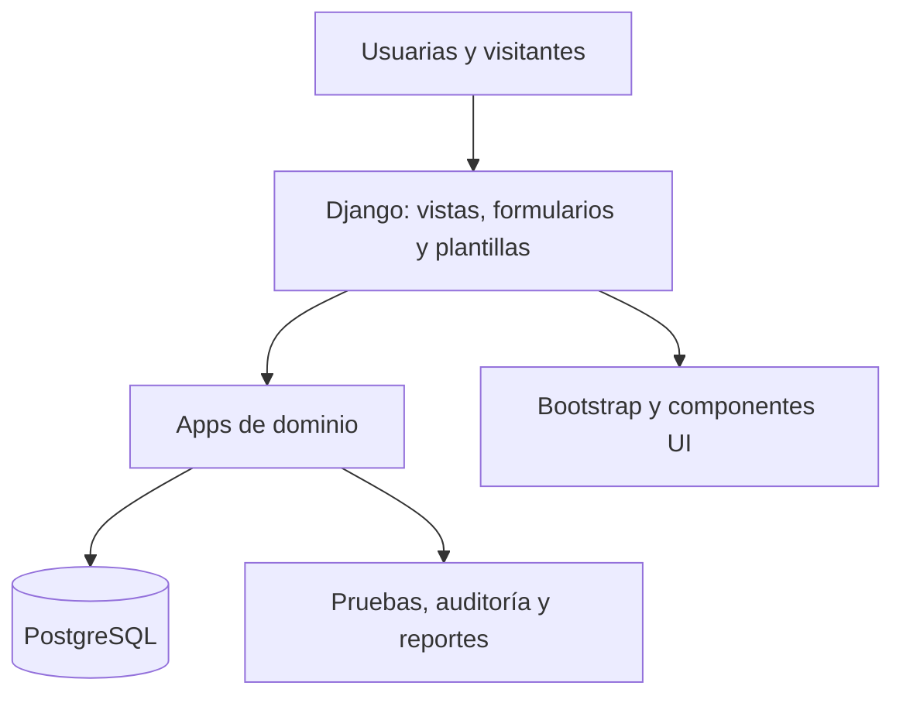

# Arquitectura objetivo de la aplicación

## Decisión de alto nivel

Construir un monolito modular Django. La interfaz se renderiza en el servidor con plantillas
y Bootstrap 5. PostgreSQL mantiene los datos transaccionales. Esta forma permite entregar
una aplicación completa con una sola base de despliegue, sin impedir límites claros entre
módulos.

## Módulos previstos

| App | Responsabilidad | No debe poseer |
|---|---|---|
| `core` | tipos y utilidades transversales realmente compartidos | reglas de todos los dominios |
| `accounts` | usuario, membresía, roles, permisos y perfil | actividades o producción |
| `planning` | jornadas, actividades, asignaciones y estados | registro de asistencia |
| `attendance` | entradas, salidas, participación y correcciones autorizadas | autenticación o inventario |
| `traceability` | acopio, secado, lotes, mermas y movimientos de inventario | presentación de reportes globales |
| `reports` | consultas, filtros, exportaciones y vistas derivadas | duplicar datos operativos |
| `public_site` | contenido y navegación pública | información interna o personal |

Los límites se confirmarán con los requisitos. `reports` lee datos mediante consultas; no
mantiene una segunda copia de los totales salvo una necesidad de rendimiento demostrada.

## Convenciones Django

- `models.py` o paquete `models/`: entidades e invariantes locales.
- `forms.py`: validación de entradas de usuaria.
- `views.py`: coordinación HTTP pequeña.
- `services.py`: solo operaciones de escritura que coordinan varias entidades/transacciones.
- `queries.py`: consultas complejas y reportes, si el volumen lo justifica.
- `policies.py` o permisos nativos: reglas de autorización reutilizables.
- `templates/<app>/`: páginas y parciales propiedad del módulo.
- `tests/`: recorridos de integración; cada app puede añadir pruebas cercanas al código.

No se crea una capa de repositorio encima del ORM por defecto. La arquitectura se profundiza
cuando una regla real lo exige, no para imitar otro framework.

## Integridad y auditoría

- Usuario personalizado desde el inicio.
- Todas las relaciones organizativas usan claves y restricciones explícitas.
- Una corrección sensible conserva autor, fecha, valor previo, valor nuevo y motivo si el
  requisito confirmado lo exige.
- Operaciones de lote, transformación e inventario se ejecutan dentro de `transaction.atomic`.
- Las existencias se derivan de movimientos o se concilian con ellos; no se altera un total
  sin rastro.
- Fechas y zonas horarias usan la configuración Django; los reportes explicitan periodo.
- Los borrados funcionales se deciden por dominio. No se agrega `soft delete` global sin
  analizar consultas, privacidad y retención.

## Seguridad

- RBAC con grupos/permisos Django y comprobación en backend.
- Pruebas de acceso permitido y denegado para cada operación sensible.
- CSRF, gestión de sesión, hash de contraseña y escaping mediante mecanismos Django.
- Archivos subidos, si se aprueban, validan tipo, tamaño, acceso y almacenamiento.
- Logs sin claves ni datos personales innecesarios.
- Admin de Django limitado a mantenimiento técnico; no sustituye la interfaz de negocio.

## Despliegue inicial propuesto

Una aplicación web, un proceso PostgreSQL y almacenamiento de archivos definido por el
entorno. Contenedores pueden mejorar reproducibilidad, pero no deben bloquear el desarrollo
local. La plataforma final se elige después de conocer conectividad, presupuesto, respaldos
y acceso de la organización.

## Decisiones todavía abiertas

- Denominación legal y perfiles reales.
- Alcance de ventas y cuentas por cobrar.
- Variables y correcciones del secado.
- Auditoría requerida y política de retención.
- Reportes prioritarios y formato de exportación.
- Despliegue, respaldos y operación con conectividad real.
