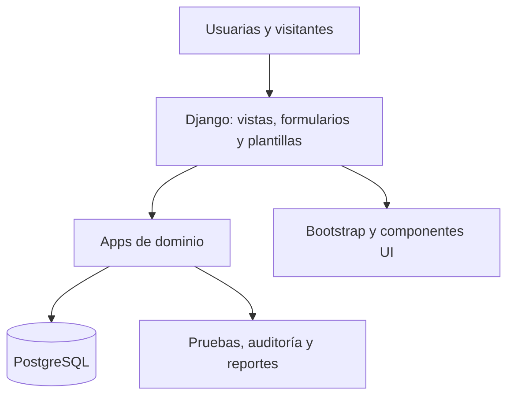
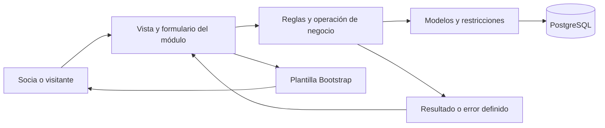

# Arquitectura objetivo de la aplicación

## Decisión de alto nivel

Construir un monolito modular Django. La interfaz se renderiza en el servidor con plantillas
y Bootstrap 5. PostgreSQL mantiene los datos transaccionales. Esta forma permite entregar
una aplicación completa con una sola base de despliegue, sin impedir límites claros entre
módulos. El tesista confirmó mantener este estilo el 2026-10-08. La decisión y su evidencia
están en [[../decisions/ADR-0006-monolito-modular-y-entrega-incremental|ADR-0006]]. Esta guía
define cómo organizar y evolucionar la aplicación; todavía no existe código Django funcional.
Las reglas de negocio y entidades concretas siguen dependiendo de requisitos/specs aprobados.

## Módulos previstos

| App | Responsabilidad | No debe poseer |
|---|---|---|
| `core` | tipos y utilidades transversales realmente compartidos | reglas de todos los dominios |
| `accounts` | usuario, membresía, roles, permisos y perfil | actividades o producción |
| `portal` | inicio privado y composición de navegación y resúmenes autorizados | autenticación propia, reglas o escrituras de otros módulos |
| `planning` | jornadas, actividades, asignaciones y estados | registro de asistencia |
| `attendance` | entradas, salidas, participación y correcciones autorizadas | autenticación o inventario |
| `traceability` | catálogos, acopio, secado, lotes, inventario, ventas, gastos y cuentas por cobrar | presentación de reportes globales |
| `reports` | consultas, filtros, exportaciones y vistas derivadas | duplicar datos operativos |
| `public_site` | contenido y navegación pública | información interna o personal |

Los límites concretos se precisan con los requisitos y planes de cada funcionalidad. `reports` lee datos mediante consultas; no
mantiene una segunda copia de los totales salvo una necesidad de rendimiento demostrada.

## Comportamiento de la aplicación

La socia entra en una aplicación común con sesión y navegación coherentes. Cada solicitud
llega a la vista del módulo responsable: valida entrada y autorización, ejecuta la operación
de negocio y presenta su resultado. Una operación compleja coordina modelos y una transacción
cuando los cambios deben confirmar juntos. Los errores se convierten en mensajes recuperables.

La captura offline aprobada tiene una entrada específica: una operación guardada localmente
permanece pendiente hasta que el servidor valida identidad, permiso actual y reglas. SSR y
sincronización reutilizan la misma operación de negocio; la interfaz diferencia resultado
local de aceptación remota. Las specs PWA concretarán almacenamiento, compatibilidad,
conflictos y recuperación según P-13/P-14. SPEC-001 conserva su alcance y protección no-caché.

## Cómo logramos alta cohesión

Alta cohesión significa agrupar lo que responde a una misma responsabilidad y cambia por
los mismos motivos. Se aplica mediante estas reglas de diseño y revisión:

- Cada entidad tiene un propietario de sus invariantes, escrituras y migraciones.
- Las operaciones, permisos, pantallas y pruebas del recorrido permanecen cerca del módulo.
- Se amplía el módulo existente si la capacidad pertenece a su responsabilidad; se crea otro
  cuando haya una frontera distinta validada, no por añadir una pantalla.
- Dentro de una app grande se separan paquetes por responsabilidades reales manteniendo el
  registro de modelos Django. Ventas y producción pueden necesitar agrupaciones internas
  antes de justificar otra app; no se divide una operación atómica por estética.
- `core` contiene utilidades sin autoridad sobre el negocio; no posee personas comerciales,
  usuarios, catálogos productivos ni estados de todos los módulos.

## Cómo logramos bajo acoplamiento

Bajo acoplamiento significa conocer solo lo necesario para colaborar con otro módulo.
No elimina dependencias: hace explícitos su sentido, alcance y consumidores.

- Las escrituras cruzadas pasan por operaciones públicas del propietario, con actor, datos
  de entrada, resultado/errores y garantías documentados. No se expone un CRUD genérico
  que permita saltarse invariantes o autorización.
- Las lecturas cruzadas usan consultas públicas o consultas ORM explícitas revisadas y
  autorizadas. FK/JOIN se conservan donde protejan integridad o eviten duplicar información.
  No se hacen consultas de negocio desde plantillas ni se copian saldos para aislar carpetas.
- Los proveedores no importan a sus consumidores. El plan registra dirección de dependencias,
  cambios de contrato y ubicación de composición; se evitan ciclos entre apps.
- Un recorrido que coordina módulos declara un único punto transaccional y llama operaciones
  de sus propietarios. Su ubicación responde al caso de uso, no a un `core` universal.
- Una pantalla que reúne varios dominios compone resultados en una capacidad consumidora o
  presentación definida por su plan. Los dominios fuente no dependen de esa pantalla; la
  bienvenida de SPEC-001 no adelanta el dashboard operativo de RF-ACC-004.
- Integraciones externas usan un adaptador concreto cuando resulta útil. Su fallo no se trata
  como una transacción PostgreSQL revertible: se definen estado, reintento y recuperación.
- Los contratos internos pueden ser funciones Python. Se versiona explícitamente cuando
  existen consumidores con versiones coexistentes, como PWA; no se exige HTTP entre apps.

Dependencias de referencia: `planning` consume identidad/autorización; `attendance` consume
identidad y actividades; `traceability` consume identidad y encargos cuando el requisito lo
necesita; `reports` consume lecturas de sus fuentes. `public_site` solo expone contenido
aprobado. Este mapa se concreta por spec; no crea eventos o modelos nuevos.

## Convenciones Django

- `models.py` o paquete `models/`: entidades e invariantes locales.
- `forms.py`: validación de entradas de usuaria.
- `views.py`: coordinación HTTP pequeña.
- `services.py`: casos de uso con reglas o coordinación reales que justifican extraer la operación.
- Las operaciones reutilizables se extraen cuando una regla real o entradas distintas lo
  justifican; no dependen de `HttpRequest`, plantillas o renderizado. El actor se obtiene
  de una identidad confiable de la entrada y se comprueba su autorización vigente.
- `queries.py`: consultas complejas o reutilizadas y reportes, cuando lo justifique el comportamiento.
- `policies.py` o permisos nativos: reglas de autorización reutilizables.
- `templates/<app>/`: páginas y parciales propiedad del módulo.
- `tests/`: recorridos de integración; cada app puede añadir pruebas cercanas al código.

No se crea una capa de repositorio encima del ORM por defecto. La arquitectura se profundiza
cuando una regla real lo exige, no para imitar otro framework.

Las capas son responsabilidades; no exigen tres carpetas vacías. Para SPEC-001 se conserva
el árbol aprobado de `models.py`, `forms.py`, `views.py`, `urls.py`, migraciones y pruebas.
Los modelos siguen en `models.py` o registrados desde `models/__init__.py`, y las migraciones
en la ubicación nativa salvo excepción configurada y probada.
[Fuente: registro de apps Django](https://docs.djangoproject.com/en/5.2/ref/applications/#how-applications-are-loaded).

### Adenda aprobada: organización de backend y frontend — 2026-10-28

El tesista aprobó expresamente la propuesta de organización por módulo y solicitó reglas
para la generación de código por IA. Se conserva la arquitectura y el backend nativo descritos
arriba. La aprobación corresponde a esta convención técnica, sin ampliar requisitos, permisos
ni funcionalidades de negocio y sin declarar realizada la migración del código existente.

La ubicación objetivo de cada pantalla es
`apps/<modulo>/frontend/<modulo>/<pantalla>/`: HTML junto a un directorio `recursos/` para sus
CSS, JS e imágenes exclusivos, cuando existan. Los directorios de recursos públicos se
configuran de forma independiente a las raíces de plantillas. Se mantienen los componentes
HTML generales y los estáticos compartidos con un único propietario fuera de las pantallas.
Esta ubicación sustituye la convención de plantillas y estáticos separados por app para las
pantallas que se adapten; el árbol anterior puede coexistir hasta completar una transición
verificada por porciones. No se duplican fuentes activas ni se publica `frontend/` completo.

Las reglas operativas se mantienen en
[`zhud-aleli-codigo-legible`](../../.agents/skills/zhud-aleli-codigo-legible/SKILL.md), que se
aplica al generar, modificar y revisar código. La adaptación comprueba descubrimiento de
plantillas y estáticos, rutas, comportamiento, migraciones cuando corresponda y política PWA.
La estructura descrita para SPEC-001 conserva su valor como registro de implementación previo;
esta adenda no altera retroactivamente sus criterios funcionales.

### Separación de identidad e inicio privado — 2026-10-28

El tesista solicitó implementar la separación propuesta entre `accounts` y `portal`.
`accounts` conserva autenticación, sesiones, contraseñas y propiedad de la identidad.
`portal` recibe la vista y la presentación de `/inicio/`; mantiene la bienvenida mínima
de SPEC-001 y queda como propietario del futuro inicio operativo de RF-ACC-004, sin
declararlo implementado. La cuenta y la sesión se comparten mediante Django. La separación
es de responsabilidades: las barreras de acceso continúan en la verificación backend de
sesión y permisos, el cambio obligatorio, la caducidad y la política de caché.

`portal` no crea modelos ni migraciones porque su presentación actual no posee datos.
Cuando componga información de planificación, asistencia u otros módulos, usará lecturas
autorizadas sin asumir sus escrituras. Los módulos fuente no importan el portal. El acceso
y el cambio de contraseña usan `LOGIN_REDIRECT_URL`, definido en la configuración general,
para evitar que cuentas importe su presentación consumidora.

Las URLs del navegador no cambian. El nombre interno `portal:inicio` sustituye a
`accounts:dashboard`; el [[../../specs/001-acceso-usuarias-internas/contracts/http|contrato HTTP]]
registra el ajuste técnico. No cambia criterios funcionales ni autoriza nuevas operaciones.

## Integridad y auditoría

- Usuario personalizado desde el inicio.
- Todas las relaciones organizativas usan claves y restricciones explícitas.
- Una corrección sensible conserva autor, fecha, valor previo, valor nuevo y motivo si el
  requisito confirmado lo exige.
- Operaciones de lote, transformación e inventario se ejecutan dentro de `transaction.atomic`.
- Las partes de una operación comercial que deben confirmar juntas comparten transacción,
  auditoría y control de concurrencia según el criterio aprobado; los límites de app no
  justifican confirmaciones parciales. Efectos externos necesitan un tratamiento propio.
  [Fuente: transacciones Django](https://docs.djangoproject.com/en/5.2/topics/db/transactions/).
- Las existencias se derivan de movimientos o se concilian con ellos; no se altera un total
  sin rastro.
- Fechas y zonas horarias usan la configuración Django; los reportes explicitan periodo.
- Los borrados funcionales se deciden por dominio. No se agrega `soft delete` global sin
  analizar consultas, privacidad y retención.

## Seguridad

- RBAC con grupos/permisos Django y comprobación en backend.
- Pruebas de acceso permitido y denegado para cada operación sensible.
- CSRF, gestión de sesión, hash de contraseña y escaping mediante mecanismos Django.
- Archivos subidos, si se aprueban, validan tipo, tamaño, acceso y almacenamiento.
- Logs sin claves ni datos personales innecesarios.
- También se revalida identidad, origen y permisos al devolver un resultado de sincronización
  repetida; un identificador de operación no permite leer resultados de otra cuenta.
- Admin de Django limitado a mantenimiento técnico; no sustituye la interfaz de negocio.

## Despliegue inicial propuesto

Una aplicación web, un proceso PostgreSQL y almacenamiento de archivos definido por el
entorno. Contenedores pueden mejorar reproducibilidad, pero no deben bloquear el desarrollo
local. La factibilidad actual prevé Supabase para PostgreSQL y Vercel en el presupuesto.
Debe verificarse dónde se ejecuta Django y cómo se conectan BD/archivos, además de límites,
seguridad y respaldo. El nombre de un servicio no demuestra el despliegue.
Referencia: [[../evidence/casos-de-uso/2026-09-28-cronograma-presupuesto-stack|stack y presupuesto vigentes]].

La unidad de entrega es una versión de la aplicación Django con código, migraciones y
recursos compatibles. Puede tener varios workers o instancias según el entorno; no se define
como un único proceso. Supabase/Vercel son antecedentes de factibilidad, no evidencia de que
el servidor, archivos y restauración ya funcionen. P-11 conserva la verificación pendiente.

### Entregas incrementales con socias

1. Delimitar un recorrido útil desde requisitos confirmados y dependencias disponibles.
2. Implementar y comprobar reglas, permisos, datos y recorridos anteriores afectados.
3. Revisar el diff, resolver hallazgos y registrar una versión con autorización Git.
4. Publicar un piloto autorizado con solo capacidades utilizables y un alcance visible.
5. Probar tareas con socias, registrar hallazgos sin datos innecesarios y corregir.
6. Incorporar el siguiente incremento conservando lo validado. Nuevas reglas de negocio
   surgidas durante el piloto se validan antes de implementarse.

El repositorio registra versiones; las socias usan la aplicación en un entorno accesible.
Cada publicación del monolito es conjunta aunque el cambio se concentre en un módulo.
El roadmap mantiene sus dependencias/solapamientos: un incremento cerrado no equivale a
un módulo completo ni cambia el cronograma académico. SPEC-001 no completa todo S1.

### Publicación reproducible y recuperación

Cada plan de despliegue concreta entorno, dependencia bloqueada, configuración/secrets,
PostgreSQL y archivos, HTTPS y versión publicada. Antes de actualizar se comprueban migraciones
y respaldo/restauración; después se verifica arranque, acceso y recorridos críticos. Se
definen señales de fallo y recuperación compatibles con el esquema; volver al código anterior
no garantiza deshacer datos migrados. CI automatiza comprobaciones cuando esté definido,
sin convertir autorización Git/publicación en automática.
[Fuente: checklist de despliegue Django](https://docs.djangoproject.com/en/5.2/howto/deployment/checklist/).

## Incorporar o cambiar una capacidad

Para una capacidad nueva, el plan responde: qué problema resuelve, qué módulo la posee,
qué datos necesita y de quién, qué permisos aplica, qué consumidores afecta, qué migraciones
requiere y cómo se demuestra su recorrido integrado. Se implementa una porción verificable,
se revisa y se entrega en el ciclo anterior. No se crean apps futuras antes de necesitarse.

Facturación, clientes o funciones relacionadas con ARCSA son ejemplos de evolución, no nuevos
requisitos aprobados. Si se necesitara facturación antes de gestión de clientes, se definiría
la identidad comercial mínima bajo un propietario; la gestión posterior la reutiliza o migra
formalmente. El contenido histórico de documentos se preserva frente a cambios de la ficha
actual. No se confunde un cliente externo con `accounts.User` ni se inventan campos fiscales
o cumplimiento. El requisito comercial vigente RF-VEN-002 sigue sin reinterpretación fiscal.

Cambiar una regla interna puede localizarse. Cambiar un esquema, autorización o significado
compartido exige revisar otros consumidores. Esta guía facilita análisis y mantenimiento;
no garantiza un tiempo fijo, extracción automática o capacidad de carga sin mediciones.

## Comprobación de las fronteras

| Pregunta de revisión | Evidencia exigida en el plan o cambio |
|---|---|
| ¿Quién posee datos y escrituras? | Entidades, operaciones públicas e invariantes asignadas. |
| ¿Qué consume cada módulo? | Dependencias explícitas sin ciclos y composición ubicada. |
| ¿Se separa HTTP de las reglas necesarias? | Operación reutilizable cuando el comportamiento lo justifica. |
| ¿Se conserva integridad y autorización? | Pruebas de permisos, transacciones y concurrencia según riesgo. |
| ¿Qué rompe una modificación? | Consumidores, migraciones, compatibilidad y regresión relevantes. |
| ¿Qué necesita una publicación? | Versión, esquema, comprobación, respaldo y recuperación verificables. |

Las pruebas de fronteras pueden automatizarse cuando existe código. Se comprueban reglas
locales e integración PostgreSQL, además de recorridos entre módulos. La simplicidad no se
demuestra contando carpetas: los resultados y la revisión muestran el cumplimiento real.

## Bases funcionales confirmadas

- Nombre visible del Comité y perfiles Directiva, Socia operaria y Visitante.
- Encargada como asignación temporal de producción o feria/venta.
- Ventas, cuentas por cobrar, valor base, excedente y pagos parciales dentro del alcance.
- Variables mínimas de secado y auditoría de correcciones.
- Reportes prioritarios descargables en PDF.

## Decisiones técnicas todavía abiertas

- Ubicar ventas, gastos y cuentas por cobrar dentro de `traceability` o en una app de dominio
  separada, según cohesión y tamaño confirmados por las specs.
- Política de retención, desactivación y borrado por dominio.
- Catálogos, unidades, formación de lotes y reglas detalladas de conciliación.
- Despliegue y respaldos; detalle de operaciones offline y políticas P-13/P-14. La necesidad
  de guardar y sincronizar ya es obligatoria en el diseño solicitado.
- Filtros, gráficos, generación de PDF y almacenamiento del logo autorizado.

La adopción no introduce arquitectura hexagonal completa, outbox de servidor ni proyecciones
obligatorias. Esas decisiones requieren necesidad y ADR propios. Los análisis anteriores
se conservan como antecedente; el [[PLAN-DESDE-CERO|plan maestro]] se reconcilia con ADR-0006.

## Continuidad PWA y relación con SSR

[[../requirements/proposals/2026-09-28-catalogo-v1-1|Revisión v1.1 de requisitos]]:
Manifest/Service Worker/Cache Storage permiten preparar recursos; IndexedDB conserva las
operaciones esenciales pendientes. Django sigue renderizando las páginas en línea; una
interfaz local específica y contratos de sincronización permiten captura sin red, sin exigir
una SPA o API completa. La futura spec delimita qué datos se precargan y protegen.

El servidor valida autorización y reglas antes de aplicar cada operación atómica. El
resultado local y el remoto son distintos. No se guardan páginas de autenticación ni se
anula el no-caché privado de SPEC-001. Tiempo/QR, revocación, dispositivo compartido,
conflictos, reintentos y retención requieren criterios verificables. El detalle de colas,
eventos y aislamiento del [[PLAN-DESDE-CERO|plan maestro]] requiere ADR; no está aprobado
solo por figurar en una propuesta. Los reportes no son otra fuente de saldos operativos.

## Aprobación de requisitos fuente — 2026-09-28

[[../requirements/CAT-REQ-001|CAT-REQ-001 v1.1]] está confirmado por el tesista, con
[[../evidence/casos-de-uso/2026-09-28-aprobacion-requisitos-v1-1|evidencia de aceptación]].
Queda resuelta la exclusión offline de la línea base anterior. P-13/P-14 y las specs siguen
pendientes; aquella aprobación de requisitos no aprobó por sí misma una arquitectura ni
sustituyó la revisión académica, estimación o prueba de despliegue.

## Adopción arquitectónica — 2026-10-08

El tesista confirmó el monolito modular y se aplicó constitución 0.2.0 según ADR-0006.
La revisión independiente cerró sin hallazgos documentales accionables. La
[[../evidence/architecture/2026-10-08-aceptacion-monolito-modular|evidencia de aceptación]]
registra alcance y verificaciones reales; no demuestra implementación ni capacidad de carga.
