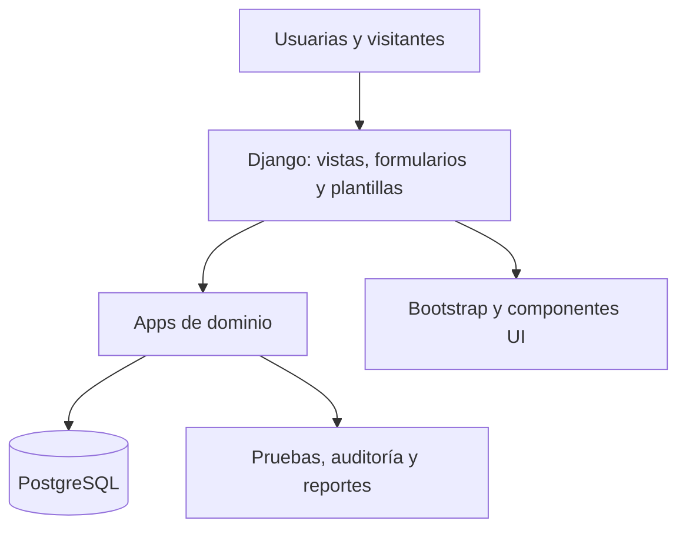

# Arquitectura objetivo de la aplicación

## Decisión de alto nivel

Construir un monolito modular Django. La interfaz se renderiza en el servidor con plantillas
y Bootstrap 5. PostgreSQL mantiene los datos transaccionales. Esta forma permite entregar
una aplicación completa con una sola base de despliegue, sin impedir límites claros entre
módulos.

## Módulos previstos

| App | Responsabilidad | No debe poseer |
|---|---|---|
| `core` | tipos y utilidades transversales realmente compartidos | reglas de todos los dominios |
| `accounts` | usuario, membresía, roles, permisos y perfil | actividades o producción |
| `planning` | jornadas, actividades, asignaciones y estados | registro de asistencia |
| `attendance` | entradas, salidas, participación y correcciones autorizadas | autenticación o inventario |
| `traceability` | catálogos, acopio, secado, lotes, inventario, ventas, gastos y cuentas por cobrar | presentación de reportes globales |
| `reports` | consultas, filtros, exportaciones y vistas derivadas | duplicar datos operativos |
| `public_site` | contenido y navegación pública | información interna o personal |

Los límites se confirmarán con los requisitos. `reports` lee datos mediante consultas; no
mantiene una segunda copia de los totales salvo una necesidad de rendimiento demostrada.

## Convenciones Django

- `models.py` o paquete `models/`: entidades e invariantes locales.
- `forms.py`: validación de entradas de usuaria.
- `views.py`: coordinación HTTP pequeña.
- `services.py`: solo operaciones de escritura que coordinan varias entidades/transacciones.
- `queries.py`: consultas complejas y reportes, si el volumen lo justifica.
- `policies.py` o permisos nativos: reglas de autorización reutilizables.
- `templates/<app>/`: páginas y parciales propiedad del módulo.
- `tests/`: recorridos de integración; cada app puede añadir pruebas cercanas al código.

No se crea una capa de repositorio encima del ORM por defecto. La arquitectura se profundiza
cuando una regla real lo exige, no para imitar otro framework.

## Integridad y auditoría

- Usuario personalizado desde el inicio.
- Todas las relaciones organizativas usan claves y restricciones explícitas.
- Una corrección sensible conserva autor, fecha, valor previo, valor nuevo y motivo si el
  requisito confirmado lo exige.
- Operaciones de lote, transformación e inventario se ejecutan dentro de `transaction.atomic`.
- Las existencias se derivan de movimientos o se concilian con ellos; no se altera un total
  sin rastro.
- Fechas y zonas horarias usan la configuración Django; los reportes explicitan periodo.
- Los borrados funcionales se deciden por dominio. No se agrega `soft delete` global sin
  analizar consultas, privacidad y retención.

## Seguridad

- RBAC con grupos/permisos Django y comprobación en backend.
- Pruebas de acceso permitido y denegado para cada operación sensible.
- CSRF, gestión de sesión, hash de contraseña y escaping mediante mecanismos Django.
- Archivos subidos, si se aprueban, validan tipo, tamaño, acceso y almacenamiento.
- Logs sin claves ni datos personales innecesarios.
- Admin de Django limitado a mantenimiento técnico; no sustituye la interfaz de negocio.

## Despliegue inicial propuesto

Una aplicación web, un proceso PostgreSQL y almacenamiento de archivos definido por el
entorno. Contenedores pueden mejorar reproducibilidad, pero no deben bloquear el desarrollo
local. La factibilidad actual prevé Supabase para PostgreSQL y Vercel en el presupuesto.
Debe verificarse dónde se ejecuta Django y cómo se conectan BD/archivos, además de límites,
seguridad y respaldo. El nombre de un servicio no demuestra el despliegue.
Referencia: [[../evidence/casos-de-uso/2026-09-28-cronograma-presupuesto-stack|stack y presupuesto vigentes]].

## Bases funcionales confirmadas

- Nombre visible del Comité y perfiles Directiva, Socia operaria y Visitante.
- Encargada como asignación temporal de producción o feria/venta.
- Ventas, cuentas por cobrar, valor base, excedente y pagos parciales dentro del alcance.
- Variables mínimas de secado y auditoría de correcciones.
- Reportes prioritarios descargables en PDF.

## Decisiones técnicas todavía abiertas

- Ubicar ventas, gastos y cuentas por cobrar dentro de `traceability` o en una app de dominio
  separada, según cohesión y tamaño confirmados por las specs.
- Política de retención, desactivación y borrado por dominio.
- Catálogos, unidades, formación de lotes y reglas detalladas de conciliación.
- Despliegue y respaldos; detalle de operaciones offline y políticas P-13/P-14. La necesidad
  de guardar y sincronizar ya es obligatoria en el diseño solicitado.
- Filtros, gráficos, generación de PDF y almacenamiento del logo autorizado.

## Continuidad PWA y relación con SSR

[[../requirements/proposals/2026-09-28-catalogo-v1-1|Revisión v1.1 de requisitos]]:
Manifest/Service Worker/Cache Storage permiten preparar recursos; IndexedDB conserva las
operaciones esenciales pendientes. Django sigue renderizando las páginas en línea; una
interfaz local específica y contratos de sincronización permiten captura sin red, sin exigir
una SPA o API completa. La futura spec delimita qué datos se precargan y protegen.

El servidor valida autorización y reglas antes de aplicar cada operación atómica. El
resultado local y el remoto son distintos. No se guardan páginas de autenticación ni se
anula el no-caché privado de SPEC-001. Tiempo/QR, revocación, dispositivo compartido,
conflictos, reintentos y retención requieren criterios verificables. El detalle de colas,
eventos y aislamiento del [[PLAN-DESDE-CERO|plan maestro]] requiere ADR; no está aprobado
solo por figurar en una propuesta. Los reportes no son otra fuente de saldos operativos.

## Aprobación de requisitos fuente — 2026-09-28

[[../requirements/CAT-REQ-001|CAT-REQ-001 v1.1]] está confirmado por el tesista, con
[[../evidence/casos-de-uso/2026-09-28-aprobacion-requisitos-v1-1|evidencia de aceptación]].
Queda resuelta la exclusión offline de la línea base anterior. P-13/P-14 y las specs siguen
pendientes; la aprobación de requisitos no promueve automáticamente esta propuesta técnica
ni sustituye la revisión académica, la estimación de trabajo o la prueba de despliegue.
