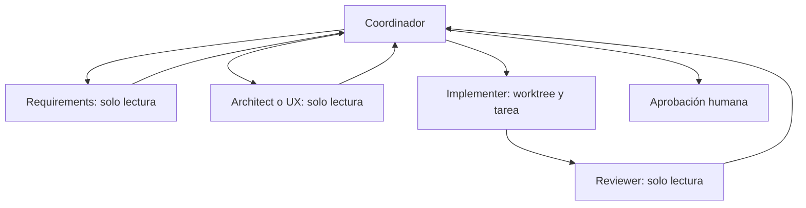

# Flujo multiagente del proyecto

## Objetivo

Usar especialización y revisión independiente sin convertir el proyecto en un conjunto de
agentes que modifican los mismos archivos. El coordinador conserva contexto, asigna límites
y presenta el resultado al tesista.



No se ejecutan todos los roles en cada tarea. Un cambio de texto puede necesitar solo
coordinador y reviewer; una funcionalidad sensible puede necesitar análisis, UX,
implementación y revisión.

## Cuándo paralelizar

Es seguro paralelizar:

- análisis de requisitos y revisión UX, ambos sin editar;
- exploración de módulos diferentes sin archivos compartidos;
- pruebas de distintos recorridos después de una implementación estable;
- implementaciones en worktrees separados cuando no comparten migraciones, settings,
  plantillas base ni contratos.

No es seguro paralelizar:

- dos cambios al mismo modelo o migración;
- navegación base y pantallas que dependen de esa navegación;
- varios escritores de dashboard, matriz, sprint o ADR;
- implementación mientras el requisito todavía cambia;
- cambios de dependencias o settings por más de un agente.

## Contrato de asignación

Toda tarea delegada incluye:

```yaml
task_id: TXXX
requirement_ids: [RF-XXX]
objective: resultado observable
allowed_paths: []
forbidden_paths: []
inputs: []
expected_tests: []
write_owner: nombre-del-agente
handoff_to: coordinator
```

Si falta alguno de estos datos y el vacío puede alterar alcance o archivos, el agente debe
detenerse y pedir precisión.

## Contrato de entrega

El agente devuelve:

- estado: `completed`, `partially-complete` o `blocked`;
- archivos leídos y, si aplica, modificados;
- decisiones y supuestos;
- comandos ejecutados con resultado real;
- criterios cubiertos y no cubiertos;
- riesgos, conflictos y próximo paso.

Solo el coordinador actualiza la matriz y propone el cierre. Solo el tesista autoriza Git
externo o acepta cambios de alcance.

## Límites iniciales

- Máximo tres hilos de agente abiertos.
- Profundidad uno: los subagentes no delegan.
- Un implementador por worktree.
- Ninguna fusión automática.
- Revisión independiente obligatoria para autenticación, permisos, asistencia, trazabilidad,
  inventario y migraciones de datos.
