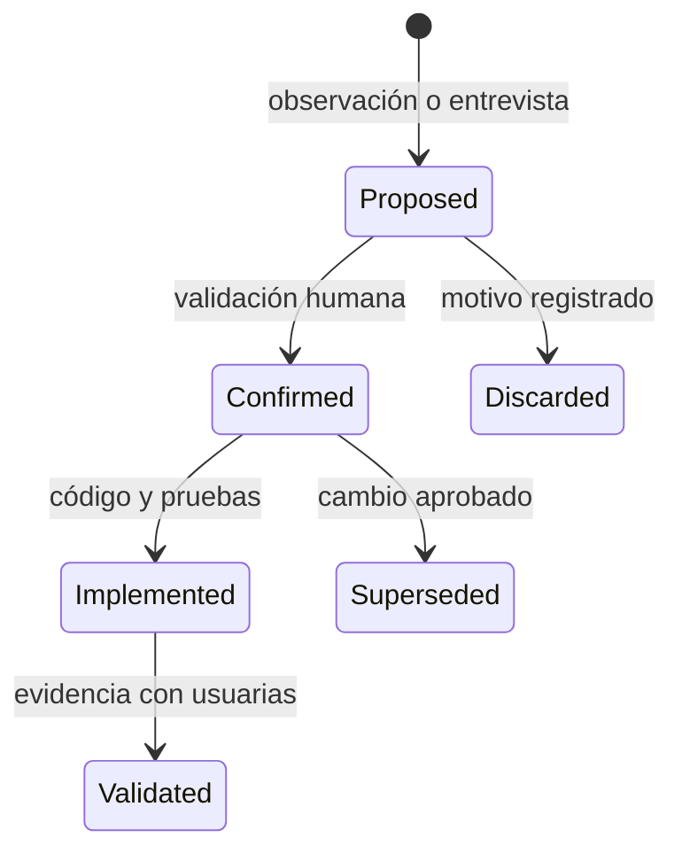

# Fuentes de verdad del proyecto

## Regla principal

Obsidian, Codex, Kimi y cualquier otro motor leen el mismo repositorio. No se copia un
requisito completo en varias carpetas ni se considera una conversación como documento
aprobado.

| Información | Fuente canónica | Uso de otras carpetas |
|---|---|---|
| Alcance académico | Anteproyecto aprobado + ADR de alcance | El contexto resume y enlaza; no sustituye el original |
| Hallazgos de campo | Nota con fecha, técnica y fuente en `docs/requirements/proposals/` | Se mantiene `proposed` hasta validación |
| Línea base de requisitos | CAT-REQ-001 con su evidencia de validación | Revisiones propuestas enlazan cambios y no heredan la aprobación anterior |
| Funcionalidad aprobada | `specs/<id>/spec.md` | `docs/requirements/` solo indexa o conserva propuesta de origen |
| Diseño técnico | `specs/<id>/plan.md` + ADR relacionados | Diagramas enlazan el plan |
| Trabajo ejecutable | `specs/<id>/tasks.md` | Sprint enlaza y resume, no duplica el detalle |
| Comportamiento implementado | Código, migraciones y pruebas | La documentación explica, pero no contradice el código |
| Decisión | Un ADR en `docs/decisions/` | Si cambia, se reemplaza mediante otro ADR, no se borra historia |
| Evidencia | `docs/evidence/<sprint-o-requisito>/` | La matriz enlaza el archivo exacto |
| Estado global | Dashboard, sprint actual y matriz | Solo el coordinador los actualiza en trabajo multiagente |
| Configuración de IA | Archivos versionables sin secretos + configuración local | Nunca se copian claves al vault |

## Ciclo de una propuesta

El nombre de archivo y los metadatos deben conservar un ID estable. Un cambio editorial no
crea otro requisito; un cambio semántico relevante se registra y vuelve a validar.

## Reglas de escritura multiagente

- Cada tarea declara un escritor y rutas permitidas.
- Los permisos de cada rol se toman de `agents/tesis/roles/`; reviewer es de solo lectura.
  Una propuesta autorizada de arquitectura o UX no aprueba requisitos ni modifica una spec confirmada.
- Implementadores trabajan en worktrees distintos cuando hay paralelismo.
- Dashboard, sprint, catálogo y matriz global tienen un único escritor: el coordinador.
- Los resultados de agentes hijos se integran después de revisar conflictos y evidencia.

## Datos que no son fuente de verdad

- Historial de chat del proveedor.
- Memoria interna o embeddings de un agente.
- Resúmenes sin vínculo a una fuente.
- Porcentajes de progreso sin criterio de terminado.
- Capturas sin fecha, contexto o recorrido reproducible.
- Salida declarada de una prueba que no fue ejecutada.
