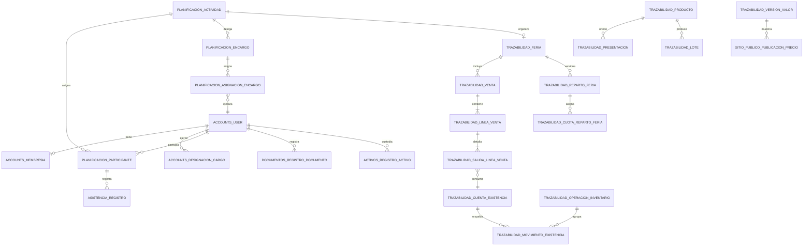
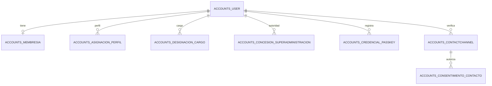
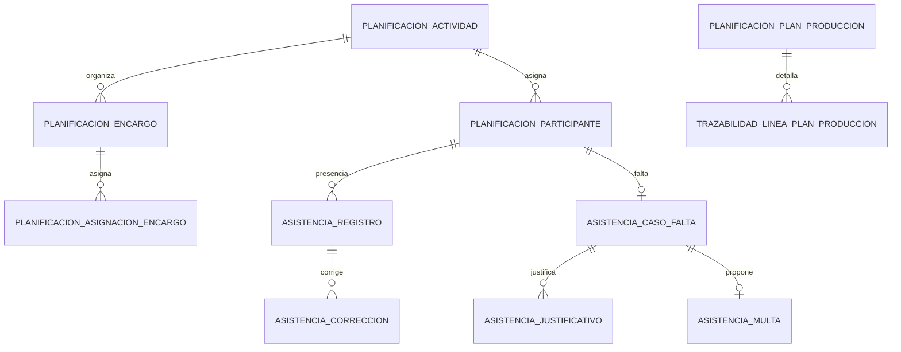
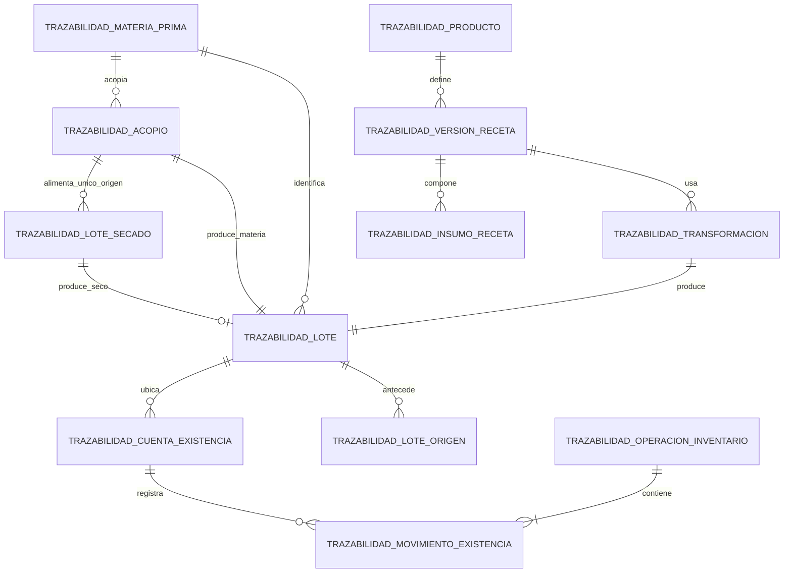
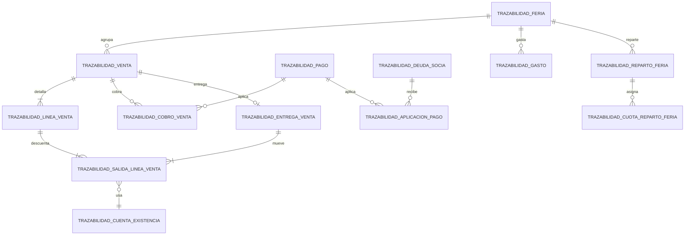
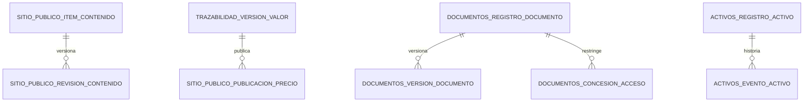

# Diseño integral propuesto de la base de datos

> Referencia de trabajo actual — 2026-10-30: [consolidación de datos v2.0](../../../documentacion/arquitectura/diseno_base_datos_v2.0_2026-10-30.md). Este archivo conserva el antecedente; las reglas incompatibles sobre Superadministración, devoluciones, reparto, rendición periódica, contingencia offline y kits están sustituidas. Las decisiones no modificadas conservan su evidencia.

**Estado:** propuesta técnica para revisión. Incluye únicamente reglas confirmadas en fuentes o decididas expresamente por el tesista el 29/10/2026; donde faltan datos, conserva parámetros sin valor activo y marca **Pregunta abierta**. Su aprobación como diseño no equivale a aprobar fórmulas, contenidos o permisos pendientes. No se generaron migraciones ni se ejecutaron operaciones en PostgreSQL.

**Revisión 0.2:** correcciones solicitadas por el tesista después de la revisión del diseño. Las tablas siguientes incorporan identidad de stock, linaje y cobros explícitos; §§16–19 precisan integridad, concurrencia, casos de aceptación y pendientes. Las preguntas de negocio sin respuesta conservan su bloqueo específico. La revisión no declara terminada SB-S1-03 ni aprueba nuevos requisitos.

Fuentes principales: [[../../requirements/CAT-REQ-001|CAT-REQ-001 v1.3]], [[../../../documentacion/requisitos/requisitos_generales_v2.3_2026-10-28|requisitos generales v2.3]], [[../../../documentacion/historias/usuario/historias_usuario_v2.8_2026-10-28|historias de usuaria v2.8]], [[../../../documentacion/historias/tecnicas/historias_tecnicas_v1.9_2026-10-28|historias técnicas v1.9]], [[../../../documentacion/arquitectura/arquitectura_v1.2_2026-10-28|arquitectura v1.2]], [[../ARQUITECTURA-OBJETIVO|arquitectura objetivo]], [[../../decisions/ADR-0006-monolito-modular-y-entrega-incremental|ADR-0006]], [[2026-10-29-decisiones-pendientes-diseno-datos|decisiones de este diseño]]. Para reglas heredadas, el texto base está en [[../../requirements/proposals/2026-07-22-catalogo-revisado-requisitos-r3|CAT-R3]], incorporado por CAT-REQ-001 con sus modificaciones posteriores. Cada tabla cita sus RF/HU; la presencia de una tabla es **Propuesta técnica** salvo cuando se indica que ya existe.

## 1. Contrato de modelado

- **Documentado:** una base PostgreSQL, apps Django `accounts`, `portal`, `planning`, `attendance`, `traceability`, `reports`, `public_site` y `core`; propiedad de escrituras por módulo; dependencias sin ciclos. [[../ARQUITECTURA-OBJETIVO|Arquitectura objetivo]], [[2026-10-29-mapa-conceptual-modulos-y-dependencias|mapa]].
- **Documentado:** `AUTH_USER_MODEL = "accounts.User"`. Ya existen por migración `accounts_user`, `accounts_loginthrottle`, `accounts_contactchannel`, `accounts_authchallenge`, `accounts_authattempt` y las tablas de Django `auth_*`, `django_content_type`, `django_session`, entre otras. `portal` no tiene modelos. No se modifica ninguna tabla de login en esta propuesta; esta lista deriva de código/migraciones, **no** de una inspección de migraciones aplicadas en la BD física. Fuentes: `app/config/settings/base.py`, `app/apps/accounts/models.py`, `app/apps/accounts/migrations/0001_initial.py` a `0003_contactchannel_authchallenge_authattempt.py`, [[../../../specs/001-acceso-usuarias-internas/data-model|SPEC-001]].
- **Propuesta técnica:** nuevas PK `bigint GENERATED BY DEFAULT AS IDENTITY`; FK a usuario mediante `settings.AUTH_USER_MODEL` y `ON DELETE RESTRICT` para registros históricos. En Django, `PROTECT` para dominios históricos y `SET_NULL` solo donde la pérdida de referencia esté justificada. Un borrado de usuario autenticable no es operación de negocio: se desactiva y se conservan FKs.
- **Propuesta técnica:** importes USD `numeric(18,2)`; cantidades físicas `numeric(20,6)` y factores `numeric(20,10)` con unidad explícita; `timestamptz` para instantes y `date` para días de negocio. Esas escalas son técnicas provisionales y se revisan con P-04/redondeo, sin convertir unidades desconocidas. No usar `float` monetario.
- **Propuesta técnica:** cada tabla sensible tiene `created_at timestamptz NOT NULL`, `created_by_id bigint FK accounts_user` cuando existe actor, y las rectificaciones/estados posteriores se registran en una tabla de eventos del **mismo módulo** con `actor_id`, `occurred_at`, `reason`, `old_value`, `new_value`, `source_operation_id`. Se evita una tabla global mutable en `core`. Los datos personales en snapshots se minimizan. [[../../requirements/CAT-REQ-001|RNF-AUD-001, RNF-PRV-001]].
- **Propuesta técnica:** estados, categorías, tipo de merma, tipo de gasto y demás opciones cambiantes son catálogos por dominio con `code` único, `label`, `is_active`, `valid_from/to`. Los códigos técnicos estables de una operación pueden ser constantes internas; no se transforman todas las constantes en tablas. FKs a catálogos preservan historial y desactivar una opción no invalida hechos anteriores. [[../../requirements/CAT-REQ-001|RF-CAT-001]], [[../ARQUITECTURA-OBJETIVO|arquitectura]].
- **Decisión del tesista D-17:** duraciones, montos, precios, umbrales y opciones de negocio se almacenan en tablas versionadas. Los servicios y constraints implementan las reglas protegidas; no se evalúa código arbitrario guardado en la BD. [[2026-10-29-decisiones-pendientes-diseno-datos|D-17]].
- **Propuesta técnica:** `CHECK` protege signo, rango y relación de columnas de la misma fila; `UNIQUE` e índices parciales protegen identidad y vigencia; FK protege pertenencia. Una regla entre múltiples filas, como saldo disponible, se verifica en una operación Django del módulo dueño bajo `transaction.atomic` y bloqueo de la fila que serializa la cuenta; se prueba con concurrencia PostgreSQL. No se presupone RLS, funciones o triggers de negocio. [[../../../documentacion/arquitectura/arquitectura_v1.2_2026-10-28|arquitectura §9]], [[../../requirements/CAT-REQ-001|RNF-DAT-001]].
- **Compatibilidad técnica:** confirmar versión de PostgreSQL y extensiones antes de traducir a migraciones. La unicidad con nulos usa `NULLS NOT DISTINCT` en PostgreSQL 15+ o índices únicos parciales por combinación válida de campos nulos. La ausencia de esa cláusula nunca elimina la restricción de BD. La no superposición usa exclusión con `btree_gist` si está disponible, o servicio que bloquea una fila padre existente antes de leer e insertar cualquier intervalo de ese ámbito. `select_for_update` sobre una búsqueda vacía no serializa creaciones. Véase §16.5.

**Convención de lectura de tablas:** cada fila indica columnas propias además de `id` y `created_at`. `FK U` significa `settings.AUTH_USER_MODEL`; `FK X` referencia la tabla nombrada. `R` significa `ON DELETE RESTRICT` para hechos. Una columna `*_at` es `timestamptz`; las FKs e índices finales se concretan en la spec del recorrido sin inventar un dato de negocio faltante.

## 2. `accounts`: identidad organizacional sobre login existente

**Documentado:** perfiles Directiva, Socia operaria y Visitante; cargos/encargos limitan operaciones; la Directiva administra membresía; la Superadministradora fue aceptada expresamente por el tesista en este chat, aunque RF-ACC-005 continúa `proposed` en CAT. El `is_superuser` técnico de Django no confiere autoridad organizacional. [[../../requirements/CAT-REQ-001|RF-ACC-001/002/003/005/006/007/008/009]], [[../../../specs/002-superadministracion/spec|SPEC-002]], [[2026-10-29-decisiones-pendientes-diseno-datos|D-01]].

| Tabla propuesta | Columnas y relaciones esenciales | Restricciones e índices | Trazabilidad |
|---|---|---|---|
| `accounts_membresia` | `user_id FK U R UNIQUE`, `joined_on date`, `ended_on date NULL`, `membership_status_id FK accounts_estado_membresia R`, `recorded_by_id FK U R`. | `CHECK ended_on IS NULL OR ended_on >= joined_on`; índice `(membership_status_id, joined_on)`. Desactivar conserva historia. | **Propuesta técnica:** RF-ACC-002/003, HU-ACC-002/003. |
| `accounts_estado_membresia` | `code varchar(32) UNIQUE`, `label varchar(80)`, `is_active boolean`. | No borrar códigos usados; índice único de código. | **Propuesta técnica:** RF-ACC-002/003. |
| `accounts_tipo_perfil` | `code varchar(32) UNIQUE`, `label varchar(80)`, `is_active boolean`. | Catálogo base: `socia_operaria` y `visitante`. La condición de Directiva no es un perfil paralelo, sino una propiedad derivada de poseer una designación de cargo activa. | **Documentado:** RF-ACC-003; **Propuesta técnica:** tabla. |
| `accounts_asignacion_perfil` | `user_id FK U R`, `profile_type_id FK accounts_tipo_perfil R`, `valid_from`, `valid_to NULL`, `assigned_by_id FK U R`, `reason text`. | `CHECK valid_to > valid_from`; `UNIQUE(user_id) WHERE valid_to IS NULL`; índice `(profile_type_id, valid_to)`. Asigna la condición base (socia o visitante). | **Propuesta técnica:** RF-ACC-003, HU-ACC-003. |
| `accounts_tipo_cargo` | `code varchar(32) UNIQUE`, `label varchar(80)`, `is_active boolean`. | Presidenta, Tesorera y Secretaria como cargos documentados; pertenecer a la Directiva se deriva de tener activa una de estas designaciones. | **Documentado:** RF-ACC-003, roles de CAT; **Propuesta técnica:** tabla. |
| `accounts_designacion_cargo` | `user_id FK U R`, `cargo_type_id FK accounts_tipo_cargo R`, `valid_from`, `valid_to NULL`, `assigned_by_id FK U R`, `reason text`. | `CHECK valid_to > valid_from`; `UNIQUE(cargo_type_id) WHERE valid_to IS NULL`; índice `(cargo_type_id, valid_to)`. Un solo titular activo por cargo: índice único parcial `(cargo_type_id) WHERE valid_to IS NULL` (decisión del tesista, pendiente de confirmar con el estatuto). Conserva histórico y da origen a la condición directiva. | **Propuesta técnica:** RF-ACC-003, P-01. |
| `accounts_concesion_superadministracion` | `user_id FK U R`, `authorized_by_id FK U R NULL`, `authorization_evidence varchar(255)`, `granted_by_id FK U R NULL`, `valid_from`, `revoked_at NULL`, `revocation_authorized_by_id FK U R NULL`, `revoked_by_id FK U R NULL`, `reason text`. | `CHECK revoked_at IS NULL OR revoked_at > valid_from`; `CHECK granted_by_id IS NULL OR granted_by_id <> user_id`; `UNIQUE(user_id) WHERE revoked_at IS NULL`; evidencia obligatoria. Servicio exige Presidenta vigente para autorizar cada alta/revocación; primer alta puede usar constancia presidencial externa si todavía no existe cuenta autorizadora. Varias concesiones activas a distintas usuarias son válidas. Límites administrativos actuales D-25/D-28; D-23 conserva antecedente. | **Propuesta técnica:** RF-ACC-005 aceptado por tesista; D-19, D-23, P-SUP-02. |
| ~~`accounts_concesion_modulo`~~ (Aplazada) | *Aplazada / retirada del alcance base.* | RF-ACC-005 define la superadministración transversal sin asignación individual por módulo; no se fragmenta la autorización técnica módulo a módulo. | **Descartada por conflicto:** RF-ACC-005, SPEC-002. |
| `accounts_credencial_passkey` | `user_id FK U R`, `credential_id bytea UNIQUE`, `public_key bytea`, `sign_count bigint`, `created_at`, `last_used_at NULL`, `revoked_at NULL`, `nickname varchar(80) NULL`. | `CHECK sign_count >= 0`; índice `(user_id, revoked_at)`; nunca guardar clave privada, PIN o biometría. | **Propuesta técnica:** RF-ACC-007, HU-ACC-011, [[../../../specs/003-acceso-multicanal/spec\|SPEC-003]]. |
| `accounts_evento_acceso` | `user_id FK U R NULL`, `actor_id FK U R NULL`, `event_type_id FK accounts_tipo_evento_acceso`, `occurred_at`, `subject_id FK U R NULL`, `reason text NULL`, `old_value jsonb NULL`, `new_value jsonb NULL`, `operation_id uuid UNIQUE`. | Índices `(subject_id, occurred_at DESC)`, `(actor_id, occurred_at DESC)`; almacenar solo campos necesarios y nunca tokens, contraseñas o claves. | **Propuesta técnica:** RF-ACC-002/005, RNF-AUD-001/PRV-001. |
| `accounts_version_politica_login` | `version_no integer UNIQUE`, `max_attempts integer`, `window_seconds integer`, `lock_seconds integer`, `idle_session_seconds integer`, `valid_from`, `valid_to NULL`, `approved_by_id FK U R`, `reason`. | `CHECK` todos los parámetros positivos; la versión inicial copia los valores ya aprobados en SPEC-001, sin alterar tablas de login. Cambio posterior solo con autorización de seguridad y auditoría. | **Propuesta técnica condicionada:** RF-ACC-001/005, D-17, [[../../../specs/001-acceso-usuarias-internas/spec\|SPEC-001]]. |

**Documentado:** `ContactChannel` ya enlaza cuenta, tipo y valor verificado; `AuthChallenge` guarda digest y caducidad; `AuthAttempt`/`LoginThrottle` limitan intentos. No se duplican esas tablas para los flujos de correo, WhatsApp o recuperación. La relación futura entre `AuthChallenge.contact` y `AuthChallenge.user` debe comprobarse en el servicio, porque dos FKs independientes no garantizan que el contacto pertenezca al mismo usuario; una restricción compuesta podría añadirse en una migración posterior si se justifica. [[../../../specs/003-acceso-multicanal/spec|SPEC-003]], código citado en §1.

## 3. `planning`: actividades, participación y encargos

| Tabla propuesta | Columnas y relaciones esenciales | Restricciones e índices | Trazabilidad |
|---|---|---|---|
| `planificacion_tipo_actividad` | `code UNIQUE`, `label`, `is_active`. | FK desde actividad; desactivar sin borrar historia. | **Propuesta técnica:** RF-PLA-001/002, HU-PLA-001/002. |
| `planificacion_actividad` | `activity_type_id FK`, `title varchar(180)`, `starts_at`, `ends_at NULL`, `status_id FK planificacion_estado_actividad`, `organizer_id FK U R`, `location text NULL`, `created_by_id FK U R`. | `CHECK ends_at IS NULL OR ends_at > starts_at`; índice `(starts_at, status_id)`; no borrado físico tras participación. | **Propuesta técnica:** RF-PLA-001/002/004. |
| `planificacion_estado_actividad` | `code UNIQUE`, `label`, `is_active`. | Estados válidos configurados por el módulo; transición por servicio. | **Propuesta técnica:** RF-PLA-001/004. |
| `planificacion_participante` | `activity_id FK planificacion_actividad R`, `user_id FK U R`, `assignment_status_id FK planificacion_estado_participante`, `assigned_by_id FK U R`, `assigned_at`, `withdrawn_at NULL`. | `UNIQUE(activity_id, user_id) WHERE withdrawn_at IS NULL`; índice `(user_id, withdrawn_at, activity_id)`; no se elimina una asignación usada por asistencia. | **Propuesta técnica:** RF-PLA-002/004, RF-ASI-001/006. |
| `planificacion_tipo_encargo` | `code UNIQUE`, `label`, `is_active`. | Secado, feria, pesaje u otros solo cuando su uso esté aprobado. | **Propuesta técnica:** RF-PLA-003, RF-INV-003. |
| `planificacion_encargo` | `activity_id FK planificacion_actividad R NULL`, `encargo_type_id FK planificacion_tipo_encargo R`, `title varchar(180)`, `description text NULL`, `status_id FK planificacion_estado_encargo`, `created_by_id FK U R`. | Define la responsabilidad objetiva y alcance en la actividad; no se reescribe al reasignar personas. | **Propuesta técnica:** RF-PLA-003, HU-PLA-003. |
| `planificacion_asignacion_encargo` | `encargo_id FK planificacion_encargo R`, `user_id FK U R`, `assigned_by_id FK U R`, `assigned_at`, `accepted_at NULL`, `starts_at NULL`, `ends_at NULL`, `revoked_at NULL`, `status_id FK planificacion_estado_asignacion_encargo`, `replaced_by_id FK self R NULL`, `close_evidence_ref text NULL`. | `CHECK ends_at IS NULL OR starts_at IS NOT NULL`; `CHECK ends_at IS NULL OR ends_at > starts_at`; `UNIQUE(encargo_id, user_id) WHERE ends_at IS NULL`; índice `(user_id, status_id, ends_at)`. Cardinalidad de encargo (Decisión 5): un encargo (p. ej. feria) puede tener múltiples encargadas activas simultáneamente; la restricción única impide duplicar a la misma socia activa en el mismo encargo. Una reasignación cierra la asignación previa (`ends_at = now()`) y crea una nueva fila sin alterar la historia ni el encargo base. | **Propuesta técnica:** RF-PLA-003, HU-PLA-003, P-01, Decisión 5. |
| `planificacion_evento_encargo` | `encargo_id FK planificacion_encargo R`, `assignment_id FK planificacion_asignacion_encargo R NULL`, `actor_id FK U R`, `occurred_at`, `event_type_id FK planificacion_tipo_evento_encargo`, `reason text NULL`, `old_value jsonb NULL`, `new_value jsonb NULL`. | Historial append-only de asignaciones, aceptaciones, cierres, delegaciones y reasignaciones con actor y fecha. | **Propuesta técnica:** RF-PLA-003, RNF-AUD-001. |
| `planificacion_plan_produccion` | `week_start date`, `created_by_id FK U R`, `status_id FK`, `approved_at NULL`. | `CHECK week_start` corresponde al inicio semanal acordado; definición de semana en spec. Índice `(week_start, status_id)`. No crea stock. | **Propuesta técnica:** RF-PLA-005, HU-PLA-005. |
| `planificacion_evento_cambio` | `entity_type`, `entity_id`, `actor_id FK U R`, `occurred_at`, `reason`, `old_value jsonb`, `new_value jsonb`, `operation_id uuid`, `revision_no integer`. | Índice `(entity_type, entity_id, occurred_at)`; `UNIQUE(operation_id, entity_type, entity_id, revision_no)` y revisión positiva; no borrar. | **Propuesta técnica:** RF-PLA-003/005, RNF-AUD-001. |

**Frontera de RF-PLA-005:** `planning` guarda fecha, estado y responsables del plan; `traceability` es dueño de las líneas de producto e insumo que referencian `planificacion_plan_produccion` (véase §5). Así se conserva `traceability → planning` y no se introduce un ciclo por la FK al catálogo productivo. **Propuesta técnica**, conforme [[../ARQUITECTURA-OBJETIVO|arquitectura objetivo]] y [[2026-10-29-mapa-conceptual-modulos-y-dependencias|mapa]].

## 4. `attendance`: eventos, correcciones, faltas y multas

| Tabla propuesta | Columnas y relaciones esenciales | Restricciones e índices | Trazabilidad |
|---|---|---|---|
| `asistencia_version_politica_qr` | `version_no integer UNIQUE`, `duration_seconds integer`, `valid_from`, `valid_to NULL`, `configured_by_id FK U R`, `reason`. | `CHECK duration_seconds > 0`; fila inicial de 3600 segundos por D-16; configuración por Superadministradora con auditoría y vigencia sin modificar fases emitidas. | **Propuesta técnica:** RF-ASI-007, D-16/D-17. |
| `asistencia_fase_qr` | `activity_id FK planificacion_actividad R`, `event_kind_id FK asistencia_tipo_evento`, `policy_version_id FK asistencia_version_politica_qr R`, `opened_by_id FK U R`, `opened_at`, `closed_at NULL`, `token_digest varchar(64) UNIQUE`, `expires_at`, `state_id FK`. | `CHECK expires_at > opened_at`; índice `(activity_id, event_kind_id, closed_at)`; solo Secretaria abre/cierra mediante servicio, token no contiene datos personales. `expires_at` usa duración de versión vigente. | **Propuesta técnica:** RF-ASI-007, D-16. |
| `asistencia_tipo_evento` | `code UNIQUE`, `label`, `is_active`. | Entrada y salida como datos iniciales documentados; no reutilizar código con otra semántica. | **Documentado:** RF-ASI-001; **Propuesta técnica:** catálogo. |
| `asistencia_registro` | `participant_id FK planificacion_participante R`, `event_kind_id FK`, `recorded_by_id FK U R`, `source_id FK asistencia_fuente_registro`, `server_received_at`, `declared_at NULL`, `accepted_at NULL`, `voided_at NULL`, `qr_phase_id FK asistencia_fase_qr R NULL`, `delegate_reason text NULL`, `sync_operation_id uuid NULL`. | `UNIQUE(participant_id, event_kind_id) WHERE accepted_at IS NOT NULL AND voided_at IS NULL`; `CHECK accepted_at IS NULL OR accepted_at >= server_received_at`; motivo obligatorio si origen delegado, validado por servicio/catálogo; referencia única al recibo de sincronización por actor/tipo/operación (§16.6). Salida sin entrada y orden cronológico en servicio atómico con bloqueo del participante. | **Propuesta técnica:** RF-ASI-001/002/007, RF-PWA-003. |
| `asistencia_correccion` | `event_id FK asistencia_registro R`, `actor_id FK U R`, `authorized_role_ref`, `occurred_at`, `reason text`, `old_value jsonb`, `new_value jsonb`, `revision_no integer`. | `UNIQUE(event_id, revision_no)`; `CHECK revision_no > 0`; no actualización ni borrado ordinario. | **Propuesta técnica:** RF-ASI-003, RNF-AUD-001. |
| `asistencia_participacion_adicional` | `participant_id FK planificacion_participante R`, `participation_type_id FK asistencia_tipo_participacion`, `recorded_by_id FK U R`, `recorded_at`, `note text NULL`. | `UNIQUE(participant_id, participation_type_id)` si tipo no repetible; la spec define repetibilidad. | **Propuesta técnica:** RF-ASI-005. |
| `asistencia_caso_falta` | `participant_id FK planificacion_participante R UNIQUE`, `closed_activity_at`, `status_id FK asistencia_estado_falta`, `generated_at`, `reviewed_by_id FK U R NULL`. | Se genera solo al cierre sin asistencia válida, dentro de transacción; índice `(status_id, generated_at)`. | **Propuesta técnica:** RF-ASI-006. |
| `asistencia_justificativo` | `absence_case_id FK asistencia_caso_falta R`, `submitted_by_id FK U R`, `submitted_at`, `reason text`, `evidence_ref text NULL`, `decision_id FK NULL`, `decided_by_id FK U R NULL`, `decided_at NULL`. | Índice `(absence_case_id, submitted_at)`; servicio verifica tres días hábiles y cargo de Presidenta para aceptar/rechazar, con vencimiento al final del día 3 local. Evidencia privada, no URL pública. | **Propuesta técnica:** RF-ASI-006, D-11, RNF-PRV-001. |
| `asistencia_calendario_habil` | `calendar_date date`, `is_holiday boolean`, `holiday_scope_id FK`, `recorded_by_id FK U R`, `reason text`. | `UNIQUE(calendar_date, holiday_scope_id)`; índice `(calendar_date, is_holiday)`; la regla excluye fines de semana y feriados nacionales/locales registrados por la Directiva, con vencimiento al final del día 3 en hora de Ecuador. | **Propuesta técnica:** RF-ASI-006, D-11. |
| `asistencia_version_regla_multa` | `version_no integer UNIQUE`, `absence_amount numeric(18,2)`, `late_amount_per_minute numeric(18,2)`, `valid_from`, `valid_to NULL`, `approved_by_id FK U R`, `reason`. | `CHECK` ambos importes >=0; fila inicial con USD 10/falta y USD 0,01/minuto comunicados en CAT; no recalcular multas históricas al cambiar versión. Quién aprueba un cambio de sanción requiere regla organizacional. | **Propuesta técnica:** RF-ASI-006, D-17, P-03. |
| `asistencia_multa` | `absence_case_id FK asistencia_caso_falta R UNIQUE`, `amount numeric(18,2)`, `rule_version_id FK asistencia_version_regla_multa R`, `status_id FK`, `validated_by_id FK U R NULL`, `validated_at NULL`. | `CHECK amount >= 0`; aplicación requiere validación de Tesorera. Redondeo de minutos según D-11; impugnación y cobro esperan P-03. | **Propuesta técnica:** RF-ASI-006, D-11/D-17. |
| `asistencia_impugnacion_multa` | `fine_id FK asistencia_multa R`, `submitted_by_id FK U R`, `submitted_at`, `reason text`, `evidence_ref NULL`, `received_by_id FK U R`, `status_id FK`, `decided_by_id FK U R NULL`, `decided_at NULL`, `decision_reason NULL`, `decided_amount numeric(18,2) NULL`. | `CHECK decided_amount IS NULL OR decided_amount >= 0`; índice `(fine_id, submitted_at)`; Tesorera recibe y decide. Mientras esté abierta, servicio prohíbe cobro. Decisión motivada en `[0, monto original]`, validada bajo bloqueo; rechazo mantiene original; cero deja caso sin cobro. | **Propuesta técnica:** RF-ASI-006, D-18. |
| `asistencia_pago_multa` | `fine_id FK asistencia_multa R`, `amount numeric(18,2)`, `paid_at`, `recorded_by_id FK U R`, `internal_receipt_id uuid UNIQUE`, `method_id FK asistencia_metodo_pago_multa`, `reversed_at NULL`, `reversal_reason NULL`. | `CHECK amount > 0`; `UNIQUE(fine_id) WHERE reversed_at IS NULL`; Tesorera registra solo pago total, igual al monto exigible tras la decisión vigente; comprobante interno automático. No cobro con impugnación abierta. | **Propuesta técnica:** RF-ASI-006, D-18. |
| `asistencia_evento_caso` | `absence_case_id FK R`, `actor_id FK U R`, `occurred_at`, `event_type_id FK`, `reason`, `old_value jsonb`, `new_value jsonb`. | Índice `(absence_case_id, occurred_at)`; apéndice histórico. | **Propuesta técnica:** RF-ASI-003/006, RNF-AUD-001. |

**Regla de autorización documentada:** socia consulta solo su asistencia; Directiva según cargo; corrección por Directiva o Encargada autorizada con motivo. La Presidenta acepta/rechaza justificaciones según D-11. D-28 limita a la Superadministradora a administración y correcciones auditadas; no registra asistencia ni decide multas/justificativos. La multa requiere validación de Tesorera antes de aplicarse. Si una falta cae lunes sin feriados, miércoles es día hábil 3; 5 min 30 s se cobran como 6 minutos. [[../../requirements/CAT-REQ-001|RF-ASI-003/004/006]], [[2026-10-29-decisiones-pendientes-diseno-datos|D-01/D-11]].

## 5. `traceability`: catálogo, producción, inventario y comercio

### 5.1 Catálogos, unidades y valores históricos

| Tabla propuesta | Columnas y relaciones esenciales | Restricciones e índices | Trazabilidad |
|---|---|---|---|
| `trazabilidad_unidad` | `code varchar(20) UNIQUE`, `name varchar(80)`, `dimension varchar(20)`, `decimal_places smallint`, `is_active boolean`. | `CHECK decimal_places BETWEEN 0 AND 6`; la dimensión impide comparar masa con volumen o piezas. Datos iniciales solo gramos/mililitros documentados; completar P-04. | **Propuesta técnica:** RF-CAT-001, RF-INV-006, P-04. |
| `trazabilidad_conversion_unidad` | `from_unit_id FK unit R`, `to_unit_id FK unit R`, `factor numeric(20,10)`, `valid_from`, `valid_to NULL`, `approved_by_id FK U R`. | `CHECK factor > 0 AND from_unit_id <> to_unit_id`; `UNIQUE(from_unit_id, to_unit_id, valid_from)`; prohibir solapamiento de vigencias en servicio. Solo unidades de igual dimensión o conversión contextual aprobada. | **Propuesta técnica:** RF-CAT-001, P-04. |
| `trazabilidad_categoria_materia_prima` | `code UNIQUE`, `label`, `is_active`. | Catálogo; no borrar usados. | **Propuesta técnica:** RF-CAT-001. |
| `trazabilidad_materia_prima` | `category_id FK`, `name varchar(150)`, `default_unit_id FK unit R`, `is_active boolean`, `approved_at NULL`. | Índice único de nombre normalizado dentro de categoría mientras activo; la lista de plantas queda P-04. | **Propuesta técnica:** RF-CAT-001, RF-TRA-001. |
| `trazabilidad_categoria_producto` | `code UNIQUE`, `label`, `is_active`. | Catálogo de categorías sin ENUM rígido. | **Propuesta técnica:** RF-CAT-001. |
| `trazabilidad_producto` | `category_id FK`, `name varchar(150)`, `variant varchar(150) NULL`, `is_active boolean`, `approved_at NULL`. | Índice único de nombre/variante normalizados según catálogo validado; no exigir secado al libro de recetas. | **Propuesta técnica:** RF-CAT-001, catálogo inicial de CAT. |
| `trazabilidad_presentacion` | `product_id FK product R`, `name varchar(100)`, `quantity numeric(20,6) NULL`, `unit_id FK unit R NULL`, `is_active boolean`. | `CHECK quantity IS NULL OR quantity > 0`; `CHECK (quantity IS NULL) = (unit_id IS NULL)` salvo kit/libro con unidad aprobada; índice `(product_id, is_active)`. P-04 define tamaños. | **Propuesta técnica:** RF-CAT-001, RF-INV-001, P-04. |
| `trazabilidad_version_valor` | `presentation_id FK presentation R`, `value_kind_id FK value_kind`, `amount numeric(18,2)`, `valid_from`, `valid_to NULL`, `approved_by_id FK U R`, `approved_at`, `reason`. | `CHECK amount >= 0`, `CHECK valid_to IS NULL OR valid_to > valid_from`; impedir vigencias solapadas para presentación/tipo mediante exclusion constraint o servicio con bloqueo. Precio de fábrica = valor base por D-04; sugerido, vigente y costo conocido conservan significado distinto. | **Propuesta técnica:** RF-INV-001, RF-VEN-003, D-04. |
| `trazabilidad_version_receta` | `product_id FK product R`, `version_no integer`, `valid_from`, `valid_to NULL`, `approved_by_id FK U R`, `status_id FK`, `contract_ref NULL`, `reference_yield_qty numeric(20,6) NULL`, `reference_yield_unit_id FK unidad R NULL`. | `UNIQUE(product_id, version_no) WHERE contract_ref IS NULL`; `UNIQUE(product_id, contract_ref, version_no) WHERE contract_ref IS NOT NULL`; `CHECK version_no > 0`; rendimiento de referencia y unidad presentes juntos y positivos antes de activar; vigencias sin solape por producto/contrato. No se inventan proporciones ni rendimiento. | **Propuesta técnica:** RF-TRA-005, P-04; revisión 0.2. |
| `trazabilidad_insumo_receta` | `recipe_version_id FK R`, `material_id FK material R NULL`, `product_id FK product R NULL`, `quantity numeric(20,6)`, `unit_id FK unit R`. | `CHECK quantity > 0`; `CHECK` exactamente uno de material/producto; índice `(recipe_version_id)`; compatibilidad de unidad P-04. | **Propuesta técnica:** RF-TRA-005. |
| `trazabilidad_umbral_minimo` | `material_id FK material R NULL`, `product_id FK product R NULL`, `unit_id FK unit R`, `minimum_qty numeric(20,6)`, `valid_from`, `valid_to NULL`, `approved_by_id FK U R`. | `CHECK` exactamente un objeto; `CHECK minimum_qty >= 0`; unicidad de umbral vigente por objeto y ubicación si se añade; no comparar dimensiones distintas. Sin umbrales por defecto. | **Propuesta técnica:** RF-INV-006, P-04. |
| `trazabilidad_linea_plan_produccion` | `plan_id FK planificacion_plan_produccion R`, `product_id FK product R`, `target_qty numeric(20,6)`, `unit_id FK unit R`, `responsible_id FK U R NULL`, `needed_on date NULL`. | `CHECK target_qty > 0`; índice `(plan_id, product_id)`; no genera lote ni movimiento. | **Propuesta técnica:** RF-PLA-005; ubicación evita ciclo modular. |
| `trazabilidad_material_plan` | `plan_line_id FK production_plan_line R`, `material_id FK material R`, `planned_qty numeric(20,6)`, `unit_id FK unit R`. | `CHECK planned_qty > 0`; índice `(plan_line_id)`; previsión, no consumo real. | **Propuesta técnica:** RF-PLA-005, RF-TRA-005. |

**P-04 parcialmente resuelto:** D-10 aporta diez presentaciones y composición cualitativa: horchata, mashua seca y kit para colada morada de 35 g; acondicionador y cuatro champús de 500 ml; dos tónicos de 100 ml. Horchata y kit para colada morada son productos diferentes. El libro de recetas y kit por contrato siguen en el catálogo confirmado anterior, sin presentación aportada en D-10. La BD no inventa proporciones, unidades de acopio ni conversiones. Una conversión masa↔volumen exige densidad o regla específica aprobada. [[2026-10-29-decisiones-pendientes-diseno-datos|D-10]], [[../../requirements/CAT-REQ-001|CAT §Catálogo inicial y P-04]].

### 5.2 Pesajes, secado, lotes y movimientos

| Tabla propuesta | Columnas y relaciones esenciales | Restricciones e índices | Trazabilidad |
|---|---|---|---|
| `trazabilidad_operacion_inventario` | `operation_type_id FK`, `performed_by_id FK U R`, `occurred_at`, `recorded_at`, `reason NULL`, `sync_operation_id uuid NULL`, `status_id FK`. | Sin UUID global duplicado: referencia al recibo de sincronización del módulo, único por actor/tipo/operación (§16.6); índice `(operation_type_id, occurred_at)`; cabecera común para todos los movimientos de un hecho. | **Propuesta técnica:** RF-INV-002, RF-PWA-003, RNF-DAT-001. |
| `trazabilidad_cuenta_existencia` | `lot_id FK trazabilidad_lote R NOT NULL`, `presentation_id FK trazabilidad_presentacion R NULL`, `unit_id FK trazabilidad_unidad R`, `custody_kind_id FK trazabilidad_tipo_custodia R`, `holder_id FK U R NULL`, `fair_id FK trazabilidad_feria R NULL`, `opened_at`, `closed_at NULL`. | Objeto productivo derivado del lote, sin duplicar producto/materia en la cuenta. Identidad activa: lote/presentación/unidad/clase/titular/feria, con nulos tratados como iguales (§16.1). Titular obligatorio en custodia individual; feria obligatoria en custodia de feria; reglas por clase en servicio. Bloquear el lote existente para crear cuentas y las cuentas por PK para movimientos. | **Propuesta técnica:** RF-INV-002/003/005, RNF-DAT-001; revisión 0.2. |
| `trazabilidad_movimiento_existencia` | `operation_id FK trazabilidad_operacion_inventario R`, `stock_account_id FK trazabilidad_cuenta_existencia R`, `direction smallint`, `quantity numeric(20,6)`, `unit_id FK trazabilidad_unidad R`, `created_at`. | `CHECK direction IN (-1, 1)` y `quantity > 0`; unidad igual a la unidad canónica de la cuenta; índice `(stock_account_id, id)` y `(operation_id)`; inmutable tras confirmación. Cantidad recibida en otra unidad conserva factor/versiones y valor original en el hecho origen; el saldo suma cantidades canónicas sin reinterpretar conversiones históricas. | **Propuesta técnica:** RF-INV-002/004/005, RNF-DAT-001; revisión 0.2. |
| `trazabilidad_acopio` | `operation_id FK trazabilidad_operacion_inventario R UNIQUE`, `output_lot_id FK trazabilidad_lote R UNIQUE`, `source_user_id FK U R`, `material_id FK trazabilidad_materia_prima R`, `quantity numeric(20,6)`, `unit_id FK trazabilidad_unidad R`, `received_at`, `responsible_id FK U R`, `valuation_amount numeric(18,2) NULL`, `observation text NULL`. | `CHECK quantity > 0`; valoración nula o no negativa; al confirmar, crea lote de materia prima, cuenta y movimiento de entrada en una transacción. Materia del lote igual a la del acopio; operación fuente coincide con el lote. | **Propuesta técnica:** RF-TRA-001; revisión 0.2. |
| `trazabilidad_lote_secado` | `source_collection_id FK trazabilidad_acopio R NOT NULL`, `output_lot_id FK trazabilidad_lote R UNIQUE NULL`, `operation_id FK trazabilidad_operacion_inventario R UNIQUE NULL`, `encargo_assignment_id FK planificacion_asignacion_encargo R NULL`, `started_at`, `ended_at NULL`, `initial_weight numeric(20,6)`, `final_weight numeric(20,6) NULL`, `unit_id FK trazabilidad_unidad R`, `temperature_c numeric(6,2) NULL`, `humidity_pct numeric(5,2) NULL`, `status_id FK`, `review_reason NULL`. | Cada secado pertenece a un solo acopio (D-26). No se crea tabla de múltiples aportes. Peso inicial positivo, final nulo o no negativo, humedad 0–100 y fin no anterior al inicio. Cierre positivo exige lote de materia seca de la misma materia, consumos/salida y linaje; merma total exige cierre excepcional sin inventar lote con cantidad disponible. Peso mayor queda en revisión. | **Propuesta técnica:** RF-TRA-002/003, D-26, P-05; revisión 0.2. |
| `trazabilidad_correccion_pesaje` | `drying_batch_id FK R`, `actor_id FK U R`, `occurred_at`, `reason`, `old_weight`, `new_weight`, `unit_id FK unit R`, `authorization_id FK U R NULL`. | `CHECK old_weight >= 0 AND new_weight >= 0`; índice `(drying_batch_id, occurred_at)`; apéndice histórico. La merma absoluta se deriva de pesajes efectivos, sin columna libre editable. | **Propuesta técnica:** RF-TRA-003, RNF-AUD-001. |
| `trazabilidad_lote` | `lot_code varchar(80) UNIQUE`, `product_id FK trazabilidad_producto R NULL`, `material_id FK trazabilidad_materia_prima R NULL`, `created_at`, `closed_at NULL`, `yield_qty numeric(20,6) NULL`, `unit_id FK trazabilidad_unidad R`, `status_id FK`, `source_operation_id FK trazabilidad_operacion_inventario R NULL`. | `CHECK` exactamente producto o materia; cantidad nula o no negativa. Lote confirmado exige operación de origen y cantidad comprobada. Un lote de acopio/secado conserva materia, uno de transformación conserva producto. Existencias derivadas de movimientos; cierre no significa agotamiento. No crear lote nuevo por entrega a socia. | **Propuesta técnica:** RF-TRA-001/002/004/005; revisión 0.2. |
| `trazabilidad_lote_origen` | `child_lot_id FK trazabilidad_lote R`, `parent_lot_id FK trazabilidad_lote R`, `source_operation_id FK trazabilidad_operacion_inventario R`, `input_qty numeric(20,6)`, `unit_id FK trazabilidad_unidad R`. | PK técnica `id`; `UNIQUE(child_lot_id, parent_lot_id, source_operation_id)`; `CHECK child <> parent AND input_qty > 0`; coincide con consumo real en movimientos. Secado conserva el lote de su único acopio; transformación conserva cada lote consumido; mezcla de producto terminado solo conforme D-12. §16.2 impide ciclos. | **Propuesta técnica:** RF-TRA-002/004/005, D-12/D-26; revisión 0.2. |
| `trazabilidad_transformacion` | `operation_id FK trazabilidad_operacion_inventario R UNIQUE`, `recipe_version_id FK trazabilidad_version_receta R`, `output_lot_id FK trazabilidad_lote R UNIQUE`, `responsible_id FK U R`, `occurred_at`, `residue_qty numeric(20,6) NULL`, `residue_unit_id FK trazabilidad_unidad R NULL`. | Residuo y unidad presentes juntos, cantidad no negativa. Lote de salida corresponde al producto de receta; entradas por lote/cuenta con movimientos, linaje y cantidades efectivas; todo confirma junto. No activar producción basada en proporciones desconocidas. | **Propuesta técnica:** RF-TRA-005, RNF-DAT-001; revisión 0.2. |
| `trazabilidad_insumo_transformacion` | `transformation_id FK R`, `stock_account_id FK stock_account R`, `quantity numeric(20,6)`, `unit_id FK unit R`. | `CHECK quantity > 0`; índice `(transformation_id)`; unidad compatible y disponibilidad en servicio bajo bloqueo. | **Propuesta técnica:** RF-TRA-005, RF-INV-002. |
| `trazabilidad_excepcion_inventario` | `operation_id FK inventory_operation R`, `exception_type_id FK`, `subject_lot_id FK lot R NULL`, `requested_by_id FK U R`, `approved_by_id FK U R NULL`, `reason`, `status_id FK`. | Índice `(status_id, created_at)`; la aprobación y movimiento ocurren juntos, sin excepciones activas predeterminadas. | **Propuesta técnica:** RF-TRA-004, RF-INV-002, P-05. |

**Integridad de stock:** toda entrada/salida se registra como operación y movimiento; transferir entre cuentas produce salida y entrada equivalentes en una transacción. `CHECK` valida una fila; la disponibilidad se valida con bloqueo de `stock_account` y suma de movimientos en el servicio propietario. El saldo derivado no puede ser negativo al confirmar. Una venta multiproducto bloquea las cuentas en orden estable, comprueba todas las líneas y confirma una sola transacción. La conciliación no fabrica cantidades para ocultar una diferencia. D-12 solo permite mezcla física de lotes sobrantes de horchata; consumir varios lotes de materia prima para un pedido preserva todos los orígenes sin fusionarlos. [[../../requirements/CAT-REQ-001|RF-INV-002/003/004/005, RF-VEN-001, RNF-DAT-001]], [[2026-10-29-decisiones-pendientes-diseno-datos|D-12]].

### 5.3 Custodia, ventas, deudas y rendición

| Tabla propuesta | Columnas y relaciones esenciales | Restricciones e índices | Trazabilidad |
|---|---|---|---|
| `trazabilidad_feria` | `activity_id FK planificacion_actividad R UNIQUE`, `opened_by_id FK U R`, `opened_at`, `closed_at NULL`, `status_id FK`, `notes NULL`. | `CHECK closed_at IS NULL OR closed_at >= opened_at`; el conjunto de encargadas se lee de `planificacion_encargo` de la actividad. | **Propuesta técnica:** RF-INV-003/004, RF-VEN-006/009. |
| `trazabilidad_transferencia_custodia` | `operation_id FK trazabilidad_operacion_inventario R`, `fair_id FK trazabilidad_feria R NULL`, `encargo_assignment_id FK planificacion_asignacion_encargo R NULL`, `from_account_id FK trazabilidad_cuenta_existencia R`, `to_account_id FK trazabilidad_cuenta_existencia R`, `outgoing_movement_id FK trazabilidad_movimiento_existencia R UNIQUE`, `incoming_movement_id FK trazabilidad_movimiento_existencia R UNIQUE`, `quantity numeric(20,6)`, `unit_id FK trazabilidad_unidad R`, `responsible_id FK U R`, `recipient_id FK U R`, `received_at NULL`, `difference_qty numeric(20,6) NULL`. | `CHECK from_account_id <> to_account_id AND quantity > 0`; movimientos opuestos de la misma operación, cantidad, lote, presentación y unidad; `CHECK difference_qty IS NULL OR difference_qty >= 0`; varias líneas de lote pueden agruparse bajo una operación atómica para una socia. Cada línea conserva lote de origen; no hay recepción ficticia ni deuda automática. | **Propuesta técnica:** RF-INV-003/004/005, D-12 ampliado por tesista. |
| `trazabilidad_comprador` | `display_name varchar(180)`, `buyer_type_id FK`, `contact_value NULL`, `created_by_id FK U R`. | Índice de búsqueda normalizada; datos mínimos aprobados. Contado puede usar código de Público general sin ficha personal. No es `accounts.User`. | **Propuesta técnica:** RF-VEN-002, RNF-PRV-001. |
| `trazabilidad_venta` | `fair_id FK trazabilidad_feria R NULL`, `sale_type_id FK`, `buyer_id FK trazabilidad_comprador R NULL`, `recorded_by_id FK U R`, `sold_at`, `recorded_at`, `internal_id uuid UNIQUE`, `manual_voucher_id FK trazabilidad_comprobante_manual R UNIQUE NULL`, `status_id FK`. | D-24: cero crédito en feria, venta individual e institucional. Forma de pago pertenece al cobro (§16.3); no representa crédito. Venta confirmada exige cobro completo y entrega posterior; borrador no genera stock ni deuda. Folio interno único. Comprador anónimo admisible donde RF lo permita. Superadministradora no vende ni registra venta por otra socia (D-25). | **Cambio solicitado por tesista:** D-24/D-25; discrepancia con RF-VEN-002/007 y CAT vigente; revisión 0.2. |
| `trazabilidad_linea_venta` | `sale_id FK trazabilidad_venta R`, `presentation_id FK trazabilidad_presentacion R`, `seller_id FK U R`, `quantity numeric(20,6)`, `unit_price numeric(18,2)`, `unit_base numeric(18,2)`, `line_total numeric(18,2)`, `base_total numeric(18,2)`, `price_version_id FK trazabilidad_version_valor R`, `base_version_id FK trazabilidad_version_valor R`, `discount_policy_id FK NULL`, `below_base_authorization_id FK U R NULL`. | Cantidad positiva y precios no negativos; cantidad en unidades comerciales de la presentación. Valores, totales calculados y referencia histórica congelados. `line_total = ROUND_HALF_UP(quantity * unit_price, 2)` y `base_total = ROUND_HALF_UP(quantity * unit_base, 2)` según D-30; total de venta = suma de totales de línea, sin redondear nuevamente. La vendedora se identifica solo en cada línea; la cabecera conserva quien digitó para admitir comprobantes colectivos sin atribución contradictoria. Las asignaciones de stock por lote están en `trazabilidad_salida_linea_venta`; su suma cubre exactamente la cantidad vendida. Vendedora pertenece a la operación y tiene custodia/encargo. | **Propuesta técnica:** RF-VEN-001/003/004/005/006/009, D-24/D-25; revisión 0.2. |
| `trazabilidad_cobro_venta` | `payment_id FK trazabilidad_pago R`, `sale_id FK trazabilidad_venta R`, `amount numeric(18,2)`. | `UNIQUE(payment_id, sale_id)` y monto positivo; pago de tipo cobro de comprador, nunca rendición. La suma vigente debe cubrir el total exacto de la venta antes de entregar. Un cobro no se aplica dos veces ni a ventas de otra persona/ámbito sin causa autorizada. | **Propuesta técnica:** RF-VEN-001/006/007, D-24; revisión 0.2. |
| `trazabilidad_entrega_venta` | `sale_id FK trazabilidad_venta R UNIQUE`, `inventory_operation_id FK trazabilidad_operacion_inventario R UNIQUE`, `delivered_at`, `delivered_by_id FK U R`, `evidence_ref NULL`. | Solo después de cobro completo confirmado; no entrega parcial automática ni venta a crédito. Cabecera con todas las salidas de líneas bajo una sola transacción. No confundir entrega a comprador con transferencia a custodia. | **Propuesta técnica:** D-24/D-27, RF-VEN-001; revisión 0.2. |
| `trazabilidad_salida_linea_venta` | `sale_line_id FK trazabilidad_linea_venta R`, `delivery_id FK trazabilidad_entrega_venta R`, `stock_account_id FK trazabilidad_cuenta_existencia R`, `movement_id FK trazabilidad_movimiento_existencia R UNIQUE`, `quantity numeric(20,6)`. | Cantidad positiva; línea y entrega de la misma venta; movimiento negativo de la misma cuenta y operación. Unidades/presentación coinciden; una línea puede consumir varios lotes del mismo ámbito económico, conservando cada origen sin mezcla física; nunca combina custodia individual y compartida ni titulares diferentes. | **Propuesta técnica:** RF-TRA-004, RF-VEN-001, D-12/D-24; revisión 0.2. |
| `trazabilidad_politica_descuento` | `presentation_id FK presentation R`, `threshold_qty numeric(20,6)`, `unit_id FK unit R`, `discount_kind_id FK`, `new_price numeric(18,2) NULL`, `percent numeric(7,4) NULL`, `valid_from`, `valid_to NULL`, `approved_by_id FK U R`, `status_id FK`. | `CHECK threshold_qty > 0`; `CHECK` exactamente precio o porcentaje; `CHECK percent BETWEEN 0 AND 100` si consta; no activar sin P-08 completo; precio bajo base necesita excepción. | **Propuesta técnica:** RF-VEN-005, P-08. |
| `trazabilidad_excepcion_precio` | `sale_line_id FK sale_line R UNIQUE`, `authorized_by_id FK U R`, `authorized_at`, `reason`, `base_difference numeric(18,2)`, `approval_mode_id FK`. | `CHECK base_difference > 0`; excepción trazable, previa o posterior según contingencia aprobada. | **Propuesta técnica:** RF-VEN-004, RNF-AUD-001. |
| `trazabilidad_comprobante_manual` | `fair_id FK fair R`, `internal_id uuid UNIQUE`, `paper_ref varchar(80) NULL`, `occurred_at`, `digitized_at NULL`, `digitized_by_id FK U R NULL`, `verified_at NULL`, `verified_by_id FK U R NULL`, `status_id FK`. | Identificador automático interno, no factura; `UNIQUE(fair_id, paper_ref) WHERE paper_ref IS NOT NULL`; índice `(status_id, occurred_at)`; un comprobante se vincula a una sola venta. Registrar hasta el fin del día calendario siguiente (23:59:59 hora de Ecuador) según D-14 y D-21. | **Propuesta técnica:** RF-VEN-008, D-14, D-21, P-10. |
| `trazabilidad_deuda_socia` | `member_id FK U R`, `origin_sale_line_id FK trazabilidad_linea_venta R UNIQUE`, `base_amount numeric(18,2)`, `opened_at`, `status_id FK`. | Base positiva; cuenta interna por rendir al vender stock individual, según D-04/D-27. Recibir custodia no crea deuda. No es crédito al comprador. Solo líneas de venta individual entregadas y pagadas por comprador; movimiento de stock compartido se concilia por feria. Ajustes monetarios pendientes D-03/D-29. | **Propuesta técnica:** RF-CXC-001, D-04/D-27; revisión 0.2. |
| ~~`trazabilidad_cuenta_por_cobrar_externa`~~ | Retirada de la propuesta activa por D-24. | No hay crédito al comprador ni deuda externa ni cuotas de cliente. El CAT aprobado conserva su texto hasta revisión de la enmienda trazable; no se borra historial ni tabla real (esta entidad aún no existe en código). | **Discrepancia registrada:** RF-VEN-002/007, RF-CXC-001/002, D-24. |
| `trazabilidad_pago` | `flow_type_id FK trazabilidad_tipo_flujo_pago R`, `amount numeric(18,2)`, `paid_at`, `recorded_by_id FK U R`, `received_by_id FK U R`, `member_id FK U R NULL`, `buyer_id FK trazabilidad_comprador R NULL`, `payment_method_id FK trazabilidad_metodo_pago R`, `evidence_ref NULL`, `status_id FK`, `operation_id uuid UNIQUE`. | `amount > 0`; flujo técnico protegido: cobro de comprador o rendición de socia; no habilita crédito. El flujo determina destino en §16.3. Nunca sumar cobro y rendición como dos ventas. Inmutable al confirmar; reversión con causa y efecto pendiente de regla D-29. | **Propuesta técnica:** RF-VEN-001, RF-CXC-001/002, D-24/D-27/D-29; revisión 0.2. |
| `trazabilidad_aplicacion_pago` | `payment_id FK trazabilidad_pago R`, `member_debt_id FK trazabilidad_deuda_socia R`, `applied_amount numeric(18,2)`. | `CHECK applied_amount > 0`; `UNIQUE(payment_id, member_debt_id)`; solo rendición interna. Suma aplicada no supera pago ni saldo interno, bajo bloqueo de ambos. No contiene deuda externa ni pagos a crédito de compradores. Rechazar/retener exceso como incidente, sin crear crédito o reembolso automático. | **Propuesta técnica:** RF-CXC-001/002 acotados a rendición, D-24/D-27/D-29; revisión 0.2. |
| `trazabilidad_categoria_gasto` | `code UNIQUE`, `label`, `is_active`, `common_fair_cost boolean`. | Transporte, hospedaje, comida y puesto iniciales por D-06; otros tras validación. No borrar histórico. | **Documentado por tesista:** D-06; **Propuesta técnica:** catálogo. |
| `trazabilidad_plan_gasto_feria` | `fair_id FK fair R`, `category_id FK expense_category R`, `planned_amount numeric(18,2)`, `planned_by_id FK U R`, `planned_at`, `note NULL`. | `CHECK planned_amount >= 0`; plan no equivale a gasto real ni se descuenta del fondo hasta incurrir/aprobar. | **Propuesta técnica:** RF-GAS-001 ajustado en CAT v1.2. |
| `trazabilidad_gasto` | `fair_id FK fair R NULL`, `category_id FK expense_category R`, `amount numeric(18,2)`, `paid_by_kind_id FK`, `incurred_at`, `recorded_by_id FK U R`, `approved_by_id FK U R NULL`, `concept text`, `evidence_ref NULL`, `status_id FK`. | `CHECK amount > 0`; índice `(fair_id, status_id)`; solo gastos comunes de la asociación aprobados entran en fondo. Gastos personales quedan fuera de este cálculo. | **Propuesta técnica:** RF-GAS-001/002, RF-VEN-009, D-06. |
| `trazabilidad_caso_ajuste_venta` | `sale_id FK sale R`, `reason_kind_id FK`, `requested_by_id FK U R`, `requested_at`, `physical_operation_id FK inventory_operation R NULL`, `money_effect_status_id FK`, `resolved_by_id FK U R NULL`, `resolution_reason NULL`. | Índice `(money_effect_status_id, requested_at)`; efecto monetario queda pendiente por D-03/P-09; movimiento físico no altera deuda por inferencia. | **Propuesta técnica:** RF-CXC-001/003, RF-INV-002, D-03. |
| `trazabilidad_conciliacion_feria` | `fair_id FK fair R`, `version_no integer`, `prepared_by_id FK U R`, `prepared_at`, `verified_by_id FK U R NULL`, `verified_at NULL`, `money_received numeric(18,2) NULL`, `status_id FK`, `difference_note NULL`. | `UNIQUE(fair_id, version_no)`; importes resumidos son snapshot con fuente en pagos/ventas, no saldo editable. Preparación por la socia encargada (`prepared_by_id`) y verificación/cierre conjunto por la Tesorera (`verified_by_id`) según D-22. | **Propuesta técnica:** RF-INV-004, RF-CXC-003, RF-REP-005, D-22. |
| `trazabilidad_linea_conciliacion_feria` | `reconciliation_id FK fair_reconciliation R`, `stock_account_id FK stock_account R`, `unit_id FK unit R`, `received_qty numeric(20,6)`, `sold_qty numeric(20,6)`, `returned_qty numeric(20,6)`, `remaining_qty numeric(20,6)`, `difference_qty numeric(20,6)`. | `UNIQUE(reconciliation_id, stock_account_id)`; `CHECK` cantidades no negativas salvo diferencia; `CHECK remaining_qty = received_qty - sold_qty - returned_qty` solo cuando el movimiento representa esa secuencia; se coteja con movimientos fuente. No sumar productos/unidades incompatibles. | **Propuesta técnica:** RF-INV-004, RF-CXC-003. |
| `trazabilidad_version_regla_reparto_feria` | `version_no integer UNIQUE`, `strategy_code varchar(40)`, `valid_from`, `valid_to NULL`, `approved_by_id FK U R`, `reason`. | La versión inicial identifica fórmula D-05: **ventas compartidas cobradas − base de esas líneas − gastos comunes**; modo de reparto se elige por feria. No guarda SQL/código editable. Una fórmula distinta requiere revisión del módulo y nueva versión. | **Propuesta técnica:** RF-VEN-006/009, D-05/D-17. |
| `trazabilidad_reparto_feria` | `fair_id FK fair R`, `reconciliation_id FK trazabilidad_conciliacion_feria R`, `rule_version_id FK fair_rule_version R`, `prepared_by_id FK U R`, `prepared_at`, `distribution_mode_id FK`, `shared_sales_total numeric(18,2)`, `shared_base_total numeric(18,2)`, `common_expenses numeric(18,2)`, `pool_amount numeric(18,2)`, `version_no`, `closed_at NULL`, `status_id FK`. | `UNIQUE(fair_id, version_no)`; `CHECK pool_amount = shared_sales_total - shared_base_total - common_expenses`; solo líneas de stock compartido entran en estos dos primeros importes; sin comisión si `pool_amount <= 0`; cierre tras conciliación y aprobación de todas. El excedente individual queda fuera. | **Propuesta técnica:** RF-VEN-006/009, RF-VEN-003, D-04/D-05/D-06/D-17. |
| `trazabilidad_cuota_reparto_feria` | `distribution_id FK trazabilidad_reparto_feria R`, `encargo_assignment_id FK planificacion_asignacion_encargo R`, `member_id FK U R`, `shared_sales_basis numeric(18,2)`, `share_amount numeric(18,2)`, `accepted_at NULL`, `accepted_by_id FK U R NULL`. | `UNIQUE(distribution_id, member_id)`; cuota no negativa; aceptación de beneficiaria = titular de cuota, perteneciente al encargo de la feria. La Superadministradora no participa como vendedora ni beneficiaria por ese rol (D-25/D-28). Suma de cuotas = max(fondo,0); una nueva versión invalida aceptaciones anteriores. | **Propuesta técnica:** RF-VEN-006/009, D-05/D-09/D-25/D-28; revisión 0.2. |
| `trazabilidad_vista_cierre_mensual_socia` *(Vista SQL / consulta autorizada, no tabla física)* | `member_id FK U`, `period_start date`, `period_end date`, `individual_sales_total numeric(18,2)`, `base_due numeric(18,2)`, `individual_gross_surplus numeric(18,2)`, `shared_fair_share_total numeric(18,2)`, `buyer_collections_total numeric(18,2)`, `internal_renditions_total numeric(18,2)`. | Vista de lectura o consulta autorizada calculada dinámicamente sobre ventas, transferencias, devoluciones, repartos y pagos fuente (Decisión del tesista 2). No es tabla física; no almacena estado mutable ni duplica hechos. No convierte custodia en deuda. | **Propuesta técnica:** RF-REP-005, RF-INV-005, RF-VEN-003/006/009, RF-CXC-001/002, Decisión 2. |
| `trazabilidad_evento_cambio` | `entity_type`, `entity_id`, `actor_id FK U R`, `occurred_at`, `reason`, `old_value jsonb`, `new_value jsonb`, `operation_id uuid`, `revision_no integer`, `authorization_id FK U R NULL`. | `UNIQUE(operation_id, entity_type, entity_id, revision_no)` y revisión positiva; índice `(entity_type, entity_id, occurred_at)`; historial append-only de precio, movimiento correctivo, venta, gasto, pago, reparto y ajuste. | **Propuesta técnica:** RNF-AUD-001, RF-TRA-003, RF-INV-002, RF-VEN-004/005/009. |

**Decisiones de feria documentadas por el tesista:** `fondo común = ventas cobradas de stock compartido - valor base de esas líneas - gastos comunes asociativos`. El excedente de stock individual se atribuye solo a la socia titular y no entra al fondo. En feria no hay crédito. D-24 exige cobro al comprador antes de entregar también fuera de feria. D-27 conserva la obligación interna de rendir el valor base al vender desde custodia individual; esa obligación no es crédito al comprador. Cada línea identifica vendedora; modo igualitario o proporcional al importe **compartido** vendido por encargada; todas las encargadas aceptan su cuota. Fondo común cero/negativo = sin comisión y diferencia pendiente de conciliación como pérdida de la asociación. Gastos comunes: transporte, hospedaje, comida y puesto pagados por la asociación. Los centavos se asignan por mayor resto y empate por identificador de asignación de encargo menor (§16.4). [[2026-10-29-decisiones-pendientes-diseno-datos|D-04 a D-09]], [[../../requirements/CAT-REQ-001|RF-VEN-006/009, P-07]].

**Venta individual documentada por el tesista:** una socia activa puede vender su stock individual sin encargo de feria; el servidor comprueba titularidad y saldo. La venta con stock compartido requiere encargo de la feria y la institucional sigue a cargo de Tesorera. D-24 exige pago antes de entrega en todos los casos; D-25 excluye ventas por Superadministradora. El cambio de RF-VEN-001 debe sincronizarse en requisito e historia antes de implementar. [[2026-10-29-decisiones-pendientes-diseno-datos|D-02]], [[../../requirements/CAT-REQ-001|RF-VEN-001/006/007]].

**División para ventas individuales:** el tesista explicó que la Secretaria reparte cantidades de uno o varios lotes entre socias. **Decisión D-27:** modelar esto como transferencia a cuentas de custodia individuales, manteniendo cada lote original en los movimientos y mostrando a la socia un total agrupado. Esto evita crear un lote productivo nuevo por una entrega y mantiene la regla de que solo una mezcla física crea lote derivado. [[2026-10-29-decisiones-pendientes-diseno-datos|D-12]], [[../../requirements/CAT-REQ-001|RF-TRA-004, RF-INV-005]].

**P-08/D-13:** los campos del esquema para descuentos existen, pero la base de datos comienza **sin filas de política activas**. La Presidenta y la organización completarán valores; crear filas vacías que puedan aplicarse por accidente sería menos seguro. **P-10/D-14/D-21/D-22:** una venta registrada al cierre o después tiene plazo hasta el fin del día calendario siguiente (23:59:59 hora de Ecuador) para registrarse con su identificador automático interno. La verificación física de sobrantes y la conciliación de dinero la realizan conjuntamente la socia encargada y la Tesorera, cerrando el acta de feria sin acciones unilaterales. [[2026-10-29-decisiones-pendientes-diseno-datos|D-13/D-14/D-21/D-22]], [[../../requirements/CAT-REQ-001|RF-VEN-005/008, RF-INV-004]].

## 6. `public_site`, `portal`, `reports` y avisos

| Tabla o módulo | Columnas y relaciones esenciales | Restricciones e índices | Trazabilidad |
|---|---|---|---|
| `sitio_publico_item_contenido` | `content_type_id FK sitio_publico_tipo_contenido`, `slug varchar(160) UNIQUE`, `current_status_id FK`, `created_by_id FK U R`, `created_at`. | `slug` único, sin datos privados; no borrar tras publicación. | **Propuesta técnica:** RF-PUB-001/002. |
| `sitio_publico_revision_contenido` | `item_id FK content_item R`, `revision_no`, `title`, `body`, `media_ref NULL`, `prepared_by_id FK U R`, `prepared_at`, `approved_by_id FK U R NULL`, `approved_at NULL`, `published_at NULL`, `retired_at NULL`. | `UNIQUE(item_id, revision_no)`; solo una revisión publicada vigente por ítem mediante índice parcial `UNIQUE(item_id) WHERE published_at IS NOT NULL AND retired_at IS NULL`; aprobación precede publicación en servicio transaccional. | **Propuesta técnica:** RF-PUB-001/002, P-12. |
| `sitio_publico_publicacion_precio` | `value_version_id FK trazabilidad_version_valor R`, `published_by_id FK U R`, `published_at`, `retired_at NULL`. | `UNIQUE(value_version_id) WHERE retired_at IS NULL`; servicio comprueba precio vigente/aprobado antes de exponerlo. No crea pedido ni venta; enlace de WhatsApp solo consulta contextual. | **Propuesta técnica:** RF-PUB-003, P-12. |
| `sitio_publico_evento_publicacion` | `item_id FK content_item R NULL`, `price_publication_id FK R NULL`, `actor_id FK U R`, `occurred_at`, `event_type_id FK`, `reason`, `old_value jsonb`, `new_value jsonb`. | `CHECK` exactamente un objeto; índice por objeto/fecha; histórico append-only. | **Propuesta técnica:** RF-PUB-002/003, RNF-AUD-001. |
| `accounts_consentimiento_contacto` | `user_id FK U R`, `contact_id FK accounts_contactchannel R`, `purpose_id FK accounts_proposito_consentimiento`, `given_at`, `withdrawn_at NULL`, `source_ref`, `recorded_by_id FK U R`. | `UNIQUE(contact_id, purpose_id) WHERE withdrawn_at IS NULL`; verificar que contacto pertenece al usuario y está verificado antes de enviar. Consentimiento no se infiere de tener teléfono. | **Propuesta técnica:** RF-NOT-002, RNF-PRV-001. |
| `planificacion_version_politica_recordatorio` | `activity_type_id FK planificacion_tipo_actividad R`, `lead_days smallint`, `valid_from`, `valid_to NULL`, `configured_by_id FK U R`, `reason`. | `CHECK lead_days > 0`; las versiones aprobadas iniciales usan uno o dos días según RF-NOT-001, sin incrustar el valor en código; política por tipo y vigencia sin solape. | **Propuesta técnica:** RF-NOT-001, D-17. |
| `planificacion_recordatorio` | `activity_id FK planificacion_actividad R NULL`, `encargo_assignment_id FK planificacion_asignacion_encargo R NULL`, `recipient_id FK U R`, `due_at`, `seen_at NULL`, `status_id FK`. | `CHECK` al menos una fuente; índice `(recipient_id, status_id, due_at)`; uno/dos días antes según regla de actividad o asignación. | **Propuesta técnica:** RF-NOT-001, RF-PLA-001/003. |
| `planificacion_envio_externo` | `reminder_id FK planificacion_recordatorio R`, `contact_consent_id FK accounts_consentimiento_contacto R`, `provider_ref NULL`, `attempt_no`, `requested_at`, `result_at NULL`, `delivery_status_id FK`, `failure_code NULL`. | `UNIQUE(reminder_id, contact_consent_id, attempt_no)`; intento fallido no cuenta como enviado; reintento idempotente. Solo se crea al habilitar canal/proveedor/costo aprobados. | **Propuesta técnica condicionada:** RF-NOT-002, P-14; proveedor pendiente. |

**`portal`:** no necesita tablas operativas propias. Compone solo consultas autorizadas de `accounts`, `planning`, `attendance` y `traceability` para RF-ACC-004; la bienvenida existente no acredita tablero completo. **`reports`:** tampoco crea saldos paralelos. Expone consultas y exportaciones derivados de las tablas fuente con filtros autorizados y fórmulas visibles; una bitácora mínima de exportación se justificaría solo si una política de auditoría la exige. [[../ARQUITECTURA-OBJETIVO|Arquitectura objetivo]], [[../../requirements/CAT-REQ-001|RF-ACC-004, RF-REP-001 a 006, RNF-PDF-001]].

Los avisos de asistencia, mínimos de inventario y vencimiento documental siguen siendo responsabilidad del módulo que conoce el hecho; no se asignan escrituras de esos dominios a `planificacion_envio_externo`. **Pregunta abierta:** un servicio común de envío y su persistencia, si se habilita mensajería externa para todos los módulos. Las fuentes solo confirman el consentimiento y el resultado, no proveedor ni canal definitivo. [[../../requirements/CAT-REQ-001|RF-NOT-001/002, RF-INV-006, RF-DOC-001]].

## 7. Documentos y activos: frontera decidida, detalle pendiente

**Documentado:** RF-DOC-001 exige versiones, tipo, entidad relacionada, fecha, vigencia y acceso autorizado; RF-AST-001 exige altas, cambios y retiros históricos de activos separados de inventario consumible. La arquitectura anterior dejaba sin decidir propietarios. **Decisión expresa del tesista en este chat:** crear una app `documents` y otra `assets` cuando se implemente cada capacidad. El mapa arquitectónico canónico deberá actualizarse antes de crear esas apps; esta propuesta no crea código ni migraciones. [[../../requirements/CAT-REQ-001|RF-DOC-001/RF-AST-001]], [[../../../documentacion/arquitectura/arquitectura_v1.2_2026-10-28|arquitectura §13/14]], [[2026-10-29-decisiones-pendientes-diseno-datos|D-08]].

| Opción | Ventaja | Costo o límite | Estado |
|---|---|---|---|
| `documents` y `assets` como apps propias al implementar | Propiedad clara de versiones, privacidad, retención y ciclo de activos; ambas dependen de `accounts` y referencian documentos/activos por operaciones explícitas. | Dos apps nuevas justificadas solo cuando tengan spec y recorrido; ajusta mapa aprobado mediante ADR/plan. | **Decisión expresa D-08; detalle físico pendiente de spec.** |
| `traceability` para activos; documentos en app existente según su uso dominante | Menos apps iniciales. | Activos no consumibles y documentos transversales pueden ampliar demasiado `traceability` o crear FKs cruzadas. | **Supuesto alternativo; no aprobado.** |

**Borrador de entidades por app futura:** `document_type`, `document_record`, `document_version`, `document_access_grant`, `document_event`; `asset_category`, `asset_record`, `asset_event`. Sus columnas mínimas se explican en §9. Los campos de privacidad, retención y asociación con otras entidades esperan la spec. No se usa una pareja `content_type/object_id` como sustituto de FK para un registro sensible sin resolver integridad y autorización. [[../../requirements/CAT-REQ-001|RF-DOC-001/RF-AST-001, RNF-PRV-001]].

## 8. Catálogos auxiliares referenciados

Cada catálogo siguiente es **Propuesta técnica**, tiene `id bigint PK`, `code varchar(40) UNIQUE NOT NULL`, `label varchar(100) NOT NULL`, `is_active boolean NOT NULL`, `valid_from timestamptz NULL`, `valid_to timestamptz NULL` y `CHECK valid_to IS NULL OR valid_from IS NULL OR valid_to > valid_from`. No se borra un valor usado; la transición de hechos se valida en el servicio propietario. Se crean solo cuando el módulo se implemente y la opción de negocio esté aprobada.

| Módulo | Catálogos | RF/RNF fuente |
|---|---|---|
| `accounts` | `accounts_tipo_evento_acceso`, `accounts_proposito_consentimiento` | RF-ACC-002/005, RF-NOT-002, RNF-AUD-001 |
| `planning` | `planificacion_estado_participante`, `planificacion_estado_encargo`, `planificacion_estado_asignacion_encargo`, `planificacion_tipo_evento_encargo`, `planificacion_estado_plan_produccion` | RF-PLA-002/003/005 |
| `attendance` | `asistencia_fuente_registro`, `asistencia_estado_fase_qr`, `asistencia_tipo_participacion`, `asistencia_estado_falta`, `asistencia_decision_justificativo`, `asistencia_estado_multa`, `asistencia_tipo_evento_caso`, `asistencia_alcance_feriado`, `asistencia_estado_impugnacion_multa`, `asistencia_metodo_pago_multa` | RF-ASI-001/003/005/006/007, D-11/D-18 |
| `traceability` | `trazabilidad_tipo_valor`, `trazabilidad_estado_receta`, `trazabilidad_tipo_operacion_inventario`, `trazabilidad_estado_operacion_inventario`, `trazabilidad_tipo_custodia`, `trazabilidad_estado_secado`, `trazabilidad_estado_lote`, `trazabilidad_tipo_excepcion`, `trazabilidad_estado_excepcion`, `trazabilidad_estado_feria`, `trazabilidad_tipo_comprador`, `trazabilidad_tipo_venta`, `trazabilidad_estado_venta`, `trazabilidad_tipo_descuento`, `trazabilidad_estado_descuento`, `trazabilidad_modo_aprobacion_precio`, `trazabilidad_estado_comprobante_manual`, `trazabilidad_estado_deuda`, `trazabilidad_metodo_pago`, `trazabilidad_tipo_flujo_pago`, `trazabilidad_estado_pago`, `trazabilidad_tipo_pagador_gasto`, `trazabilidad_estado_gasto`, `trazabilidad_tipo_motivo_ajuste`, `trazabilidad_estado_efecto_monetario`, `trazabilidad_estado_conciliacion`, `trazabilidad_modo_reparto`, `trazabilidad_estado_reparto` | RF-CAT-001, RF-TRA-001 a 005, RF-INV-001 a 006, RF-VEN-001 a 009, RF-GAS-001/002, RF-CXC-001 a 003, RF-REP-005 |
| `public_site` | `sitio_publico_tipo_contenido`, `sitio_publico_estado_contenido`, `sitio_publico_tipo_evento_publicacion` | RF-PUB-001/002/003 |
| `planning` para avisos | `planificacion_estado_recordatorio`, `planificacion_estado_envio` | RF-NOT-001/002 |

La cantidad de catálogos de `traceability` podría reducirse agrupando tipos **solo** cuando las opciones y reglas tengan el mismo dueño y ciclo de vida. No se crea un catálogo universal de estados que permita combinar códigos incompatibles. El diseño físico de cada sprint deja únicamente los catálogos usados por el recorrido implementado, sin apps/capas vacías. [[../../decisions/ADR-0006-monolito-modular-y-entrega-incremental|ADR-0006]].

D-24 retira el catálogo comercial de contado/crédito. `trazabilidad_metodo_pago` describe el medio (valores por validar), sin conceder plazo ni crédito. `trazabilidad_tipo_flujo_pago` separa cobro de comprador y rendición interna; estos códigos expresan invariantes del servicio y no pueden editarse para eludirlas. Entregar exige cobro efectivo confirmado; elegir un medio no acredita dinero recibido. **Propuesta técnica**, D-24/D-27 y §16.3.

## 9. Tablas condicionadas por las capacidades transversales

Las siguientes estructuras concretan únicamente datos mínimos ya sustentados. **Propuesta técnica condicionada:** la spec de cada capacidad debe cerrar clasificación, retención, permisos y relación con otras entidades antes de migrar. La decisión D-08 autoriza la **frontera modular futura**, no un despliegue inmediato.

| App y tabla futura | Columnas esenciales | Integridad y límite | Trazabilidad |
|---|---|---|---|
| `documentos_tipo_documento` | `code UNIQUE`, `label`, `is_active`, `retention_policy_ref NULL`. | Tipo aprobable y versionado; no borrar usado. Plazo/retención exactos abiertos. | RF-DOC-001, RNF-PRV-001; D-08. |
| `documentos_registro_documento` | `document_type_id FK`, `title`, `effective_on NULL`, `expires_on NULL`, `privacy_class_id FK`, `created_by_id FK U R`. | `CHECK expires_on IS NULL OR effective_on IS NULL OR expires_on >= effective_on`; no contenido binario en la fila. Relación con entidad de otro módulo por vínculo explícito posterior, sin FK polimórfica genérica. | RF-DOC-001; D-08. |
| `documentos_version_documento` | `record_id FK R`, `version_no`, `storage_key`, `content_digest`, `uploaded_by_id FK U R`, `uploaded_at`, `valid_from`, `valid_to NULL`. | `UNIQUE(record_id, version_no)`; versión anterior inmutable; `storage_key` privado, acceso por servicio autorizado. | RF-DOC-001, RNF-SEC-001/PRV-001. |
| `documentos_concesion_acceso` | `record_id FK R`, `user_id FK U R`, `granted_by_id FK U R`, `valid_from`, `valid_to NULL`. | Índice `(record_id, user_id, valid_to)`; no sustituye permisos por cargo; alcance preciso por spec. | RF-DOC-001, RNF-PRV-001. |
| `documentos_evento_documento` | `record_id FK R`, `actor_id FK U R`, `occurred_at`, `action_id FK`, `reason`, `old_value jsonb`, `new_value jsonb`. | Append-only, sin copiar el documento completo a JSON. | RF-DOC-001, RNF-AUD-001. |
| `activos_categoria_activo` | `code UNIQUE`, `label`, `is_active`. | Catálogo propio; no es materia ni producto de inventario consumible. | RF-AST-001; D-08. |
| `activos_registro_activo` | `asset_code UNIQUE`, `category_id FK`, `name`, `acquired_on NULL`, `status_id FK`, `custodian_id FK U R NULL`, `created_by_id FK U R`. | Historial de cambios, sin decrementos de stock ni depreciación automática. Datos de precio/vida útil solo tras regla aprobada. | RF-AST-001; D-08. |
| `activos_evento_activo` | `asset_id FK R`, `actor_id FK U R`, `occurred_at`, `event_type_id FK`, `reason`, `old_value jsonb`, `new_value jsonb`. | Append-only; retiro no borra activo. | RF-AST-001, RNF-AUD-001. |

Los catálogos `documentos_clase_privacidad`, `documentos_tipo_accion`, `activos_estado_activo` y `activos_tipo_evento_activo` siguen el patrón de §8; cada uno se limita a RF-DOC-001 o RF-AST-001 y sus valores concretos esperan spec. **Pregunta abierta:** tipos documentales, nivel de privacidad, metadatos, vínculos por dominio, retención y responsable de vencimientos. [[../../requirements/CAT-REQ-001|RF-DOC-001/RF-AST-001]].

### Idempotencia offline y avisos por dueño

| Tabla propuesta | Columnas esenciales | Integridad | Trazabilidad |
|---|---|---|---|
| `asistencia_recibo_sincronizacion` | `user_id FK U R`, `client_operation_id uuid`, `payload_digest varchar(64)`, `declared_at`, `received_at`, `result_code`, `asistencia_registro_id FK NULL`, `response_digest`, `reviewed_by_id FK U R NULL`. | `UNIQUE(user_id, client_operation_id)`; reintento con digest diferente es conflicto; asistencia offline queda pendiente de revisión, con hora declarada visible y hora de servidor separada. Un QR vencido no se revalida. Retención P-14. | RF-PWA-002/003, RF-ASI-001/007, D-15. |
| `trazabilidad_recibo_sincronizacion` | `user_id FK U R`, `client_operation_id uuid`, `payload_digest`, `declared_at`, `received_at`, `result_code`, `inventory_operation_id FK NULL`, `response_digest`. | Igual mecanismo sin tabla universal en `core`; pesaje se revalida al sincronizar, con hora declarada marcada como tal. | RF-PWA-002/003, RF-TRA-001/002, D-15. |
| `trazabilidad_recibo_sincronizacion_venta` | `user_id FK U R`, `client_operation_id uuid`, `payload_digest`, `declared_at`, `received_at`, `result_code`, `sale_id FK NULL`, `response_digest`, `resolved_by_id FK U R NULL`. | `UNIQUE(user_id, client_operation_id)`; la venta local solo se confirma tras revalidar permiso, precio y stock. Conflicto queda visible para la encargada que registró y para revisión administrativa; corrección por Superadministradora respeta D-28 y no aprueba efectos de negocio ni sobrescribe stock. | RF-PWA-002/003, RF-VEN-001/008, D-15. |
| `asistencia_aviso_falta` | `absence_case_id FK R`, `recipient_id FK U R`, `notice_kind_id FK`, `created_at`, `seen_at NULL`. | `UNIQUE(absence_case_id, recipient_id, notice_kind_id)` para aviso de tercera falta y otros eventos autorizados. | RF-ASI-006, RF-NOT-001. |
| `trazabilidad_alerta_minimo` | `threshold_id FK R`, `stock_account_id FK R`, `observed_qty`, `unit_id FK`, `created_at`, `resolved_at NULL`, `recipient_id FK U R`. | Índice parcial de alerta abierta por umbral/cuenta/destinatario; no comparar unidades incompatibles. | RF-INV-006. |
| `documentos_aviso_vencimiento` | `record_id FK R`, `recipient_id FK U R`, `due_at`, `created_at`, `seen_at NULL`. | Un aviso por documento/destinatario/vencimiento configurado. Plazo aún abierto. | RF-DOC-001. |

**Documentado:** captura local no es aceptación; al sincronizar se revalidan sesión, permisos, referencia, tiempo y conflicto, y se confirma una sola operación. D-15 amplía los flujos a ventas; acepta la hora declarada como dato de negocio identificado, no como hora certificada del servidor. La asistencia offline queda pendiente de revisión y la venta se confirma únicamente al sincronizar tras comprobar stock. La cola IndexedDB no se representa como stock o asistencia aceptada en PostgreSQL. **Pregunta abierta P-13/P-14:** caducidad del dispositivo, límites de tiempo, orden de dependencias, retención y descarte. [[../../requirements/CAT-REQ-001|RF-PWA-001/002/003]], [[2026-10-29-decisiones-pendientes-diseno-datos|D-15]].

## 10. Aplicación de reglas en BD y en el servicio dueño

| Invariante o cálculo | PostgreSQL | Servicio Django dueño y transacción | Fuente/estado |
|---|---|---|---|
| Cuenta, perfil y cargo vigentes | FK a `accounts_user`, CHECK de intervalos, únicos parciales de asignación activa. | Autoriza acción y fila por rol/cargo/encargo y estado de cuenta; registra cambio de autoridad y cierra sesiones al revocar. | RF-ACC-001/002/003/005; D-01. |
| Asistencia única | Índice único parcial por participante/tipo aceptado; FKs a actividad y actor. | Bloquea participante, valida entrada antes de salida, fase QR, token, delegación y hora; rectifica con evento. | RF-ASI-001/002/003/007. |
| Falta y multa | `UNIQUE(participant_id)` por caso, monto no negativo, FK a validación, calendario de feriados y comprobante único. | Al cerrar actividad genera faltas sin asistencia válida; cuenta el día de falta como día 1, excluye fines de semana y feriados, redondea segundos al minuto más próximo con medio hacia arriba. Presidenta resuelve justificativo; Tesorera valida, decide impugnación con monto 0..original y cobra solo monto exigible completo, suspendiendo cobro durante impugnación. | RF-ASI-006, D-11/D-18. |
| Peso, merma y duración | CHECK de pesos no negativos, humedad 0–100 y fin posterior al inicio. | Deriva merma/duración de pesajes efectivos y unidad compatible; peso final mayor queda en revisión; rectificación conserva antes/después. | RF-TRA-002/003, RNF-AUD-001. |
| Lote y receta | FK de ingredientes, linaje y versión; CHECK de cantidades positivas; `UNIQUE` de código de lote. | Verifica ausencia de ciclo en ancestros, consumo y rendimiento bajo `atomic`; mezcla física solo de horchata sobrante y uso de lotes múltiples de materia prima sin fusión. Reparto entre socias = transferencia de custodia sin lote nuevo. Excepción autorizada por encargada vigente o Secretaria; D-28 retira aprobación por Superadministradora. | RF-TRA-004/005, RF-INV-005, D-12. |
| Stock no negativo | CHECK de movimiento positivo y dirección; FK a cuenta y operación; movimientos inmutables. | Bloquea cuentas en orden estable, suma movimientos y rechaza salida que excede saldo; transfiere con dos movimientos atómicos. | RF-INV-002/003/004/005, RNF-DAT-001. |
| Venta multiproducto | FK de líneas, CHECK de cantidad/precios, folio único, cobros y entrega explícitos e idempotencia. | Autoriza titular/encargo y stock, congela valores, crea todas las salidas o revierte; no hay crédito en ninguna venta por D-24; entrega posterior al cobro completo y sin actuación vendedora de Superadministradora por D-25. | RF-VEN-001/002/003/006/007/008; D-02/D-07. |
| Precio y descuentos | Versiones sin solapamiento; `CHECK` de importe/umbral/porcentaje; FK de excepción. | Selecciona valor vigente, verifica política completa P-08, autorización bajo base y audita cambios. | RF-INV-001, RF-VEN-004/005, P-08. |
| Deuda y pago | Cobro de venta separado de rendición interna; destinos explícitos, importes positivos y FK. | Aplica rendición bajo bloqueo de pago y deuda; cobro del comprador completo antes de entrega; sobrepago y devoluciones pendientes D-29 sin efectos automáticos. | RF-CXC-001/002, D-03, P-09. |
| Fondo y reparto de feria | `CHECK pool = ventas compartidas - base compartida - gastos comunes` sobre snapshot; FK de cuota a encargo; importes no negativos y aceptación de beneficiaria; D-25 excluye Superadministradora de venta/reparto por ese rol. | Filtra líneas por origen compartido, recalcula fuentes, comprueba todas las encargadas, suma cuotas, aprobación de todas y ninguna comisión si fondo <=0; excedente individual permanece separado. | RF-VEN-006/009, RF-CXC-003, D-04 a D-07. |
| Sitio público | Unicidad parcial de revisión publicada; FK a precio aprobado. | Verifica permiso y aprobación antes de publicar/retirar; filtra solo contenido vigente. | RF-PUB-001/002/003, P-12. |
| Offline | `UNIQUE(user_id, client_operation_id)`, digest, hora declarada/recibida y FK al resultado. | Asistencia queda pendiente de revisión; pesajes y ventas se revalidan al sincronizar, venta confirma solo con stock; mismo ID/mismo contenido devuelve resultado propio, ID con otro contenido es conflicto. | RF-PWA-001/002/003, D-15, P-13/P-14. |
| Auditoría | FKs a actor, integridad de versiones/eventos; índices cronológicos. | Guarda evento y cambio en la misma transacción. El acceso SQL administrativo fuera del servicio requiere controles operativos; si se exige garantía ante escritura SQL directa, se justifica un trigger de inmutabilidad/auditoría **solo** para hechos sensibles. | RNF-AUD-001; excepción técnica propuesta, no habilitada por defecto. |

**Permisos por fila:** los módulos filtran en Django desde una operación/queryset autorizada. Una socia ve solo sus actividades, asistencia, custodia, ventas y saldos; una encargada ve su feria/encargo; Tesorera ve y prepara saldos, multas y reparto según RF; Directiva ve gestión según cargo; la Superadministradora administra y corrige con propósito/auditoría, sin ejecutar ni aprobar operaciones de negocio (D-28). No se habilita RLS por defecto porque Django usa una cuenta de conexión compartida y la política de cargo/encargo es contextual; habría que demostrar un riesgo concreto, definir variables de sesión seguras y probar el efecto en toda consulta antes de introducirlo. [[../../requirements/CAT-REQ-001|RF-ACC-003/005, RF-ASI-004, RF-REP-006, RNF-SEC-001/PRV-001]], [[../ARQUITECTURA-OBJETIVO|arquitectura §Seguridad]].

**Cálculos derivados:** `merma = peso inicial - peso final` y duración, saldos de stock y deuda, total de venta, excedente bruto, fondo de feria y reportes se calculan desde hechos y versiones congeladas. Por defecto se ofrecen como consultas/vistas SQL o métodos de lectura del módulo; no se crean columnas de saldo editables ni vistas materializadas sin medición de rendimiento. Los snapshots de conciliación/reparto son **actas históricas versionadas**, no fuente primaria de existencia. [[../../requirements/CAT-REQ-001|RF-TRA-003, RF-INV-002/004, RF-VEN-003/009, RF-REP-001 a 006, RNF-DAT-001]].

## 11. Diagramas ER de relación esencial

Las cajas representan entidades principales, no todos los catálogos y eventos ya detallados arriba. Una relación expresa pertenencia o FK propuesta, no autoriza escritura de otra app. **Propuesta técnica** sobre [[2026-10-29-mapa-conceptual-modulos-y-dependencias|mapa]] y RF citados en §§2–9.

### Global

### `accounts`

### `planning` y `attendance`

### `traceability`: producción e inventario

### `traceability`: comercio y rendición

### `public_site`, `documents`, `assets`

`portal` y `reports` no poseen ER operativo propio. Sus salidas se basan en lecturas autorizadas de las entidades fuente. [[../ARQUITECTURA-OBJETIVO|Arquitectura objetivo]].

## 12. Trazabilidad de cobertura y permisos

| Requisitos / historias | Propietario y entidades principales | Lectura o acción autorizada | Estado |
|---|---|---|---|
| RF-ACC-001/002/003/005/006/007/008/009; HU-ACC-001 a 013 según edición | `accounts`: login existente, membresía, perfil/cargo, concesión superadmin, canal, reto y passkey. | Cuenta activa, Directiva por cargo, Superadministradora por autoridad vigente; soporte técnico separado. | **Documentado** salvo sincronización de RF-ACC-005; estructura propuesta. |
| RF-ACC-004; HU-ACC-004 | `portal`: consulta autorizada, sin tabla nueva. | Cada usuaria ve solo inicio propio. | **Documentado**; tablero futuro. |
| RF-PLA-001 a 005; HU-PLA-001 a 005 | `planning`: actividad, participante, encargo, plan; `traceability`: líneas productivas. | Directiva asigna; socia ve propios; encargada usa encargo vigente. | **Documentado**; ubicación de línea propuesta. |
| RF-ASI-001 a 007; HU-ASI-001 a 007 | `attendance`: QR, evento, rectificación, falta, justificación, multa, impugnación/pago, calendario hábil y política QR. | Socia propia; Secretaria abre/cierra QR y delega con motivo; Presidenta resuelve justificación; Tesorera valida, decide impugnación con reducción motivada y registra cobro completo. | **Documentado + D-11/D-15/D-16/D-18**; detalle de comunicación y offline abierto. |
| RF-CAT-001, RF-TRA-001 a 005, RF-INV-001 a 006; HU-CAT/TRA/INV | `traceability`: catálogos, acopio, secado, lotes, receta, operación y movimiento. | Responsable autorizado por encargo y titular de custodia; Secretaria reparte a custodia; excepción por encargada o Secretaria; Superadministradora solo corrección auditada D-28. | **Documentado + D-10/D-12**; conversiones/recetas cuantitativas pendientes. |
| RF-VEN-001 a 009, RF-GAS-001/002, RF-CXC-001 a 003; HU-VEN/GAS/CXC | `traceability`: venta/línea, descuento, excepción, deuda separada, pago, gasto previsto/real, feria/reparto y cierre mensual. | Socia vende stock propio por D-02; encargada vende en feria; Tesorera gestiona institucional y prepara reparto; todas las encargadas aprueban D-05. | **Documentado + D-02 a D-07/D-13/D-14**; valores de descuento, efecto de ajustes y verificación del registro tardío pendientes. |
| RF-REP-001 a 006; HU-REP-001 a 006 | `reports`: lecturas/vistas de módulos fuente. | Directiva/Tesorera según cargo; socia únicamente resumen propio. | **Documentado**; filtros detallados por spec. |
| RF-NOT-001/002; HU-NOT | Aviso en módulo origen; consentimiento en `accounts`; envío condicional. | Destinatario autorizado y consentido para externo. | **Documentado**; canal/proveedor/reintentos específicos pendientes. |
| RF-PUB-001/002/003; HU-PUB | `public_site`: contenido/versiones y referencia a precio aprobado. | Visitante ve solo publicado; editor/aprobador autorizado. | **Documentado**; P-12 pendiente. |
| RF-PWA-001/002/003 | Recibo idempotente en `attendance`/`traceability`, incluidas ventas según D-15; cola local PWA. | Revalidación de sesión, actor y recurso en servidor; asistencia pendiente de revisión. | **Documentado + D-15**; dispositivos/retención pendientes. |
| RF-DOC-001, RF-AST-001 | `documents`/`assets` futuros según D-08. | Directiva y personas autorizadas; privacidad por documento. | **Documentado + decisión de frontera del tesista**; spec pendiente. |
| RF-COS-001, RNF-OPS-001 | Sin cálculo completo ni esquema de política activados. | No publicar costo completo ni afirmar respaldo operativo no definido. | **Proposed** en CAT; P-06/P-11 pendientes. |

**Brecha documental verificada:** los siete RF `RF-DOC-001`, `RF-AST-001`, `RF-INV-005`, `RF-INV-006`, `RF-PUB-003`, `RF-VEN-009` y `RF-NOT-002` no aparecen por ID en las historias v2.8 ni en la pila v2.0 inspeccionadas. Esta tabla los cubre para el diseño, pero las HU/pila deben sincronizarse sin inventar criterios. [[../../../documentacion/historias/usuario/historias_usuario_v2.8_2026-10-28|HU v2.8]], [[../../../documentacion/pila_producto/pila_producto_v2.0_2026-10-28|pila v2.0]], [[../../../documentacion/arquitectura/arquitectura_v1.2_2026-10-28|arquitectura §14]].

## 13. Crecimiento y migraciones

1. **Nuevo módulo:** definir RF/HU, propietario de escrituras, operaciones públicas y dependencias DAG; añadir app solo con recorrido verificable. Si necesita identidad, FK a `settings.AUTH_USER_MODEL`; si necesita datos de otra app, preferir lectura/operación publicada y conservar FK directa únicamente para integridad justificada. `documents` y `assets` se incorporan así tras D-08. [[../../decisions/ADR-0006-monolito-modular-y-entrega-incremental|ADR-0006]].
2. **Nuevo campo:** migración aditiva nullable o con valor seguro explícito, desplegar lectura compatible, rellenar desde fuente verificable y solo después agregar `NOT NULL`/constraint. No rellenar con cero desconocido un costo ni asignar un cargo por defecto. [[../../requirements/CAT-REQ-001|RNF-DAT-001, RF-COS-001]].
3. **Nuevo rol/cargo:** alta en catálogo y permisos por operación, vigencia y auditoría; no añadir booleanos por rol a cada tabla. Nueva Superadministradora mediante concesión documentada, sin `is_superuser`. [[../../requirements/CAT-REQ-001|RF-ACC-003/005, RNF-AUD-001]].
4. **Catálogo/precio/fórmula:** nueva versión con inicio/fin y aprobador; hechos previos conservan snapshot y referencia. Desactivar no borra valores usados. Fórmula incompleta nunca se activa. [[../../requirements/CAT-REQ-001|RF-CAT-001, RF-INV-001, RF-VEN-005/009]].
5. **Migraciones:** expandir → copiar/verificar si hace falta → contraer solo tras comprobar consumidores; construir índices concurrentemente cuando el volumen lo justifique; validar constraints sobre datos existentes antes de imponerlos; preservar reversibilidad lógica y plan de rollback. Nunca editar/renombrar las tablas de autenticación existentes en este diseño. Cada sprint implementa solo sus tablas y pruebas de integridad, permisos, concurrencia y compatibilidad. [[../ARQUITECTURA-OBJETIVO|arquitectura]], [[../../decisions/ADR-0006-monolito-modular-y-entrega-incremental|ADR-0006]].

## 14. Preguntas que impiden llamar «cerrado» al diseño

Las decisiones D-01 a D-29 están registradas en [[2026-10-29-decisiones-pendientes-diseno-datos|registro de discrepancias]], incluido D-09 aceptado para centavos, D-21 para plazo de feria, D-22 para conciliación conjunta y D-23 para límites previos y D-24 a D-30 para las precisiones de esta revisión, que prevalecen donde sustituyen decisiones anteriores. Las respuestas recibidas son fuente de propuesta, no se han sincronizado aún con el CAT. El diseño no debe marcarse aprobado ni generar migraciones mientras queden abiertas las decisiones que determinan columnas, autorizaciones o cálculos del recorrido afectado.

1. **P-04:** D-10 aporta diez presentaciones y composición cualitativa, con horchata y kit separados. Faltan conversiones, proporciones de receta y unidades de acopio.
2. **P-03/P-05:** D-11 fija plazo, Presidenta y redondeo; D-18 fija impugnación, reducción motivada y pago completo. Precisar notificación y entrega de comprobante en la spec. D-12 fija mezcla, transferencia a custodia y autorizadoras; validar ejemplos de cierres excepcionales en la spec.
3. **P-07/RF-VEN-009:** D-04 a D-09 cierran fondo, separación individual/compartido, modo, ventas pagadas, aprobaciones y centavos; falta sincronizar CAT/HU y probar ejemplos de reparto.
4. **P-08/P-09/P-10:** D-13 exige campos de descuento sin valores activos; D-03 deja ajustes monetarios en revisión; D-14, D-21 y D-22 resuelven el ciclo de feria: digitación hasta el fin del día calendario siguiente (23:59:59 Ecuador) con ID automático y conciliación conjunta obligatoria entre la encargada de feria y la Tesorera. Quedan valores comerciales de descuento y conciliación de soporte en papel si se usa.
5. **P-13/P-14:** D-15 añade venta offline, hora declarada y revisión de asistencia; D-20 liga pendientes a cuenta. Faltan seguridad del dispositivo, ventanas, conflictos detallados y retención.
6. **P-SUP-01/02:** D-19 fija autorización presidencial de altas/revocaciones y coexistencia; D-23 establece límites estatutarios estrictos (no auto-aprobación de cuotas de comisión de feria ni suplantación de la decisión presidencial sobre justificativos). Faltan clases privadas excepcionales y formato de evidencia de designación.
7. **RF-DOC-001/RF-AST-001, P-11/P-12:** tipos/retención documental, ciclo de activos, respaldos y contenido público autorizado.
8. **Versión de PostgreSQL y extensiones:** Confirmar versión y extensiones antes de migrar. Unicidad con nulos mediante restricción nativa o índices parciales equivalentes; intervalos mediante exclusión o bloqueo de padre existente. Nunca sustituir unicidad por una consulta vacía con `select_for_update` (§16.5).

La revisión 0.2 resuelve las relaciones técnicas de §§16–18; el estado de las preguntas anteriores se interpreta con §19 y D-24 a D-30. La aprobación de una capacidad no aporta automáticamente sus valores. Las especificaciones por sprint cierran cada grupo antes de implementar el cálculo o permiso correspondiente. [[../../requirements/CAT-REQ-001|CAT §Decisiones de detalle abiertas]], [[../../../documentacion/arquitectura/arquitectura_v1.2_2026-10-28|arquitectura §13]].

## 15. Matriz rol × operación de datos

Los nombres de rol proceden de RF-ACC-003/005; D-25/D-28 corrigen el alcance de Superadministradora. Directiva es condición derivada de un cargo vigente. `P` = operación permitida con recurso/estado válido; `V` = depende de titularidad/cargo/encargo; `A` = administración; `C` = corrección auditada sin sustituir aprobación de negocio; `?` = decisión pendiente, denegada; `—` = denegada para ese rol. Un cargo no concede automáticamente todas las operaciones de otra columna. La lectura administrativa conserva exclusiones de privacidad.

| Operación | Superadm. | Directiva | Presidenta | Tesorera | Secretaria | Socia | Encargada | Visitante | Soporte | Fuente |
|---|:---:|:---:|:---:|:---:|:---:|:---:|:---:|:---:|:---:|---|
| Crear/desactivar cuenta y administrar permisos vigentes | A | V | ? | ? | ? | — | — | — | — | RF-ACC-002/003/005; D-28; P-01 |
| Autorizar alta/revocación de Superadministradora | — | — | P | — | — | — | — | — | — | D-19 |
| Ejecutar concesión ya autorizada | A | — | ? | — | — | — | — | — | — | D-19/D-28; bootstrap con evidencia |
| Configurar valores de políticas aprobadas | A | V | V | V | V | — | — | — | — | D-17/D-28; aprobación de regla por cargo |
| Consultar inicio propio | A | P | P | P | P | P | P | — | — | RF-ACC-004; vista administrativa |
| Crear actividad/asignar encargo | — | V | V | V | V | — | — | — | — | RF-PLA-001/002/003, P-01 |
| Ver actividad/encargo propio | A | V | V | V | V | V | V | — | — | RF-PLA-004; alcance administrativo |
| Registrar asistencia propia | — | V | V | V | V | V | V | — | — | RF-ASI-001/007; D-28 |
| Abrir/cerrar QR; delegar con motivo | — | — | — | — | P | — | — | — | — | RF-ASI-007, D-16/D-28 |
| Corregir registro con motivo y auditoría | C | V | V | V | V | — | V | — | — | RF-ASI-003, RNF-AUD-001, D-28; §17 |
| Resolver justificativo | — | — | P | — | — | — | — | — | — | RF-ASI-006, D-11 |
| Validar multa / decidir impugnación / registrar pago completo | — | — | — | P | — | — | — | — | — | RF-ASI-006, D-18/D-28 |
| Presentar impugnación propia | — | V | V | V | V | V | V | — | — | RF-ASI-006, D-18 |
| Transferir a custodia personal | — | — | — | — | P | — | — | — | — | RF-INV-003/005, D-12/D-27/D-28 |
| Registrar pesaje/secado | — | V | V | V | V | — | V | — | — | RF-TRA-001/002, P-01, D-26/D-28 |
| Aprobar excepción de inventario | — | — | — | — | P | — | V | — | — | D-12 corregida por D-28 |
| Vender stock individual propio | — | V | V | V | V | V | V | — | — | RF-VEN-001, D-02/D-24/D-25 |
| Vender en feria asignada | — | V | V | V | V | V | V | — | — | Siempre encargo vigente y recurso; D-05/D-24/D-25 |
| Registrar venta institucional | — | — | — | P | — | — | — | — | — | RF-VEN-007 ajustado D-24/D-28 |
| Registrar cobro/entrega de venta autorizada | — | V | V | V | V | V | V | — | — | Mismo alcance que venta; D-24/D-28 |
| Rendir dinero de custodia propia | — | V | V | V | V | V | V | — | — | D-27; recepción por cargo autorizado |
| Preparar reparto de feria | — | — | — | P | — | — | — | — | — | RF-VEN-009, D-05/D-28 |
| Aceptar cuota propia de feria | — | V | V | V | V | V | V | — | — | Solo beneficiaria de esa versión; D-05/D-25 |
| Verificar/cerrar conciliación conjuntamente | — | — | — | P | — | — | P | — | — | Ambas intervenciones; D-22/D-28 |
| Consultar reportes autorizados | A | V | V | V | V | V | V | — | — | Global por cargo o propio; RNF-PRV-001 |
| Preparar/publicar contenido público | — | ? | ? | ? | ? | — | — | — | — | RF-PUB-001/002/003, P-12/D-28 |
| Ver contenido público | P | P | P | P | P | P | P | P | P | RF-PUB-001 |
| Gestionar documentos/activos de negocio | C | V | V | V | V | — | — | — | — | Cargo dueño; corrección administrativa limitada; D-28 |

`A` y `C` no permiten cambiar una regla aprobada por cuenta propia: parámetros se configuran dentro de la regla autorizada y una corrección conserva las aprobaciones del cargo competente. No hay concesión independiente de módulos ni bypass por `is_superuser`. La matriz evita conceder un permiso de negocio a una cuenta con concesión administrativa activa; si se requiere cambiar de función organizacional, se resuelve su asignación antes de ejecutar, sin suplantaciones ni cuentas duplicadas por inferencia.

## 16. Contrato técnico corregido de relaciones e integridad

### 16.1 Identidad y ámbito de existencias

- El lote identifica exactamente una materia prima o un producto (`CHECK` XOR). La cuenta referencia ese lote y deriva de él el objeto, evitando mantener dos identidades divergentes.
- Para producto envasado, la cuenta identifica presentación y su unidad comercial aprobada. Para materia prima o producto a granel, la presentación es nula y la unidad canónica pertenece a la dimensión física aprobada. La presentación debe pertenecer al producto del lote. No se convierte masa en volumen ni se descuenta una pieza como un gramo.
- La identidad de cuenta activa es `(lot_id, presentation_id, unit_id, custody_kind_id, holder_id, fair_id)`. Cada combinación válida es única con nulos equivalentes. Opción preferida PostgreSQL 15+: `UniqueConstraint(..., condition=Q(closed_at__isnull=True), nulls_distinct=False)`, cuya SQL se comprobará en la migración. Alternativa: índices únicos parciales por formas válidas de nulos, sin retirar la protección de BD.
- Custodia general: sin titular ni feria. Custodia compartida de feria: feria obligatoria y sin titular individual. Custodia individual: titular obligatorio; feria opcional para identificar lo llevado a una feria conservando el origen económico individual. Los códigos semánticos del servicio no pueden cambiarse editando una etiqueta del catálogo.
- Toda cuenta nueva se crea bajo bloqueo del lote padre existente; los movimientos bloquean cuentas por PK ascendente. Cerrar cuenta exige saldo cero y ninguna operación pendiente; una cuenta histórica no se reutiliza para otro lote, presentación, titular o feria.
- Cada línea conserva un único origen económico: compartido de esa feria o individual de la misma titular vendedora. Sus salidas pueden usar varios lotes, pero no mezclar titulares ni tipos de custodia; dividir en líneas distintas cuando cambie el origen.
- La cantidad de línea de venta expresa unidades comerciales de una presentación. Cada salida por lote usa la misma presentación/unidad, y la suma de sus cantidades coincide con la línea. Un reenvasado requiere transformación explícita con consumo y producción, nunca cambiar la etiqueta de la cuenta.

### 16.2 Linaje desde el acopio hasta la venta

1. Acopio confirmado: crea lote de materia prima, cuenta y movimiento de entrada; conserva socia de origen y peso original.
2. Cada secado referencia un único acopio (D-26). Si un acopio alimenta varios secados, cada uno consume cantidades disponibles del lote de ese acopio bajo bloqueo; la suma nunca excede sus existencias. Esta posibilidad técnica no obliga a dividir acopios.
3. El cierre de secado consume la cantidad húmeda utilizada y produce el peso seco comprobado en un lote de la misma materia. Registra operación y enlace de origen con cantidad/unidad consumidas. Merma total se cierra como excepción documentada sin saldo ficticio. Una corrección posterior no reescribe movimientos confirmados.
4. La transformación referencia versión de receta, cuentas/lotes de insumo, movimientos de consumo y lote producido. Las relaciones de origen se obtienen de esos consumos; no se introducen ancestros sin respaldo físico. Usar varios lotes no significa fusionarlos.
5. Solo una mezcla física permitida por D-12 crea lote derivado de producto terminado. Entregar a socia o feria conserva el lote y genera transferencia entre cuentas.
6. La entrega de venta referencia los movimientos y las líneas que los causaron. Se puede recorrer venta → salida → cuenta → lote → secado/transformación → acopio → socia de origen.

El linaje es append-only: un lote nuevo se crea con sus padres bajo la misma transacción y no se agregan después aristas hacia lotes ya confirmados. Todos los padres existen antes de confirmar el hijo; esta regla impide ciclos por construcción. Una rectificación invalida o compensa mediante operación autorizada y conserva la cadena anterior. No se impone igualdad de masas entre dimensiones distintas ni rendimientos desconocidos.

### 16.3 Venta pagada, entrega y rendición interna

**D-24/D-27:** todas las ventas al comprador son sin crédito. La transferencia a custodia individual ocurre antes de la venta y no es una venta ni una deuda por recibir producto.

| Hecho | Registro que lo demuestra | Garantía |
|---|---|---|
| Comprador paga | `trazabilidad_pago` de flujo cobro + `trazabilidad_cobro_venta` | Importe positivo, identificador idempotente y suma de aplicaciones no mayor al pago. Medio de pago no sustituye confirmación efectiva. |
| Producto se entrega al comprador | `trazabilidad_entrega_venta` + salidas por línea/lote | Entrega posterior al último cobro necesario y cobertura exacta del total; stock suficiente y salidas atómicas. Sin crédito ni entrega parcial automática. |
| Socia debe rendir base de lo vendido | `trazabilidad_deuda_socia` por línea individual entregada | Monto base congelado. Recibir en custodia no crea deuda; venta compartida no crea deuda individual por la totalidad del stock. |
| Socia entrega dinero a la organización | `trazabilidad_pago` de flujo rendición + aplicaciones a deuda interna | Cada aplicación reduce solo saldo interno; no se registra como otra venta ni como otro pago del comprador. |
| Encargada rinde una feria | Conciliación + detalle de rendiciones de feria (§16.4) | Conserva quién entregó/recibió, dinero contado y pagos fuente; nunca se atribuye deuda de feria completa a cada encargada. |

Confirmar una venta en servidor bloquea venta, pagos, feria cuando exista y cuentas de stock; comprueba autorización, precios congelados, cobro completo y saldo; crea entrega, salidas, deuda interna si corresponde y auditoría en una transacción. Un pago registrado con anterioridad conserva su instante efectivo; una venta cobrada pendiente de entrega se identifica así y no se presenta como entregada. La corrección de un cobro no puede permitir entregar sin dinero confirmado.

No se crea crédito ni reserva anticipada implícita. Si un cobro ya ocurrió fuera de la aplicación y el servidor rechaza la entrega por stock o permiso, se conserva el incidente y la referencia del dinero recibido; el sistema no inventa una reversión del proveedor ni decide un reembolso (D-29). La aceptación de ventas offline es provisional hasta sincronizar; un conflicto puede requerir conciliación porque la captura local no garantiza stock global.

Totales: ventas suman líneas entregadas; cobros suman pagos aplicados a esas ventas; rendiciones suman entregas de dinero a la organización. No se suman esos tres flujos como ingresos independientes. La deuda externa y sus cuotas se retiran de la propuesta por D-24; los abonos internos de socias permanecen según RF-CXC-002 hasta que una decisión expresa cambie esa regla.

### 16.4 Conciliación, evidencia y correcciones

| Tabla complementaria | Columnas esenciales | Integridad |
|---|---|---|
| `trazabilidad_rendicion_feria` | `fair_id FK feria R`, `payment_id FK pago R UNIQUE`, `assignment_id FK asignacion_encargo R`, `delivered_by_id FK U R`, `received_by_id FK U R`, `received_at` | Pago de flujo rendición; asignación de esa feria y titular igual a quien entrega. Recepción por cargo autorizado; no crea cobro de comprador ni deuda individual duplicada. |
| `trazabilidad_fuente_conciliacion` | `reconciliation_id FK conciliacion R`, `sale_id FK venta R NULL`, `expense_id FK gasto R NULL`, `rendition_id FK rendicion_feria R NULL`, `movement_id FK movimiento R NULL` | Exactamente una fuente; índices únicos parciales por conciliación/fuente. Permite reconstruir qué hechos sustentaron cada versión. |
| `trazabilidad_fuente_reparto` | `distribution_id FK reparto R`, `sale_line_id FK linea_venta R NULL`, `expense_id FK gasto R NULL`, `amount_snapshot numeric(18,2)` | Exactamente una fuente; índices únicos por reparto/fuente. Solo ventas compartidas cobradas/entregadas y gastos comunes aprobados. Snapshot inmutable de esa versión. |
| `trazabilidad_resolucion_ajuste` | `case_id FK caso_ajuste_venta R`, `version_no`, `resolved_by_id FK U R`, `resolved_at`, `reason`, `evidence_ref`, `rule_version_id FK NULL` | `UNIQUE(case_id, version_no)`; estructura preparada, ejecución monetaria deshabilitada hasta regla de D-29. La administradora no aprueba una resolución de negocio. |

La conciliación se verifica conjuntamente por encargada y Tesorera conforme D-22, guardando ambas identidades y fechas. El reparto referencia una conciliación verificada y congela las beneficiarias según encargos/ventas del periodo; cambiar después una asignación no reatribuye ventas ni cuotas históricas. Si una encargada es sustituida durante la feria, la inclusión de cuotas se revisa explícitamente antes del cierre, conservando ambas asignaciones.

Cada beneficiaria acepta su cuota. La Superadministradora no vende ni obtiene cuota por ese rol; D-25/D-28 sustituyen el supuesto anterior de autoaprobación. Cambiar importe, beneficiarias o fuentes crea nueva versión y exige nuevas aceptaciones. Se exige una única versión cerrada vigente por feria; una corrección se relaciona con la versión anterior y no la borra. El modo proporcional usa venta compartida; el desempate de centavos usa el ID estable de la asignación de encargo de cada beneficiaria, porque el encargo puede ser común a varias socias.

Auditoría del mismo módulo: el cambio y el evento confirman juntos; `operation_id` agrupa eventos y `UNIQUE(operation_id, entity_type, entity_id, revision_no)` impide repeticiones sin limitar una operación a una sola fila. Un par tipo/ID en la bitácora es un localizador histórico, nunca sustituye las FKs operativas de cobro, lote, entrega, corrección o aprobación. La app no expone actualización/borrado de eventos confirmados. Ante requerimiento de impedir manipulación SQL directa, evaluar trigger acotado y privilegios del usuario de BD antes de afirmar esa garantía.

### 16.5 Unicidad, intervalos y operaciones concurrentes

| Operación | Fila estable que se bloquea antes de consultar | Restricción adicional / conjunto atómico |
|---|---|---|
| Crear cuenta de stock | Lote existente | Único de identidad activa con nulos equivalentes; no basta consultar cuenta inexistente. |
| Transferir/vender/producir | Padres de ámbito/lotes → cabecera de negocio → cuentas por PK ascendente | Movimientos de todas las líneas, cabeceras, linaje, deuda y eventos juntos; saldo solo sobre operaciones confirmadas. |
| Confirmar cobro / aplicar rendición | Pagos por PK y después deudas por PK; todos los recorridos conservan este orden | Límites de sumas y saldo; claves idempotentes; no reutilizar el mismo pago en dos entregas. |
| Cerrar feria/reparto | Feria → conciliación/reparto → cuentas/pagos requeridos en orden estable | Venta/gasto/rendición también bloquean feria antes de escribir, para que no cambien fuentes mientras se cierra. |
| Versionar precio/receta/umbral | Presentación o producto/materia existentes, según ámbito | Intervalos `[desde,hasta)` sin solape; índice parcial para una versión abierta; exclusión si se dispone. |
| Designar cargo | Fila del tipo de cargo existente | Un solo intervalo vigente por cargo; alta/cierre/auditoría juntos; no usar solo `valid_to IS NULL` para permitir solapes históricos. |
| Asignar perfil/autoridad | Cuenta existente | Intervalos sin solape por cuenta/tipo; autorización vigente, sin autoasignación. |
| Reasignar encargo | Encargo existente | Cierra asignación anterior y crea nueva; unicidad por encargo/usuaria activa; revocación cierra periodo y estado juntos. |
| Aceptar asistencia / corregir | Participante existente | Un evento aceptado por tipo; fase/actividad/titular coherentes; motivo e historial juntos. |
| Decidir impugnación / cobrar multa | Multa existente | Cobro suspendido con impugnación abierta; pago completo exigible; decisión Tesorera, justificativo Presidenta. |

Todos los recorridos que comparten entidades respetan una jerarquía única de familias: identidad/cargos → actividad/feria → catálogos/configuración → lotes → cabeceras de negocio → cuentas de stock → pagos → deudas → detalles/eventos; dentro de cada conjunto, PK ascendente. No se toma un padre después de un hijo ya bloqueado. El diseño físico revisará cada composición contra esta jerarquía y probará interbloqueos/reintentos; no se afirma seguridad solo por usar `atomic`.

Políticas globales sin padre de dominio (login/QR/multa) usan una fila de configuración singleton **del módulo**, creada por migración antes de cualquier versión. Esa fila serializa versiones; no se bloquea un conjunto vacío. Las filas de anclaje propuestas son `accounts_configuracion_login`, `asistencia_configuracion_qr` y `asistencia_configuracion_multas`, cada una con `id smallint PRIMARY KEY CHECK(id = 1)` y sin parámetros duplicados: las versiones referencian su ancla. Una política vigente satisface inicio <= instante y fin nulo o > instante, además del estado aprobado; `fin IS NULL` por sí solo no significa vigente.

**Restricciones mínimas adicionales:** comprobante manual uno-a-uno con venta; receta estándar única sin contrato y variante contractual única con contrato; pares fecha/actor de aceptación/decisión presentes juntos; `valid_to IS NULL OR valid_to > valid_from`; XOR donde se declara alternativa; nulos y valores desconocidos no se convierten en cero. En el prototipo de migración se verifican nombres, SQL generado y errores reales antes de dar estas reglas por implementadas.

Referencias técnicas verificadas: [unicidad y nulos en PostgreSQL](https://www.postgresql.org/docs/current/ddl-constraints.html#DDL-CONSTRAINTS-UNIQUE-CONSTRAINTS), [bloqueos de fila](https://www.postgresql.org/docs/current/explicit-locking.html#LOCKING-ROWS), [restricciones Django 5.2](https://docs.djangoproject.com/en/5.2/ref/models/constraints/). Las restricciones `PROTECT` de Django y `ON DELETE` de la BD se verificarán por separado; escribir `PROTECT` no acredita una cláusula SQL `RESTRICT`.

### 16.6 Idempotencia, tiempo e inmutabilidad

- Clave de reintento: `(user_id, operation_type, client_operation_id)` dentro del módulo dueño. Las tablas separadas de ventas/pesajes representan espacios de operación diferentes. Las cabeceras usan referencia al recibo correspondiente; no añaden un UUID global que contradiga ese ámbito. Los campos `sync_operation_id` de tablas previas pasan a FK explícita en la implementación.
- Se crea el recibo y el resultado en una misma transacción. La restricción única arbitra solicitudes concurrentes; la segunda recupera el resultado propio sin repetir movimientos. Mismo ID con contenido diferente da conflicto. Revalidar identidad y autorización para consultar el resultado previo.
- No se registra aceptación si falla o revierte la operación; un rechazo persistente referencia la causa sin inventar entrega. Operaciones correctivas tienen nueva clave y referencia al original.
- Guardar hora declarada, recibida y aceptada por separado. Instantes con zona; días de negocio en `America/Guayaquil`. El plazo de feria se implementa como instante `< inicio del segundo día calendario posterior al fin de feria`, equivalente al final completo del día siguiente sin perder fracciones de segundo.
- D-30 fija `ROUND_HALF_UP` al centavo por importe de línea, tanto venta como base; suma de líneas ya redondeadas forma el total. Por ejemplo 1,005 da 1,01. Reparto positivo usa mayor resto y empate por ID de asignación menor; no redondear cada cuota independientemente de la suma. Valores canónicos y snapshots conservan precisión y versión de conversión/redondeo aplicada. Cambiar catálogo o política no recalcula operaciones previas. `metodo_pago`, parámetros y etiquetas editables no conceden autoridad ni cambian fórmulas ejecutables.

## 17. Permisos y límites administrativos corregidos

**D-25/D-28:** Superadministradora administra cuentas, permisos y parámetros y corrige registros mediante operaciones auditadas. No ejecuta ni aprueba operaciones de negocio. Se deniega expresamente registrar venta, figurar como vendedora, recibir custodia para venta, registrar cobro/rendición/entrega, abrir/cerrar QR, decidir justificativos/multas, autorizar merma o cerrar feria/reparto. Un permiso técnico de Django no sustituye estas reglas.

La corrección administrativa conserva actor real, registro previo, motivo y evidencia. No modifica valores cerrados sin revisión del cargo dueño, no firma por otra persona, no borra movimientos, no acepta cuotas ni genera nuevos efectos monetarios pendientes de D-29. Cuando una corrección requiera un ajuste de negocio, la administradora registra la incidencia y el cargo autorizado decide/ejecuta el ajuste; se relacionan ambas intervenciones.

La Directiva ejerce funciones según cargo; una socia por membresía y titularidad; una encargada por asignación, recurso, aceptación y periodo. Participar en una actividad no concede permisos productivos. La consulta de Superadministradora se limita a su función administrativa y las exclusiones de privacidad aún pendientes; no se publica acceso irrestricto a documentos privados.

## 18. Casos de aceptación del diseño y pruebas de implementación

Los casos siguientes son verificaciones esperadas; su definición no significa que se ejecutaron pruebas de producto.

| Caso | Escenario y resultado esperado | Verificación al implementar |
|---|---|---|
| DAT-01 | Dos cuentas activas iguales con nulos deben ser rechazadas; distintas feria/presentación conservan saldos independientes. | Constraint real PostgreSQL + dos creaciones concurrentes. |
| DAT-02 | Acopio 10 kg; secado consume 6 kg y produce 2 kg secos: quedan 4 kg húmedos y 2 kg secos, con origen único. Un segundo secado no consume más del saldo. | Servicio transaccional, movimientos y recorrido de linaje. Cantidades solo de ejemplo, no receta. |
| DAT-03 | Un secado no acepta un segundo acopio; una transformación conserva todos los lotes realmente consumidos. | FK/servicio y reconstrucción de origen desde venta. |
| DAT-04 | Dos ventas simultáneas intentan la última unidad: solo una entrega confirma; no hay stock negativo. | `TransactionTestCase`/conexiones independientes PostgreSQL. |
| DAT-05 | Venta de USD 10 con USD 0 o USD 9 cobrados no entrega; cobro completo permite entrega posterior. | Casos contado/feria/institucional + instantes efectivos. No crea crédito externo. |
| DAT-06 | Entregar custodia no crea deuda; vender desde ella crea la base por rendir una vez; rendir reduce esa obligación sin duplicar venta. | Transferencia, venta, rendición y reporte conciliados. |
| DAT-07 | Repetir operación offline devuelve mismo resultado propio; otro contenido da conflicto y otra usuaria no obtiene su resultado. | Reintento simultáneo y pruebas negativas de identidad. |
| DAT-08 | Receta estándar duplicada con contrato nulo y comprobante usado por otra venta fallan. | `IntegrityError` de BD, no solo validación de formulario. |
| DAT-09 | Cambiar precio/receta después de vender conserva importe, base y consumos históricos. Intervalos superpuestos se rechazan aun con inserción simultánea. | Migraciones, snapshots y concurrencia por padre. |
| DAT-10 | Superadministradora puede administrar/corregir dentro de límites, pero no vender, cobrar ni aprobar una excepción o justificativo. | Permisos positivos y negativos por entrada HTTP y operación reutilizable. |
| DAT-11 | Feria no cierra sin ambas intervenciones; reparto no cierra sin aceptación de todas las beneficiarias de la versión. | Congelación de fuentes; impedir escritura concurrente durante cierre. |
| DAT-12 | Importe 1,005 produce 1,01 con `ROUND_HALF_UP`. Fondo 10,00 repartido entre tres cuotas iguales produce 3,34 + 3,33 + 3,33 con desempate estable; fondo <=0 produce cero comisión. | Decimal exacto y regla D-09; versiones invalidadas requieren nueva aceptación. |
| DAT-13 | Devolución/anulación/sobrepago sin política conserva incidente, sin reembolso, crédito ni reducción de deuda automáticos. | Pruebas de bloqueo y ausencia de efectos parciales. |
| DAT-14 | Multa con impugnación no se cobra; Tesorera decide y Presidenta resuelve justificativo; corrección conserva antes/después. | Roles positivos/negativos y evento en misma transacción. |
| DAT-15 | Migración aditiva preserva usuarios/contactos existentes; reversión del código no se confunde con reversión de datos. | `check`, `makemigrations --check`, migración en BD aislada y regresión del módulo afectado. |

## 19. Cierre por recorrido y pendientes delimitados

**Resuelto en revisión 0.2:** identidad de stock; origen de materia prima y secado de un solo acopio; linaje hasta venta; vínculo cobro/entrega; separación de custodia y rendición interna; retiro de crédito externo; unicidades con nulos; bloqueo de padres existentes; límites administrativos; casos de verificación.

**Sin valor activo hasta validación:** proporciones/rendimiento de recetas y unidades de acopio (P-04), descuentos (P-08), ventanas/retención/dispositivos offline (P-13/P-14), privacidad/retención documental y contenido público (P-11/P-12). Las estructuras admiten configuración versionada y exigen datos completos antes de activar el recorrido; no se necesita inventarlos para representar el esquema.

**Pendiente de negocio reconocido por el tesista D-29:** devoluciones, anulaciones después del cobro, pérdidas y sobrepagos. Se registran casos de revisión sin efecto monetario automático. No se declara completa esa capacidad ni se implementa un reembolso por inferencia.

**Discrepancias por sincronizar:** D-24 sustituye crédito al comprador; D-25/D-28 sustituyen autoridad transversal para ejecutar/aprobar operaciones; D-26 fija un acopio por secado; D-27 conserva custodia y rendición. La enmienda propuesta enlazada desde el registro de decisiones reúne RF/HU/HT/pila/backlog afectados, sin sobrescribir las ediciones aprobadas ni afirmar validación organizacional no adjunta.

**Verificación realizada en esta revisión:** cotejo documental y controles estructurales registrados en el checkpoint de corrección. Los casos DAT son un contrato de pruebas futuras. Ningún modelo de negocio ni migración fue creado por esta revisión.
