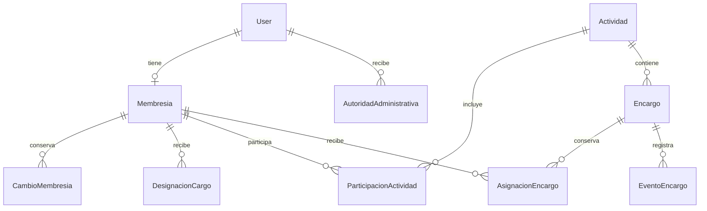

# Modelo de identidad, cargos y encargos delegados

> Referencia de trabajo actual — 2026-10-30: [consolidación de datos v2.0](../../../documentacion/arquitectura/diseno_base_datos_v2.0_2026-10-30.md). Este archivo conserva el antecedente; las reglas incompatibles sobre Superadministración, devoluciones, reparto, rendición periódica, contingencia offline y kits están sustituidas. Las decisiones no modificadas conservan su evidencia.

## Propósito y estado

Diseño lógico para revisar con el tesista antes de crear migraciones. La solicitud
actual pide analizar la gestión y diseñar la base; esta propuesta no crea tablas,
cuentas, permisos ni datos reales. No cambia prioridades ni estados de terminación.
Los nombres de modelos y estados son candidatos, no contratos ya implementados.

La cuenta `accounts.User` ya existe. Se conserva, con sus contraseñas, contactos y
sesiones. La nueva estructura debe representar pertenencia al Comité, cargos,
autoridad administrativa y tareas temporales sin convertirlos en tipos de cuenta
incompatibles.

## Actualización de límites administrativos — revisión 0.2

Las respuestas directas del tesista D-25/D-28 sustituyen en este documento la interpretación de ejecución transversal: Superadministradora administra cuentas, permisos y parámetros y corrige con auditoría, **sin ejecutar ni aprobar operaciones de negocio**. No vende ni cobra ni registra pesajes por otra persona; una corrección no suplanta el actor ni una aprobación del cargo competente. La frase anterior de todas las funciones y el alcance de SPEC-002 quedan como antecedente incompatible a reconciliar en la [[../../requirements/proposals/2026-10-29-enmienda-datos-sin-credito-y-administracion|enmienda propuesta]]. No se aprueba el requisito por inferencia.

## Fuentes y alcance de las afirmaciones

- [RF-ACC-002/003/004 y RF-PLA-001 a 004](../../../documentacion/requisitos/requisitos_generales_v2.3_2026-10-28.md):
  membresía, autorización por perfil/cargo/encargo, inicio propio, actividades,
  participantes, encargos temporales, aceptación, cierre y reasignación con historia.
- [HU-ACC-003/004 y HU-PLA-001 a 004](../../../documentacion/historias/usuario/historias_usuario_v2.8_2026-10-28.md):
  un encargo habilita únicamente sus operaciones durante su vigencia; la socia ve
  sus actividades y pendientes. HU-TRA-001/002 dependen de HU-PLA-003.
- RF-TRA-001/002: registros de acopio y secado con responsable, cantidades, unidades,
  fechas y origen; pesos válidos, conservación de historia y condiciones de captura
  sin conexión pendientes de P-13/P-14.
- [RF-ACC-005 y SPEC-002](../../../specs/002-superadministracion/spec.md): autoridad
  transversal de Superadministradora, con reglas de negocio y aprobaciones del
  módulo todavía aplicables. RF-ACC-005 conserva estado propuesto.
- [Arquitectura objetivo](../ARQUITECTURA-OBJETIVO.md): `accounts` posee identidad,
  membresías y cargos; `planning` actividades y asignaciones; `traceability`
  registros productivos; `portal` compone el inicio sin poseer sus escrituras.
- Aclaración del tesista en este chat, 2026-10-29: la Superadministradora puede
  ejercer todas las funciones; Secretaria o Presidenta pueden asignar una tarea
  de pesaje a otra usuaria y se le habilita esa tarea. Esta aclaración orienta
  el diseño; no equivale a aprobar todos los detalles de RF-ACC-005 ni una matriz
  completa de operaciones de otros módulos.

## Lectura del flujo

1. Una persona tiene una cuenta y una membresía. Ser usuaria general no requiere
   inventar un cargo llamado «general».
2. Puede existir una designación organizativa vigente: Presidenta, Secretaria o
   Tesorera. La pertenencia a Directiva puede obtenerse de las designaciones
   vigentes, evitando dos campos independientes que se contradigan.
3. Una persona autorizada programa una actividad y vincula participantes.
4. Crea un encargo de tipo concreto, con alcance y periodo, y lo asigna a una
   usuaria activa. Participar en la actividad no concede por sí solo permiso de
   registrar pesos, vender o corregir información.
5. La asignada consulta el encargo en su inicio y confirma su aceptación según
   el recorrido aprobado. La propuesta recomienda exigir aceptación para ejecutar;
   ese momento exacto debe precisarse para cada tipo antes de implementarlo.
6. Durante la vigencia, el backend permite las operaciones previstas sobre los
   recursos indicados. Una tarea de pesaje no habilita toda la producción.
7. Al completar, revocar o vencer la asignación, cesa esa habilitación temporal.
   Los registros y la identidad de quien los realizó se conservan.
8. La autoridad administrativa permite gestionar cuentas/permisos/parámetros y corregir
   con auditoría. No crea designaciones ficticias en cargos ni concede ejecución o
   aprobación de operaciones de negocio (D-25/D-28).

## Tablas lógicas propuestas

### Identidad y pertenencia — `accounts`

| Modelo | Datos esenciales | Relaciones y límites |
|---|---|---|
| `User` existente | identificador, nombre, credenciales y estado de acceso | No reemplazar ni duplicar la cuenta actual. |
| `Membresia` | usuaria, estado, fecha de alta y fecha de baja cuando corresponda | Una membresía del Comité por cuenta; sin cédula, domicilio u otros datos no justificados. El estado de cuenta controla el acceso; la membresía representa pertenencia. Su coordinación se define en una operación transaccional. |
| `CambioMembresia` | membresía, estado anterior y nuevo, actor, fecha, motivo | Conserva activación/desactivación sin borrar historia. |
| `DesignacionCargo` | membresía, cargo, inicio, fin, designada por, retirada por y motivo | Cargo entre Presidenta, Secretaria y Tesorera. La fila conserva su periodo histórico. Por decisión del tesista (pendiente de confirmar con el estatuto), rige un solo titular activo por cargo mediante índice único parcial con `vigente_hasta IS NULL`. |
| `AutoridadAdministrativa` | cuenta, tipo de autoridad, inicio, fin, otorgada por, retirada por y motivo/evidencia | Superadministración separada de cargos e independiente de `is_staff`/`is_superuser` de Django. Su otorgamiento tiene un procedimiento protegido; no se habilita por autoedición de perfil. |

La unicidad de la membresía por cuenta es una elección de diseño para el único
Comité del alcance actual. Una reincorporación conserva la misma identidad y sus
cambios de estado. No se añade una tabla de organizaciones ni soporte multiempresa.
Una visitante pública no necesita membresía ni cuenta autenticada.

### Organización del trabajo — `planning`

| Modelo | Datos esenciales | Relaciones y límites |
|---|---|---|
| `Actividad` | título, tipo, inicio/fin, lugar, responsable organizativa, estado y creada por | Jornada, evento o actividad real. No representa un módulo de la app. |
| `ParticipacionActividad` | actividad, membresía, tipo de participación y asignada por | Vínculo explícito con la actividad; impide duplicar la misma participante dentro de ella. No concede todas las acciones de esa actividad. |
| `Encargo` | actividad, tipo, descripción, inicio/fin previstos, estado y creado por | Define el trabajo y su alcance. Por ejemplo, registrar el peso de recepción de una jornada. |
| `AsignacionEncargo` | encargo, destinataria, asignada por, fecha de asignación, periodo de ejecución, aceptación y finalización/revocación | Conserva quién recibió y aceptó cada asignación. Una reasignación termina la anterior y crea otra en la misma transacción; no reemplaza el nombre en la fila histórica. |
| `EventoEncargo` | encargo, asignación cuando aplique, actor, fecha, tipo de evento y motivo | Historial de asignación, aceptación, reasignación, revocación, cierre y revisión. Las evidencias concretas se definen según la tarea antes de admitir archivos. |

Cardinalidad del encargo (Decisión del tesista 5): un encargo (por ejemplo, una feria) puede tener múltiples encargadas activas simultáneamente. Por tanto, no se impone una sola asignación vigente por encargo en la base de datos; la restricción única es por `(encargo, encargada)` mientras la asignación esté vigente. Una reasignación o relevo cierra la asignación previa y genera una nueva fila sin alterar la historia ni el encargo base.

### Resultados del trabajo — módulo propietario

Los datos productivos viven en `traceability`, no en columnas genéricas de Encargo.
Se diseñan e implementan cuando se construya el recorrido correspondiente:

- `Acopio`: origen, materia, socia que entrega, cantidad/peso, unidad, fecha,
  valoración y responsable del registro, según RF-TRA-001.
- `Secado`: materia/acopio relacionado, peso inicial/final, temperatura, inicio/fin,
  responsable y demás datos de RF-TRA-002.
- Sus registros incluyen actor real y relación con la asignación cuando se
  ejecutaron por encargo; una actuación autorizada por cargo
  conserva la base de autorización sin inventar un encargo personal.
- El vínculo entre encargo y un recurso productivo específico se ubica en
  `traceability` mediante FK explícitas según el recorrido (por ejemplo, un vínculo
  encargo–secado). No se usa un `objeto_id` libre ni JSON como sustituto de FK.
  Así `traceability` depende de `planning`, sin obligar a `planning` a importar
  los modelos productivos ni introducir un ciclo.

## Relaciones principales

`portal` consulta estas relaciones para componer «Mis actividades», «Mis tareas» y
los accesos permitidos. No necesita una tabla duplicada de «mis tareas» ni cuatro
copias del dashboard para los cargos.

## Autorización y alcance

Para cada petición, comprobar cuenta activa y restricciones de sesión; después,
autoridad aplicable a la acción y al objeto: cargo vigente, asignación vigente o
autoridad transversal. Finalmente aplicar las invariantes y aprobaciones del módulo.
Un permiso sobre una actividad no autoriza automáticamente recursos de otra.

Cada tipo de encargo habilita una lista cerrada de operaciones publicada por su
módulo. Ejemplo candidato: un encargo de registrar peso habilita la captura y la
consulta necesarias de su recepción; no implica aprobar correcciones, consultar
finanzas ni administrar cuentas. El conjunto exacto se define con el recorrido.
Los permisos nativos de Django pueden identificar acciones; los servicios y
políticas del módulo comprueban recurso, vigencia y asignación en servidor.

Los módulos visibles y botones se derivan de la misma política que valida la
petición. Ocultar una opción en el menú nunca es el único control.

## Integridad y concurrencia para futuras migraciones

- FK hacia `User`/`Membresia` y registros históricos con protección frente a
  eliminación que destruya trazabilidad; desactivación lógica para bajas.
- Identidad única para la membresía de la cuenta y la participación por actividad.
- Fechas finales posteriores a las iniciales, estados reconocidos y operaciones
  de transición validadas en backend. Los nombres y valores finales de estados se
  fijan con el recorrido; no se crean plazos por defecto sin decisión.
- Asignación a una cuenta inactiva rechazada. Reasignación y cierre bloquean la
  fila de encargo en una transacción para evitar responsables vigentes incompatibles.
- La escritura de un registro y la comprobación de vigencia del encargo se coordinan
  para evitar que una revocación concurrente deje una operación indebidamente aceptada.
- Un cambio de cargo, autoridad o destinataria no reatribuye registros históricos.
- La sincronización offline revalida permisos, vigencia e identidad de la operación
  en servidor según la política aprobada. No se decide aquí aceptación tardía.
- Para cantidades y pesos: decimales con unidad explícita y validaciones del módulo;
  no `float` ni una columna genérica de valor para todos los tipos de tarea.

## Decisiones concretas pendientes

1. Matriz de delegación: la aclaración nombra Presidenta y Secretaria como quienes
   asignan; precisar qué tipos puede delegar cada cargo, así como Tesorera y otras
   responsables. Poder ejecutar una acción no implica poder delegarla.
2. Si el encargo requiere aceptación antes de registrar resultados, plazos de
   aceptación, quién revisa el cierre y evidencia admitida. RF-PLA-003 exige
   aceptación e historia, pero no resuelve todo el ciclo.
3. Cargos ordinarios simultáneos, titularidad por cargo y tareas conjuntas. La
   autoridad transversal de Superadministradora no resuelve estas cardinalidades.
4. Para cada tarea: alcance sobre actividad, recepción, secado o lote y operaciones
   incluidas. El ejemplo de pesaje no constituye permiso para todo el inventario.
5. Procedimiento de otorgamiento/revocación de superadministración; RF-ACC-005
   continúa propuesto. Su capacidad funcional transversal ya está aclarada.

Estas decisiones no exigen redefinir la pila completa. Se precisan en la porción
que las necesita, conservando requisitos, evidencia y estados existentes.

## Secuencia de construcción propuesta

1. Reutilizar la base PostgreSQL y `User`. Primera migración de identidad con
   membresía, cargos, historia y restricciones decididas; autoridad transversal
   solo cuando sus criterios concretos estén resueltos. No crear cuentas reales.
2. En el incremento de planificación: Actividad y ParticipacionActividad.
3. Encargo, AsignacionEncargo y EventoEncargo con un recorrido de delegación completo.
4. En el recorrido productivo: registro de pesaje/acopio o secado y sus FK al encargo;
   enlazar sus acciones al inicio de la destinataria.
5. Revisar compatibilidad y pruebas positivas/negativas de delegación, recurso ajeno,
   cuenta inactiva, encargo vencido/revocado, reasignación, historial y concurrencia;
   incluir autoridad transversal sin omitir las reglas del módulo.

Esta secuencia es una propuesta técnica, no una reasignación de sprints aprobada.
El diseño conceptual puede abarcar todos esos módulos; sus tablas físicas se crean
por recorrido, sin anticipar apps vacías.

## Comprobación de la propuesta

Se contrastaron las dependencias HU-PLA-003 → HU-TRA-001/002, los límites de propiedad
de datos y las autorizaciones diferenciadas de ejecución/delegación. El ejemplo del
tesista queda representado sin cambiar el cargo de la destinataria, duplicar cuentas
ni sustituir las entidades productivas por una tabla genérica de tareas.
No se ejecutaron migraciones ni pruebas de producto: el resultado es un diseño lógico.
