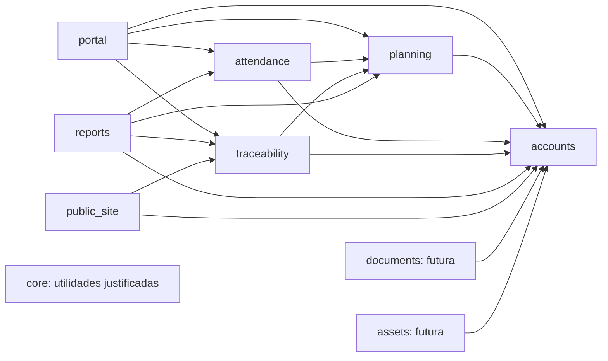

# Mapa conceptual de módulos y dependencias

> Referencia de trabajo actual — 2026-10-30: [consolidación de datos v2.0](../../../documentacion/arquitectura/diseno_base_datos_v2.0_2026-10-30.md). Este archivo conserva el antecedente; las reglas incompatibles sobre Superadministración, devoluciones, reparto, rendición periódica, contingencia offline y kits están sustituidas. Las decisiones no modificadas conservan su evidencia.

**Alcance de esta entrega:** punto 1 de SB-S1-03 / HT-PRE-003. Los nombres de entidades futuras describen conceptos que habrá que precisar por recorrido; no fijan tablas físicas, campos, cardinalidades ni migraciones. **Documentado** identifica una responsabilidad o capacidad de los requisitos y la arquitectura vigentes. **Supuesto** identifica una ubicación técnica que aún debe validarse. **Pregunta abierta** identifica una decisión sin fuente suficiente. Este mapa no declara implementadas las capacidades futuras.

## Revisión 0.2 — precisiones del tesista

D-24: ningún crédito al comprador, cobro antes de entrega. D-27: la socia recibe en custodia y rinde después, conservando cuenta interna separada. D-25/D-28: Superadministradora administra/corrige con auditoría, sin ejecutar ni aprobar negocio. D-26: secado de un solo acopio. D-29: reembolsos/anulaciones después de cobrar siguen pendientes. Estas precisiones corrigen el mapa propuesto; las discrepancias con fuentes aprobadas se registran en la [[../../requirements/proposals/2026-10-29-enmienda-datos-sin-credito-y-administracion|enmienda propuesta]].

## Esquema observado en el código

**Documentado:** `AUTH_USER_MODEL = "accounts.User"`. Los modelos y migraciones de `accounts` definen `User`, `LoginThrottle`, `ContactChannel`, `AuthChallenge` y `AuthAttempt`. `User` hereda de `AbstractUser`; conserva las relaciones nativas con grupos y permisos. El proyecto instala `auth`, `contenttypes` y `sessions`, además de `accounts` y `portal`; `portal` no define modelos propios. El nombre de tabla esperado por las migraciones para la cuenta es `accounts_user`, y `django_session` pertenece a Django. Estos son hechos del código y de las migraciones, no una comprobación de qué migraciones están aplicadas físicamente en PostgreSQL. [Fuentes: [[../../../specs/001-acceso-usuarias-internas/data-model|modelo de SPEC-001]], [[../../../specs/001-acceso-usuarias-internas/plan|plan de SPEC-001]], `app/config/settings/base.py`, `app/apps/accounts/models.py`, `app/apps/accounts/migrations/0001_initial.py` a `0003_contactchannel_authchallenge_authattempt.py`.]

**Documentado:** la bienvenida privada vive en `portal` y consulta la identidad de `accounts`; su alcance actual es la bienvenida de SPEC-001, no el tablero operativo completo de RF-ACC-004. [Fuentes: [[../ARQUITECTURA-OBJETIVO|arquitectura objetivo]], [[../../context/feature-index|índice de funcionalidades]], `app/apps/portal/`.]

## Mapa de propiedad conceptual

| Módulo | Responsabilidad y entidades propias, solo nombres | Dependencias de lectura u operación permitidas | Estado y fuente |
|---|---|---|---|
| `accounts` | Cuenta autenticable y control de acceso. **Existentes:** `User`, `LoginThrottle`, `ContactChannel`, `AuthChallenge`, `AuthAttempt`. **Futuros a precisar:** membresía, designación de cargo, autoridad de Superadministradora, permiso organizacional o vínculo con una operación. La credencial WebAuthn y la recuperación requieren precisar su persistencia en el recorrido de RF-ACC-007/009. | Django `auth`, `contenttypes` y `sessions` para identidad y sesión. No consume escrituras de negocio. | **Documentado:** RF-ACC-001/002/003/004/006/007/008/009 y SPEC-001/003. **Documentado por instrucción del tesista:** RF-ACC-005, pendiente de sincronizar en el CAT. **Pregunta abierta:** forma física y ciclo de cargo, autoridad y permisos. [[../../requirements/CAT-REQ-001\|CAT]], [[../../../specs/003-acceso-multicanal/spec\|SPEC-003]]. |
| `portal` | Inicio privado y composición de actividades, pendientes y encargos autorizados; sin datos operativos propios previstos. | Lee `accounts` y, cuando existan, consultas autorizadas de `planning`, `attendance` y `traceability`. | **Documentado:** app y bienvenida existentes; RF-ACC-004 describe el inicio futuro. [[../ARQUITECTURA-OBJETIVO\|arquitectura]], [[../../../documentacion/requisitos/requisitos_generales_v2.3_2026-10-28\|requisitos v2.3]]. |
| `planning` | Actividad o jornada, participante, responsable, encargo temporal, asignación y plan semanal de producción. El encargo de pesaje/secado/feria es una responsabilidad temporal vinculada al trabajo, no otro tipo de cuenta. | Consume identidad y autorización de `accounts`. Publica actividad y encargo a `attendance`, `traceability`, `reports` y `portal`. | **Documentado:** RF-PLA-001 a 005 y HU-PLA-001 a 005. Los estados y evidencia exacta del encargo son **pregunta abierta**. [[../../requirements/CAT-REQ-001\|CAT]], [[../../../documentacion/historias/usuario/historias_usuario_v2.8_2026-10-28\|HU vigentes]], [[../../../documentacion/arquitectura/arquitectura_v1.2_2026-10-28\|arquitectura v1.2]]. |
| `attendance` | Evento de entrada, evento de salida, participación adicional, inconsistencia, corrección, falta, justificación y validación de multa; nombres conceptuales, sin imponer todavía una tabla por cada concepto. | Consume cuenta/cargo/permiso de `accounts` y actividad/participante de `planning`. Publica lecturas autorizadas a `reports` y `portal`. | **Documentado:** RF-ASI-001 a 007, RNF-AUD-001. **Pregunta abierta:** P-02/P-03/P-13/P-14 y detalle de resolución. [[../../requirements/CAT-REQ-001\|CAT]], [[../../../documentacion/requisitos/requisitos_generales_v2.3_2026-10-28\|requisitos v2.3]]. |
| `traceability` | Catálogo productivo, unidad, presentación, valor comercial vigente e histórico, acopio, secado, lote y origen, receta/transformación, movimiento de existencias, custodia individual y general, entrega, venta, gasto, cuenta interna por rendir, cobro de venta, entrega, aplicación de rendición y conciliación. Estos son conceptos, no una propuesta de tablas definitivas. | Consume identidad/autorización de `accounts` y encargos de `planning` cuando el recorrido los exige. Publica consultas autorizadas a `reports`, `portal` y precios aprobados a `public_site`. | **Documentado:** RF-CAT-001, RF-TRA-001 a 005, RF-INV-001 a 006, RF-VEN-001 a 009, RF-GAS-001/002, RF-CXC-001 a 003 y RNF-DAT-001. **Pregunta abierta:** ubicación definitiva de las capacidades comerciales, P-04 a P-10 y fórmula de RF-VEN-009. [[../../requirements/CAT-REQ-001\|CAT]], [[../../../documentacion/arquitectura/arquitectura_v1.2_2026-10-28\|arquitectura v1.2]]. |
| `reports` | Filtros, consultas autorizadas y exportaciones de asistencia, actividades, producción, inventario, ventas/saldos y resumen propio. No se prevé una copia editable de saldos. | Lee `accounts` para autorización y lecturas públicas de `planning`, `attendance` y `traceability`. | **Documentado:** RF-REP-001 a 006 y RNF-PDF-001. **Pregunta abierta:** filtros, permisos y formatos concretos por reporte. [[../../requirements/CAT-REQ-001\|CAT]], [[../ARQUITECTURA-OBJETIVO\|arquitectura]]. |
| `public_site` | Contenido público, su preparación/aprobación/publicación/retiro y presentación de precio aprobado con enlace contextual de consulta. Los nombres de entidades se precisarán con la spec. | Consulta autorización editorial de `accounts` y precio aprobado mediante una lectura explícita de `traceability`. | **Documentado:** RF-PUB-001/002/003 y P-12; el contacto de WhatsApp no crea venta ni pedido. [[../../requirements/CAT-REQ-001\|CAT]], [[../../../documentacion/requisitos/requisitos_generales_v2.3_2026-10-28\|requisitos v2.3]]. |
| `documents` **futura** | Documentos organizacionales y productivos versionados, acceso restringido y avisos de vencimiento; entidades concretas tras la spec. | Consume identidad/autorización de `accounts`; relaciones a hechos de otros módulos por contratos explícitos por definir. | **Documentado:** RF-DOC-001. **Decisión del tesista 29/10/2026:** app propia al implementar; [[2026-10-29-decisiones-pendientes-diseno-datos\|D-08]]. |
| `assets` **futura** | Activos organizacionales con alta, cambios, retiro e historial, separados de existencias consumibles. | Consume identidad/autorización de `accounts`; no altera movimientos de `traceability`. | **Documentado:** RF-AST-001. **Decisión del tesista 29/10/2026:** app propia al implementar; [[2026-10-29-decisiones-pendientes-diseno-datos\|D-08]]. |
| `core` | Utilidades transversales que resulten realmente compartidas. Hoy no se identificó una entidad de negocio que deba poseer. | Solo uso puntual desde otros módulos cuando exista una necesidad demostrada. | **Documentado:** núcleo pequeño, sin reglas de negocio ni apps vacías anticipadas. [[../../decisions/ADR-0006-monolito-modular-y-entrega-incremental\|ADR-0006]], [[../ARQUITECTURA-OBJETIVO\|arquitectura]]. |

La PWA es una forma de captura y entrega de operaciones, no una fuente independiente de registros confirmados: una operación local de asistencia o pesaje se valida por el módulo dueño al llegar al servidor. **Documentado:** RF-PWA-001/002/003. **Pregunta abierta:** P-13/P-14 definen las operaciones exactas, tiempos, conflictos y retención; D-15 incluye ventas provisionales y D-28 limita resolución administrativa a correcciones auditadas. [[../../requirements/CAT-REQ-001|CAT]], [[../../../documentacion/arquitectura/arquitectura_v1.2_2026-10-28|arquitectura v1.2 §8]].

## Dependencias propuestas para revisión

La flecha sale del consumidor y llega al módulo que posee la operación o lectura. El diagrama expresa dependencias lógicas; no impone una FK en cada flecha. **Supuesto:** `public_site` consultará el precio aprobado mediante una operación explícita de `traceability`. **Supuesto:** `portal` compondrá las lecturas de los módulos que se implementen. Las demás direcciones siguen la arquitectura aceptada y los RF citados en la tabla. No hay ciclos.

**Documentado:** los módulos propietarios realizan sus escrituras; los consumidores usan operaciones públicas o lecturas autorizadas. Una venta multiproducto y sus movimientos se confirman juntos; las existencias se respaldan en movimientos y las correcciones sensibles conservan actor, fecha, valores y motivo. Las relaciones con FK se conservan donde protegen integridad; no se prohíben por ser intermodulares. [[../../decisions/ADR-0006-monolito-modular-y-entrega-incremental|ADR-0006]], [[../../requirements/CAT-REQ-001|CAT]], [[../../../documentacion/arquitectura/arquitectura_v1.2_2026-10-28|arquitectura v1.2 §9]].

## Capacidades transversales: propietario decidido y detalle pendiente

| Capacidad | Opciones de ubicación para decidir más adelante | Impacto y estado |
|---|---|---|
| RF-DOC-001, documentos versionados | **Decisión posterior D-08:** una app `documents` propia al implementar. | **Pregunta abierta:** clases documentales, metadatos, privacidad, relación con otros dominios y retención. [[../../requirements/CAT-REQ-001\|CAT]], [[2026-10-29-decisiones-pendientes-diseno-datos\|D-08]]. |
| RF-AST-001, activos organizacionales | **Decisión posterior D-08:** una app `assets` propia al implementar. | **Pregunta abierta:** recorrido de altas, cambios y retiros. Depreciación no está aprobada. [[../../requirements/CAT-REQ-001\|CAT]], [[2026-10-29-decisiones-pendientes-diseno-datos\|D-08]]. |
| RF-NOT-001/002, avisos internos y externos | **Supuesto:** la notificación se origina en el módulo que conoce el evento y puede presentarse en `portal`; se precisará si se necesita un propietario común para el estado de envío y consentimiento. | **Pregunta abierta:** dueño de los registros de notificación, canal externo, proveedor, destinatarios y reintentos. No se asignan estas escrituras a `reports` por inferencia. [[../../requirements/CAT-REQ-001\|CAT]], [[../../../documentacion/arquitectura/arquitectura_v1.2_2026-10-28\|arquitectura v1.2 §4/14]]. |

## Discrepancias y decisiones que condicionan el siguiente entregable

1. **RF-ACC-005 — estado documental.** El tesista indicó en este chat el 2026-10-29 que la Superadministradora ya está aceptada. El texto adjunto y [[../../requirements/CAT-REQ-001|CAT-REQ-001 v1.3]] aún dicen `proposed`. **Documentado:** existe esa discrepancia; la corrección de estado en el catálogo y sus derivados necesita sincronización trazable. Este mapa reconoce la instrucción del tesista, sin atribuirle una validación directa de la presidenta ni resolver la designación y delegación posteriores.
2. **Encargo y cuenta.** **Documentado:** `accounts` controla identidad, membresía, cargos y autorización; `planning` posee el encargo temporal y sus asignaciones. La descripción del punto 2 del adjunto agrupa «encargo» con `accounts`; el diseño de detalle deberá representar el permiso resultante sin trasladar la escritura del encargo fuera de `planning`. [[../ARQUITECTURA-OBJETIVO|arquitectura]], [[../../../documentacion/arquitectura/arquitectura_v1.2_2026-10-28|arquitectura v1.2 §4]].
3. **Merma y venta personal.** **Documentado:** RF-TRA-003 define la merma de secado como cálculo de pesos; RF-VEN-001 asigna la venta a la socia encargada y RF-VEN-007 la institucional a la Tesorera. RF-INV-005 y RF-REP-005 cubren custodia y cierre mensual por socia. **Pregunta abierta:** no está confirmada una habilitación universal para que toda usuaria registre ventas personales, ni una merma editable libremente. [[../../requirements/CAT-REQ-001|CAT]], [[../../../documentacion/requisitos/requisitos_generales_v2.3_2026-10-28|requisitos v2.3]].
4. **Reglas productivas/comerciales.** **Pregunta abierta:** P-04 a P-10 mantienen sin decidir conversiones, excepciones de lote, costos, reparto compartido, descuentos, efectos de devoluciones y comprobantes; RF-VEN-009 espera fórmula y destinatarios de comisión. Esas decisiones se cierran por recorrido antes del esquema detallado correspondiente. [[../../requirements/CAT-REQ-001|CAT §Decisiones de detalle abiertas]].

**Adenda del 29/10/2026:** el tesista pidió continuar hasta el diseño integral y decidió que RF-DOC-001 y RF-AST-001 tengan apps propias cuando se implementen. Este mapa se complementa con [[2026-10-29-decisiones-pendientes-diseno-datos|decisiones de negocio]] y [[2026-10-29-diseno-integral-base-datos|diseño de datos propuesto]]. La arquitectura canónica y el CAT aún requieren sincronización de estas decisiones.
