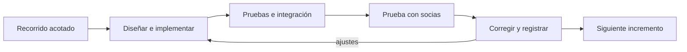

# Alternativas de arquitectura para entrega incremental y cambios por módulo

## 1. Nueva aclaración y estado de decisión

El tesista pidió ampliar el análisis a microservicios. Su objetivo es trabajar en un módulo,
terminar una versión utilizable, probarla con las socias, incorporar otro módulo y facilitar
correcciones o capacidades futuras. Al preguntar por publicación independiente, respondió
que todavía no lo decide y quiere comparar ambos enfoques.

Esta aclaración no acepta la arquitectura ni la enmienda de
[[2026-10-07-monolito-modular-con-capas|PRO-ARCH-002]]. La propuesta anterior y su revisión se
conservan. Esta adenda amplía alternativas y criterios; no modifica requisitos, roadmap,
specs confirmadas o constitución. La versión 0.2.0 anterior corresponde al texto candidato
de PRO-ARCH-002; no se aplica automáticamente a una arquitectura distribuida distinta.

## 2. Separar los objetivos para comparar correctamente

| Objetivo | Qué debe demostrarse | Qué no lo demuestra por sí solo |
|---|---|---|
| Entrega incremental | Un recorrido útil se puede construir, integrar y probar antes de completar el sistema. | Tener carpetas o servicios separados. |
| Mantenibilidad por módulo | Una regla interna cambia con impacto localizado y regresión de consumidores afectados. | Llamar a un módulo mediante HTTP. |
| Extensibilidad | Una nueva capacidad se incorpora con reglas, permisos, datos e integración delimitados. | Prometer que agregar una app o un contenedor es suficiente. |
| Publicación independiente | Actualizar y revertir una capacidad manteniendo consumidores y otras versiones operativas. | Repositorios diferentes con despliegues obligatoriamente coordinados. |
| Aislamiento de fallos | Un fallo no inutiliza recorridos que no dependen de la capacidad afectada. | Ejecutar procesos distintos que se llaman obligatoriamente en cadena. |
| Capacidad de carga | Cumplir objetivos de latencia, errores y recursos en escenarios representativos. | Contar capas, servicios o servidores. |

Desarrollar y validar por incrementos es posible tanto en una aplicación integrada como en
servicios distribuidos. La independencia de publicación es un atributo adicional.

Las capas y los puertos/adaptadores organizan responsabilidades dentro del código; pueden existir en monolitos y servicios. La decisión de distribución y la de organización interna deben justificarse por separado, evitando comparar nombres como si fueran excluyentes.

## 3. Alternativas aplicadas al objetivo del tesista

La tabla expresa una evaluación de diseño, no tiempos o resultados de carga medidos.

| Alternativa | Desarrollo y prueba con socias | Publicación y cambios | Coste o límite relevante |
|---|---|---|---|
| A. Monolito modular con capas internas | Incrementos por módulo con recorridos integrados, autorización y datos transaccionales comunes. | Cambios internos pueden localizarse; se publica una versión de la aplicación conjunta. | Comparte recursos y esquema; una dependencia o fallo común puede afectar varios módulos. |
| B. Monolito con puertos/adaptadores selectivos | Igual entrega incremental, aislando una integración o regla que realmente lo necesita. | Puede sustituir una dependencia detrás de una interfaz; sigue publicándose conjuntamente. | Más interfaces y mapeos; no convierte una extracción futura en automática. |
| C. Servicios alrededor de capacidades amplias | Cada capacidad puede tener varias funciones cohesivas y pilotos; requiere integrar dependencias remotas. | Permite autonomía de algunas capacidades con contratos y datos suficientemente separados. | Red, permisos, observabilidad y compatibilidad; agrupar más funciones conserva cambios conjuntos dentro de cada servicio. |
| D. Microservicios autónomos por capacidades de negocio | Se prueban servicios y luego recorridos completos con sus consumidores reales. | Permite publicación y escalado independientes si contratos, datos y operación sostienen esa autonomía. | Más fronteras distribuidas, fallos parciales, versiones coexistentes y coordinación de datos. |

C y D no se distinguen por un tamaño o número arbitrario. Son variantes de distribución;
la autonomía, cohesión y dependencias de cada frontera determinan su valor. Un servicio puede
abarcar varias apps Django. Una pantalla, una tabla o una app no definen automáticamente un microservicio.

También existe una evolución híbrida: mantener el núcleo integrado y separar una capacidad
cuando aparezca una necesidad comprobada. Es una estrategia posible, no una extracción
prometida ni una decisión de esta evaluación. Un worker que ejecuta el mismo código y comparte
sus tablas tampoco constituye automáticamente un microservicio autónomo.

## 4. Microservicios: beneficios reales y condiciones

Los microservicios pueden aportar autonomía de publicación, propiedad de datos, escalado
Selectivo y aislamiento de fallos. Estos beneficios dependen de límites cohesivos, contratos
Compatibles y capacidad de operar servicios; no aparecen solo por dividir el proyecto.
[Fuente: arquitectura de microservicios de Microsoft](https://learn.microsoft.com/en-us/azure/architecture/guide/architecture-styles/microservices).

Martin Fowler contrasta esa autonomía con el coste operativo de sistemas distribuidos y
advierte que también es posible entregar continuamente un monolito. Se usa como análisis de trade-offs del autor, no como prueba de rendimiento para Zhud Alelí.
[Fuente: Microservice Trade-Offs](https://martinfowler.com/articles/microservice-trade-offs.html).

Para evaluar favorablemente servicios independientes deben existir necesidades concretas:

- Publicar, revertir o ampliar recursos de una capacidad sin publicar las demás.
- Equipos o responsables capaces de mantener contratos y atender incidentes de servicios.
- Una carga, disponibilidad, integración externa o aislamiento que requiera trato distinto.
- Fronteras de reglas y datos estables, y presupuesto para despliegue, pruebas y recuperación.

No son condiciones que obliguen a tener un equipo por servicio ni a usar tecnologías
distintas. Un único desarrollador puede construir un sistema distribuido; debe estimar y
asumir también su mantenimiento. El plan actual describe un desarrollador y 16 semanas,
pero todavía no cuantifica ese coste ni define quién operará después de la tesis.

### 4.1 Viabilidad en Django y experiencia unificada

Django puede implementar una aplicación integrada o proyectos/servicios separados. Dispone
de respuestas JSON nativas para contratos HTTP; la elección de una biblioteca de API sería
otra decisión del plan, no un requisito implícito.
[Fuente: JsonResponse de Django 5.2](https://docs.djangoproject.com/en/5.2/ref/request-response/#jsonresponse-objects).

Distribuir el backend no obliga a tener varios repositorios, microfrontends ni una SPA.
Puede conservarse una interfaz común SSR/Bootstrap. Debe diseñarse cómo compone información,
inicia/cierra sesión, aplica CSRF y muestra errores cuando una dependencia no responde.
Una funcionalidad que cambia la pantalla puede exigir publicar también esa interfaz común,
aunque su servicio backend tenga despliegue propio.

Autenticación común no equivale a autorización universal. Cada operación sensible exige
comprobar el actor y sus permisos actuales, también en llamadas internas y sincronización.
Un gateway puede resolver tareas transversales; no sustituye la autorización sobre el recurso.
La sesión Django actual no define automáticamente identidad y revocación entre servicios.

No se propone Kubernetes, un gateway concreto, JWT, un broker ni varios proveedores como
infraestructura obligatoria. Esas elecciones requieren un diseño y coste que todavía no existen.

### 4.2 Propiedad de datos e integridad

Servicios autónomos poseen sus datos y contratos; compartir las mismas tablas y modificarlas desde varios servicios conserva acoplamiento. Es posible compartir un servidor PostgreSQL físico con propiedad lógica separada, aunque mantenga recursos y puntos de fallo comunes.
[Fuente: datos en microservicios](https://learn.microsoft.com/en-us/azure/architecture/microservices/design/data-considerations).

En Zhud Alelí el catálogo exige venta multiproducto completa o revertida y auditoría en
la misma transacción. Separar inventario, venta y saldo arbitrariamente crea un problema:
si una escritura remota confirma y otra falla, el recorrido puede quedar parcialmente aplicado. Es un riesgo de diseño ilustrativo; no ocurrió en una aplicación existente.

Una opción distribuida debe conservar la operación que necesita atomicidad bajo un dueño transaccional o demostrar otro diseño que cumpla el criterio. Una saga de compensación no equivale automáticamente a la garantía aprobada. Relajarla exige validación de requisito, no solo elegir otro patrón técnico. Las referencias entre datos de servicios también necesitan reglas de borrado, historial y comprobación de dependencias sin registros huérfanos.

### 4.3 Aislamiento y pruebas

El monolito modular tiene entrega conjunta y un radio de impacto mayor ante agotamiento de recursos o fallos de infraestructura compartida. Separar código no elimina esos límites.

En servicios, aislar un fallo exige que otros recorridos no dependan obligatoriamente de él
o puedan recuperarse. El proveedor de identidad, interfaz, gateway o base física común
pueden seguir siendo dependencias compartidas. Se deben probar indisponibilidad, lentitud, respuesta perdida, reintento y versiones distintas, además de las reglas y permisos locales.

Ninguna opción elimina las pruebas de regresión y de integración. Las simulaciones ayudan a probar contratos, pero no demuestran un recorrido real de socia con todos sus componentes.

## 5. Cómo aplicar la entrega incremental al proyecto

El [roadmap vigente](../../sprints/ROADMAP-ANTEPROYECTO.md) ya contempla pruebas parciales
y permite solapamientos cuando están satisfechas las dependencias. No exige terminar cada
módulo completo antes de comenzar el siguiente. Esta adenda no cambia ese cronograma.

Un incremento terminado tiene un alcance explícito y verificable; la validación con socias
puede conducir a correcciones posteriores. No significa que todo el módulo quede inmutable.

Para cada incremento se propone aplicar las puertas existentes:

1. Delimitar requisitos confirmados, actores, recorrido, dependencias y exclusiones.
2. Diseñar e implementar datos, permisos, pantalla y pruebas del alcance acordado.
3. Integrar con las capacidades ya disponibles y comprobar los recorridos anteriores afectados.
4. Probar tareas representativas con socias en un entorno controlado, con identidades/datos
   de prueba adecuados. Registrar comprensión, errores y recuperación sin datos innecesarios.
5. Corregir y revisar los hallazgos. Una regla organizativa nueva se registra y valida antes
   de convertirse en comportamiento; un piloto no aprueba automáticamente nuevo alcance.
6. Registrar la versión y evidencia antes del siguiente incremento. Las pruebas parciales
   no sustituyen la evaluación integral ni una verificación de despliegue real.

### 5.1 Dependencias que impiden tratar los módulos como islas

| Porción prevista | Dependencias y límite de cierre |
|---|---|
| SPEC-001: acceso básico | Cuenta, credencial, sesión y bienvenida. Puede cerrarse y validarse como porción propia; no completa S1. |
| Administración y acceso restante | RF-ACC-002/003 requieren sus specs. RF-ACC-004 consume actividades, pendientes y encargos de capacidades posteriores. |
| Planificación | Identidades y autorización; produce actividades/instancias y encargos. |
| Asistencia | Socias/cuentas, actividades/instancias y permisos. QR y offline conservan sus decisiones pendientes. |
| Producción/comercial | Personas autorizadas, catálogos/unidades y movimientos; reglas pendientes y atomicidad según operación. |
| Reportes | Datos de los dominios que resume, autorización y filtros; puede avanzar por reportes acotados cuando existen sus fuentes. |
| Sitio público | Contenido/publicadores aprobados; no necesita exponer ni esperar todos los datos privados. |

Fuente: [módulos y requisitos detallados](../../architecture/MODULOS-DETALLADOS.md),
[CAT-REQ-001](../../requirements/CAT-REQ-001.md) y
[SPEC-001](../../../specs/001-acceso-usuarias-internas/spec.md).

Por eso cerrar todo el dashboard operativo antes de desarrollar planificación no refleja
las dependencias reales. Conviene distinguir la bienvenida de SPEC-001 del dashboard posterior.
Para su primer recorrido ya existe el protocolo SC-002 en el plan; no se sustituye aquí por
una muestra o un criterio inventados.

## 6. Qué implica cambiar o agregar una función

Los ejemplos siguientes son ilustraciones de arquitectura, no nuevos requisitos aprobados.

| Cambio solicitado | Aplicación modular integrada | Servicios autónomos |
|---|---|---|
| Corregir un texto o presentación local | Cambiar la vista/componente correspondiente y verificar uso; publicación de aplicación integrada. | Cambiar el componente que posee la UI; puede requerir publicar el frontend común. |
| Cambiar una regla interna sin alterar consumidores | Modificar el caso de uso y sus pruebas; comprobar invariantes y regresión afectadas. | Modificar servicio y pruebas; publicar solo ese servicio si contrato y datos siguen compatibles. |
| Añadir un dato requerido o cambiar significado | Revisar modelos/migraciones, formulario, reportes y consumidores afectados. | Revisar esquema/API, migración y versiones coexistentes; consumidores pueden necesitar cambios coordinados. |
| Incorporar una capacidad nueva | Ampliar el módulo propietario o añadir uno si existe una responsabilidad distinta; revisar datos, rutas, permisos e integración y publicar conjuntamente. | Ampliar el servicio propietario o crear otro si hay una frontera de negocio y autonomía justificadas; revisar contratos, datos, operación, consumidores y UI. |

La facilidad depende de cuánto atraviesa el cambio las fronteras, no solo de que la llamada sea Python o HTTP. Cambiar el significado de un dato compartido puede afectar varias capacidades en ambos enfoques. No se promete rapidez sin conocer el cambio y sus dependencias.

Para facilitar evolución se proponen responsabilidades explícitas, ausencia de escrituras
arbitrarias entre módulos, contratos mínimos útiles y pruebas de comportamiento. En un
monolito no se exige versionar cada llamada Python como una API remota. Si hay consumidores con versiones coexistentes, se preserva compatibilidad antes de retirar contratos anteriores.

La PWA introduce un consumidor importante: comandos capturados con una versión anterior pueden seguir pendientes al publicar otra. La política de compatibilidad, revalidación, dependencias y rechazo recuperable pertenece a sus specs/P-13/P-14. No se descartan pendientes silenciosamente ni se conceden permisos por conservar una operación antigua.

## 7. Evaluación provisional y criterios para decidir

Con los objetivos expresados, A satisface la entrega incremental y ofrece un punto de partida
proporcional a las dependencias conocidas. B puede añadirse selectivamente donde exista una
dependencia que deba aislarse. Es una recomendación del análisis, no la decisión del tesista.

C o D ganarían peso si se confirma necesidad de publicación o escalado independiente,
fronteras estables y capacidad de mantener su operación. Si solo una capacidad lo necesita,
se evaluará separarla individualmente. No se afirma que microservicios sean imposibles con
un desarrollador ni que sean automáticamente más fáciles de mantener.

Fowler plantea validar límites antes de distribuir y describe también alternativas con
servicios más amplios; reconoce que extraer un monolito puede ser difícil. Se considera su
argumento, no una regla universal ni evidencia de que esta extracción sería rápida.
[Fuente: Monolith First](https://martinfowler.com/bliki/MonolithFirst.html).

Antes de decidir faltan prioridades y evidencia sobre:

- Necesidad de publicar/revertir capacidades por separado y tolerancia a interrupciones.
- Responsables de desarrollo y operación durante y después de la tesis.
- Consumidores externos, aislamiento y diferencias de carga/disponibilidad por dominio.
- Dependencias de datos y operaciones que deben confirmar conjuntamente.
- Presupuesto y coste de contratos, monitorización, respaldo y recuperación; P-11 pendiente.

La siguiente comparación práctica puede diseñar el mismo recorrido aprobado en las opciones
finalistas y examinar qué cambia en datos, permisos, pruebas y publicación. Sería un ejercicio
de diseño y estimación; una maqueta o laboratorio no demostraría capacidad de producción.
La selección, ADR y enmienda constitucional siguen pendientes, conservando las puertas de
SPEC-001 y las políticas de offline. No se requiere escoger una arquitectura para leer esta adenda.

## 8. Revisión y continuidad

El arquitecto contrastó las alternativas con los objetivos y dependencias del proyecto.
El reviewer cerró la revisión documental después de una corrección de precisión: una nueva
función puede ampliar su módulo o servicio propietario; no obliga a crear otro. No quedan
hallazgos accionables dentro del alcance documental revisado.

La revisión no demuestra rendimiento ni acepta una arquitectura. La constitución 0.1.0
permanece vigente y la decisión humana continúa abierta. La trazabilidad se conserva en la
[[../../evidence/architecture/2026-10-07-alternativas-entrega-incremental|evidencia de comparación]]
y el [[../../bitacora/checkpoints/2026-10-07-alternativas-entrega-incremental|checkpoint]].
