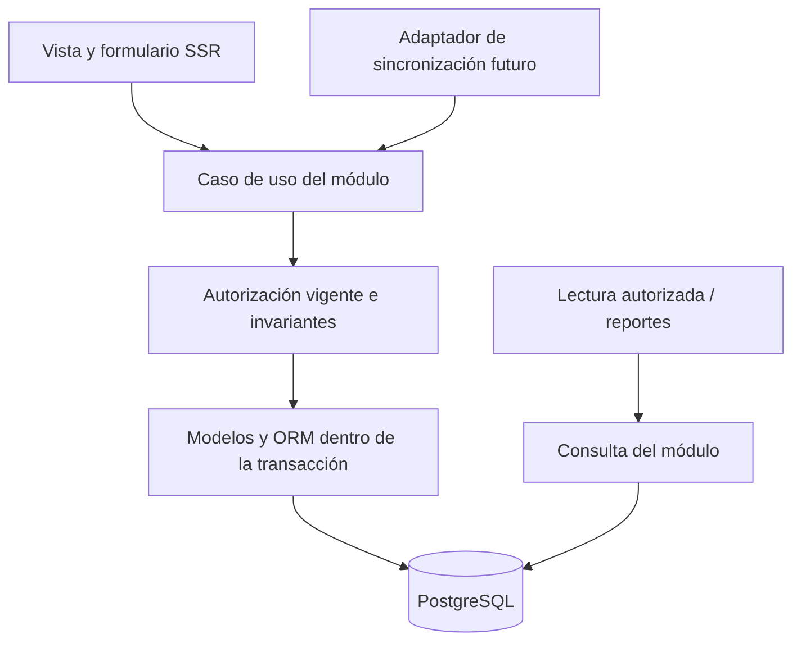

# Evaluación de monolito modular y capas internas en Django

## 1. Solicitud y límite de esta evaluación

El 2026-10-07 el tesista pidió revisar la arquitectura por recomendación de su profesor.
Aclaró que busca capas **dentro de cada módulo**, bajo acoplamiento y alta cohesión para
añadir funciones y mejorar el sistema en el futuro. Autorizó agentes especializados y
documentación; condicionó el cambio de la constitución a estar de acuerdo con la arquitectura.

Este documento entrega una recomendación y una enmienda concreta para revisión. No constituye
un ADR aceptado, una aprobación académica ni una autorización para implementar módulos futuros.
La constitución vigente continúa en 0.1.0. La solicitud no establece un número de usuarias
concurrentes, una tasa de solicitudes ni una latencia objetivo.

## 2. Base comprobada y fuentes locales

- [Constitución vigente](../../../.specify/memory/constitution.md): principio IV exige monolito
  modular, integridad, transacciones y justificación de complejidad adicional.
- [Arquitectura objetivo](../../architecture/ARQUITECTURA-OBJETIVO.md): ya permite vistas
  pequeñas, servicios transaccionales y consultas complejas cuando aportan valor.
- [ADR-0003](../ADR-0003-estructura-raiz-aplicacion-django.md): raíz común para Django y vault.
- [Plan aprobado de SPEC-001](../../../specs/001-acceso-usuarias-internas/plan.md): acceso
  básico con mecanismos nativos; excluye servicios, policies y apps vacíos en esta porción.
- [CAT-REQ-001 v1.1](../../requirements/CAT-REQ-001.md): continuidad offline de asistencia y
  pesajes obligatoria; las políticas P-13/P-14 conservan sus puertas.
- [Contexto del proyecto](../../../agents/tesis/PROJECT_CONTEXT.md): escala descrita de
  12 socias legales y 6 activas. Es un antecedente organizativo, no una medida de concurrencia
  ni un límite de crecimiento o de visitantes públicos.
- [Plan maestro](../../architecture/PLAN-DESDE-CERO.md): horizonte aportado de 16 semanas
  y un desarrollador. Sigue proposed; autorizar planificación no acepta todas sus decisiones.

La rama comprobada es `opencode/spec-001-fase-1-diseno`, HEAD `c2654519b041d8f96a2028482608c93ac9d8ea0b`.
No existen `manage.py`, `apps/` ni `config/`. Hay cambios locales de diseño que esta tarea
preserva. El estado operativo previo aún registraba HEAD `a6e842f`; no describe esta evaluación.

## 3. Qué se está comparando

| Eje | Pregunta que responde | Aplicación al proyecto |
|---|---|---|
| Monolito o servicios distribuidos | ¿Qué se despliega y versiona como unidad? | Una aplicación Django puede ejecutarse en varios workers o réplicas. |
| Módulos | ¿Quién posee cada responsabilidad de negocio? | Acceso, planificación, asistencia, trazabilidad, reportes y sitio público. |
| Capas | ¿Cómo se separan las responsabilidades dentro de un módulo? | Presentación, casos de uso/reglas y persistencia. |
| Niveles de despliegue | ¿Dónde se ejecutan aplicación, datos y otros componentes? | Django y PostgreSQL pueden estar en entornos distintos. |

Monolito y capas pueden combinarse. La separación lógica no exige distribuir cada capa en
otro servidor. Esta distinción está documentada por
[Microsoft Learn](https://learn.microsoft.com/en-us/dotnet/architecture/modern-web-apps-azure/common-web-application-architectures).
Se utiliza su definición conceptual; no se propone adoptar .NET ni Azure.

La aclaración del tesista prioriza **crecimiento funcional y mantenibilidad**. La capacidad
para atender más tráfico es otro atributo que exige medir carga, recursos y cuellos de botella.

## 4. Alternativas y recomendación

La siguiente comparación es un juicio de diseño para Zhud Alelí, no un benchmark.

| Alternativa | Aporte al proyecto | Coste o límite | Evaluación |
|---|---|---|---|
| A. Monolito modular con Django nativo y convenciones actuales | Inicio simple, ORM y autenticación directos. | Si no se controlan responsabilidades, reglas pueden terminar duplicadas en vistas. | Viable; requiere explicitar límites. |
| B. Monolito modular con capas internas pragmáticas | Casos de uso compartidos, propiedad de escrituras y pruebas de reglas por módulo. | Conserva dependencia del ORM y despliegue conjunto; requiere disciplina y revisión. | **Recomendada para revisión humana.** |
| C. Monolito con dominio completamente independiente del framework, puertos y adaptadores | Mayor aislamiento tecnológico cuando se necesita sustituir infraestructura. | Más interfaces, mapeos y mantenimiento; no se ha demostrado necesidad de sustituir el ORM. | Evaluar solo con un caso concreto y ADR. |
| D. Servicios desplegables independientemente | Permite escalar o liberar componentes por separado. | Introduce fallos de red, contratos remotos y coordinación de datos/transacciones. | Falta evidencia que justifique adoptarla en esta entrega. |

Se recomienda B: **monolito modular Django, organizado por dominio y por capas internas**.
Mantiene una unidad de entrega de la aplicación, una fuente transaccional PostgreSQL y
responsabilidades verificables. Se crean archivos y paquetes conforme aparece comportamiento;
no se exige llenar un árbol de capas sin funciones reales.

Esta decisión mejora las condiciones para evolucionar el código. No garantiza por sí misma
capacidad, rendimiento, independencia de despliegue ni una extracción futura sin trabajo.

## 5. Implementación posible en Django

Django busca bajo acoplamiento, cohesión y separación de presentación; sus modelos integran
datos y comportamiento. Añadir casos de uso propios es una organización del código del proyecto,
no una arquitectura que Django imponga automáticamente.
[Fuente: filosofías de Django 5.2](https://docs.djangoproject.com/en/5.2/misc/design-philosophies/).

| Responsabilidad lógica por módulo | Ubicación Django propuesta | Regla verificable |
|---|---|---|
| Presentación y entrada | `urls.py`, `views.py`, `forms.py`, `templates/<app>/` | Resolver HTTP, validar forma de entrada y presentar resultados; no duplicar una operación de negocio. |
| Aplicación y reglas | `services.py` para casos de uso complejos; métodos de modelo para invariantes locales; permisos nativos o reglas reutilizables | Coordinar autorización, cambios e integridad según el requisito. |
| Lectura | Managers/QuerySets; `queries.py` cuando una consulta lo necesita | Filtrar por autorización y devolver información para pantallas/reportes sin mutar datos. |
| Persistencia | `models.py` o `models/`, `migrations/`, ORM y PostgreSQL | Conservar restricciones, relaciones y migraciones nativas. |

Lectura es una responsabilidad dentro de las capas, no un sistema CQRS independiente.
Los modelos Django participan en dominio y persistencia: esta propuesta no promete un dominio
puro independiente de Django. Una vista simple puede usar directamente comportamiento nativo
del framework o una consulta autorizada; no necesita un servicio que solo reenvíe una llamada.

Para comprobar la separación cuando existe un caso de uso propio: este recibe datos y un
actor explícito, verifica reglas y devuelve un resultado o error de negocio. No recibe una
solicitud HTTP completa ni renderiza plantillas; la vista o el adaptador transforma su resultado
en una respuesta. Los modelos no importan vistas, formularios ni plantillas. Las reglas de
negocio se verifican aunque la entrada no provenga de un formulario. Estas dependencias se
revisan en el plan y el diff del módulo, junto con sus pruebas de comportamiento.

Flujo ilustrativo de una **operación compleja**, no estructura obligatoria de cada CRUD:



Árbol orientativo para un módulo futuro con operaciones complejas:

```text
apps/<modulo>/
├── apps.py
├── urls.py
├── views.py
├── forms.py
├── models.py
├── services.py       # solo si existen casos de uso que lo justifican
├── queries.py        # solo si existen consultas que lo justifican
├── migrations/
├── templates/<modulo>/
└── tests/
```

Si crece el módulo, los archivos pueden convertirse en paquetes conservando descubrimiento
nativo de modelos y migraciones. No se crea un repositorio genérico encima del ORM por defecto.
El principio se aplica a cada módulo; no obliga a crear apps de sprints futuros por anticipado.

## 6. Bajo acoplamiento, cohesión e integridad

1. Cada módulo posee sus reglas, modelos, escrituras, migraciones y pruebas. Las nuevas
   funciones se ubican por responsabilidad de negocio, no por conveniencia de una pantalla.
2. Un módulo solicita cambios de otro mediante su operación pública. No replica sus reglas ni modifica directamente sus tablas. Las interfaces internas son funciones o métodos explícitos; no requieren HTTP, bus de eventos ni serialización dentro del mismo monolito.
3. Las relaciones relacionales justificadas conservan claves foráneas y políticas de borrado definidas por la spec. Reducir acoplamiento de código no autoriza perder integridad de datos.
4. Lecturas y JOIN autorizados pueden existir en la misma base. Reportes consultan datos operativos sin mantener otra verdad de existencias o saldos por defecto.
5. Un caso de uso que afecta varios módulos declara un coordinador y una transacción común  en la misma base. Cada módulo conserva la propiedad de sus cambios. Las operaciones que  deban confirmarse juntas no se sustituyen por eventos con resultados parciales.
6. La atomicidad no elimina por sí sola carreras: las specs definen restricciones y control
   de concurrencia conforme a sus invariantes, con casos positivos, negativos y concurrentes.
7. Los casos de uso compartidos verifican autorización vigente en servidor; las lecturas
   también filtran el acceso. La interfaz, el cargo mostrado o un comando local no conceden permisos.
8. `core` contiene solo utilidades compartidas con necesidad real. No absorbe reglas de acceso,
   asistencia, inventario o sincronización de todos los dominios.

Django permite delimitar una operación con `transaction.atomic()` y revertir sus cambios de base de datos ante un error. Esto no hace atómica una operación sobre varios servicios remotos.
[Fuente: transacciones Django 5.2](https://docs.djangoproject.com/en/5.2/topics/db/transactions/).

Ejemplo de aplicación futura, sin aprobar reglas nuevas: una operación que modifica inventario
y saldo debe compartir la regla transaccional entre sus entradas SSR y de sincronización.
Las reglas exactas de venta, saldo y autorización pertenecen a su spec, no a este diagrama.

`traceability` agrupa hoy responsabilidades productivas y comerciales amplias. Si las specs
demuestran baja cohesión o ciclos, se evaluará dividir responsabilidades; esta propuesta no
aprueba nuevas apps ni cambia el número de módulos académicos.

## 7. Escalabilidad: qué mejora y qué falta demostrar

**Evolución funcional:** la propuesta busca localizar cambios, reutilizar casos de uso y
probar reglas sin depender de una pantalla. Se verificará por revisión de dependencias,
ausencia de reglas duplicadas y pruebas de comportamiento compartidas entre entradas.
Sigue existiendo acoplamiento al ORM, al esquema compartido y a una entrega conjunta.

**Capacidad:** podría ampliarse la instancia inicial o ejecutar réplicas de la misma aplicación
detrás de un balanceador. Eso exige compartir estado de sesiones y archivos cuando corresponda,
dimensionar conexiones y evitar estado de negocio exclusivo de la memoria de un worker.
El plan de SPEC-001 ya prevé sesiones en base de datos, una capacidad nativa de Django.
[Fuente: sesiones Django 5.2](https://docs.djangoproject.com/en/5.2/topics/http/sessions/).

Añadir réplicas no resuelve un cuello de botella en PostgreSQL. El escalado se decide con
mediciones de la carga real.
[Fuente: principios de escalado de Microsoft](https://learn.microsoft.com/en-us/azure/architecture/guide/design-principles/scale-out).
Optimizar consultas comienza por perfilar el problema, conforme a
[Django: optimización de acceso a datos](https://docs.djangoproject.com/en/5.2/topics/db/optimization/).

Antes de afirmar capacidad suficiente se deben definir y medir:

- Usuarios concurrentes y visitantes, ritmo de registros y crecimiento de datos.
- Tamaño y frecuencia de reportes, y ráfagas de sincronización al recuperar la conexión.
- Objetivos de latencia, errores y recursos, acordados para cada escenario.
- Consultas por operación, conexiones, CPU/memoria y bloqueo durante escrituras concurrentes.
- Integridad bajo concurrencia, reintentos y corte de red, además de tiempos de respuesta.

La futura prueba de carga combinará escenarios aprobados de uso normal, consultas/reportes y
reconexión. Sus cantidades y umbrales quedan por definir: no se inventan en esta evaluación.
Solo ante evidencia de una carga específica se considerarán cachés, trabajos en segundo plano
o extracción de componentes, con coste, privacidad, pruebas y ADR.

El despliegue concreto sigue abierto. Django ofrece WSGI y ASGI y exige un servidor adecuado;
el servidor de desarrollo no acredita producción.
[Fuente: despliegue Django 5.2](https://docs.djangoproject.com/en/5.2/howto/deployment/).
Este análisis no verifica que los proveedores presupuestados soporten el despliegue requerido.

## 8. PWA y separación de responsabilidades

La capacidad offline aprobada se conserva. La captura local envía operaciones al adaptador
de sincronización, que utiliza los casos de uso del módulo propietario. El servidor comprueba
la autorización actual, las reglas y la deduplicación al aceptar cada operación.

El resultado idempotente se devuelve solo después de comprobar sesión, identidad/origen y
permisos vigentes del actor, también cuando no hay una nueva escritura. Una cuenta no puede
consultar la cola ni los resultados privados de otra. La spec define el alcance del identificador
y el tratamiento de reintentos incompatibles, sin fijar aquí las políticas pendientes de P-14.

La política de identificadores, dependencias, orden y tratamiento de conflictos se define en
las specs afectadas según RF-PWA-002/003 y P-13/P-14. No se afirma que sincronizar equivalga
a aceptar, ni que los datos locales deban prevalecer sobre los del servidor.

La cola local de comandos del navegador y un outbox de eventos del servidor resuelven
problemas distintos. La necesidad de la primera no obliga a introducir el segundo. Tampoco
habilita cachear páginas privadas o autenticar offline: SPEC-001 mantiene acceso en línea,
sesiones y respuestas privadas sin caché.

## 9. Revisión de la propuesta de septiembre

La [propuesta del 2026-09-22](2026-09-22-arquitectura-modular-desacoplada.md) ya combinaba
monolito y capas con aislamiento hexagonal. Continúa proposed; no se acepta ni elimina aquí.
El arquitecto y el revisor identifican riesgos que requieren resolución antes de adoptarla:

| Hallazgo de diseño | Riesgo | Tratamiento propuesto |
|---|---|---|
| Prohibir toda FK y JOIN entre apps | Referencias huérfanas y conciliación adicional sin protocolo probado. | Conservar integridad relacional y lecturas autorizadas; justificar excepciones individualmente. |
| Outbox de servidor y proyecciones de reportes como base obligatoria | Consistencia eventual, reconstrucción y operación adicionales sin carga demostrada. | Consultas operativas por defecto; esos mecanismos requieren necesidad y ADR propios. |
| Modelos y migraciones solo bajo `infrastructure/` | El árbol no documenta cómo Django descubriría esos artefactos. | Mantener rutas nativas o especificar y probar registro/migraciones explícitos. |
| Definir monolito como un único proceso | Confunde unidad de despliegue con workers o réplicas. | Definir una aplicación entregada conjuntamente, compatible con múltiples instancias. |

Son riesgos documentales y de diseño, no errores observados en una aplicación ejecutándose.
El plan aprobado de SPEC-001 tiene prioridad frente a un árbol propuesto incompatible.

El riesgo de descubrimiento se contrasta con la documentación oficial sobre
[carga de aplicaciones](https://docs.djangoproject.com/en/5.2/ref/applications/#how-applications-are-loaded)
y [MIGRATION_MODULES](https://docs.djangoproject.com/en/5.2/ref/settings/#migration-modules).
Una ubicación alternativa es posible con configuración explícita; su omisión en el árbol
anterior exige completar y verificar el diseño antes de implementarlo.

## 10. Enmienda concreta para consideración del tesista

Se propone **0.1.0 → 0.2.0 (MINOR)** porque se amplía materialmente la guía de arquitectura
y su verificación; se conservan el monolito, PostgreSQL, los demás principios y las puertas.
La ratificación original se conserva en 2026-07-21. La fecha de enmienda será la fecha real
de aceptación y aplicación, no se registra como aprobada el día de este borrador.

Texto candidato para reemplazar únicamente el principio IV:

> ### IV. Arquitectura modular, separación de responsabilidades e integridad de datos
>
> La aplicación será un monolito modular Django con PostgreSQL. Cada módulo conserva límites
> de dominio claros y separa responsabilidades de presentación, casos de uso/reglas y
> persistencia. Las vistas resuelven HTTP; los casos de uso coordinan operaciones complejas;
> los modelos, restricciones y migraciones nativos protegen datos e invariantes locales.
> Se crean servicios y consultas propios cuando existe comportamiento que lo justifica,
> sin exigir capas vacías ni repositorios genéricos encima del ORM.
>
> Cada módulo posee sus escrituras. La colaboración entre módulos utiliza operaciones
> públicas explícitas y lecturas autorizadas; conserva claves foráneas y relaciones
> justificadas. Las operaciones con varias entidades que deban confirmarse juntas usan
> una transacción común y control de concurrencia conforme a sus invariantes. Inventario,
> pesajes, secado y lotes conservan movimientos e historial según el requisito.
>
> La autorización se verifica en backend, incluidas entradas alternativas como sincronización.
> Separar capas favorece evolución y pruebas, pero no acredita capacidad de carga. El escalado
> se justifica con escenarios, objetivos y mediciones. Microservicios, SPA, colas de servidor,
> proyecciones persistidas y aislamiento genérico adicional requieren necesidad comprobada
> y ADR. Las capacidades offline aprobadas conservan sus specs y políticas de seguridad.

Adición candidata a restricciones técnicas:

> - Capas internas por módulo con responsabilidades y dependencias explícitas; crear solo
>   archivos y paquetes que contengan comportamiento requerido por el plan de la funcionalidad.
> - La estructura conserva el descubrimiento nativo de modelos y migraciones Django; toda
>   excepción se documenta y verifica antes de aplicarse.

Este texto precisa una separación pragmática, no impone arquitectura hexagonal completa
ni convierte los módulos en servicios distribuidos.

## 11. Impacto de sincronización de la constitución

Preparado con la skill `speckit-constitution`; **la propagación todavía no se ejecuta**.
Antes de actualizar la fuente vigente se registrarán aceptación, ADR y evidencia reales.

| Artefacto | Tratamiento después de aceptar la arquitectura |
|---|---|
| `.specify/memory/constitution.md` | Aplicar texto aprobado, versión/fecha y Sync Impact Report. |
| `AGENTS.md` y contexto común | Alinear el resumen corto y comprobar que no surja otra fuente de arquitectura. |
| `docs/architecture/ARQUITECTURA-OBJETIVO.md` | Alinear convenciones y añadir enlace al nuevo ADR aceptado. |
| `docs/architecture/PLAN-DESDE-CERO.md` y propuesta de septiembre | Reconciliar alcance de aprobación; versionar/sustituir reglas incompatibles sin borrar historia. |
| Templates y overrides de constitución, plan, spec y tasks | Revisar puertas, dependencias, escala y pruebas; editar solo los apartados afectados. |
| Comandos/skills Spec Kit y guías de ejecución | Comprobar referencias al principio cambiado y su coherencia, según la skill. |
| SPEC-001 `spec.md`, `plan.md`, `tasks.md` | Conservar alcance y rutas aprobadas; registrar resultado de compatibilidad. Cualquier cambio semántico exige revisión propia. |
| Estado activo, checkpoint y evidencia | Registrar decisión y verificaciones realizadas, sin simular implementación, commit o publicación. |

Compatibilidad prevista: SPEC-001 puede mantener sus vistas, formularios, modelos y
autenticación nativos sin `services.py`, `queries.py`, API o `core` vacíos. Los siguientes
planes concretarán casos de uso cuando aparezcan reglas complejas o entradas SSR/sync comunes.

No hay extensiones registradas en `.specify/extensions.yml` al efectuar esta evaluación.
No se alteran las templates ni se afirma haber completado la sincronización de una enmienda.

## 12. Decisión que queda pendiente

El tesista debe indicar si acepta la alternativa B y el texto candidato del principio IV,
o qué cambio requiere. Su acuerdo no sustituye la revisión académica del profesor/directora
ni aprueba automáticamente cada spec, el despliegue, las políticas offline o Git.

La arquitectura es técnicamente implementable en Django. La adecuación al proyecto se
fundamenta en responsabilidades, integridad y coste de evolución; la capacidad de carga
permanece pendiente de dimensionamiento y mediciones.

## 13. Revisión y evidencia

El agente especializado de arquitectura entregó el contraste local. El reviewer independiente
revisó la propuesta y cerró sin hallazgos accionables pendientes después de incorporar la
revalidación de acceso a resultados idempotentes. Su revisión no acepta la arquitectura.
El [registro de evidencia](../../evidence/architecture/2026-10-07-revision-monolito-capas.md)
y el [checkpoint](../../bitacora/checkpoints/2026-10-07-revision-arquitectura-monolito-capas.md)
conservan verificaciones reales, límites y la decisión humana pendiente.
