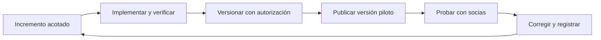

# Evolución modular y versiones piloto con socias

## Aclaración recibida y alcance

El tesista quiere poder incorporar con el tiempo facturación electrónica, gestión de clientes
o capacidades relacionadas con ARCSA. Busca mantenimiento localizado y entregar avances
por módulo para trabajar y probar con las socias. Los nombres son ejemplos de evolución:
no aprueban esas funcionalidades ni determinan su orden en el roadmap vigente.

Esta aclaración respalda evaluar un monolito modular con capas internas y entregas incrementales.
No es una aceptación arquitectónica ni autorización de commit, push o despliegue en esta tarea.
PRO-ARCH-002/003 y la constitución 0.1.0 se conservan; su enmienda continúa condicionada al
acuerdo explícito del tesista. SPEC-001 sigue en diseño, sin aplicación Django construida.

## Qué facilita el monolito modular

Django permite organizar un proyecto en apps con funcionalidades, modelos, vistas y plantillas.
Esta capacidad ofrece una base para delimitar módulos; el framework no impide por sí solo
que se acoplen. [Fuente: aplicaciones de Django](https://docs.djangoproject.com/en/5.2/ref/applications/).

La propuesta usa responsabilidades propias, capas internas proporcionadas al comportamiento,
operaciones públicas de negocio y dependencias explícitas. Añadir una capacidad puede ampliar
el módulo propietario o justificar otro; no se exige una app por pantalla o función.

| Ejemplo futuro | Frontera que habría que diseñar | Integración que podría afectar |
|---|---|---|
| Facturación electrónica | Datos y estado del documento, operaciones de emisión y conector externo, si ese alcance se valida. | Operaciones comerciales, datos del receptor, permisos e historial. |
| Gestión de clientes | Registro y gestión comercial del cliente, si tiene responsabilidad distinta del receptor básico. | Referencias utilizadas por ventas, facturación y reportes. |
| Funciones relacionadas con ARCSA | Casos de uso concretos confirmados; por ejemplo seguimiento documental si se valida. | Productos, responsables, documentos y permisos según el alcance real. |

La tabla es un ejercicio de diseño. No especifica obligaciones tributarias o sanitarias,
campos legales, certificación ni cumplimiento. Esas decisiones requieren fuentes oficiales
vigentes y validación humana cuando se solicite esa funcionalidad. ARCSA es una institución;
su nombre no determina por sí solo qué debe hacer un módulo.

### Facturación primero y clientes después

Si un recorrido de facturación necesita identificar un receptor, esos datos mínimos deben
existir antes de cerrar ese recorrido. Eso no obliga a construir previamente una gestión
comercial completa de clientes. Su propietario inicial se decide según el caso de uso:
no se crean tablas maestras duplicadas por anticipar una pantalla futura.

El antecedente comercial RF-VEN-002 distingue contado con Público general de crédito o
institución con identificación mínima aprobada. Facturación futura no cambia automáticamente
esa regla: los requisitos fiscales del nuevo recorrido se investigan y validan aparte.
[Fuente local: módulos detallados](../../architecture/MODULOS-DETALLADOS.md).
La identidad comercial tiene un propietario y no se coloca en `accounts` por ser una persona
ni en un `core` genérico: un cliente externo no equivale a la cuenta que autentica a una socia.
Identificación, unicidad y correspondencia de registros se especifican; no se fusionan personas
solo por tener el mismo nombre.

Después puede incorporarse la gestión de clientes y vincularla o ampliar el registro inicial
mediante migraciones e integración. El diseño debe conservar el contenido histórico de los
documentos emitidos cuando cambie el registro actual del cliente. Una representación histórica
del receptor no es otro maestro de clientes; sirve para reproducir el documento de su momento.
Es una recomendación de integridad para el diseño futuro, no una regla fiscal aprobada aquí.

Si cambia el dueño de datos existentes, habrá trabajo de migración, referencias y regresión.
La arquitectura reduce el impacto cuando las fronteras son adecuadas; no elimina ese trabajo.
Django dispone de migraciones para versionar cambios de esquema y datos.
[Fuente: migraciones de Django](https://docs.djangoproject.com/en/5.2/topics/migrations/).

La comunicación con un servicio externo también necesita estados de error y recuperación.
Si se valida facturación electrónica, su spec deberá definir reintentos y cómo evitar duplicar
operaciones tras una respuesta perdida. Una transacción local no confirma automáticamente
una operación en un proveedor remoto. La atomicidad comercial aprobada continúa vigente.

## Reglas que convierten la separación en mantenibilidad

1. Cada módulo posee responsabilidades y escrituras explícitas; otros usan sus operaciones
   de negocio cuando existen, sin modificar arbitrariamente sus tablas.
2. Las pantallas delegan reglas de negocio; los casos de uso no dependen de renderizar una
   pantalla. Los permisos se comprueban en backend y se conserva autorización vigente.
3. Se mantienen relaciones y transacciones que protegen integridad; separar módulos no
   exige eliminar claves foráneas ni convertir llamadas internas en HTTP.
4. Se evitan ciclos de dependencia y un `core` que acumule toda la lógica. La composición
   entre módulos tiene ubicación y propósito explícitos.
5. Un cambio de datos, permisos o contrato revisa los consumidores afectados. Pruebas locales
   se complementan con integración y regresión de recorridos anteriores.
6. Las integraciones externas se aíslan donde aporta valor. No se generan repositorios,
   interfaces o capas genéricas vacías antes de que una funcionalidad las justifique.

Estos criterios ayudan al crecimiento funcional. Capacidad de carga, disponibilidad y tiempo
de implementación se evalúan con escenarios y mediciones; no se garantizan por el nombre
de la arquitectura. Una nueva capacidad también puede ampliar navegación, reportes o datos
de otro módulo: no se promete que nunca haya cambios fuera de su carpeta.

## Versionado y publicación progresiva

| Acción | Resultado |
|---|---|
| Versionar código en el repositorio | Historial revisable del incremento y sus migraciones; no pone la aplicación a disposición de las socias. |
| Publicar una versión piloto | Aplicación ejecutándose en un entorno accesible a las participantes, con el alcance listo para probar. |
| Publicar otro incremento del monolito | Nueva versión conjunta que conserva lo anterior e incorpora la capacidad nueva o corregida. |
| Desplegar servicios independientemente | Autonomía operativa distinta, comparada en PRO-ARCH-003; no es necesaria solo para entregar avances. |

El flujo propuesto para capacidades confirmadas es:

Cada versión conserva los recorridos anteriores afectados. La publicación debe incluir código,
migraciones y recursos necesarios, y comprobar arranque, permisos e integración en el entorno
piloto. Las funciones incompletas no se presentan como disponibles; ocultar un menú no
reemplaza proteger rutas y operaciones en backend.

El repositorio conserva código, migraciones y evidencia; credenciales, datos personales
innecesarios y bases del piloto quedan fuera de Git. Las participantes acceden a la aplicación,
no necesitan utilizar el repositorio. Entorno de pruebas y datos se delimitan antes del piloto.

Un despliegue conjunto no equivale a cambiar las reglas de todos los módulos, pero comparte
recursos y radio de impacto. Antes de una actualización se prevé respaldo/recuperación y
compatibilidad de esquema; volver al código anterior no garantiza revertir datos migrados.
La PWA y sus operaciones pendientes conservan las decisiones de compatibilidad de P-13/P-14.

La publicación será una tarea posterior con entorno, alcance y autorización concretos;
esta nota no crea CI/CD, servidor, aplicación, versiones Git ni pilotos. Se conservan las
puertas actuales: diseño validado, requisitos confirmados, pruebas y revisión. La bienvenida
de SPEC-001 sigue separada del dashboard posterior que necesita otros dominios.

## Conclusión del análisis

El objetivo aclarado es compatible con un monolito modular Django con capas internas y
versiones piloto incrementales. Esa sigue siendo la recomendación del análisis. La facilidad
depende de aplicar las fronteras y comprobar cambios, no de separar carpetas solamente.
La aceptación arquitectónica y la enmienda constitucional siguen pendientes del tesista.
Los ejemplos futuros no amplían el alcance actual ni requieren infraestructura distribuida.

## Revisión y trazabilidad

El arquitecto contrastó el caso facturación-clientes, la identidad comercial, el historial
y los límites de las capacidades futuras. El reviewer cerró la revisión documental sin
hallazgos accionables pendientes. Este cierre no acepta la arquitectura ni demuestra
rendimiento o facilidad de implementación medidos.

La [[../../evidence/architecture/2026-10-08-evolucion-modular-y-versiones-piloto|evidencia]]
y el [[../../bitacora/checkpoints/2026-10-08-evolucion-modular-y-versiones-piloto|checkpoint]]
conservan la aclaración y verificaciones. La constitución 0.1.0 sigue vigente; selección
y enmienda continúan pendientes del acuerdo humano indicado por el tesista.
