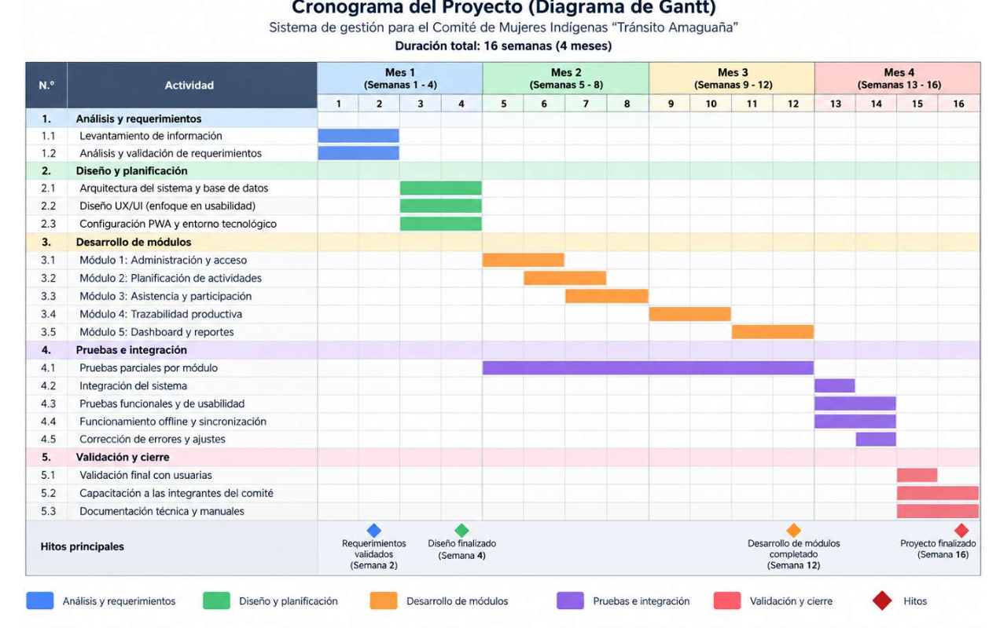
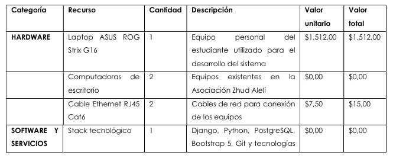
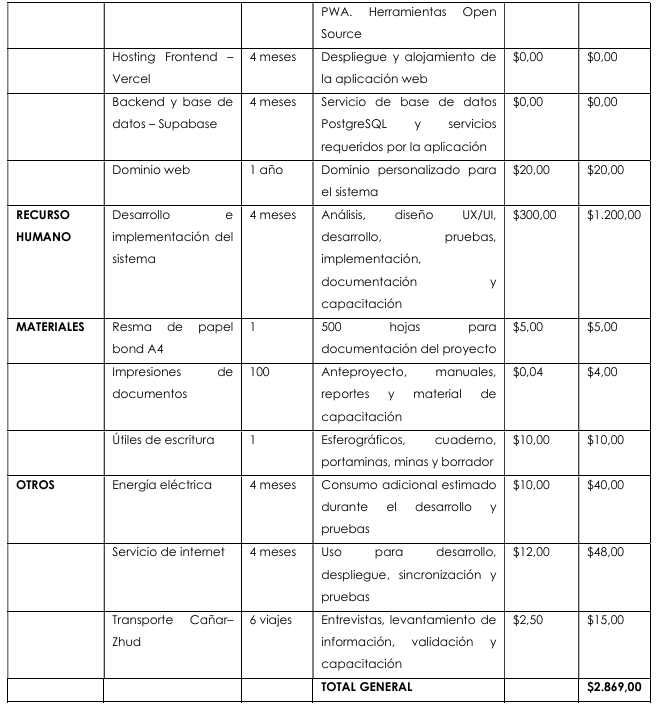

# Referencia actualizada de cronograma, presupuesto y stack

## Fuente y vigencia documental

El tesista aportó tres imágenes y la tabla tecnológica con esta indicación:

> ese es el nuevo plan de tiempo para el proyecto y el presupuesto y stack tecnologico

Se registra como **referencia actualizada aportada por el tesista** para continuar el diseño:
16 semanas (cuatro meses en la organización del Gantt), presupuesto total **USD 2.869,00**
y el stack descrito abajo. Reemplaza, en la revisión en curso, la cifra anterior de USD 1.845
y la referencia temporal septiembre de 2026–febrero de 2027. No se atribuye a estas imágenes
una firma de la organización/directora ni fechas de calendario que no muestran.

Los originales recibidos se conservan sin edición como evidencia dentro del vault. Esta nota
transcribe sus datos y normaliza la presentación del texto tecnológico, conservando su sentido.
Los documentos anteriores quedan como antecedentes; la propagación a documentos académicos
y planes canónicos debe enlazar esta fuente y conservar la historia de sus versiones.

## Cronograma de 16 semanas

Transcripción de las barras del Gantt; semanas inicial y final incluidas. Meses relativos:
mes 1 = S1–S4, mes 2 = S5–S8, mes 3 = S9–S12, mes 4 = S13–S16.

| ID | Actividad | Inicio | Fin |
|---|---|---:|---:|
| 1.1 | Levantamiento de información | 1 | 2 |
| 1.2 | Análisis y validación de requerimientos | 1 | 2 |
| 2.1 | Arquitectura del sistema y base de datos | 3 | 4 |
| 2.2 | Diseño UX/UI con enfoque en usabilidad | 3 | 4 |
| 2.3 | Configuración PWA y entorno tecnológico | 3 | 4 |
| 3.1 | Módulo 1: Administración y acceso | 5 | 6 |
| 3.2 | Módulo 2: Planificación de actividades | 6 | 7 |
| 3.3 | Módulo 3: Asistencia y participación | 7 | 8 |
| 3.4 | Módulo 4: Trazabilidad productiva | 9 | 10 |
| 3.5 | Módulo 5: Dashboard y reportes | 11 | 12 |
| 4.1 | Pruebas parciales por módulo | 5 | 12 |
| 4.2 | Integración del sistema | 13 | 13 |
| 4.3 | Pruebas funcionales y de usabilidad | 13 | 14 |
| 4.4 | Funcionamiento offline y sincronización | 13 | 14 |
| 4.5 | Corrección de errores y ajustes | 14 | 14 |
| 5.1 | Validación final con las usuarias | 15 | 15 |
| 5.2 | Capacitación a las integrantes del comité | 15 | 16 |
| 5.3 | Documentación técnica y manuales | 15 | 16 |

| Hito previsto | Semana |
|---|---:|
| Requerimientos validados | 2 |
| Diseño finalizado | 4 |
| Desarrollo de módulos completado | 12 |
| Proyecto finalizado | 16 |

Las barras expresan trabajo planificado, no avance ejecutado. Administración, planificación
y asistencia se solapan en las semanas 6 y 7; no se interpreta como dedicación completa
simultánea ni como delegación a varios desarrolladores. La frase anterior «validar cada módulo
antes de avanzar al siguiente» debe precisarse para admitir estos solapamientos y conservar
puertas de validación por incremento.

La fila 4.4 está dentro de **Pruebas e integración**: no implica posponer toda la construcción
offline hasta la semana 13. PWA se configura en S3–S4 y las operaciones se desarrollan con sus
módulos; S13–S14 verifica integración y sincronización. La distribución exacta de esas tareas
debe quedar en las specs. Del mismo modo, S15–S16 concentra documentación técnica/manuales
finales y no sustituye la documentación continua exigida por la constitución.

No se aportó fecha de inicio calendario. Para esta referencia se usan semanas relativas;
no se convierten automáticamente a septiembre–febrero ni se equiparan cuatro meses civiles
con 112 días exactos.

## Presupuesto actualizado

| Categoría | Recurso | Cantidad | Valor unitario USD | Total USD |
|---|---|---:|---:|---:|
| Hardware | Laptop ASUS ROG Strix G16 | 1 | 1.512,00 | 1.512,00 |
| Hardware | Computadoras de escritorio existentes | 2 | 0,00 | 0,00 |
| Hardware | Cable Ethernet RJ45 Cat6 | 2 | 7,50 | 15,00 |
| Software y servicios | Stack tecnológico | 1 | 0,00 | 0,00 |
| Software y servicios | Hosting frontend — Vercel (rótulo de la fuente) | 4 meses | 0,00 | 0,00 |
| Software y servicios | Backend y base de datos — Supabase (rótulo de la fuente) | 4 meses | 0,00 | 0,00 |
| Software y servicios | Dominio web | 1 año | 20,00 | 20,00 |
| Recurso humano | Desarrollo e implementación del sistema | 4 meses | 300,00 | 1.200,00 |
| Materiales | Resma de papel bond A4 | 1 | 5,00 | 5,00 |
| Materiales | Impresiones de documentos | 100 | 0,04 | 4,00 |
| Materiales | Útiles de escritura | 1 | 10,00 | 10,00 |
| Otros | Energía eléctrica | 4 meses | 10,00 | 40,00 |
| Otros | Servicio de Internet | 4 meses | 12,00 | 48,00 |
| Otros | Transporte Cañar–Zhud | 6 viajes | 2,50 | 15,00 |
| **Total general** | | | | **2.869,00** |

Control por categorías: hardware 1.527,00; software/servicios 20,00; recurso humano 1.200,00;
materiales 19,00; otros 103,00. Suman **2.869,00**. Todas las multiplicaciones de cantidad por
unitario concuerdan con el total de su fila. El presupuesto de 1.845 queda como referencia
anterior; no existe una diferencia pendiente de elegir para esta versión.

Los ceros de infraestructura son importes presupuestados de la fuente, no evidencia de
facturación futura ni de características incluidas en un plan comercial. Su verificación
operativa permanece en el trabajo de despliegue; no altera la transcripción del presupuesto.

## Stack tecnológico aportado

| Tecnología | Característica técnica | Aplicación al proyecto |
|---|---|---|
| Python | Tipado dinámico, orientación a objetos y ecosistema | Lógica de negocio y estructura modular compatible con Django. |
| Django | Autenticación, autorización, grupos/permisos para RBAC, ORM y arquitectura MTV (MVT en la fuente) | Control de acceso por cargos y usuarias; manejo relacional desde Python. Se usa la convención MTV del repositorio para referirse a Model–Template–View. |
| PostgreSQL | Atomicidad, consistencia, aislamiento y durabilidad (ACID) | Persistencia de asistencia, producción, inventario, despachos y cuentas por cobrar; las operaciones sensibles deben completar o revertir sus cambios mediante transacciones definidas en backend. |
| Supabase | PostgreSQL administrado, conexión segura e infraestructura cloud; la fuente menciona backups | Persistencia centralizada en la nube. Configuración, condiciones del plan y restauración verificable se concretan en despliegue. |
| Django Templates + HTML5 | Renderizado en servidor (SSR) | Interfaces generadas por Django, sin SPA independiente ni API completa de separación frontend/backend. |
| Bootstrap 5 | Grid responsive, breakpoints y componentes reutilizables | Interfaz mobile-first para teléfono, tableta y computadora. |
| CSS | Media queries y personalización de estilos | Botones, tipografía, espaciado y controles táctiles accesibles. |
| JavaScript | Eventos y APIs del navegador | Interacción, validación y acceso a capacidades PWA. |
| PWA | Web App Manifest, Service Worker e instalación en dispositivos compatibles | Experiencia instalable y continuidad de operaciones esenciales sin aplicación nativa separada. |
| Service Worker | Interceptación de solicitudes mediante eventos fetch | Decidir acceso a red o recursos almacenados según estrategia definida. |
| Cache Storage | Almacenamiento local de pares Request/Response | Recursos estáticos e interfaces esenciales disponibles durante cortes de Internet. |
| IndexedDB | Almacenamiento local estructurado y transaccional | Asistencias, pesajes y operaciones expresamente habilitadas pendientes de sincronización. |
| Git | Control de versiones distribuido | Ramas y commits para evolución y recuperación durante las 16 semanas, sujetos a autorización del tesista. |
| GitHub | Repositorio remoto y trazabilidad | Historial del código y evidencia del desarrollo incremental. |

La tabla de stack tiene 14 entradas. Vercel está identificado en la tabla de presupuesto y en
la factibilidad anterior como plataforma de despliegue; no aparece como fila independiente en
el texto tecnológico recién aportado. Esto no se interpreta como un retiro de Vercel.

Se conserva el monolito modular Django, PostgreSQL, plantillas y Bootstrap del proyecto.
Guardar y sincronizar sin conexión sigue siendo obligatorio en el diseño solicitado. La PWA
necesita intercambio con el servidor para sincronizar; evitar una API frontend/backend completa
no excluye los puntos de comunicación específicos de sincronización ya contemplados en el plan.
La lista de tecnologías no decide todavía tolerancias QR, reloj, conflictos o permisos offline.

## Resolución de hallazgos y propagación

| Hallazgo | Estado tras esta fuente | Acción restante |
|---|---|---|
| I4 — Presupuesto | Resuelto en cuanto a la referencia vigente: USD 2.869,00. | Sustituir 1.845 en las versiones académicas futuras que describan este presupuesto; conservar origen histórico. |
| I5 — Duración | Resuelto en cuanto al cronograma relativo vigente: 16 semanas. | Usar este Gantt; las fechas calendario se añaden cuando se aporten, sin mantener septiembre–febrero como plazo equivalente. |
| U4 — Despliegue | Abierto en su detalle técnico. Stack y plataformas documentados. | Precisar dónde ejecuta Django, conexión, estáticos y límites; no tratar el rótulo «backend Supabase» como ubicación demostrada del backend Django. |
| C1/C2/U3 — Offline | Se mantiene la obligación y los pendientes de especificación. | Reconciliar catálogo anterior; precisar reloj/QR, permisos, aislamiento local, duplicados y conflictos. |

I4/I5 conservan sus IDs y evidencia histórica; ya no se presentan como decisiones pendientes
de escoger presupuesto o duración. La incorporación formal a un roadmap aprobado es un
cambio de versión distinto de registrar esta fuente. Las correcciones documentales de esta
sesión afectan la evidencia y el informe de revisión, sin declarar implementada la aplicación.

## Verificación

Las tres imágenes se inspeccionaron y se copiaron sin transformación. Cronograma: 18
actividades, cuatro hitos, rangos dentro de S1–S16. Presupuesto: 14 partidas, productos por
fila y suma conciliados. Stack: 14 entradas. Enlaces y resultados finales registrados en el
checkpoint de CU-REVIEW-001.

Huellas SHA-256 de las copias, verificadas contra cada adjunto original:

| Archivo | SHA-256 |
|---|---|
| cronograma.png | `166467d1f1735357fa0e73539f92cf1b8154753000c9c27fdc42d60d67b62d6a` |
| presupuesto-1.png | `2f3a92f3ca7fb09ae28d56d4d601fd6b7fbCCE848b36ce486e5122f4440c4bee` |
| presupuesto-2.png | `8a66bfa124458781e49747cff48bce3121f9b2da61de46015d98fff2eee0b482` |
