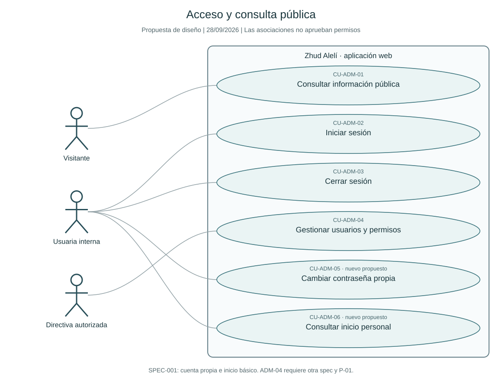
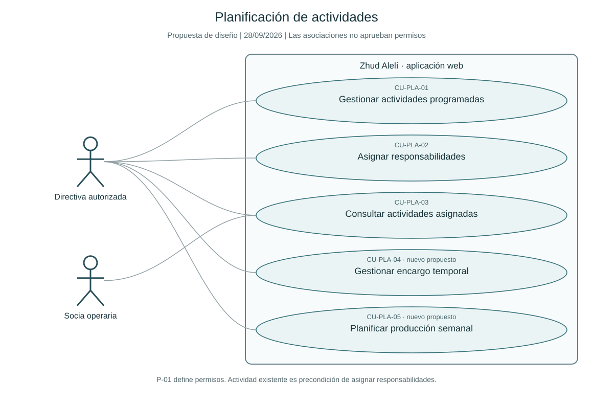
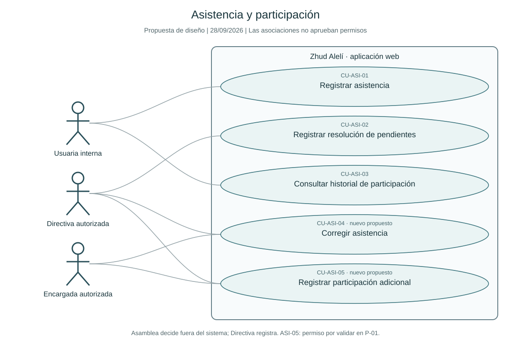
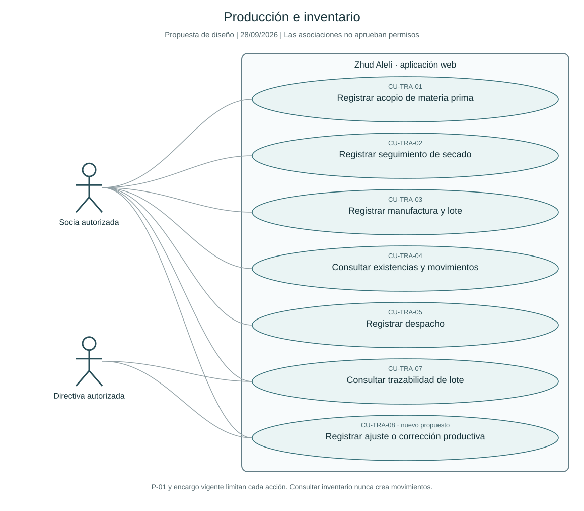
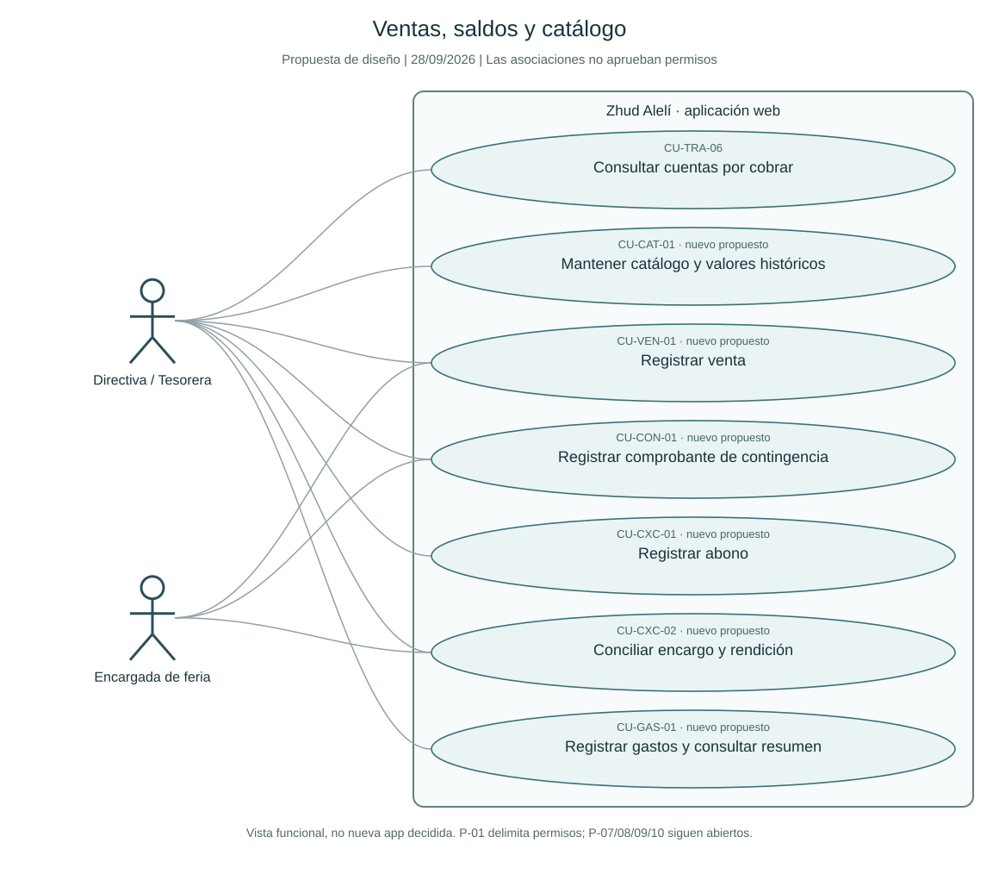
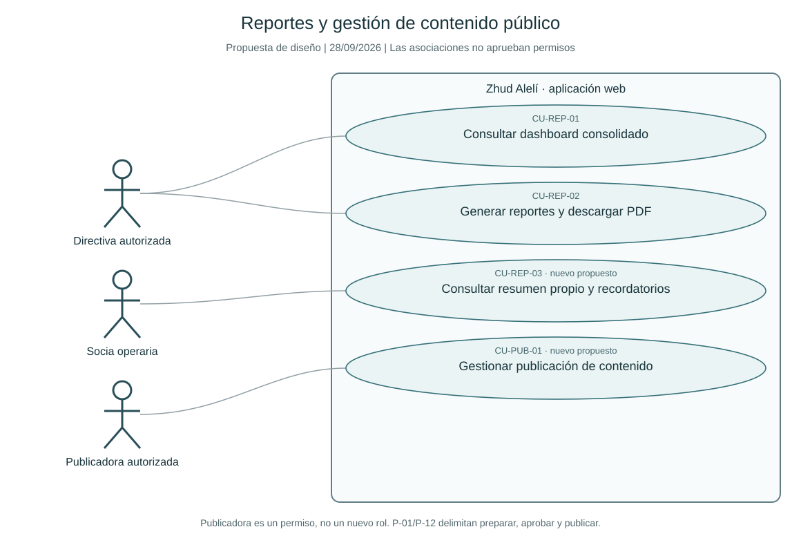
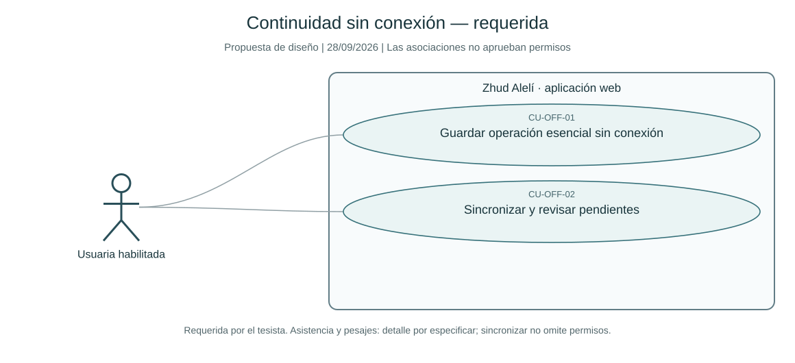

# Diagramas de casos de uso

Este archivo reúne **siete vistas del mismo sistema**, no siete módulos nuevos. Conserva los
21 IDs originales y añade 15 IDs propuestos para capacidades ausentes en las fichas originales.
Son diagramas de la propuesta revisada, no copias exactas de los del PDF. Los SVG se incluyen
para leerlos en Obsidian sin plugins; los actores, elipses, asociaciones y límites se conservan
también en un único [archivo PlantUML editable](2026-09-28-diagramas-casos-de-uso.puml).

**Lectura:** una línea significa interacción. No concede automáticamente permiso a todo un rol.
Los IDs con etiqueta «nuevo propuesto» organizan capacidades de las fuentes; no aprueban requisitos.
Los actores «autorizada», «encargada» y «publicadora» representan contextos/alcances sujetos a P-01.
«Usuaria interna» agrupa Directiva y Socia operaria solo para recorridos comunes de cuenta propia.
En ASI-03 cada socia ve lo propio y la Directiva según cargo. Las asociaciones de ASI-05 son
hipótesis de diseño pendientes de matriz, no permisos confirmados.

No se dibujan relaciones `include` o `extend` para expresar simple orden temporal, existencia de
datos o navegación. Asignar responsabilidad no ejecuta de nuevo la creación de actividad;
secado utiliza material previo; cobrar después del despacho constituye otra interacción.
La autenticación es precondición de operaciones privadas, no una inclusión que se repite en cada una.
Referencia de sintaxis: [PlantUML oficial](https://plantuml.com/use-case-diagram).

Las condiciones, alternos, fuentes RF/CA, pendientes y aceptación están en las
[[2026-09-28-casos-de-uso|fichas de casos de uso]]; las asociaciones no sustituyen esa información.
CU-OFF-01/02 se mantienen en el diseño por la exigencia registrada en
[[../../evidence/casos-de-uso/2026-09-28-factibilidad-aportada|EVID-FACT-001]].

## Acceso y consulta pública

Casos: [[2026-09-28-casos-de-uso#CU-ADM-01|CU-ADM-01]], [[2026-09-28-casos-de-uso#CU-ADM-02|CU-ADM-02]], [[2026-09-28-casos-de-uso#CU-ADM-03|CU-ADM-03]], [[2026-09-28-casos-de-uso#CU-ADM-04|CU-ADM-04]], [[2026-09-28-casos-de-uso#Descomposición propuesta de capacidades ausentes|CU-ADM-05]], [[2026-09-28-casos-de-uso#Descomposición propuesta de capacidades ausentes|CU-ADM-06]].

SPEC-001: cuenta propia e inicio básico. ADM-04 requiere otra spec y P-01.

## Planificación de actividades

Casos: [[2026-09-28-casos-de-uso#CU-PLA-01|CU-PLA-01]], [[2026-09-28-casos-de-uso#CU-PLA-02|CU-PLA-02]], [[2026-09-28-casos-de-uso#CU-PLA-03|CU-PLA-03]], [[2026-09-28-casos-de-uso#Descomposición propuesta de capacidades ausentes|CU-PLA-04]], [[2026-09-28-casos-de-uso#Descomposición propuesta de capacidades ausentes|CU-PLA-05]].

P-01 define permisos. Actividad existente es precondición de asignar responsabilidades.

## Asistencia y participación

Casos: [[2026-09-28-casos-de-uso#CU-ASI-01|CU-ASI-01]], [[2026-09-28-casos-de-uso#CU-ASI-02|CU-ASI-02]], [[2026-09-28-casos-de-uso#CU-ASI-03|CU-ASI-03]], [[2026-09-28-casos-de-uso#Descomposición propuesta de capacidades ausentes|CU-ASI-04]], [[2026-09-28-casos-de-uso#Descomposición propuesta de capacidades ausentes|CU-ASI-05]].

Asamblea decide fuera del sistema; Directiva registra. ASI-05: permiso por validar en P-01.

## Producción e inventario

Casos: [[2026-09-28-casos-de-uso#CU-TRA-01|CU-TRA-01]], [[2026-09-28-casos-de-uso#CU-TRA-02|CU-TRA-02]], [[2026-09-28-casos-de-uso#CU-TRA-03|CU-TRA-03]], [[2026-09-28-casos-de-uso#CU-TRA-04|CU-TRA-04]], [[2026-09-28-casos-de-uso#CU-TRA-05|CU-TRA-05]], [[2026-09-28-casos-de-uso#CU-TRA-07|CU-TRA-07]], [[2026-09-28-casos-de-uso#Descomposición propuesta de capacidades ausentes|CU-TRA-08]].

P-01 y encargo vigente limitan cada acción. Consultar inventario nunca crea movimientos.

## Ventas, saldos y catálogo

Casos: [[2026-09-28-casos-de-uso#CU-TRA-06|CU-TRA-06]], [[2026-09-28-casos-de-uso#Descomposición propuesta de capacidades ausentes|CU-CAT-01]], [[2026-09-28-casos-de-uso#Descomposición propuesta de capacidades ausentes|CU-VEN-01]], [[2026-09-28-casos-de-uso#Descomposición propuesta de capacidades ausentes|CU-CON-01]], [[2026-09-28-casos-de-uso#Descomposición propuesta de capacidades ausentes|CU-CXC-01]], [[2026-09-28-casos-de-uso#Descomposición propuesta de capacidades ausentes|CU-CXC-02]], [[2026-09-28-casos-de-uso#Descomposición propuesta de capacidades ausentes|CU-GAS-01]].

Vista funcional, no nueva app decidida. P-01 delimita permisos; P-07/08/09/10 siguen abiertos.

## Reportes y gestión de contenido público

Casos: [[2026-09-28-casos-de-uso#CU-REP-01|CU-REP-01]], [[2026-09-28-casos-de-uso#CU-REP-02|CU-REP-02]], [[2026-09-28-casos-de-uso#Descomposición propuesta de capacidades ausentes|CU-REP-03]], [[2026-09-28-casos-de-uso#Descomposición propuesta de capacidades ausentes|CU-PUB-01]].

Publicadora es un permiso, no un nuevo rol. P-01/P-12 delimitan preparar, aprobar y publicar.

## Continuidad sin conexión — requerida

Casos: [[2026-09-28-casos-de-uso#CU-OFF-01|CU-OFF-01]], [[2026-09-28-casos-de-uso#CU-OFF-02|CU-OFF-02]].

Requerida por el tesista. Asistencia y pesajes: detalle por especificar; sincronizar no omite permisos.

## Conexión con la continuidad offline

ASI-01 y los pesajes de TRA-01/02 pueden producir un registro provisional según la operación
que se especifique. OFF-01 lo conserva y OFF-02 lo somete a validación del servidor. Esta
dependencia de datos se documenta aquí; no se dibuja como inclusión universal que obligue a
sincronizar en toda ejecución en línea. No se habilitan automáticamente ventas o pagos offline.

El diseño contempla interfaz de estado/reintento; no promete Background Sync universal con
el navegador cerrado. Deben cerrarse permisos, reloj/QR, reintentos, duplicados y conflictos
en la nueva especificación. Ver hallazgos C1/C2/U3 del informe.

## Verificación y mantenimiento

Las siete vistas SVG y los siete bloques PlantUML se generaron desde el mismo inventario de
36 IDs; no hay casos huérfanos ni IDs duplicados entre vistas. Los 21 casos originales se
conservan una vez. El archivo PlantUML es fuente editable; los SVG son su representación
equivalente dibujada desde ese inventario, no una compilación del motor PlantUML.
Al cambiar una ficha deben revisarse asociación, fuente, permiso y esquema correspondiente.
