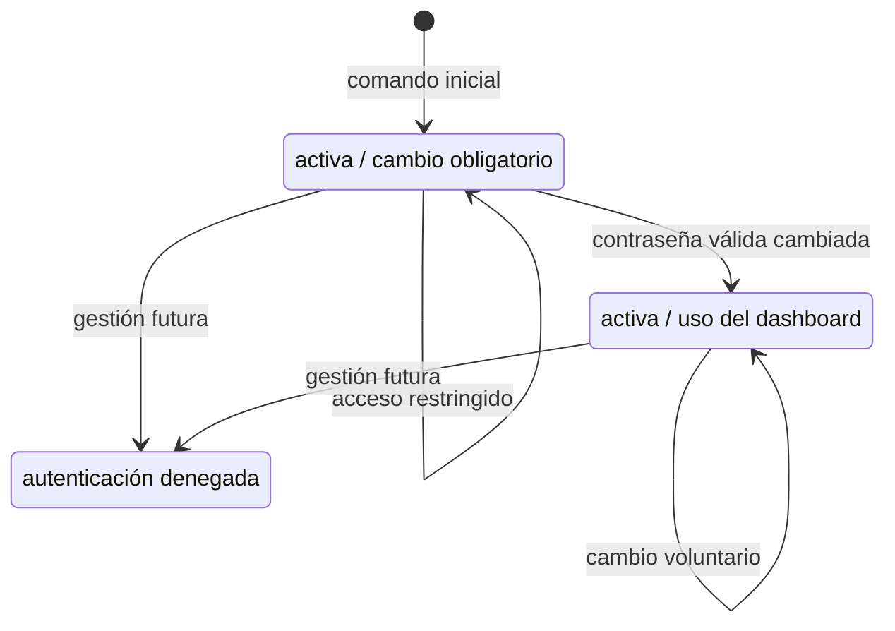

# Modelo de datos de SPEC-001

## Límite del modelo

La app `accounts` es propietaria de la identidad autenticable. En esta spec no existen
entidades para membresías, cargos, actividades, recuperación externa, bitácora organizacional
ni credencial temporal en texto claro.

## Entidad `accounts.User`

Hereda los campos y comportamiento de `django.contrib.auth.models.AbstractUser`.

| Campo relevante | Tipo | Regla |
|---|---|---|
| `id` | clave primaria | identificador interno; no se muestra en el acceso |
| `username` | texto, máximo heredado | obligatorio, solo ASCII controlado, almacenado en minúsculas y sin espacios externos |
| `password` | hash Django | nunca contiene ni expone la contraseña original |
| `is_active` | booleano | solo `True` puede autenticarse con el backend predeterminado |
| `is_staff` | booleano | `False` para la primera cuenta; el Admin no es parte del recorrido |
| `is_superuser` | booleano | `False` para la primera cuenta |
| `must_change_password` | booleano, predeterminado `True` | `True` restringe la sesión a cambio de contraseña y salida |
| `last_login` | fecha/hora opcional | mantenida por Django; no se muestra en esta porción |
| `date_joined` | fecha/hora | mantenida por Django |

Los campos heredados de nombre, apellido y correo no son necesarios para autenticarse ni se
solicitan al crear la primera cuenta. Las relaciones heredadas con grupos y permisos existen
por compatibilidad de Django, pero no modelan aún los cargos de la organización.

### Invariantes

1. `AUTH_USER_MODEL` apunta a `accounts.User` antes de la primera migración.
2. El valor canónico de `username` elimina espacios externos, valida caracteres ASCII
   controlados (letras, números, punto, guion y guion bajo) y se almacena en minúsculas.
3. No pueden coexistir dos usuarios cuyo
   `Lower(Trim(username))` sea igual.
4. La contraseña se asigna con `set_password()` o el administrador de usuarios; nunca por
   asignación directa de texto.
5. La primera cuenta cumple:
   `is_active=True`, `is_staff=False`, `is_superuser=False` y
   `must_change_password=True`.
6. Completar correctamente el cambio obligatorio establece
   `must_change_password=False` en la misma operación lógica.
7. Una cuenta inactiva no abre sesión y obtiene el mismo mensaje exterior que otras
   credenciales inválidas.

### Restricciones e índices

- Se conserva la unicidad exacta heredada de `username`.
- Se añade una restricción funcional de unicidad PostgreSQL:
  `Lower(Trim("username"))`, con nombre estable
  `accounts_user_username_canon_uniq`.
- La restricción, la validación ASCII y la normalización se prueban sobre PostgreSQL; no se da
  por válido un resultado solo en SQLite.

## Entidad nativa `django_session`

No pertenece a `accounts` y no se personaliza.

| Campo nativo | Uso |
|---|---|
| `session_key` | identificador aleatorio enviado en la cookie; no se registra en evidencia |
| `session_data` | contenido firmado/codificado administrado por Django |
| `expire_date` | vigencia renovada por actividad y consultada por el backend |

Reglas:

- La cookie tiene vigencia máxima de 1 800 segundos desde la última actividad reconocida.
- Cerrar sesión elimina los datos de esa sesión y rota/descarta su clave.
- Cambiar contraseña conserva la sesión que realiza el cambio y deja inválidas las demás
  sesiones autenticadas con el hash anterior.
- `clearsessions` elimina periódicamente filas vencidas; no es una regla de negocio ni una
  tarea de la usuaria.

## Estados de una cuenta en el recorrido

La transición a `Inactiva` se representa para entender la autenticación, pero la interfaz que
la ejecutará pertenece a una especificación posterior.

## Operaciones y atomicidad

| Operación | Escrituras | Garantía |
|---|---|---|
| Crear primera cuenta | bloqueo asesor PostgreSQL y fila de usuario | transacción serializada; una segunda ejecución espera, vuelve a comprobar y no crea |
| Iniciar sesión | datos de sesión y `last_login` | mecanismos nativos de Django |
| Cambiar contraseña | fila bloqueada, hash nuevo y bandera temporal en una sola escritura; sesión actual rotada por Django | `select_for_update()` ocurre antes de validar; solo una solicitud concurrente puede usar la clave anterior |
| Cerrar sesión | eliminación/invalidación de sesión | `POST` protegido por CSRF |

La transacción del cambio existe por concurrencia, no por el número de atributos. La vista
bloquea la fila y después construye y valida el formulario con la instancia actualizada. Dos
solicitudes solapadas no pueden validar simultáneamente el mismo hash: la perdedora continúa
después del commit, ve la nueva contraseña y devuelve un error corregible sin sobrescribir.

El comando inicial no usa `select_for_update()` sobre usuarios porque una tabla vacía no
ofrece una fila que bloquear. Usa un bloqueo asesor transaccional PostgreSQL exclusivo de
esta operación, vuelve a consultar `User.objects.exists()` y crea como máximo una cuenta.

## Migración y reversión

1. Crear proyecto y app sin ejecutar `migrate`.
2. Definir `accounts.User`, su restricción y `AUTH_USER_MODEL`.
3. Generar y revisar `accounts/0001_initial.py`.
4. Aplicar todas las migraciones en una base PostgreSQL vacía.
5. Verificar creación desde cero y `makemigrations --check --dry-run`.
6. Verificar con dos conexiones que el bloqueo asesor permite una sola primera cuenta y que
   el bloqueo de fila permite un solo cambio concurrente.

Antes de datos reales se puede recrear únicamente la base de desarrollo si la migración
inicial es incorrecta. Después de datos reales, `0001_initial.py` no se reescribe: cualquier
cambio se realiza con una nueva migración hacia adelante y respaldo probado.

## Datos de prueba y privacidad

- Usuarios ficticios: `directiva_demo`, `socia_demo`, `inactiva_demo`.
- Contraseñas solo dentro de la preparación de la prueba y nunca en salida, capturas o
  evidencia.
- No se copian nombres, teléfonos, cédulas, correos ni credenciales reales.
- No se crea una fixture versionada con la primera cuenta real.
