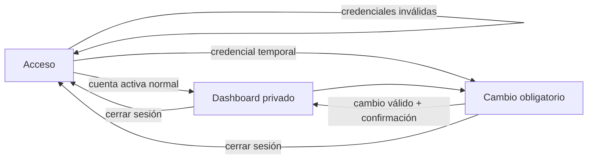

# Plan de implementación: Acceso de usuarias internas

## Estado y puerta de aprobación

Este plan desarrolla técnicamente [[spec|SPEC-001]], que está `confirmed`. El plan fue
aprobado explícitamente por el tesista el 2026-08-24 y queda `approved`. Su aprobación
habilitó generar `tasks.md`. El tesista autorizó iniciar la implementación de `SB-S2-02` y
actualizar los criterios de mensajes y bloqueo el 2026-10-21; esta revisión registra ese
alcance sin cambiar el resto de la arquitectura aprobada.

## Resumen

Se construirá la primera porción vertical del monolito Django en la raíz aprobada por
[[../../docs/decisions/ADR-0003-estructura-raiz-aplicacion-django|ADR-0003]]. La app
`accounts` usará el sistema de autenticación y sesiones de Django, un usuario personalizado
creado antes de la primera migración, PostgreSQL, formularios y plantillas renderizadas en
servidor y Bootstrap local.

La porción permitirá iniciar y cerrar sesión, proteger el dashboard, cambiar la contraseña y
forzar el reemplazo de la credencial temporal. No crea administración de cuentas, cargos,
recuperación externa, apps futuras vacías ni operaciones de negocio.

## Contexto técnico (Technical Context)

- **Lenguaje/runtime**: Python 3.12.
- **Framework**: Django 5.2 LTS, plantillas Django y Bootstrap 5.3 distribuido localmente.
- **Persistencia**: PostgreSQL 14 o posterior, ORM Django y controlador Psycopg 3.
- **Dependencias propuestas**: `uv`, `pyproject.toml` y `uv.lock`; dependencias de desarrollo
  en el grupo `dev`. Esta elección se vuelve vinculante solo al aprobar el plan.
- **Configuración**: variables de entorno cargadas localmente con `python-dotenv`; archivos separados
  para base, desarrollo, pruebas y producción; `.env` fuera de Git.
- **Pruebas**: `django.test.TestCase`, `TransactionTestCase` para concurrencia real, cliente
  Django y recorridos manuales representativos. El laboratorio de agentes conserva su
  entorno y sus pruebas independientes.
- **Módulo propietario**: `apps.accounts`.
- **Escala y datos**: cantidad de cuentas aún no cuantificada y sin necesidad de optimización
  especial; credenciales, identificadores de cuenta y contenido privado son sensibles.
- **Restricciones**: móvil desde 360 px, zoom al 200 %, teclado, contraste AA, acciones
  táctiles de 44 × 44 px, conectividad limitada, recursos críticos locales y mensajes breves.
  El tesista acepta que «Contraseña incorrecta» permite inferir una cuenta activa; usuario
  inexistente e inactivo comparten «Usuario incorrecto».
- **Dudas técnicas**: la política autorizada limita a tres fallos por identificador canónico
  dentro de tres minutos y bloquea ese identificador durante tres minutos.

Las decisiones y alternativas están justificadas en [[research]].

## Comprobación de la constitución (Constitution Check)

### Antes del diseño

| Puerta | Evidencia en este plan | Resultado |
|---|---|---|
| Requisito confirmado | [[spec#Control de validación]] y EVID-SPEC-001 | `pass` |
| Portabilidad | Markdown, Django, PostgreSQL, `pyproject.toml` y bloqueo versionado | `pass` |
| Pruebas y permisos | Matriz de autorización y estrategia CA → prueba | `pass` |
| Simplicidad e integridad | Autenticación nativa, una app, sin SPA ni capas vacías | `pass` |
| UX/accesibilidad | Recorridos y validaciones para RNF-UX-001 a 003 | `pass` |
| Trazabilidad | `RF-ACC-001`, RNF aplicables, CA-ACC-001-01 a 13 | `pass` |
| Control humano/privacidad | Plan aprobado por el tesista, secretos fuera de Git y entrega presencial | `pass` |

### Después del diseño

| Puerta | Evidencia resultante | Resultado |
|---|---|---|
| Datos y migración | [[data-model]]; `User` en `accounts/0001_initial.py` y `LoginThrottle` en la migración incremental | `pass` |
| Autorización backend | vistas protegidas y barrera de credencial temporal con pruebas negativas | `pass` |
| Interfaz verificable | contrato HTTP, estados, 360 px, teclado, foco y zoom | `pass` |
| Pruebas reproducibles | matriz de pruebas y [[quickstart]] | `pass` |
| Riesgos y reversión | matriz de riesgos y estrategia de migración inferior | `pass` |
| Trazabilidad académica | rutas de evidencia y matriz global identificadas | `pass` |

No se requiere excepción a la constitución ni un ADR adicional para implementar este plan.

## Diseño de dominio y datos

- `accounts.User` hereda de `AbstractUser` y agrega únicamente
  `must_change_password: bool`, con valor inicial seguro `True`.
- `accounts.LoginThrottle` almacena un HMAC del identificador canónico, contador y vencimientos
  temporales; no conserva el nombre de usuario ni la IP.
- El nombre de usuario acepta únicamente caracteres ASCII controlados (letras, números, punto,
  guion y guion bajo), elimina espacios externos y se almacena en minúsculas mediante un único
  método reutilizado por la creación controlada y el formulario de acceso. Una restricción
  funcional de PostgreSQL sobre `Lower(Trim(username))` impide duplicados canónicos aunque una
  escritura futura omita el formulario.
- `AUTH_USER_MODEL = "accounts.User"` se configura antes de ejecutar cualquier migración y
  el modelo se crea en `apps/accounts/migrations/0001_initial.py`.
- Las contraseñas se almacenan solo mediante los hashers de Django. No existe una entidad
  propia para la credencial temporal ni se conserva su valor después de establecer el hash.
- Las sesiones usan `django.contrib.sessions` con backend de base de datos. No se crea un
  modelo `Session` de la aplicación.
- El vencimiento por inactividad es deslizante: edad 1 800 segundos y guardado de sesión en
  cada solicitud autenticada procesada correctamente. Cerrar el navegador no sustituye
  cerrar sesión ni agrega un vencimiento diferente al requisito.
- Cambiar la contraseña bloquea la fila de la usuaria con `select_for_update()` antes de
  validar la contraseña actual. Dos cambios simultáneos se serializan: solo el primero puede
  validar la clave anterior. El cambio rota la clave de la sesión ganadora, la mantiene
  autenticada e invalida las demás mediante el hash de autenticación nativo.
- No se borran cuentas ni se administra su estado en esta porción. No se inventan bitácoras
  de auditoría o historial de cuentas sin requisito validado.
- La primera cuenta se crea mediante un comando interactivo controlado que se niega a operar
  si ya existe otra cuenta: cuenta activa, `must_change_password=True`, sin acceso
  administrativo y sin aceptar la contraseña por argumento, archivo, variable, fixture o
  log. Dentro de `transaction.atomic()`, el comando adquiere un bloqueo asesor transaccional
  PostgreSQL de clave fija, vuelve a comprobar que no haya cuentas, ejecuta los validadores
  de contraseña y crea la cuenta. Una ejecución concurrente espera y luego se rechaza sin
  cambios.

El detalle de campos, invariantes, estados y migración está en [[data-model]].

## Autorización y privacidad

| Operación | Regla backend | Permitido | Denegado | Prueba negativa |
|---|---|---|---|---|
| Iniciar sesión | backend nativo + formulario y limitador transaccional | cuenta activa con credenciales válidas | inexistente, inactiva, contraseña errónea o identificador bloqueado | mensajes según CA-02/03/12; nunca crea sesión ni muestra datos privados |
| Ver dashboard | `LoginRequiredMixin` | Directiva o Socia operaria con sesión normal | anónima, sesión vencida o credencial temporal | redirección sin contenido privado |
| Cambiar contraseña propia | vista autenticada y contraseña actual | cualquier cuenta interna autenticada | anónima o contraseña actual inválida | sin cambio ni filtración |
| Usar otras vistas con credencial temporal | guarda backend reutilizable sobre cada vista privada | cambio de contraseña y cierre de sesión | dashboard y cualquier vista privada | acceso directo redirigido al cambio |
| Cerrar sesión | `LogoutView` mediante `POST` con CSRF | sesión activa | `GET` y solicitudes sin CSRF | `405` o rechazo CSRF |
| Administrar cuentas o permisos | sin ruta ni interfaz | nadie en esta porción | todos los actores | URL/acción inexistente |

Minimización y privacidad:

- El acceso solicita solo nombre de usuario y contraseña.
- El dashboard no muestra datos personales ni operaciones aún inexistentes.
- Cuenta inexistente e inactiva comparten «Usuario incorrecto»; una contraseña errónea para
  una cuenta activa recibe «Contraseña incorrecta». El tesista acepta la señal de existencia
  que produce esta distinción.
- Tres fallos para el mismo identificador normalizado dentro de tres minutos bloquean los
  intentos por tres minutos. El bloqueo no cambia el estado de la cuenta.
- Contraseñas, cookies, tokens CSRF y datos de cuentas reales no aparecen en logs,
  documentación, capturas, fixtures ni evidencia.
- Las pruebas y demostraciones usan identidades ficticias. La entrega real de la primera
  credencial se hace presencialmente a la representante designada por la Directiva.
- En producción se exige HTTPS, cookie segura, `HttpOnly` y `SameSite=Lax`. Las respuestas
  privadas y de autenticación usan directivas de no almacenamiento en caché.

## Interfaz

### Recorrido



### Vistas y estados

- **Acceso**: nombre de usuario conservado tras error, contraseña vacía, mensaje corto asociado
  al campo que debe corregirse, estado de bloqueo con tiempo restante e indicación de sesión
  vencida sin detalles internos.
- **Cambio de contraseña**: contraseña actual, nueva y confirmación; errores junto al campo y
  resumen accesible; control de mostrar/ocultar progresivo.
- **Dashboard**: bienvenida, confirmación persistente después de un cambio y solo “Cambiar
  contraseña” y “Cerrar sesión”.
- **Aviso de vigencia**: las pantallas privadas explican que 30 minutos sin actividad
  requieren iniciar sesión nuevamente, sin mostrar un contador impreciso ni renovar la
  sesión mediante pulsos automáticos.
- **Sin acceso**: una persona anónima vuelve al acceso; una sesión temporal vuelve al cambio
  obligatorio; nunca se renderiza primero el contenido privado.
- **Interrupción**: el navegador conserva los datos no secretos que sea seguro conservar y
  explica que se debe reintentar; no afirma éxito sin respuesta del servidor.

Todas las vistas reutilizan `base.html` y componentes de mensajes. El orden de foco sigue el
orden visual; tras varios errores el foco pasa a un resumen enlazado a los campos; los
controles principales miden al menos 44 × 44 px; no existe desplazamiento horizontal
accidental desde 360 px ni al 200 % de zoom. Bootstrap se sirve desde `static/vendor/`, por
lo que el recorrido no depende de una CDN. No se adoptan colores, logotipo ni símbolos
culturales como identidad hasta su validación.

El contrato de métodos, respuestas y guardas está en [[contracts/http]].

## Estructura del proyecto (Project Structure)

```text
F:\Tesis\App Tesis\
├── manage.py
├── pyproject.toml
├── uv.lock
├── .env.example
├── config\
│   ├── __init__.py
│   ├── urls.py
│   ├── asgi.py
│   ├── wsgi.py
│   └── settings\
│       ├── __init__.py
│       ├── base.py
│       ├── development.py
│       ├── test.py
│       └── production.py
├── apps\
│   ├── __init__.py
│   └── accounts\
│       ├── __init__.py
│       ├── apps.py
│       ├── admin.py
│       ├── models.py
│       ├── forms.py
│       ├── views.py
│       ├── urls.py
│       ├── decorators.py
│       ├── migrations\
│       │   ├── __init__.py
│       │   └── 0001_initial.py
│       ├── management\
│       │   └── commands\
│       │       └── create_initial_account.py
│       ├── templates\
│       │   └── accounts\
│       │       ├── login.html
│       │       ├── password_change_form.html
│       │       └── dashboard.html
│       └── tests\
│           ├── __init__.py
│           ├── test_models.py
│           ├── test_authentication.py
│           ├── test_password_change.py
│           ├── test_sessions.py
│           ├── test_security.py
│           └── test_management_command.py
├── templates\
│   ├── base.html
│   └── components\
│       └── messages.html
├── static\
│   ├── css\
│   │   └── app.css
│   ├── js\
│   │   ├── password-toggle.js
│   │   └── form-state.js
│   └── vendor\
│       └── bootstrap\
│           ├── bootstrap.min.css
│           └── LICENSE
├── .github\
│   └── workflows\
│       └── ci.yml
├── specs\
│   └── 001-acceso-usuarias-internas\
└── docs\
    └── evidence\
        └── S1\
            └── RF-ACC-001\
```

No se crean `core`, apps futuras, `policies.py`, API, SPA ni repositorios genéricos. `services.py`
se justifica para serializar intentos concurrentes y aplicar el bloqueo temporal.

## Estrategia de pruebas

### Criterios de aceptación

| Criterio | Tipo y prueba prevista | Ruta propietaria |
|---|---|---|
| CA-ACC-001-01 | integración: acceso válido abre dashboard | `test_authentication.py` |
| CA-ACC-001-02 | integración: clave incorrecta de cuenta activa muestra el error de contraseña y no crea sesión | `test_authentication.py` |
| CA-ACC-001-03 | integración: usuario inexistente e inactivo comparten error de usuario y no crean sesión | `test_authentication.py` |
| CA-ACC-001-04 | seguridad: acceso anónimo a cada vista privada redirige sin contenido | `test_security.py` |
| CA-ACC-001-05 | integración: `POST` de salida invalida sesión; retroceso no almacena contenido | `test_authentication.py`, recorrido de navegador |
| CA-ACC-001-06 | integración: cambio válido, clave anterior rechazada, sesión actual conservada y confirmación en dashboard | `test_password_change.py` |
| CA-ACC-001-07 | integración: clave actual incorrecta, confirmación distinta o solicitud concurrente perdedora no modifica el hash | `test_password_change.py` |
| CA-ACC-001-08 | seguridad: cuenta temporal solo llega al cambio y sale al completar | `test_password_change.py`, `test_security.py` |
| CA-ACC-001-09 | plantilla: dashboard contiene solo bienvenida y dos opciones reales | `test_authentication.py` |
| CA-ACC-001-10 | comando: primera cuenta activa, no administrativa, cambio obligatorio, secreto no expuesto y una sola creación bajo concurrencia | `test_management_command.py` |
| CA-ACC-001-11 | tiempo: activa a 29:59, expirada a 30:00 y renovación con actividad | `test_sessions.py` |
| CA-ACC-001-12 | integración/concurrencia: tres fallos en ventana de tres minutos bloquean el identificador por tres minutos; acceso correcto previo al umbral limpia el contador | `test_login_throttle.py` |
| CA-ACC-001-13 | interfaz: errores breves, asociados al campo y anuncio accesible del bloqueo | `test_authentication.py`, revisión de navegador |

### Cobertura adicional

| Requisito no funcional | Verificación prevista |
|---|---|
| RNF-UX-001 | recorrido completo a 360 px y formularios de una columna sin desbordamiento |
| RNF-UX-002 | contraste, teclado, foco, zoom 200 %, errores enlazados y cajas 44 × 44 px |
| RNF-UX-003 | prueba de comprensión sin roles, permisos ni términos técnicos |
| RNF-CON-001 | recursos locales, carga ligera, corte durante cada `POST` y reintento seguro |
| RNF-SEC-001 | matriz positiva/negativa, CSRF, sesión, cambio obligatorio, caché y salida |
| RNF-PRV-001 | revisión de campos, HTML, redirecciones, logs y evidencia anonimizada |

- Restricción canónica de usuario en PostgreSQL, incluyendo mayúsculas y espacios:
  `test_models.py`.
- CSRF real en acceso, cambio y salida con cliente `enforce_csrf_checks=True`:
  `test_security.py`.
- `GET /salir/` rechazado, redirecciones seguras y ausencia de caché privada:
  `test_security.py`.
- Dos clientes simultáneos: el cambio conserva la sesión actual e invalida la otra:
  `test_password_change.py`.
- Cuenta desactivada después del acceso: la siguiente solicitud privada pierde autorización:
  `test_security.py`.
- Envío repetido y dos cambios realmente concurrentes: `TransactionTestCase` con conexiones
  separadas comprueba un éxito, un rechazo y un único hash final.
- Dos comandos iniciales concurrentes: el bloqueo asesor permite exactamente una cuenta y la
  ejecución perdedora termina sin cambios.
- Configuración de producción y secretos fuera de Git: `manage.py check --deploy` con la
  configuración de producción preparada para CI, sin usar secretos reales.
- Recorrido visual desde 360 px, zoom al 200 %, teclado, foco, contraste, tamaño táctil,
  mensajes comprensibles y conectividad interrumpida: protocolo manual de evidencia.
- SC-002: prueba moderada propuesta con cinco usuarias representativas —dos integrantes de la
  Directiva y tres socias operarias—; al menos cuatro completan sin ayuda en máximo tres
  minutos. La composición se confirma al convocar y la validación humana no se sustituye por
  una prueba automática.

### Verificación automatizada prevista

```powershell
uv sync --locked
uv run ruff check .
uv run python manage.py check
uv run python manage.py check --deploy --settings=config.settings.production
uv run python manage.py makemigrations --check --dry-run
uv run python manage.py test
git diff --check
```

CI ejecutará las comprobaciones con PostgreSQL y variables de producción ficticias no
secretas. `check --deploy` no habilita el despliegue por sí solo: no puede dejar advertencias
sin analizar y HTTPS/HSTS se confirman contra la infraestructura real. El detalle operativo
y los recorridos están en [[quickstart]].

## Evidencia y documentación

| Artefacto | Momento | Contenido sin datos personales |
|---|---|---|
| `docs/evidence/S1/RF-ACC-001/verification.md` | implementación y revisión | comandos, versiones y resultados |
| `docs/evidence/S1/RF-ACC-001/security.md` | pruebas negativas | matriz de acceso, CSRF, sesión y caché |
| `docs/evidence/S1/RF-ACC-001/ux-validation.md` | validación representativa | dispositivo, tareas, tiempos agregados y hallazgos |
| `docs/traceability/MATRIZ-TRAZABILIDAD.md` | cada puerta | enlaces de requisito a diseño, código, prueba y evidencia |
| `docs/bitacora/checkpoints/` | pausas y cambios de puerta | estado, decisiones y próximo paso |
| manual de usuario de acceso | cuando el recorrido sea estable | instrucciones en lenguaje cotidiano |

La evidencia contribuirá a OE-02 y, en la evaluación, a adecuación funcional, operabilidad,
accesibilidad y confidencialidad conforme al instrumento de tesis que se apruebe.

La spec confirmada conservaba “Casos de prueba: Pendiente de plan”: en esa puerta significaba
que aún no existía un plan aprobado, no que faltara el borrador. Al aprobar este plan se
actualizó el enlace de la spec; la matriz global registra por separado `RF-ACC-001` y cada
RNF aplicable.

## Riesgos y reversión

| Riesgo | Probabilidad/impacto | Mitigación y señal | Reversión segura |
|---|---|---|---|
| Omitir la barrera temporal en una URL | media/alta | guarda reutilizable y pruebas directas de todas las vistas | retirar despliegue y corregir guardas antes de entregar cuentas |
| Vencimiento no deslizante o fuera de 30 min | media/alta | reloj controlado, pruebas 29:59/30:00 y revisión de configuración | restaurar configuración previa y cerrar sesiones existentes |
| Filtrar la primera credencial | baja/alta | entrada interactiva oculta, sin argumentos/logs/evidencia | invalidar clave, crear otra temporal y registrar solo el incidente anonimizado |
| Crear dos primeras cuentas simultáneas | baja/alta | bloqueo asesor transaccional, segunda comprobación y prueba con dos conexiones | eliminar solo cuentas ficticias en desarrollo; en un entorno real bloquear entrega e investigar |
| Dos cambios simultáneos usan la misma clave anterior | baja/alta | `select_for_update()` antes de validar y prueba concurrente | invalidar sesiones y restablecer mediante el procedimiento autorizado futuro |
| Duplicados por mayúsculas o espacios | media/media | normalización y restricción funcional probada en PostgreSQL | corregir datos de desarrollo y recrear migración antes de datos reales |
| Contenido privado visible al retroceder | media/alta | `never_cache`, cabeceras verificadas y recorrido de navegador | deshabilitar la ruta afectada hasta corregir cabeceras |
| Enumeración de cuentas activas | media/alta | distinción aceptada expresamente por el tesista; usuario inexistente e inactivo se agrupan; bloqueo breve y respuesta sin datos privados | volver a un mensaje común si cambia la decisión de producto |
| Bloqueo abusivo de una cuenta | media/alta | el contador se limita por identificador canónico y dura tres minutos; no desactiva ni modifica la cuenta | eliminar estado vencido; ajustar umbral/duración en un cambio documentado |
| PostgreSQL local no disponible | media/media | guía de variables, verificación temprana y CI con servicio PostgreSQL | detener implementación de datos; no sustituir silenciosamente por SQLite |
| Recurso Bootstrap ausente o licencia perdida | baja/media | archivo local versionado, licencia y prueba sin red | volver a la versión local conocida |
| SC-002 no alcanzado con usuarias | media/media | protocolo, tareas breves y registro de hallazgos | mantener spec abierta, ajustar interfaz y repetir validación |

Las migraciones se prueban desde una base vacía. Antes de usar datos reales, un error en el
modelo de usuario se revierte recreando exclusivamente la base de desarrollo y corrigiendo
`0001_initial`. Después de almacenar datos reales no se elimina ni reescribe esa migración:
se aplican migraciones hacia adelante con respaldo y procedimiento revisado.

En la verificación del 2026-08-24 se confirmaron Python 3.12.2, `uv` 0.10.9 y PostgreSQL 18
con el servicio local activo. `psql` y `pg_isready` no están directamente en `PATH`, por lo
que la ruta del cliente debe documentarse o incorporarse al entorno reproducible antes de
verificar migraciones y pruebas.

## Complejidad excepcional

| Excepción a la constitución | Necesidad demostrada | Alternativa simple descartada | ADR/aprobación |
|---|---|---|---|
| Ninguna prevista | — | — | — |
